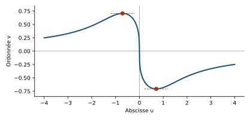

# École polytechnique — Première composition de mathématiques P′ 1995 · Corrigé brut

*Corrigé rédigé par IA, non officiel. Signalez toute erreur.*

**Rédaction** · GPT-6.2 Astra Ultra · vitesse non renseignée

L’équation de Riccati $\varphi'=x^2+\varphi^2$ gouverne les deux premières coordonnées du problème, l’abscisse $x$ et la valeur $\varphi(x)$. L’équation linéaire $f''+x^2f=0$ permettra ensuite d’identifier les extrémités des intervalles de solution.

## I. Solutions maximales de l’équation de Riccati

### Question 1.a

Le champ $(x,y)\mapsto x^2+y^2$ est lisse. Chaque donnée initiale définit une solution maximale unique sur un intervalle ouvert $I=(l,r)$. Pour $u<v$ dans $I$, $\varphi(v)-\varphi(u)\ge\int_u^v x^2\,dx>0$. La solution est strictement croissante, même si sa dérivée peut s’annuler à l’origine.

### Question 1.b

Si $\varphi(x_0)>0$, alors $\varphi(x)>0$ pour $x\ge x_0$ dans $I$ et $\varphi'/\varphi^2=1+x^2/\varphi^2\ge1$. En intégrant la dérivée de $-1/\varphi$, on obtient $x-x_0\le1/\varphi(x_0)-1/\varphi(x)<1/\varphi(x_0)$. Par conséquent $r\le x_0+1/\varphi(x_0)$.

### Question 1.c

Si $\varphi(x_1)<0$, elle est négative pour $x\le x_1$. L’intégration de $(-1/\varphi)'\ge1$ de $x$ à $x_1$ donne $x_1-x\le-1/\varphi(x_1)+1/\varphi(x)<-1/\varphi(x_1)$. Donc $l\ge x_1+1/\varphi(x_1)>-\infty$.

### Question 1.d

Si $r=+\infty$, l’inégalité $\varphi(x)\ge\varphi(u)+(x^3-u^3)/3$ pour $x\ge u$ fournit une valeur positive, contredisant 1.b. Si $l=-\infty$, on a pour $x\le u$ l’inégalité $\varphi(x)\le\varphi(u)+(x^3-u^3)/3$. On obtient alors une valeur négative, contredisant 1.c. L’intervalle est borné des deux côtés.

### Question 1.e

La monotonie garantit l’existence des deux limites dans la droite achevée. Si l’une est finie, le champ est borné près du point limite et la solution se prolonge, par existence et unicité locales, au-delà de l’extrémité correspondante. Ceci contredit la maximalité. Ainsi $\varphi(l+)=-\infty$, $\varphi(r-)=+\infty$ et $\varphi(I)=\mathbb R$ par continuité.

### Question 1.f

Une solution impaire a un intervalle symétrique et s’annule en zéro. La solution maximale issue de $(0,0)$ existe. Sa transformée $x\mapsto-\varphi(-x)$ est aussi maximale et vérifie la même équation avec la même donnée initiale. L’unicité identifie solutions et intervalles. Il y a exactement une solution maximale impaire.

### Question 2

Écrivons $I(\beta_i)=(l_i,r_i)$. Pour $\beta_1<\beta_2$ l’unicité empêche les deux solutions de se croiser sur l’intervalle commun. Puisque la courbe inférieure tend vers $+\infty$ à droite et la supérieure vers $-\infty$ à gauche, on doit avoir $r_2\le r_1$ et $l_2\le l_1$.

Pour exclure une égalité, soit $h_i$ la solution globale de $h_i''=-x^2h_i$ telle que $h_i(\alpha)=1$, $h_i'(\alpha)=-\beta_i$. Sur la composante sans zéro qui contient $\alpha$, $-h_i'/h_i$ résout l’équation de Riccati et coïncide avec $\varphi_i$. Les zéros de $h_i$ sont simples par unicité, et le quotient y diverge. Réciproquement, il resterait fini en une borne où $h_i$ serait non nulle. Ainsi $h_i(l_i)=h_i(r_i)=0$. Or $(h_1h_2'-h_1'h_2)'=0$ et ce wronskien vaut $\beta_1-\beta_2\ne0$. Les deux fonctions ne peuvent avoir un zéro commun. En définitive $l_2<l_1<\alpha<r_2<r_1$. Pour $\beta_1=\beta_2$, les deux intervalles coïncident.

### Question 3

Toute donnée $(u,v)$ est permise par le théorème de Cauchy. La dérivation de l’équation donne $\varphi''(u)=2[u+v(u^2+v^2)]$. Ainsi $H$ a pour équation $F(u,v)=u+u^2v+v^3=0$. À $u$ fixé le membre de gauche est strictement croissant en $v$, de limites opposées à l’infini. On obtient un unique $v$ pour chaque $u$, et la courbe est symétrique par rapport à l’origine. Si $u\ne0$, $|v|=|u|/(u^2+v^2)\le1/|u|$ et $uv\to-1$ aux deux infinis. L’asymptote est $v=0$.

Hors de l’origine, $F_v=u^2+3v^2>0$ et $v'=-(1+2uv)/(u^2+3v^2)$. Les tangentes horizontales vérifient $uv=-1/2$, d’où $(u,v)=(-1/\sqrt2,1/\sqrt2)$ ou $(1/\sqrt2,-1/\sqrt2)$. À l’origine $F_u=1$ et $F_v=0$, ce qui donne l’unique tangente verticale $u=0$. Pour $u>0$ la branche descend jusqu’au minimum puis remonte vers son asymptote.

### Question 4

Au point $(t,0)$ on a $\varphi_t'(t)=t^2$, $\varphi_t''(t)=2t$. La courbure signée est $\kappa=2t/(1+t^4)^{3/2}$ et sa valeur absolue est la courbure géométrique. Pour $t\ne0$, le centre du cercle osculateur est
$$C=(t,0)+\frac{1+t^4}{2t}(-t^2,1)
=\left(\frac{t(1-t^4)}2,\frac{1+t^4}{2t}\right).$$
Pour $t=0$, la courbure est nulle et il n’y a pas de centre de courbure fini.

## II. Solutions entières de l’équation linéaire

### Question 5

Les coefficients de $f''=-x^2f$ sont continus sur $\mathbb R$. Le théorème d’existence et d’unicité global pour une équation linéaire rend $f\mapsto(f(0),f'(0))$ bijective de $S$ vers $\mathbb R^2$. Cette application étant linéaire, $\dim S=2$.

### Question 6.a

Écrivons $f(x)=\sum_{n\ge0}c_n x^n$. L’identification des coefficients donne $c_2=c_3=0$ et $c_{n+4}=-c_n/[(n+4)(n+3)]$ pour $n\ge0$. Les classes $2,3$ modulo $4$ sont donc nulles. Pour $j=0,1$,
$$c_{4k+j}=\frac{(-1)^k c_j}{\prod_{m=1}^k(4m+j)(4m+j-1)}.$$
Dans chaque série non nulle le rapport des modules de deux termes successifs de la même classe tend vers zéro pour tout $x$ fixé. Le rayon est infini, également pour la série nulle. Réciproquement ces deux séries peuvent être dérivées terme à terme et leur récurrence établit l’équation.

### Question 6.b

Avec la convention du produit vide égal à $1$, les solutions prescrites sont
$$f_1(x)=\sum_{k\ge0}\frac{(-1)^k x^{4k}}{\prod_{m=1}^k4m(4m-1)},\qquad
f_2(x)=\sum_{k\ge0}\frac{(-1)^kx^{4k+1}}{\prod_{m=1}^k(4m+1)4m}.$$
Leurs premiers termes sont $1-x^4/12$ et $x-x^5/20$. Ils donnent bien les quatre valeurs initiales demandées.

### Question 6.c

L’unicité montre que $f=af_1+bf_2$ et que la tangente en $(0,a)$ est $y=a+bx$. Leur différence près de zéro vaut $-ax^4/12-bx^5/20+O(x^8)$. Pour $a>0$, le graphe est localement au-dessous de sa tangente des deux côtés. Pour $a<0$, il est au-dessus. Pour $a=0$, $b>0$, il est au-dessus à gauche et au-dessous à droite. Les côtés s’inversent pour $b<0$. Si $a=b=0$, le graphe est identique à la tangente partout.

### Question 7

Pour $0\le s=x^4\le16$, les termes alternent et leurs modules décroissent à partir du terme en $s$, car le rapport suivant est au plus $16/(8\cdot7)<1$, puis diminue. Le reste après les quatre premiers termes est positif ou nul. Donc
$$f_1(x)\ge P(s)=1-\frac{s}{12}+\frac{s^2}{672}-\frac{s^3}{88704}.$$
Sur $[0,16]$, $P'(s)\le-1/12+32/672<0$. Ainsi $f_1(x)\ge P(16)=1/693>0$ sur tout $[-2,2]$.

## III. Zéros et dérivées logarithmiques

### Question 8

Pour $f=e^{-\Phi}$, on a $f''=(\varphi^2-\varphi')f$. Comme $f>0$, l’équation $f''+x^2f=0$ équivaut exactement à $\varphi'=x^2+\varphi^2$ sur $I$.

### Question 9.a

Sur $I$, $f$ coïncide avec la solution globale de l’équation linéaire déterminée par sa valeur et sa dérivée en un point de $I$. Si cette solution avait une valeur non nulle en $l$ ou $r$, le quotient $-f'/f$ y prolongerait $\varphi$, contrairement à la maximalité. Puisque $l,r$ sont finis, la continuité du prolongement donne $\lim_{x\to l+}f(x)=\lim_{x\to r-}f(x)=0$.

### Question 9.b

Par unicité comme en 1.f, $I=(-r,r)$. En zéro, $f'(0)=-\varphi(0)f(0)=0$ et $f(0)>0$, donc $f=f(0)f_1$. Par 6.b, $f_1(x)=H(x^4)$ avec $H$ analytique et $H(0)=1$. Près de zéro,
$$\varphi(x)=-\frac{4x^3H'(x^4)}{H(x^4)}.$$
Le développement ne contient que des puissances $4k+3$. Ainsi $\varphi^{(n)}(0)=0$ pour tout entier $n\ge0$ des autres classes.

### Question 10.a

Si $f(x_0)=0$, alors $f'(x_0)\ne0$ par unicité. La dérivée conserve le même signe strict près de $x_0$ et la fonction y est strictement monotone. Ce zéro est isolé.

### Question 10.b

Si $f$ ne s’annulait plus au-delà d’un certain $R$, le quotient $-f'/f$ serait solution de Riccati sur $]R,+\infty[$ d’après la formule de 8. Son intervalle maximal contiendrait cette demi-droite, en contradiction avec 1.d. La même preuve sur $]-\infty,R[$ interdit une borne inférieure. Il existe donc des zéros arbitrairement loin dans les deux sens.

### Question 10.c

Entre deux zéros consécutifs $a<b$, $f$ garde un signe strict. Si $f>0$ alors $f''=-x^2 f\le0$ et $f'$ est strictement décroissante, car l’intégrale de $x^2f$ sur tout sous-intervalle est strictement positive. Par Rolle, $f'$ a donc un unique zéro $c\in(a,b)$. La fonction croît de $0$ à $f(c)$ puis décroît vers $0$. Si $f<0$, appliquer le même argument à $-f$ donne une décroissance suivie d’une croissance, avec unique minimum.
