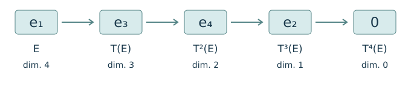

# École polytechnique — Deuxième composition de mathématiques · Option M′ 1996 · Corrigé brut

*Corrigé rédigé par IA, non officiel. Signalez toute erreur.*

**Rédaction** · GPT-6.2 Astra Ultra · vitesse non renseignée

Le corps $K$ est commutatif et de caractéristique arbitraire. Le produit $ST$ signifie que l’on applique $T$ puis $S$. L’ordre $r$ d’une algèbre nilpotente est la longueur minimale annulant tous les produits, quels que soient les facteurs.

## I. Deux dimensions

### Question 1.a

$T$ est non nul et ne peut être inversible, sinon chacune de ses puissances le serait. Son rang est donc $1$ en dimension $2$. Le théorème du rang donne $\dim\ker T=1$ et $\dim\operatorname{Im}T=1$.

### Question 1.b

L’endomorphisme induit sur la droite $\operatorname{Im}T$ est une homothétie nilpotente, donc nulle. Ainsi $T^2=0$ et $r=2$. Prenons $v$ tel que $Tv\ne0$. Si $v$ appartenait à la droite engendrée par $Tv$, il serait tué par $T$. La famille $(v,Tv)$ est donc une base et la matrice de $T$ y est $J=\left(\begin{smallmatrix}0&0\\1&0\end{smallmatrix}\right)$.

### Question 2

Prenons $0\ne T\in\mathcal A$. Chaque $S\in\mathcal A$ est nilpotent par la définition commune aux produits. Dans la base de 1.b, écrire $SJ=JS$ force $S=\left(\begin{smallmatrix}u&0\\v&u\end{smallmatrix}\right)$. Sa diagonale à la puissance $r$ vaut $u^r$ et impose $u=0$. Toute matrice de l’algèbre est donc $vJ$. Réciproquement tous ces multiples appartiennent à l’algèbre car celle-ci est un espace vectoriel contenant $T$.

## II. Calcul par blocs

### Question 3

Pour la somme directe $E=\bigoplus_j E_j$, posons $T_{i,j}=P_i\circ T|_{E_j}$. Cette application linéaire va de $E_j$ dans $E_i$. Comme $x=\sum_j x_j$, la linéarité donne $(Tx)_i=\sum_jT_{i,j}(x_j)$. En prenant $x\in E_j$, on voit aussi que les blocs ainsi construits sont uniques.

### Question 4

Pour $x\in E_j$, on a $P_i STx=\sum_\ell P_i S(P_\ell Tx)$. Il en résulte
$$
(ST)_{i,j}=\sum_\ell S_{i,\ell}T_{\ell,j}.
$$
Chaque terme a bien pour départ $E_j$ et pour arrivée $E_i$.

## III. Un endomorphisme nilpotent

### Question 5

$T\ne0$ impose $r\ge2$. Choisissons $x$ tel que $T^{r-1}x\ne0$. Ce vecteur appartient à $\operatorname{Im}T$ et $T$ l’annule. Ainsi $E_3=\operatorname{Im}T\cap\ker T$ est non nul. Il est inclus dans le noyau propre de l’endomorphisme non nul $T$, donc $E_3\ne E$.

### Question 6

L’égalité $E_3=\operatorname{Im}T$ équivaut à $T(\operatorname{Im}T)=0$, soit $T^2=0$. Puisque $T\ne0$, elle équivaut à $r=2$.

### Question 7

L’image de chaque $E_j$ est incluse dans $\operatorname{Im}T=E_2\oplus E_3$, donc $P_1T=0$. De plus $T$ est nul sur $E_3$. Dans l’ordre $(E_1,E_2,E_3)$, sa matrice par blocs est donc
$$
\begin{pmatrix}0&0&0\\T_{2,1}&T_{2,2}&0\\T_{3,1}&T_{3,2}&0\end{pmatrix}.
$$
Les définitions des supplémentaires assurent bien que ces trois espaces sont en somme directe et engendrent $E$.

### Question 8

Sur $\operatorname{Im}T/E_3\simeq E_2$, l’application induite est $T_{2,2}$. Sa puissance $r$ est induite par $T^r=0$. Pour construire la base demandée, posons $F_j=T^jE$. Pour $0\le j<r$, choisissons un supplémentaire $V_j$ de $F_{j+1}$ dans $F_j$. En concaténant les bases de $V_0,V_1,\ldots,V_{r-1}$ dans cet ordre, on obtient une base de $E$, car $F_r=0$. Un vecteur de $V_j$ est envoyé dans $F_{j+1}=\bigoplus_{i>j}V_i$. Sa colonne n’a de composantes que dans les lignes suivantes. La matrice est strictement triangulaire inférieure.

### Question 9

Avant zéro, la filtration des $F_j$ est strictement décroissante. En effet $F_j=F_{j+1}$ entraîne, par application répétée de $T$, $F_j=F_r=0$. Les $r$ chutes successives de dimension de $n$ à zéro donnent $r\le n$. La borne est atteinte par un seul bloc de taille $n$.

### Question 10

La matrice donnée réalise la chaîne $e_1\mapsto e_3\mapsto e_4\mapsto e_2\mapsto0$. Elle a $r=4=n$, $\ker T=Ke_2$ et $\operatorname{Im}T=\langle e_3,e_4,e_2\rangle$. Prenons $E_1=Ke_1$, $E_2=\langle e_3,e_4\rangle$ et $E_3=Ke_2$. Dans ces bases, $T_{2,1}$ envoie $e_1$ sur $e_3$, $T_{2,2}$ envoie $e_3$ sur $e_4$ puis $e_4$ sur zéro, $T_{3,2}$ envoie $e_4$ sur $e_2$ et annule $e_3$, et $T_{3,1}=0$. Dans la base $(e_1,e_3,e_4,e_2)$ les trois entrées juste sous la diagonale valent $1$ et toutes les autres sont nulles.

## IV. Une algèbre entière dans la même base

### Question 11

Notons $W_0=E$ et $W_{j+1}=\sum_{T\in\mathcal A}T(W_j)$. Ainsi $W_1=\mathcal I(\mathcal A)$, $W_{r-1}\ne0$ et $W_r=0$. Cette suite décroît car $W_1\subset W_0$ et la construction préserve les inclusions. Si $W_j=W_{j+1}$ pour $j<r$, l’égalité se propage jusqu’à zéro, ce qui contredit $W_{r-1}\ne0$. Donc $W_1\ne E$. Puisque chaque élément de $\mathcal A$ tue $W_{r-1}\subset W_1$, l’intersection $E_3=W_1\cap\mathcal K(\mathcal A)$ contient un vecteur non nul et est contenue dans le sous-espace propre $W_1$.

### Question 12

L’égalité $E_3=W_1$ signifie que $T(W_1)=0$ pour tout $T\in\mathcal A$, soit $W_2=0$. Comme $\mathcal A\ne0$, $W_1\ne0$, de sorte que la condition équivaut exactement à $r=2$.

### Question 13.a

Pour $r\ge3$, $W_1$ est stable et $E_3$ est tué par $\mathcal A$. L’application qui à $T$ associe son action sur $W_1/E_3\simeq E_2$ est un homomorphisme d’algèbres de valeur $T_{2,2}$. Son image est une sous-algèbre commutative dont tout produit de longueur $r$ est nul. Elle est nulle exactement si $W_2\subset E_3$. Comme $W_2\subset W_1$, cela équivaut à $W_3=0$, donc à $r=3$ sous l’hypothèse $r\ge3$.

### Question 13.b

Choisissons, pour chaque $0\le j<r$, un supplémentaire de $W_{j+1}$ dans $W_j$ et concaténons leurs bases par ordre croissant de $j$. Tout $T\in\mathcal A$ envoie $W_j$ dans $W_{j+1}$. Dans la base commune ainsi construite, chaque colonne de chaque matrice a ses composantes dans des étages strictement postérieurs. Ainsi $t_{i,j}=0$ si $i\le j$ simultanément pour tout $T$.

### Question 13.c

De $W_0=E$ à $W_r=0$, les $r$ inclusions sont strictes d’après la question 11. Chaque inclusion fait baisser la dimension d’au moins un. Ainsi $r\le n$.

### Question 14

Pour $j\ge1$, tout produit de $j$ blocs centraux est nul si et seulement si les produits correspondants de $j$ éléments de $\mathcal A$ envoient $W_1$ dans $E_3$. Leurs images engendrent $W_{j+1}$. Celui-ci est contenu dans $W_1$, donc $W_{j+1}\subset E_3$ équivaut à $W_{j+2}=0$. Le premier tel $j$ vaut $r-2$. Sous l’hypothèse $r\ge4$, on obtient donc $r'=r-2\ge2$.

### Question 15.a

Posons $H=\mathcal I(\mathcal A_{2,1})=\sum_S S_{2,1}(E_1)$. La forme par blocs donne $T_{2,2}S_{2,1}=(TS)_{2,1}$. Or $TS\in\mathcal A$. Par linéarité, $T_{2,2}(H)\subset H$.

### Question 15.b

En projetant $W_1=\sum_T T(E)$ sur son facteur $E_2$, on obtient $E_2=H+\sum_T T_{2,2}(E_2)$, car $T(E_3)=0$. D’après 15.a, les blocs centraux induisent des applications sur $V=E_2/H$. On a donc $V=\sum_T\overline T_{2,2}(V)$. En substituant cette égalité $r'$ fois, $V$ est engendré par les images de produits de longueur $r'$ des applications induites. Tous ces produits sont nuls par la question 14. Donc $V=0$ et $H=E_2$.

### Question 16.a

Pour tout $S\in\mathcal A$, les blocs $(2,1)$ de l’égalité $TS=ST$ donnent $T_{2,2}S_{2,1}=S_{2,2}T_{2,1}=0$. Ceux d’indice $(3,1)$ donnent $T_{3,2}S_{2,1}=S_{3,2}T_{2,1}=0$. Les images des $S_{2,1}$ engendrent $E_2$ d’après 15.b, d’où $T_{2,2}=T_{3,2}=0$.

### Question 16.b

Prenons $E=K^4$ avec une base $(v_1,v_2,v_3,v_4)$ et $Jv_i=v_{i+1}$ pour $i<4$, $Jv_4=0$. L’algèbre $\mathcal A=\langle J,J^2,J^3\rangle$ est commutative, d’ordre $4$ puisque $J^3\ne0$ et $J^4=0$. Ici $W_1=\langle v_2,v_3,v_4\rangle$ et le noyau commun est $Kv_4$. Prenons $E_1=Kv_1$, $E_2=\langle v_2,v_3\rangle$, $E_3=Kv_4$ et $T=J^3$. On a $T_{2,1}=0$ tandis que $T_{3,1}v_1=v_4\ne0$. Le dernier bloc peut donc être non nul.
