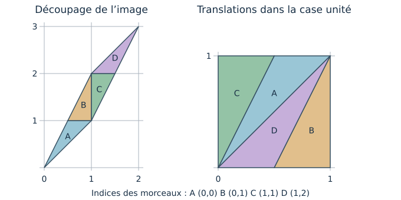

# École polytechnique — Première composition de mathématiques · Option M′ 1996 · Corrigé brut

*Corrigé rédigé par IA, non officiel. Signalez toute erreur.*

**Rédaction** · GPT-6.2 Astra Ultra · vitesse non renseignée

Sur la droite, $\alpha$ est un entier au moins égal à $2$ et $\beta>1$. Sur le plan, une fonction périodique est invariante par les translations de $\mathbb Z^2$. On pose $\Delta_0=[0,1[^2$ et $\Delta_p=p+\Delta_0$. Le coefficient de Fourier d’indice $p$ utilise l’exponentielle de signe négatif.

## I. Une série de cosinus

### Question 1.a

Posons $f(x)=\sum_{n\ge0}\beta^{-n}\cos(2\pi\alpha^n x)$. Le reste à partir du rang $N$ est majoré en valeur absolue par $\beta^{-N}/(1-\beta^{-1})$, uniformément en $x$. Les sommes partielles sont continues et $1$-périodiques puisque $\alpha^n$ est entier. La limite uniforme a ces deux propriétés.

### Question 1.b

Pour $0\le j\le k$, la norme uniforme de la dérivée d’ordre $j$ du terme de rang $n$ est au plus $(2\pi)^j(\alpha^j/\beta)^n$. Si $k<\ln\beta/\ln\alpha$, ces $k+1$ séries majorantes convergent. Le théorème de dérivation terme à terme, appliqué successivement, donne $f\in C^k(\mathbb R)$.

### Question 2

La convergence uniforme autorise l’intégration terme à terme. Pour tout $m\in\mathbb Z$, l’intégrale de $e^{2\pi imx}$ sur $[0,1]$ vaut $\mathbf1_{m=0}$. Les entiers positifs $\alpha^n$ étant distincts, il vient
$$
\widehat f(\alpha^n)=\widehat f(-\alpha^n)=\tfrac12\beta^{-n}\quad(n\ge0).
$$
Tous les autres coefficients, y compris celui d’indice zéro, sont nuls.

### Question 3

Si $f\in C^k$, les termes de bord de $k$ intégrations par parties sont nuls par périodicité. Donc $\widehat{f^{(k)}}(m)=(2\pi i m)^k\widehat f(m)$. Le lemme de Riemann–Lebesgue impose la convergence vers zéro de ces coefficients. Aux indices $\alpha^n$, leur module vaut $(2\pi)^k(\alpha^k/\beta)^n/2$. Il tend vers zéro exactement lorsque $\alpha^k<\beta$, ce qui exclut aussi l’égalité au seuil.

## II. Automorphismes entiers du plan

### Question 4

$A(\mathbb Z^2)\subset\mathbb Z^2$ signifie que les deux colonnes de $A$ sont entières. Pour une telle matrice de déterminant $1$, la formule de l’adjugée donne une inverse entière. Ainsi $G_0=\mathrm{SL}_2(\mathbb Z)$, l’ensemble des matrices entières $2\times2$ de déterminant $1$.

### Question 5

Pour $A\in G$, les deux déterminants sont des entiers de produit $1$. Les valeurs possibles sont $1$ et $-1$, réalisées par l’identité et par $\operatorname{diag}(1,-1)$.

### Question 6

Avec $t=\operatorname{tr} A$, le polynôme $X^2-tX+1$ a deux racines réelles distinctes puisque $|t|>2$. Elles sont inverses l’une de l’autre et du signe de $t$. Notons-les $a,a^{-1}$ avec $|a|>1$. Une racine rationnelle de ce polynôme unitaire à terme constant $1$ serait $1$ ou $-1$, imposant $t=\pm2$. Les deux racines sont donc irrationnelles. Aucune droite propre de $A$ ni de $A^t$ ne contient de vecteur entier non nul, car le quotient de deux coordonnées correspondantes donnerait alors une valeur propre rationnelle.

## III. Découpage d’un domaine fondamental

### Question 7

Pour $A=\left(\begin{smallmatrix}1&1\\1&2\end{smallmatrix}\right)$, on a $A^{-1}(x,y)=(2x-y,y-x)$. On obtient chaque $U_p$ en imposant conjointement
$$
0\le 2x-y<1,\quad 0\le y-x<1,\quad (x,y)\in\Delta_p.
$$
Les quatre lignes du tableau donnent les sommets de l’adhérence. Ces inégalités règlent l’appartenance des côtés et sommets. Pour $T_p$, on retranche $p$ à chaque point de $U_p$.

| $p$ | Sommets de $\overline{U_p}$ | Sommets de $\overline{T_p}$ |
|---|---|---|
| $(0,0)$ | $(0,0),(\frac12,1),(1,1)$ | $(0,0),(\frac12,1),(1,1)$ |
| $(0,1)$ | $(\frac12,1),(1,1),(1,2)$ | $(\frac12,0),(1,0),(1,1)$ |
| $(1,1)$ | $(1,1),(1,2),(\frac32,2)$ | $(0,0),(0,1),(\frac12,1)$ |
| $(1,2)$ | $(1,2),(\frac32,2),(2,3)$ | $(0,0),(\frac12,0),(1,1)$ |

En effet, pour $0\le x<1$, on a $x\le y\le 2x$ avec la convention précédente. Pour $1\le x<2$, on a $2x-1<y<x+1$. Aucun autre indice ne donne de point.

### Question 8

Les $\Delta_p$ partitionnent le plan, d’où la partition $A(\Delta_0)=\bigsqcup_p U_p$. Par ailleurs les $A(\Delta_0)+z$ partitionnent aussi le plan, puisque $A$ est bijective et que $A(\mathbb Z^2)=\mathbb Z^2$. Pour $x\in\Delta_0$, il existe donc un unique $p$ tel que $x+p\in A(\Delta_0)$. Or $x+p\in\Delta_p$, ce qui équivaut à $x\in T_p$. Réciproquement $T_p\subset\Delta_0$. Cette seconde partition est exacte jusque sur les bords.

### Question 9

Les morceaux non vides sont en nombre fini, $A(\Delta_0)$ étant borné. Par translation et périodicité, $\int_{U_p} f(y)\,dy=\int_{T_p}f(x+p)\,dx=\int_{T_p}f(x)\,dx$. En sommant sur les deux partitions, on obtient $\int_{A(\Delta_0)}f=\int_{\Delta_0}f$.

## IV. Équation fonctionnelle sur le tore

### Question 10

Fixons $A\in G_0$ hyperbolique, $b>1$ et $\varphi$ lisse et périodique. Chaque $\varphi\circ A^n$ est périodique puisque $A^n$ est entière. Sa norme uniforme est bornée par $\|\varphi\|_\infty$, finie sur une case par compacité et périodicité. La série $\psi=\sum_{n\ge0}b^{-n-1}\varphi\circ A^n$ converge donc uniformément vers une fonction continue périodique. Pour la somme arrêtée en $N$, la différence $b\psi_N-\psi_N\circ A$ vaut $\varphi-b^{-N-1}\varphi\circ A^{N+1}$. Le dernier terme tend uniformément vers zéro et $b\psi-\psi\circ A=\varphi$.

### Question 11

La différence $h$ de deux solutions est continue, périodique, bornée et vérifie $bh=h\circ A$. Ainsi $b\|h\|_\infty\le\|h\|_\infty$. Comme $b>1$, on a $h=0$. Avec la question 10, cela prouve l’existence et l’unicité.

### Question 12

La diagonalisation réelle donne $\|A^n\|\le C|a|^n$, avec $C$ indépendant de $n$. La différentielle d’ordre $j$ de $\varphi\circ A^n$ applique $D^j\varphi(A^nx)$ aux $j$ vecteurs transformés par $A^n$. Les dérivées de $\varphi$ sont périodiques et bornées, d’où la majoration uniforme $C_j|a|^{jn}$. Dès que $|a|^k<b$, les séries de dérivées d’ordres $0$ à $k$ convergent normalement après multiplication par $b^{-n-1}$. Leur somme $\psi$ est donc $C^k$.

## V. Fréquences et seuil exact de régularité

### Question 13

Posons $D=(A^t)^{-1}$. Pour $p\in\mathbb Z^2$, le changement de variable préserve l’aire et $\langle p,A^{-1}y\rangle=\langle Dp,y\rangle$. Le vecteur $Dp$ est entier, donc le produit $f(y)e^{-2\pi i\langle Dp,y\rangle}$ est périodique. La question 9 remplace son intégrale sur $A(\Delta_0)$ par celle sur $\Delta_0$. On obtient $\widehat{f\circ A}(p)=\widehat f(Dp)$.

### Question 14

$\widehat\varphi$ vaut $1/2$ aux indices $\pm e_1$ et zéro ailleurs. D’après la question 13 et la convergence uniforme,
$$
\widehat\psi(p)=\sum_{j\ge0}b^{-j-1}\widehat\varphi(D^jp).
$$
Pour $m>0$, les deux valeurs propres de $D^m$ ont des modules distincts de $1$. Il est impossible que $D^me_1=\pm e_1$. Les points $\pm D^{-n}e_1$ sont donc tous distincts et, à ces points, un seul terme contribue. Ainsi $\widehat\psi(\pm D^{-n}e_1)=1/(2b^{n+1})$ pour $n\ge0$, et le coefficient vaut zéro hors de cette famille.

### Question 15

Écrivons $D^{-n}e_1=(A^t)^ne_1=c a^n u+d a^{-n}v$, avec $u,v$ propres de $A^t$ pour $a,a^{-1}$. La question 6 exclut que $e_1$ soit sur la droite stable, donc $c\ne0$. Elle exclut aussi que $u$ soit sur un axe, donc $u_1u_2\ne0$. Chaque coordonnée $j$ est équivalente à $c a^n u_j$, y compris lorsque $a<0$. En posant $k=k_1+k_2$, le terme de la série demandée est donc équivalent à
$$
\frac{|cu_1|^{2k_1}|cu_2|^{2k_2}}{4b^2}\left(\frac{|a|^k}{b}\right)^{2n}.
$$
Pour un exposant nul le facteur correspondant vaut $1$. La constante est strictement positive. La série converge exactement pour $k<\ln b/\ln|a|$ et diverge également au cas d’égalité.

### Question 16

Si $\psi\in C^k$, $g=\partial_1^k\psi$ est périodique continue et $\widehat g(p)=(2\pi i p_1)^k\widehat\psi(p)$ par intégrations par parties. Appliquée à $D^{-n}e_1$ pour $0\le n\le N$, l’inégalité de Bessel borne la somme des carrés de ces coefficients par $\int_{\Delta_0}|g|^2$, indépendamment de $N$. La question 15 avec $(k_1,k_2)=(k,0)$ impose $|a|^k<b$. La question 12 donne la réciproque. Les entiers cherchés sont précisément les $k\ge0$ strictement inférieurs à $\ln b/\ln|a|$.
