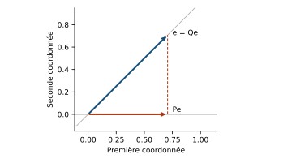

# École polytechnique — Deuxième composition de mathématiques P′ 1996 · Corrigé guidé

*Corrigé rédigé par IA, non officiel. Signalez toute erreur.*

**Rédaction** · GPT-6.2 Astra Ultra · vitesse non renseignée

Dans l’espace euclidien réel $E=\mathbb R^n$, $A^*$ désigne l’adjoint de $A$ et $|A|$ la racine positive de $A^*A$. Le terme « positif » du sujet signifie $\langle Ax,x\rangle\ge0$ pour tout $x$. La symétrie est une hypothèse distincte.

## I. Racines positives et module d’un endomorphisme

### Question 1.a

> [!INDICATION]
> Écrire la forme quadratique dans une base orthonormée de vecteurs propres.

#### Solution

Le théorème spectral donne $Ae_i=\lambda_i e_i$ dans une base orthonormée. Pour $x=\sum x_i e_i$, $\langle Ax,x\rangle=\sum\lambda_i x_i^2$. Cette somme est toujours positive ou nulle si tous les $\lambda_i\ge0$. Réciproquement, prendre $x=e_i$ impose $\lambda_i\ge0$ pour chaque $i$.

### Question 1.b

> [!INDICATION]
> Le carré est injectif sur les valeurs propres positives ou nulles de $B$.

#### Solution

Dans une base orthonormée qui diagonalise $B$, chaque vecteur propre de valeur $\mu$ pour $B$ a pour valeur $\mu^2$ pour $A=B^2$. Deux valeurs propres distinctes de $B$ ont des carrés distincts puisque $\mu\ge0$. Ainsi $\ker(A-\mu^2I)=\ker(B-\mu I)$, y compris pour $\mu=0$. Les familles de sous-espaces propres coïncident.

### Question 1.c

> [!INDICATION]
> Définir la racine sur chacun des sous-espaces propres de $A$ et exploiter leur somme orthogonale.

#### Solution

Pour chaque $\lambda$ du spectre de $A$, posons $Bx=\sqrt\lambda\,x$ sur $\ker(A-\lambda I)$. La somme orthogonale de ces espaces est $E$, d’où un endomorphisme symétrique positif tel que $B^2=A$. D’après 1.b, toute autre racine symétrique positive agit sur ces mêmes espaces par la seule valeur positive ou nulle de carré $\lambda$. Elle coïncide donc avec $B=A^{1/2}$.

### Question 2

> [!INDICATION]
> Ajouter à l’identité un endomorphisme antisymétrique non nul.

#### Solution

En dimension deux la matrice $\left(\begin{smallmatrix}1&-1\\1&1\end{smallmatrix}\right)$ n’est pas symétrique et vérifie $\langle Ax,x\rangle=x_1^2+x_2^2\ge0$. Elle fournit l’exemple demandé, extensible aux dimensions supérieures par somme directe. En dimension un tout endomorphisme est symétrique.

### Question 3.a

> [!INDICATION]
> Partir de $\langle A^*Ax,x\rangle=\|Ax\|^2$ et prendre ensuite les orthogonaux des noyaux.

#### Solution

On a $(A^*A)^*=A^*A$ et $\langle A^*Ax,x\rangle=\|Ax\|^2\ge0$. L’identité donne $\ker(A^*A)=\ker A$. En dimension finie $\operatorname{Im}(A^*A)=(\ker(A^*A))^\perp=(\ker A)^\perp=\operatorname{Im}A^*$, où la première égalité utilise la symétrie de $A^*A$.

### Question 3.b

> [!INDICATION]
> Comparer les carrés de deux endomorphismes symétriques positifs.

#### Solution

$(kA)^*(kA)=k^2A^*A$. Or $|k|\,|A|$ est symétrique positif de carré $k^2A^*A$. L’unicité de la racine positive donne $|kA|=|k|\,|A|$, également pour $k=0$.

### Question 4

> [!INDICATION]
> Les colonnes non nulles de la matrice sont orthogonales. Le produit $A^*A$ marque leurs normes carrées.

#### Solution

On a $Ae_1=\beta e_2$, $Ae_2=\alpha e_1$, $Ae_3=0$. Ainsi $A^*A=\operatorname{diag}(\beta^2,\alpha^2,0)$ et
$$|A|=\operatorname{diag}(|\beta|,|\alpha|,0).$$

## II. Isométries partielles et décomposition polaire

### Question 5.a

> [!INDICATION]
> Polariser l’identité des normes sur l’espace initial.

#### Solution

Posons $F=(\ker U)^\perp$. Pour $x,y\in F$, on a $x+y\in F$. L’égalité des normes de $x,y,x+y$ avec celles de leurs images donne, par développement du carré, $2\langle Ux,Uy\rangle=2\langle x,y\rangle$. Ainsi $U$ conserve le produit scalaire sur $F$.

### Question 5.b

> [!INDICATION]
> Décomposer chaque vecteur en une composante dans $F$ et une composante tuée par $U$.

#### Solution

Écrivons $P_F$ pour le projecteur orthogonal sur $F$. Pour tous $x,y$, on a $\langle U^*Ux,y\rangle=\langle UP_Fx,UP_Fy\rangle=\langle P_Fx,P_Fy\rangle=\langle P_Fx,y\rangle$. D’où $U^*U=P_F$.

### Question 5.c

> [!INDICATION]
> Sur l’image de $U$, calculer $U^*(Ux)$ en choisissant $x$ dans l’espace initial.

#### Solution

Sur $G=\operatorname{Im}U$, tout $z$ s’écrit $Ux$ avec $x\in F$, et $U^*z=P_Fx=x$. Ainsi $U^*$ est l’inverse isométrique de $U|_F$ sur $G$, et s’annule sur $G^\perp=\ker U^*$. Il est partiellement isométrique, d’espace initial $G$. La composition $UU^*$ est l’identité sur $G$, nulle sur $G^\perp$, donc $UU^*=P_G$.

### Question 6

> [!INDICATION]
> Un projecteur autoadjoint est le projecteur orthogonal sur l’orthogonal de son noyau.

#### Solution

Si $U^*U$ est un projecteur, sa symétrie et $\ker(U^*U)=\ker U$ montrent que c’est $P_{(\ker U)^\perp}$. Pour $x$ dans cet orthogonal, $\|Ux\|^2=\langle U^*Ux,x\rangle=\|x\|^2$. C’est précisément la propriété demandée.

### Question 7

> [!INDICATION]
> Composer les projections orthogonales sur deux droites ni égales ni perpendiculaires.

#### Solution

Soit $P$ le projecteur sur l’axe horizontal de $\mathbb R^2$ et $Q$ le projecteur sur $\mathbb R e$, où $e=(1,1)/\sqrt2$. Chacun est partiellement isométrique. Comme $Pe\ne0$, $\ker(PQ)=e^\perp$. Le vecteur unitaire $e$ appartient à l’espace initial du produit, mais $\|PQe\|=\|Pe\|=1/\sqrt2$. Le produit ne conserve donc pas la norme sur cet espace.

### Question 8.a

> [!INDICATION]
> Définir $U$ sur l’image de $A$ par la formule imposée. Vérifier que deux antécédents donnent la même valeur.

#### Solution

La racine positive a le même noyau que son carré, donc $\ker|A|=\ker A$. Pour $Ax\in\operatorname{Im}A$, posons $U(Ax)=|A|x$. La formule est bien définie et linéaire. De plus $\||A|x\|^2=\langle A^*Ax,x\rangle=\|Ax\|^2$. Prolongeons $U$ par zéro sur $(\operatorname{Im}A)^\perp$. C’est alors une isométrie partielle de noyau $(\operatorname{Im}A)^\perp$, vérifiant $UA=|A|$. Par 5.b, $U^*U=P_{\operatorname{Im}A}$ et $U^*UA=A$.

### Question 8.b

> [!INDICATION]
> Une application linéaire est déterminée par ses restrictions à deux sous-espaces supplémentaires.

#### Solution

Les conditions demandées imposent $U(Ax)=|A|x$ en chaque point de $\operatorname{Im}A$. Elles imposent également $\ker U=(\operatorname{Im}A)^\perp$, donc l’action nulle sur le supplémentaire orthogonal. Les deux restrictions étant déterminées, $U$ est unique. Cela vaut aussi pour $A=0$, auquel cas $U=0$.

### Question 9

> [!INDICATION]
> Utiliser $U(\beta e_2)=|\beta|e_1$ et $U(\alpha e_1)=|\alpha|e_2$.

#### Solution

Dans l’exemple de 4, l’espace initial $\operatorname{Im}A$ est le plan des deux premières coordonnées. On lit $Ue_1=\operatorname{sgn}(\alpha)e_2$, $Ue_2=\operatorname{sgn}(\beta)e_1$, $Ue_3=0$, soit
$$U=\begin{pmatrix}0&\operatorname{sgn}(\beta)&0\\
\operatorname{sgn}(\alpha)&0&0\\0&0&0\end{pmatrix}.$$

## III. Maximum de trace et construction d’une norme

### Question 10.a

> [!INDICATION]
> Faire varier $V$ parmi les rotations du plan engendré par deux vecteurs de la base.

#### Solution

Fixons $i\ne j$. Soit $V_\theta$ la rotation d’angle $\theta$ du plan $(e_i,e_j)$ avec bloc $\left(\begin{smallmatrix}\cos\theta&-\sin\theta\\ \sin\theta&\cos\theta\end{smallmatrix}\right)$, égale à l’identité sur l’orthogonal. Dans cette base,
$$\operatorname{Tr}(V_\theta T)-\operatorname{Tr}T
=(\cos\theta-1)(T_{ii}+T_{jj})+\sin\theta(T_{ij}-T_{ji}).$$
L’hypothèse impose un maximum en zéro, donc une dérivée nulle. Ainsi $T_{ij}=T_{ji}$ pour chaque paire. En dimension un la symétrie est automatique.

### Question 10.b

> [!INDICATION]
> Employer la réflexion orthogonale qui renverse un seul vecteur unitaire.

#### Solution

Pour un vecteur unitaire $x$, soit $V=I-2xx^T$. Il est orthogonal et $\operatorname{Tr}(VT)=\operatorname{Tr}T-2\langle Tx,x\rangle$. L’hypothèse donne donc $\langle Tx,x\rangle\ge0$ pour tout $x$ unitaire puis, par homogénéité, pour tout $x\in E$. Ainsi $T$ est positif.

### Question 11

> [!INDICATION]
> Utiliser le critère des projecteurs pour la compacité, puis composer à gauche un point du maximum par un orthogonal.

#### Solution

L’ensemble $G$ contient $U$ construit en 8. Par 5.b et 6, il est défini par les égalités polynomiales $(V^*V)^2=V^*V$ et $V^*VA=A$, donc fermé. Chaque $V\in G$ a norme opérateur au plus un car $\|Vx\|=\|P_{(\ker V)^\perp}x\|\le\|x\|$. En dimension finie, $G$ est compact. La fonction continue $V\mapsto\operatorname{Tr}(VA)$ y est bornée et atteint son maximum en $V_0$.

Pour tout orthogonal $W$, $WV_0$ appartient encore à $G$, car son produit avec son adjoint dans l’ordre $(WV_0)^*(WV_0)$ est $V_0^*V_0$. La maximalité donne $\operatorname{Tr}(WV_0A)\le\operatorname{Tr}(V_0 A)$. Par 10, $T=V_0A$ est symétrique positif. Son carré vaut $T^*T=A^*V_0^*V_0A=A^*A$. L’unicité de la racine entraîne $V_0A=|A|$. La valeur maximale est donc $\operatorname{Tr}|A|$.

### Question 12.a

> [!INDICATION]
> Prendre une base propre de $A$ et écrire la trace grâce à la cyclicité.

#### Solution

Soit $Ae_i=\lambda_i e_i$ dans une base orthonormée, avec $\lambda_i\ge0$. Par cyclicité et 5.c, $\operatorname{Tr}(V^*AV)=\operatorname{Tr}(AVV^*)=\sum_i\lambda_i\langle P_{\operatorname{Im}V}e_i,e_i\rangle$. Or chaque produit scalaire vaut $\|P_{\operatorname{Im}V}e_i\|^2\le1$. Ainsi $\operatorname{Tr}(V^*AV)\le\sum_i\lambda_i=\operatorname{Tr}A$.

### Question 12.b

> [!INDICATION]
> Dans une base propre de $A$, borner chaque coefficient diagonal du produit $UV$ par un.

#### Solution

Une isométrie partielle est contractante sur tout $E$ par décomposition orthogonale. Pour tout $i$, $\langle UV e_i,e_i\rangle\le\|UV e_i\|\le1$. Ainsi
$$\operatorname{Tr}(UVA)=\sum_i\lambda_i\langle UV e_i,e_i\rangle\le\operatorname{Tr}A.$$
La même borne suit de l’indication du feuillet. Par Cauchy–Schwarz appliqué aux deux familles $(A^{1/2}e_i)$ et $(A^{1/2}V^*U^*e_i)$, on borne la trace par $\sqrt{\operatorname{Tr}A}\sqrt{\operatorname{Tr}(UVA V^*U^*)}$. Deux applications de 12.a, aux adjoints également partiellement isométriques, majorent le dernier facteur par $\sqrt{\operatorname{Tr}A}$.

### Question 13

> [!INDICATION]
> Exprimer la norme cherchée comme un maximum sur un ensemble fixe, indépendant de l’endomorphisme.

#### Solution

Posons $N(A)=\operatorname{Tr}|A|$. D’après 8, $A=U^*|A|$. Pour tout orthogonal $W$, 12.b appliqué à $W,U^*,|A|$ donne $\operatorname{Tr}(WA)\le N(A)$. L’isométrie $U|_{\operatorname{Im}A}$ s’étend en un orthogonal $W$ de $E$ en complétant deux bases orthonormées. On a alors $WA=UA=|A|$. Donc $N(A)=\max_{W\text{ orthogonal}}\operatorname{Tr}(WA)$.

Le maximum de la somme de deux formes linéaires de $A$ évaluées avec le même $W$ donne $N(A+B)\le N(A)+N(B)$. La question 3.b donne $N(kA)=|k|N(A)$. Toutes les valeurs propres de $|A|$ sont positives ou nulles, donc $N(A)\ge0$ et $N(A)=0$ entraîne $|A|=0$, puis $A^*A=0$, enfin $A=0$. Cela définit bien une norme. Si $A$ est symétrique positif, sa propre racine de $A^2$ est $A$, donc $|A|=A$ et $N(A)=\operatorname{Tr}A$.
