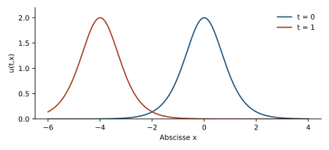

# École polytechnique — Première composition de mathématiques P′ 1996 · Corrigé guidé

*Corrigé rédigé par IA, non officiel. Signalez toute erreur.*

**Rédaction** · GPT-6.2 Astra Ultra · vitesse non renseignée

On étudie l’équation $\partial_tu=\partial_x^3u+6u\,\partial_xu$ avec le signe du sujet. Les fonctions peuvent être complexes. Dans la première partie toutes les intégrales portent sur une période et les produits sont bilinéaires, sans conjugaison.

## I. Constantes du mouvement pour les solutions périodiques

### Question 1.a

> [!INDICATION]
> Reconnaître la dérivée d’une puissance périodique.

#### Solution

Pour $u\in F$ et $k\ge0$ entier, $u^ku'=(u^{k+1})'/(k+1)$. Les valeurs aux deux bornes étant égales, $\int_0^{2\pi}u^k u'=0$. L’identité polynomiale vaut aussi lorsque $u$ prend des valeurs complexes.

### Question 1.b

> [!INDICATION]
> Appliquer la question précédente à la dérivée d’ordre $n$.

#### Solution

La dérivée $u^{(n)}$ est lisse et périodique. Son produit par $u^{(n+1)}$ est la dérivée de $(u^{(n)})^2/2$. L’intégrale demandée est donc nulle pour tout $n\ge0$.

### Question 1.c

> [!INDICATION]
> Transférer les dérivées d’un facteur à l’autre. Pour la réciproque, choisir une fonction réelle.

#### Solution

On peut supposer $m\le n$ par symétrie. Les intégrations par parties successives n’ont aucun terme de bord, les dérivées étant périodiques. Pour $n-m=2r+1$, on aboutit à $(-1)^r\int u^{(m+r)}u^{(m+r+1)}=0$. Pour $n-m=2r$, on obtient $(-1)^r\int(u^{(m+r)})^2$. En choisissant $u(x)=\cos x$, ce dernier nombre est $(-1)^r\pi\ne0$. L’annulation pour toute fonction équivaut donc à l’imparité de $m-n$.

### Question 2

> [!INDICATION]
> Dans le développement en exponentielles, seule la fréquence nulle contribue à l’intégrale.

#### Solution

Avec $u_p=e^{ix}+e^{-ipx}$, on a $u_p'''=-i e^{ix}+ip^3 e^{-ipx}$. Le terme d’indice $j$ de $u_p^n$ est $\binom nj e^{i[n-(p+1)j]x}$. Dans le premier produit la fréquence nulle exige $n+1=(p+1)j$, dans le second $n-p=(p+1)j$. Pour $1\le n<p$, aucune possibilité. Pour $n=p$, les indices sont respectivement $1$ et $0$, d’où
$$\int_0^{2\pi}u_p^n u_p'''dx=
\begin{cases}0&n<p,\\2\pi i(p^3-p)&n=p.\end{cases}$$
Pour $p=n=1$, cette dernière valeur est bien nulle.

### Question 3.a

> [!INDICATION]
> Employer la règle de la chaîne puis remplacer la dérivée temporelle par l’expression de l’équation.

#### Solution

Les dérivées sont continues sur un intervalle compact en $x$ et localement uniformes en $t$. On peut donc dériver sous l’intégrale. En notant $u_t(x)=u(t,x)$ et les primes pour les dérivées en $x$, il vient
$$\frac{d}{dt}\varphi(u_t)=\int_0^{2\pi}P'(u_t)(u_t'''+6u_tu_t')\,dx.$$

### Question 3.b

> [!INDICATION]
> Le terme non linéaire est déjà une dérivée. Pour isoler le coefficient dominant de $Q$, choisir le paramètre $p$ de la question 2 égal à son degré.

#### Solution

Pour tout polynôme $Q$, $6uQ(u)u'$ a une primitive périodique en $x$, obtenue en composant une primitive polynomiale de $6zQ(z)$ avec $u$. Sa contribution est nulle. Si $Q(z)=a+bz$, alors $\int Q(u)u'''=a\int u'''+b\int uu'''=0$ par périodicité et 1.c. Réciproquement, si le degré est $p\ge2$ et le coefficient dominant $c_p\ne0$, tester sur $u_p$ donne $2\pi i\,c_p(p^3-p)\ne0$ par 2, puisque les puissances inférieures contribuent zéro, y compris le terme constant. Les solutions sont donc exactement les polynômes de degré au plus un, avec le polynôme nul.

### Question 3.c

> [!INDICATION]
> Prendre les primitives de $1$ et de $z$, sans oublier les constantes.

#### Solution

D’après 3.a–b, les fonctionnelles $\varphi_P(u)=\int_0^{2\pi}P(u(x))dx$ sont des constantes du mouvement pour $P\in\operatorname{Vect}(1,z,z^2)$. Sur les fonctions constantes $u(x)=c$, leur valeur est $2\pi P(c)$. Une fonctionnelle identiquement nulle exige donc $P=0$. Leur espace est de dimension trois, de base $u\mapsto2\pi$, $u\mapsto\int u$, $u\mapsto\int u^2$.

## II. Une onde progressive

### Question 4

> [!INDICATION]
> Poser $s=x+vt$, intégrer l’équation de l’onde une fois, puis exprimer la dérivée seconde de la sécante hyperbolique au carré.

#### Solution

Le profil est $U(s)=\alpha\,\mathrm{sech}^2(\beta s)$. La solution est non constante exactement si $\alpha\beta\ne0$. L’équation devient $vU'=U'''+6UU'$, soit $vU=U''+3U^2+C$. Le profil et ses dérivées tendent vers zéro à l’infini, donc $C=0$. Pour $h(z)=1-\tanh^2z$, $h'=-2h\tanh z$ puis $h''=4h-6h^2$. On obtient
$$(v-4\beta^2)U=(3-6\beta^2/\alpha)U^2.$$
Comme $U$ varie et ne s’annule à aucun point fini, les deux coefficients doivent être nuls. Ainsi $\beta=\pm\sqrt v/2$ et $\alpha=v/2$. Ces deux couples donnent le même profil et vérifient l’équation par le calcul précédent. Son sommet est en $x=-vt$.

## III. Dérivation, intégration et opérateurs différentiels

### Question 5

> [!INDICATION]
> Appliquer les deux compositions à une même fonction de l’espace $E$.

#### Solution

Pour $u\in E$, $(DM_f-M_fD)u=(fu)'-fu'=f'u$. Ainsi $DM_f-M_fD=M_{f'}$, opérateur différentiel d’ordre zéro.

### Question 6

> [!INDICATION]
> L’intégrale part de moins l’infini, où chaque fonction de $E$ est identiquement nulle.

#### Solution

Le théorème fondamental donne $(DSu)(x)=u(x)$. Dans l’autre sens $(SDu)(x)=\int_{-\infty}^x u'(y)\,dy=u(x)$, puisque $u$ s’annule à gauche d’un certain point. Donc $DS=SD=I=M_1$ sur $E$.

### Question 7

> [!INDICATION]
> Multiplier l’identité à gauche par $D$ et déplacer la dérivation à travers les multiplications jusqu’au premier facteur $S$.

#### Solution

Le produit de gauche devient $DM_fS=M_f+M_{f'}S$. Pour un mot $P$ contenant au moins deux $S$, déplacer $D$ de la gauche vers le premier $S$ par $DM_g=M_gD+M_{g'}$. Chaque terme où une multiplication est dérivée conserve les deux $S$. Le terme où $D$ rencontre le premier $S$ le supprime et en conserve au moins un autre. Donc $DP$ est intégral. Il en résulte que $M_f=\sum DP_i-M_{f'}S$ est à la fois différentiel et intégral. Par le résultat admis il est nul, puis l’unicité des coefficients impose $f=0$.

### Question 8

> [!INDICATION]
> Séparer soigneusement les termes différentiels, les termes à un seul $S$ et ceux qui en contiennent au moins deux.

#### Solution

Écrivons $a=f_0$, $b=f_1$, $c=f_2$, $R=D+M_a+M_bS+M_cS^2$. Pour déplacer une multiplication à travers $S$, on a l’identité exacte $SM_a=M_aS-SM_{a'}S$, obtenue en multipliant $DM_a-M_aD=M_{a'}$ par $S$ des deux côtés. En développant le carré, on trouve
$$R^2-D^2-M_f=2M_aD+M_{a'+a^2+2b-f}
+M_{b'+2ab+2c}S+J,$$
où $J$ est une somme de mots à au moins deux $S$. En effet $DM_bS+M_bSD=M_{b'}S+2M_b$, $DM_cS^2+M_cS^2D=M_{c'}S^2+2M_cS$, et $M_bSM_a$ donne $M_{ab}S$ modulo deux intégrations.

Si le résultat est du type demandé, sa partie différentielle est intégrale, donc nulle. L’unicité de ses coefficients impose $a=0$, $2b=f$. La question 7 appliquée au terme restant à une intégration impose $b'+2c=0$. Ainsi
$$f_0=0,\qquad f_1=f/2,\qquad f_2=-f'/4.$$
Réciproquement ces valeurs annulent tous les termes affichés sauf $J$, ce qui vérifie la condition exacte du sujet.

### Question 9

> [!INDICATION]
> Dans le produit, calculer d’abord $D^2 M_g$ puis simplifier $D^jS^k$. Tout terme restant avec $S$ est intégral.

#### Solution

Posons $L=D^2+M_f$ et gardons les valeurs $b=f/2$, $c=-f'/4$. Le terme différentiel de $D^2M_bS$ est $M_bD+2M_{b'}$ et celui de $D^2M_cS^2$ est $M_c$, par la règle de Leibniz. Le terme $M_fD$ s’y ajoute, et les deux autres produits issus de $M_f$ sont intégraux. Il reste exactement
$$T=D^3+\tfrac32 M_fD+\tfrac34 M_{f'}.$$
Par construction $LR-T$ est intégral. Si un autre différentiel convenait, sa différence avec $T$ serait différentielle et intégrale, donc nulle.

### Question 10

> [!INDICATION]
> Regrouper le commutateur selon les puissances de $D$. Les termes d’ordre deux puis d’ordre un doivent se simplifier.

#### Solution

Écrivons $[A,B]=AB-BA$. Par Leibniz,
$$[D^3,M_f]=3M_{f'}D^2+3M_{f''}D+M_{f'''},\qquad
[M_fD,D^2]=-2M_{f'}D^2-M_{f''}D.$$
De même $[M_{f'},D^2]=-2M_{f''}D-M_{f'''}$, $[M_fD,M_f]=M_{ff'}$, et deux multiplications commutent. Avec les coefficients de $T$ trouvés en 9, les termes en $D^2$ et $D$ s’annulent. On obtient l’opérateur d’ordre zéro
$$T(D^2+M_f)-(D^2+M_f)T=\tfrac14 M_{f'''+6ff'}.$$
