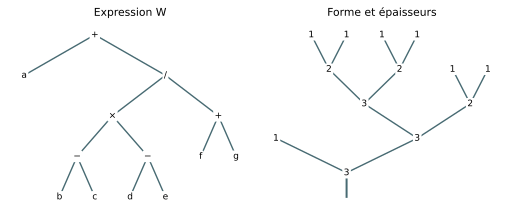
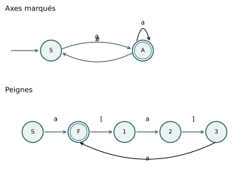

# ENS Ulm–Lyon 1997 — Informatique · Corrigé guidé

*Corrigé rédigé par IA, non officiel. Signalez toute erreur.*

**Rédaction** · GPT-6.2 Astra Ultra · vitesse non renseignée

## Formes arborescentes, registres et mots

## I. Épaisseur et matrice de ramification

### Question 1 — Compter les bifurcations

**Indication.** Partir des feuilles, étiquetées 1, et calculer chaque étiquette une fois les deux étiquettes filles connues.

Sur la figure 1 on compte trois bifurcations $(1,1)$, quatre $(1,2)$, aucune $(1,3)$, une $(2,2)$ et une $(2,3)$. Les dix arêtes terminales sont d’épaisseur 1. Les sept arêtes d’épaisseur 2 résultent des trois $(1,1)$ et des quatre $(1,2)$. Les deux arêtes d’épaisseur 3 résultent des deux dernières bifurcations. Les trois lignes de $R$ sont donc $(1,0,0)$, $(4/7,3/7,0)$ et $(0,1/2,1/2)$. Le total des bifurcations est bien la taille 9.

### Question 2 — Somme d’une ligne

**Indication.** Partitionner les nœuds qui donnent à leur arête mère l’épaisseur $k$.

Pour $k\ge2$, toute arête d’épaisseur $k$ est issue d’une bifurcation unique dont les filles ont soit les épaisseurs $(i,k)$, $i<k$, soit $(k-1,k-1)$. Ces classes sont disjointes et exhaustives. La somme des numérateurs de la ligne $k$ est donc exactement son dénominateur $N_t(k)$, d’où une somme égale à 1. La première ligne vérifie l’égalité par définition.

### Question 3 — Arbre parfait

**Indication.** Montrer d’abord qu’aucune feuille ne peut apparaître avant le dernier niveau.

Si l’arbre est parfait, tous ses sommets aux profondeurs inférieures à $h$ ont deux fils, et les feuilles sont exactement à profondeur $h$. Réciproquement, si toutes les feuilles sont à profondeur $h$, tout sommet de profondeur inférieure est interne et, par stricte binarité, a deux fils. Par récurrence le niveau $d$ contient alors $2^d$ sommets pour $0\le d\le h$. Les deux sous-arbres de chaque nœud y ont même hauteur et même épaisseur. L’épaisseur de racine vaut $h+1$ et chaque ligne ne comporte que le terme diagonal 1, soit $R=I_{h+1}$.

### Question 4 — Peigne de hauteur donnée

**Indication.** Examiner d’abord la bifurcation la plus éloignée du tronc.

Pour $h\ge1$, l’extrémité du peigne porte un nœud $(1,1)$, puis le chemin vers la racine traverse $h-1$ nœuds $(1,2)$. Il y a $h$ arêtes d’épaisseur 2. Les lignes de $R$ sont $(1,0)$ et $((h-1)/h,1/h)$. Pour $h=0$ on a une seule feuille et $R=(1)$.

### Question 5 — Comparer formes touffues et effilées

**Indication.** Interpréter un coefficient diagonal puis un coefficient de la première colonne.

Une grande proportion diagonale signifie que les deux branches filles ont souvent la même épaisseur. Une répétition de tels branchements accroît rapidement l’épaisseur globale à hauteur fixée. Une masse importante dans la première colonne, sous la diagonale, correspond à de petites pousses terminales greffées sur une branche plus épaisse, comme dans le peigne. Ces distributions ne contiennent ni les angles ni l’ordre gauche–droite et ne déterminent pas un dessin unique.

### Question 6 — Minimum à taille fixée et dénombrement

**Indication.** Un arbre d’épaisseur 2 peut-il posséder un nœud dont les deux fils sont internes ?

Pour $n=0$ il existe une seule feuille d’épaisseur 1. Pour $n\ge1$ il existe une bifurcation terminale $(1,1)$, donc l’épaisseur de racine est au moins 2. Le peigne atteint cette borne. L’épaisseur reste 2 exactement lorsque chaque bifurcation sauf la dernière a une feuille et un fils interne. À chacune des $n-1$ bifurcations on choisit le côté où continue la chaîne. Il existe donc $2^{n-1}$ arbres binaires ordonnés de taille $n$ au minimum.

### Question 7 — Tailles possibles à épaisseur fixée

**Indication.** Chercher le premier nœud qui atteint l’épaisseur $h$ en remontant depuis les feuilles.

Pour produire $h\ge2$ pour la première fois, il faut deux sous-arbres d’épaisseur $h-1$. Si $m(h)$ est la taille minimale, $m(1)=0$ et $m(h)=1+2m(h-1)$, borne atteinte par l’arbre parfait. Ainsi $m(h)=2^{h-1}-1$. Pour $h\ge2$, greffer au-dessus de la racine un nœud ayant l’ancien arbre et une feuille pour fils ajoute un nœud interne sans changer l’épaisseur. Tous les entiers $n\ge m(h)$ sont donc possibles. Pour $h=1$ seule la taille zéro convient.

### Question 8 — Représentation en mémoire

**Indication.** Relier aux $n$ nœuds internes le nombre de feuilles d’un arbre strict.

Chaque nœud peut être une feuille ou une paire ordonnée de références vers ses fils. Un tableau d’indices de fils convient également. Un arbre strict de taille $n$ possède $n+1$ feuilles, donc $2n+1$ sommets. L’occupation est $\Theta(n+1)$ mots machine pour des étiquettes et références de taille fixe. Le langage change les constantes, et une forme dessinée peut ajouter des coordonnées à chaque arête.

### Question 9 — Calcul en parcours postfixe

**Indication.** Un nœud n’a besoin que des résultats déjà obtenus pour ses deux fils.

La fonction $E$ renvoie 1 sur une feuille. Sur un nœud, elle calcule une seule fois $u=E(g)$ et $v=E(d)$, puis renvoie $u+1$ si $u=v$ et $\max(u,v)$ sinon. L’induction structurelle prouve la correction car la combinaison reprend la règle de l’énoncé. Chaque sommet est traité une fois, soit $\Theta(n+1)$ opérations. La pile a une profondeur $O(h+1)$.

### Question 10 — Tirage successif de feuilles

**Indication.** Conserver les feuilles disponibles dans un tableau pour éviter de parcourir l’arbre après chaque tirage.

Pour $n\ge1$, partir d’une bifurcation et placer ses deux feuilles dans un tableau. Si le tableau contient $m$ feuilles et si $u=r_1()\in(0,1]$, choisir l’indice $\lceil mu\rceil-1$ en numérotation depuis zéro. Transformer cette feuille en bifurcation, remplacer sa référence dans le tableau par celle de son premier fils et ajouter le second à la fin. Répéter jusqu’à $n$ nœuds internes. Un tirage uniforme sélectionne chaque feuille avec la même probabilité à cette étape. La génération demande $\Theta(n)$ opérations amorties et $O(n)$ de mémoire, sans impliquer une distribution uniforme sur toutes les formes finales.

### Question 11 — Génération à partir d’une matrice

**Indication.** Distinguer une scission qui maintient une branche d’épaisseur $k$ et une scission qui la diminue.

Empiler le tronc d’étiquette $s$. Pour chaque arête dépilée d’étiquette $k>1$, tirer $i=r_{2,k}()$. Si $i<k$, créer les enfants $i,k$ en tirant éventuellement leur ordre. Si $i=k$, créer deux enfants $k-1,k-1$. Empiler ceux d’épaisseur supérieure à 1, les autres étant terminaux. La boucle cesse lorsque la pile est vide. La terminaison n’est pas garantie pour toutes les suites de tirages. Si une ligne atteinte a une probabilité diagonale nulle, une chaîne de niveau $k$ peut se prolonger à coup sûr. Sous des tirages indépendants avec diagonales positives, chaque chaîne a une longueur géométrique finie presque sûrement et une récurrence en $k$ donne la terminaison presque sûre.

### Question 12 — Ce que reproduisent les tirages

**Indication.** Séparer une distribution de transitions et les fréquences concrètes d’un seul arbre fini.

Conditionnellement à une scission de niveau $k$, les catégories de fils suivent la ligne $M_{k,\cdot}$. Sur beaucoup d’arbres et de scissions de ce niveau, les fréquences cumulées devraient s’en approcher si les tirages sont indépendants. On espère donc retrouver le type de ramification de l’arbre initial. Une petite réalisation peut s’en écarter et la matrice ne contient ni l’ordre des fils ni la géométrie.

## II. Évaluation des expressions sur registres

### Question 13 — De gauche à droite

**Indication.** Conserver la valeur de $a$ pendant tout le calcul du produit.

Une suite d’instructions est $R_0\leftarrow a$, $R_1\leftarrow b$, $R_2\leftarrow c$, $R_1\leftarrow R_1-R_2$, $R_2\leftarrow d$, $R_3\leftarrow e$, $R_2\leftarrow R_2-R_3$, $R_1\leftarrow R_1R_2$, $R_0\leftarrow R_0+R_1$. Quatre registres sont simultanément nécessaires au chargement de $e$.

### Question 14 — De droite à gauche

**Indication.** L’ordre de chargement peut s’inverser sans inverser l’ordre des opérandes d’une soustraction.

Charger successivement $R_0\leftarrow e$, $R_1\leftarrow d$, $R_0\leftarrow R_1-R_0$, puis $R_1\leftarrow c$, $R_2\leftarrow b$, $R_1\leftarrow R_2-R_1$. Terminer par $R_0\leftarrow R_1R_0$, $R_1\leftarrow a$, $R_0\leftarrow R_1+R_0$. Le pic d’utilisation est trois registres.

### Question 15 — Ordre optimal pour une expression plus longue

**Indication.** Former le produit des deux différences avant le dénominateur, conformément à l’association usuelle de la multiplication et de la division.

Lire $W=a+[(b-c)(d-e)]/(f+g)$. Exécuter $R_0\leftarrow b$, $R_1\leftarrow c$, $R_0\leftarrow R_0-R_1$, puis $R_1\leftarrow d$, $R_2\leftarrow e$, $R_1\leftarrow R_1-R_2$, $R_0\leftarrow R_0R_1$. Ensuite $R_1\leftarrow f$, $R_2\leftarrow g$, $R_1\leftarrow R_1+R_2$, $R_0\leftarrow R_0/R_1$, $R_1\leftarrow a$, $R_0\leftarrow R_1+R_0$. Trois registres suffisent. Le produit de deux sous-expressions nécessitant chacune deux registres explique le pic de trois.

### Question 16 — Arbre d’expression

**Indication.** Identifier à chaque niveau l’opération effectuée en dernier.

La racine est l’addition de $a$ et du quotient. Le quotient a pour fils le produit et la somme $f+g$. Les fils du produit sont les soustractions $b-c$ et $d-e$. Les sept variables occupent les feuilles. La figure conserve l’ordre des opérandes, essentiel aux nœuds de soustraction et de division.

### Question 17 — Nombre de registres et épaisseur

**Indication.** Comparer les ressources quand les deux fils ont des coûts égaux puis inégaux.

Après effacement des symboles et réflexion, on ajoute une arête de tronc à l’ancienne racine. Les variables ont épaisseur 1, les deux différences et $f+g$ ont épaisseur 2, le produit, le quotient et le tronc ont épaisseur 3. En général, si les coûts des fils sont $p\ge q$, calculer le premier utilise $p$ registres, puis conserver son résultat pendant le second en requiert $1+q$. Le coût du nœud est $\max(p,1+q)$, soit $p$ pour $p>q$ et $p+1$ sinon. Avec une feuille de coût 1, c’est exactement la récurrence de l’épaisseur.

## III. Arbres codés par des mots

### Question 18 — Mot de la figure 10

**Indication.** Remplacer dans la lecture étiquetée chaque arête par la même lettre et garder les crochets de branche.

En suivant l’axe principal choisi sur le dessin, on lit successivement deux arêtes, une branche de deux arêtes, deux arêtes, une branche elle-même ramifiée, une arête, une branche de trois arêtes puis les deux dernières arêtes. Le mot est `aa[aa]aa[a[a]a]a[aaa]aa`. Les quinze lettres correspondent aux quinze arêtes marquées de $a$ à $o$ dans la version étiquetée du sujet.

### Question 19 — Quand deux crochets délimitent-ils une branche ?

**Indication.** Comparer le compteur d’ouvertures moins fermetures à sa valeur juste avant le crochet ouvrant.

Dans un mot déjà supposé valide, le crochet final doit être le partenaire du crochet initial. Cela équivaut à dire que $w$ est bien emboîté, c’est-à-dire que son bilan final est nul et que tous ses préfixes ont un bilan positif ou nul en ignorant les lettres. Alors le compteur du facteur complet ne rejoint son niveau initial qu’à la fermeture finale. Dans un mot arbitraire il faut en plus que son contenu code une branche réelle et que le mot entier respecte les règles de rattachement.

### Question 20 — Décomposition par branches immédiates

**Indication.** Lire le contenu de la branche à profondeur relative zéro.

Accumuler dans $z_1$ toutes les lettres qui précèdent la première ouverture au niveau zéro. Cette ouverture trouve son unique fermeture par le premier retour au même niveau, donnant le bloc $[a_1]$. Recommencer pour obtenir $z_2,[a_2],\ldots,z_{n+1}$. Ces positions sont forcées par le compteur et les intervalles entre eux sont exactement des mots en la seule lettre $a$. La décomposition existe et est unique, y compris lorsqu’il n’y a aucune branche latérale.

### Question 21 — Automate des axes marqués

**Indication.** Une branche latérale doit partir après un tronçon et être suivie d’une continuation.

Un axe marqué commence et finit par $a$, et ne contient pas deux marqueurs consécutifs. Réciproquement, remplacer tout marqueur d’un tel mot par `[a]` construit un codage possible. Son expression rationnelle est $a^+(\#a^+)^*$. L’automate a un état initial $S$ en attente d’une lettre et un état final $A$. Les transitions sont $S\xrightarrow{a}A$, $A\xrightarrow{a}A$ et $A\xrightarrow{\#}S$. Toute autre transition mène à un état de rejet.

### Question 22 — Reconnaissance des arbres parfaits

**Indication.** Le tronc porte deux fils de même hauteur dont les codes sont identiques.

En autorisant la feuille de hauteur zéro, $w_0=$ `a` et $w_{h+1}=a[w_h]w_h$. Cela caractérise les mots parfaits par induction. Pour tester un candidat autre que `a`, exiger le préfixe `a[`, retrouver la fermeture correspondante, comparer le contenu des crochets au suffixe suivant et tester récursivement le contenu une seule fois. Chaque étape valide divise approximativement la longueur par deux. En travaillant sur des intervalles, le temps total est linéaire.

### Question 23 — Reconnaissance des peignes

**Indication.** Dans ce peigne le fils latéral est une feuille et le prolongement reste un peigne.

Le langage est le mot initial `a` suivi de zéro ou plusieurs blocs `[a]a`. Un automate lit le premier $a$ et entre dans un état final $F$. Depuis $F$, la seule répétition permise suit un cycle de quatre transitions étiquetées, dans l’ordre, crochet ouvrant, $a$, crochet fermant et $a$, revenant à $F$. Tout autre caractère ou arrêt au milieu du cycle est rejeté. La feuille est le cas de hauteur zéro.

### Question 24 — Vérificateur de forme quelconque

**Indication.** Dans chaque branche, vérifier simultanément les crochets équilibrés et la validité de son axe marqué.

Initialiser une pile avec l’état $S$ de la question 21 pour l’axe principal. À la lecture d’un $a$, faire passer le sommet à $A$. À la lecture de `[`, exiger que le sommet soit $A$, le remplacer par $S$ (la continuation attend désormais son $a$) puis empiler $S$ pour la nouvelle branche. À la lecture de `]`, exiger une pile de profondeur au moins deux et un sommet $A$, puis dépiler. Rejeter toute transition impossible. À la fin, accepter seulement une pile réduite à un unique $A$. L’invariant est que chaque niveau contient l’état courant de son propre axe marqué. Le temps est linéaire et l’espace proportionnel à la profondeur de branchement.

### Question 25 — Du mot au dessin

**Indication.** Sauvegarder à chaque embranchement le point et la direction de la continuation principale.

Initialiser le point $P$, une direction unitaire $v$, une longueur $l>0$ et un angle de divergence fixé. Pour $a$, calculer $P'=P+lv$, appeler `tracer(P')` et prendre $P=P'$. Pour `[`, empiler $(P,v)$ et tourner $v$ pour suivre la branche latérale. Pour `]`, restaurer le couple dépilé et appeler `aller(P)`, sans tracer le retour. Les crochets bien emboîtés garantissent que chaque restauration rejoint son propre embranchement. Chaque lettre dessine exactement un segment et le traitement coûte un temps linéaire.
