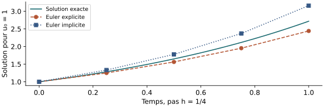
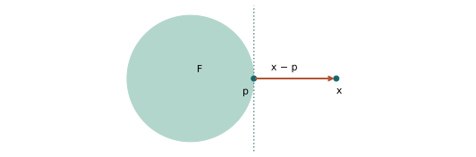

# Maths PSI — PSI 1997 — Corrigé

*Corrigé rédigé par IA, non officiel. Signalez toute erreur.*

**Rédaction** · GPT-6.2 Astra Ultra · vitesse non renseignée · 26 novembre 2026

On étudie $u'=f(u)$, $u(0)=u_0$, en dimension finie. Le champ est lipschitzien sur toute boule fermée, avec constante $k(R)$ sur la boule de rayon $R$. Les questions de tangence emploient la norme euclidienne. La question II-2 demande une précision de signe.

École polytechnique et École normale supérieure de Cachan · 4 h. [Énoncé](https://www.sujetsetcorriges.fr/dl/X/Maths/PSI/sec-x-1997-maths-PSI.pdf)

## I — Approximations du système linéaire

### I-1.a. Limite réelle

Posons $r_n=(1+ta_n/n)^n$, $s_n=(1-ta_n/n)^{-n}$, avec $a_n\to a$. Pour $a_n$ réel, les bases sont positives à partir d’un certain rang. Comme $(a_n)$ est bornée, $n\log(1\pm ta_n/n)=\pm ta_n+O(1/n)$. En exponentiant, les deux suites tendent vers $e^{ta}$.

### I-1.b. Modules dans le cas complexe

On a $|1\pm ta_n/n|^2=1\pm2t\Re(a_n)/n+t^2|a_n|^2/n^2$. Le même développement réel montre $r_n\overline r_n\to e^{2t\Re a}$ et $s_n\overline s_n\to e^{2t\Re a}$.

### I-1.c. Arguments

Pour $n$ assez grand, la partie réelle de chaque base est positive. Pour le signe $+$, prenons $\rho_n=\arctan((t\Im a_n/n)/(1+t\Re a_n/n))$ et pour le signe $-$ la formule correspondante $\theta_n$. Ainsi $n\rho_n\to t\Im a$ et $n\theta_n\to-t\Im a$. Les éventuels termes de petit indice n’affectent pas ces limites (une base nulle admet toute phase dans l’identité de forme polaire).

### I-1.d. Limite complexe

Les modules des deux puissances tendent vers $e^{t\Re a}$. Leurs phases sont $n\rho_n$ et $-n\theta_n$, toutes deux de limite $t\Im a$. D’où $r_n,s_n\to e^{ta}$.

### I-2.a. Série de matrices

Pour $m>n$, la norme de la différence des sommes partielles est majorée par $\sum_{j=n+1}^m\|B\|^j/j!$. Cette quantité tend uniformément vers zéro quand $n$ grandit. L’espace des matrices étant complet en dimension finie, la série converge vers $e^B$.

### I-2.b. Majorations

La somme des majorants vaut $e^{\|B\|}$ puisque $\|I\|=1$. De plus $\|e^{-B}(I+B)\|\leq e^{\|B\|}(1+\|B\|)\leq e^{2\|B\|}$.

### I-2.c. Dériver l’exponentielle

La série des dérivées converge normalement sur $[0,R]$, dominée par $\|B\|e^{R\|B\|}$. En dérivant la série terme à terme, $(e^{tB})'=Be^{tB}=e^{tB}B$. Ainsi $u(t)=e^{tA}u_0$ est une solution définie sur toute la demi-droite pour $f(x)=Ax$.

### I-2.d. Identité inverse

La dérivée de $e^{-tB}(I+tB)$ vaut $-tB^2e^{-tB}$ et celle de $e^{-tB}e^{tB}$ vaut zéro. La seconde fonction prend la valeur $I$ en zéro. En $t=1$, on obtient $e^{-B}e^B=I$.

### I-3.a. Pas explicite

Écrivons $D=TA$, $C=I+sD/n$. Pour $G=e^{-sD}C^n$, commutativité et règle du produit donnent $G'=-(s/n)e^{-sD}D^2C^{n-1}$. Pour $0\leq s\leq1$, $\|C^{n-1}\|\leq e^{\|D\|}$ donc $\|G'\|\leq s\|D\|^2 e^{2\|D\|}/n$. Comme $G(0)=I$, on intègre, puis multiplie à gauche par $e^D$. Cela donne $\|R_n-e^D\|\leq\|D\|^2 e^{3\|D\|}/(2n)$, en particulier $R_n\to e^D$.

### I-3.b. Pas implicite

L’inverse de $I-tA$ vaut $\sum_{j\geq0}(tA)^j$. Sa norme est au plus $(1-t\|A\|)^{-1}\leq e^{2t\|A\|}$ car $-\log(1-x)\leq2x$ sur $[0,1/2]$. En dérivant l’identité du produit, la dérivée de l’inverse vaut $A(I-tA)^{-2}$. Le cas $A=0$ est immédiat pour tout $t$. Pour $H(s)=e^{-sD}(I-sD/n)^{-n}$ on obtient

$$H'(s)=\frac{s}{n}e^{-sD}D^2(I-sD/n)^{-n-1}.$$

Pour $n\geq\max(1,2\|D\|)$, sa norme est majorée par $s\|D\|^2e^{5\|D\|}/n$ sur $[0,1]$. En intégrant puis multipliant par $e^D$, on trouve $\|S_n-e^D\|=O(1/n)$. Seuls les grands indices sont nécessaires à la limite.

## II — Existence, unicité et prolongement

### II-1. Formulation intégrale

L’intégration de $u'=f(u)$ sur $[0,t]$ donne $u(t)=u(0)+\int_0^tf(u(s))\,ds$. Réciproquement, si $u$ continue satisfait cette identité, $f\circ u$ est continue. Le théorème fondamental de l’analyse assure que $u$ est de classe $C^1$ et $u'=f(u)$.

### II-2. L’inégalité de Grönwall et son hypothèse

Pour $\beta_0\geq0$, posons $F(t)=\alpha_0+\beta_0\int_0^t\alpha(s)\,ds$. On a $\alpha\leq F$, puis $F'\leq\beta_0F$. En dérivant $e^{-\beta_0 t}F(t)$ on obtient $\alpha(t)\leq\alpha_0e^{\beta_0t}$. Le feuillet dit que $\beta_0$ est réel, ce qui autorise un signe pour lequel la conclusion est fausse. Par exemple sur $[0,3/2[$, prenons $\alpha_0=1$, $\beta_0=-1$, $\alpha(t)=\max(t-1,0)$. Pour $1\leq t<3/2$, $\alpha(t)\leq1/2<1-(t-1)^2/2$ et l’hypothèse est satisfaite, aussi pour $t<1$. En $t=1,4$, on a $0,4>e^{-1,4}$. Les utilisations suivantes emploient des constantes positives ou nulles.

### II-3. Dépendance aux données initiales

Pour $\tau<T$, prenons $R=\max_{[0,\tau]}\max(\|u\|,\|\widehat u\|)$ et $k_\tau=k(R)$. La différence des relations intégrales majore $\|u(t)-\widehat u(t)\|$ par $\|u(0)-\widehat u(0)\|+k_\tau\int_0^t\|u-\widehat u\|$. II-2 donne la majoration demandée par $\|u(0)-\widehat u(0)\|e^{k_\tau t}$. À donnée initiale commune, toute différence est nulle.

### II-4. Solutions approchées

Chaque défaut est majoré par $\varepsilon t$ en norme. On applique la même différence sur $[0,\tau]$ avec terme libre $\|u(0)-\widehat u(0)\|+2\varepsilon\tau$. En prenant $k_\tau^\varepsilon=k(R)$ pour les deux courbes approchées et en appliquant II-2, on obtient ce terme libre multiplié par $e^{k_\tau^\varepsilon t}$.

### II-5. Défaut de la ligne polygonale d’Euler

Avec $h=T/n$, l’interpolée vérifie $u_n(s)=x_j+(s-jh)f(x_j)$ sur le pas issu de $x_j$. Elle reste dans la boule de rayon $R_n$ par convexité. Son défaut de dérivée est majoré par $k_n M_n(s-jh)$. Sur une portion de longueur $b\leq h$, le défaut intégral vaut donc au plus $k_n M_nb^2/2\leq k_n M_nhb/2$. En additionnant jusqu’à $t$, on trouve un défaut au plus $tTk_nM_n/(2n)$.

### II-6. Durée commune et convergence

Posons $R=1+2\|u_0\|$ et $\mathcal F(R)=\max_{\|x\|\leq R}\|f(x)\|$. Si elle est nulle, la solution constante convient et toute durée finie est possible. Sinon $T=(1+\|u_0\|)/\mathcal F(R)$. Par récurrence, $\|x_j\|\leq\|u_0\|+jh\mathcal F(R)\leq R$. On a donc $\varepsilon_n\leq C/n$ avec $C=Tk(R)\mathcal F(R)/2$. Les défauts de $u_n,u_m$ donnent comme en II-4 la borne uniforme $T(\varepsilon_n+\varepsilon_m)e^{Tk(R)}$. Dans l’espace complet des fonctions continues sur $[0,T]$, les interpolées convergent vers $u$, de valeur initiale $u_0$. La convergence de $f(u_n)$ est uniforme par Lipschitz sur la boule commune. Passer à la limite dans le défaut intégral donne l’identité exacte, puis II-1 donne la solution.

### II-7.a. Temps maximal

II-6 fournit une durée strictement positive. Les solutions sur deux intervalles s’accordent sur leur intersection par II-3. Leur réunion définit une solution sur $[0,T(u_0)[$, car chaque temps strictement inférieur au supremum appartient à un intervalle d’existence. La même unicité vaut sur la réunion.

### II-7.b. Alternative d’explosion

Si $T_*<\infty$ et si $\|u(t)\|$ ne tend pas vers l’infini, il existe $t_j\uparrow T_*$ avec $\|u(t_j)\|\leq R$. II-6 redonne à partir de chacune de ces valeurs au moins la durée $1/\mathcal F(1+2R)$, ou toute durée si ce majorant est nul. Cette durée est indépendante de $j$. Pour $j$ assez grand, le recollement prolonge la solution au-delà de $T_*$, contradiction.

### II-7.c. Critère de globalité

Si $\|u(t)\|\leq L(t)$ et si $T_*<\infty$, la norme reste majorée par le nombre fini $L(T_*)$. L’alternative de II-7.b impose donc $T_*=\infty$.

### II-8. Croissance du champ et estimation d’énergie

On peut majorer les constantes par des constantes positives. Si $\|f(x)\|\leq C_1\|x\|+C_2$, la relation intégrale et II-2 donnent sur tout segment $\|u(t)\|\leq(\|u_0\|+C_2t)e^{C_1t}$ (fixer d’abord le temps final). Pour le produit scalaire euclidien et la norme associée, $E=\|u\|_2^2$ satisfait $E'\leq2C_1E+2C_2$. Si la norme de l’hypothèse est une autre norme, son équivalence avec la norme euclidienne permet de changer $C_1$. Ainsi $E(t)\leq(E(0)+2C_2t)e^{2C_1t}$ avec les constantes adaptées. II-7.c s’applique dans les deux cas.

## III — Ensembles invariants

### III-1. Extraire une sous-suite

Les $L_n=\sup_{p\geq n}a_p$ décroissent et sont minorés, donc convergent vers $L$. Pour $j\geq1$, choisissons une queue commençant en $m>\max(j,n_{j-1})$ puis $n_j\geq m$ tel que $a_{n_j}>L_m-1/j$. Entre ce minorant et $L_m$, la sous-suite converge vers $L$. Dans $\mathbb R^N$, on extrait successivement une sous-suite convergente pour chaque coordonnée, la dernière extraction conservant les convergences précédentes.

### III-2. Condition tangentielle nécessaire

Pour $a\in F$, $U(t,a)\in F$ par invariance. La différentiabilité à droite en zéro donne $U(t,a)=a+tf(a)+o(t)$. D’où $0\leq d(a+tf(a),F)\leq\|U(t,a)-a-tf(a)\|=o(t)$ pour $t\downarrow0$.

### III-3. Projection euclidienne

Sur un fermé borné non vide, la distance continue atteint son minimum par compacité. Pour un fermé quelconque, fixer $y_0\in F$ et travailler dans $F\cap\overline B(x,\|x-y_0\|)$ suffit. Si $F$ est convexe, soit $p$ minimisant. La dérivée à droite en zéro de $\|x-p-t(y-p)\|^2$ est positive ou nulle. Ainsi $\langle x-p,y-p\rangle\leq0$ pour tout $y\in F$. Réciproquement, le développement du carré donne $\|x-y\|^2\geq\|x-p\|^2+\|y-p\|^2$. Cette inégalité établit simultanément la minimalité et l’unicité.

### III-4. Condition sur les normales

$N(a)=\bigcap_{y\in F}\{p:\langle p,y-a\rangle\leq0\}$ est fermé, convexe, stable par multiplication positive et contient zéro. Soit $p\in N(a)$ et $x_t$ un point de $F$ le plus proche de $a+tf(a)$. Par (7), $x_t=a+tf(a)+o(t)$. La relation $\langle p,x_t-a\rangle\leq0$ divisée par $t>0$ donne $\langle p,f(a)\rangle\leq0$ à la limite.

### III-5. Des normales à la tangence

Soient $p_t$ la projection de $a+tf(a)$ et $v_t=(a+tf(a)-p_t)/t$. Comme $a\in F$, $\|v_t\|\leq\|f(a)\|$, donc $p_t\to a$. Pour chaque suite $t\downarrow0$, on peut extraire $v_t\to v$. Les inégalités $\langle v_t,y-p_t\rangle\leq0$ pour $y\in F$ donnent $v\in N(a)$. En prenant $y=a$, on trouve $\|v_t\|^2\leq\langle v_t,f(a)\rangle$. Par (9), $\|v\|^2\leq\langle v,f(a)\rangle\leq0$. Toutes les valeurs d’adhérence sont nulles. Ainsi $d(a+tf(a),F)/t=\|v_t\|\to0$. L’indication sur la monotonie se vérifie aussi par convexité de la distance le long du rayon, avec valeur zéro à l’origine.

### III-6. Une inégalité de dérivée à droite

Pour $\lambda>0$, soit $w_\lambda(t)=e^{-\gamma t}v(t)-\lambda t$. Sur la suite de (10), le développement de l’exponentielle donne une pente limite au plus $-\lambda$. Pour $0<a<b<T$, si $w_\lambda(b)>w_\lambda(a)$, un minimum sur $[a,b]$ est atteint en $c<b$. Les petits accroissements positifs en $c$ auraient tous une pente positive ou nulle, contradiction. Donc $w_\lambda(b)\leq w_\lambda(a)$. Faire tendre $a$ vers zéro par continuité, puis $\lambda$ vers zéro, donne $v(t)\leq v(0)e^{\gamma t}$.

### III-7. Suffisance pour un fermé

Pour $u(0)\in F$, posons $v(t)=d(u(t),F)$ et choisissons un plus proche point $x_t$. Sur tout segment compact de temps, $u(t)$ et $x_t$ sont bornés puisque $v(t)\leq\|u(t)-u(0)\|$. Soit $k$ une constante de Lipschitz commune. La distance est 1-lipschitzienne. Pour $h\downarrow0$, le développement de $u$ donne

$$v(t+h)\leq v(t)+hk\,v(t)+d(x_t+hf(x_t),F)+o(h).$$

En effet on compare $u(t)+hf(u(t))$ à $x_t+hf(x_t)$. Sur la suite associée à $x_t$, le terme de distance est $o(h)$. Les quotients de $v$ sont localement bornés puisque $u$ est $C^1$, donc une sous-suite réalise une limite au plus $kv(t)$. III-6 donne $v(t)\leq v(0)e^{kt}=0$. Le fermé contient ainsi toute la trajectoire.

### III-8.a. Préserver la positivité

En dimension un, la trajectoire issue de zéro doit avoir une dérivée à droite positive ou nulle, soit $f(0)\geq0$. En dimension deux, les points $(0,x_2)$ et $(x_1,0)$, $x_1,x_2\geq0$, imposent $f_1(0,x_2)\geq0$ et $f_2(x_1,0)\geq0$. Inversement, pour un point quelconque de l’orthant, les coordonnées déjà strictement positives restent positives dans un pas d’Euler assez petit et les coordonnées nulles ont un incrément positif ou nul. La distance du pas à l’orthant est alors nulle. III-7 donne l’invariance dans les deux dimensions.

### III-8.b. Préserver l’ordre

Pour $N=1$, deux solutions qui se rencontrent coïncident ensuite par unicité. Par continuité une solution initialement inférieure ne peut donc devenir supérieure. Pour $N=2$, on applique III-7 au fermé $\{(x,y):x\leq y\}$ pour le champ $(f(x),f(y))$. Aux coordonnées de contact $x_i=y_i$, il faut $f_i(x)\leq f_i(y)$. Si les dérivées partielles hors diagonale sont positives ou nulles, la fonction $f_i$ est croissante en l’autre variable à coordonnée $i$ fixée, ce qui donne cette condition. Le pas d’Euler conserve l’ordre pour $h>0$ assez petit, d’où l’invariance. Réciproquement, partant de $x$ et $x+se_j$, $s>0$, $i\ne j$, l’ordre des trajectoires dans la coordonnée $i$ initialement égale impose par dérivation à droite $f_i(x)\leq f_i(x+se_j)$. Diviser par $s$ et faire $s\downarrow0$ donne $\partial_j f_i(x)\geq0$ partout.
