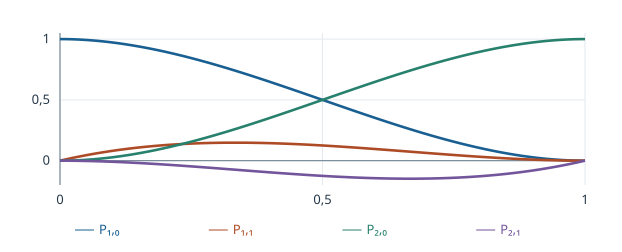

# École polytechnique — Deuxième composition de mathématiques MP 1997 · Corrigé guidé

*Corrigé rédigé par IA, non officiel. Signalez toute erreur.*

**Rédaction** · GPT-6.2 Astra Ultra · vitesse non renseignée

On écrit $E_n=\mathbb R[x_1,\ldots,x_n]$, $V_n=\prod_{i<j}(x_i-x_j)$ et $F_n$ pour les polynômes nuls dès que deux coordonnées coïncident. Le sujet admet la factorisation $P=V_nQ_P$ pour $n>2$. L’ordre décroissant des puissances dans les déterminants fixe les signes.

## I. Annulation sur les diagonales

### Question 1

> [!INDICATION]
> Diviser en la variable $x_1$, en gardant $x_2$ comme paramètre.

#### Solution

La division par le polynôme unitaire $x_1-x_2$ dans $\mathbb R[x_2][x_1]$ donne $P=(x_1-x_2)Q+R(x_2)$. L’évaluation en $x_1=x_2$ donne $R=0$. L’intégrité de l’anneau assure l’unicité.

### Question 2

> [!INDICATION]
> Examiner le facteur de Vandermonde lors d’un échange de deux variables adjacentes.

#### Solution

Chaque échange adjacent change le signe de $V_n$. Donc $T_s(V_n)=\operatorname{sgn}(s)V_n$, et $T_s(P)=V_n\operatorname{sgn}(s)T_s(Q_P)$. L’unicité donne $Q_{T_s(P)}=\operatorname{sgn}(s)T_s(Q_P)$.

### Question 3

> [!INDICATION]
> Dériver le produit en gardant les deux variables indépendantes avant de les égaler.

#### Solution

Dans $P=(x_1-x_2)Q_P$, les termes où la dérivée porte sur $Q_P$ s’annulent sur la diagonale. Par conséquent $Q_P(x,x)=(\partial_1P)(x,x)=-(\partial_2P)(x,x)$.

### Question 4

> [!INDICATION]
> Au point triple, isoler le monôme $h_1h_2^2$ dans les incréments en posant $h_3=0$.

#### Solution

Seul le terme où $\partial_1$ atteint $x_1-x_2$ subsiste en $(x,x,y)$, d’où $Q_P(x,x,y)=(\partial_1P)(x,x,y)/(x-y)^2$ si $x\ne y$. En $(x+h_1,x+h_2,x)$, le facteur de Vandermonde est $(h_1-h_2)h_1h_2$. Dans $P$ le coefficient de $h_1h_2^2$ est donc $-Q_P(x,x,x)$, les variations du quotient étant de degré supérieur. La formule de Taylor donne $Q_P(x,x,x)=-\tfrac12(\partial_1\partial_2^2P)(x,x,x)$.

## II. Déterminants et différences divisées

### Question 5

> [!INDICATION]
> Rétablir l’ordre croissant des colonnes de la matrice de Vandermonde.

#### Solution

Pour $f(X)=X^{n-1}$ les colonnes sont les puissances $n-1,\ldots,0$ évaluées aux $x_i$. En les renversant on obtient le déterminant usuel $\prod_{i<j}(x_j-x_i)$. Le renversement compte $n(n-1)/2$ inversions. On en déduit $P_f=V_n$, y compris le produit vide lorsque $n=1$.

### Question 6

> [!INDICATION]
> Développer selon la première colonne, puis isoler une évaluation de $f$ avec un polynôme de Lagrange.

#### Solution

Le cofacteur de la ligne $i$ est $(-1)^{i+1}V_{n-1}(x_1,\ldots,\widehat{x_i},\ldots,x_n)$. En le divisant par $V_n$, les $i-1$ facteurs $x_j-x_i$ avec $j<i$ changent de signe. Il reste $1/A_i$, où $A_i=\prod_{j\ne i}(x_i-x_j)$. Ainsi $Q_f=\sum_i f(x_i)/A_i$ hors des diagonales, avec prolongement polynomial prescrit par le déterminant. Pour chaque jeu fixé de nœuds distincts, un polynôme valant $1$ au nœud $i$ et $0$ aux autres impose la valeur de $1/A_i$. L’égalité sur l’ouvert dense des nœuds distincts entraîne l’unicité des polynômes $A_i$.

### Question 7

> [!INDICATION]
> La permutation agit sur les lignes du déterminant et sur les facteurs du dénominateur.

#### Solution

$P_f$ et $V_n$ changent tous deux du facteur $\operatorname{sgn}(s)$. Leur quotient est invariant hors des diagonales, puis partout par continuité polynomiale.

### Question 8

> [!INDICATION]
> Pour la puissance $n$, évaluer $\prod_i(X-x_i)$ en chaque $x_i$.

#### Solution

Pour $0\le k\le n-2$, deux colonnes coïncident, donc $Q_{X^k}=0$. Pour $k=n-1$, la question 5 donne $1$. Pour $k=n$, le polynôme $X^n-\prod_i(X-x_i)$ vaut $x_i^n$ aux nœuds, est de degré au plus $n-1$ et a pour coefficient dominant en degré $n-1$ la somme $\sum_i x_i$. Par linéarité du déterminant en première colonne, $Q_{X^n}=\sum_i x_i$. Ces identités valent aussi pour $n=1$, la première liste étant vide.

## III. Interpolation sur des nœuds distincts

### Question 9

> [!INDICATION]
> Construire un polynôme cardinal pour chacun des nœuds.

#### Solution

Posons $\ell_i(X)=\prod_{j\ne i}(X-a_j)/(a_i-a_j)$. Les valeurs $\ell_i(a_j)=\delta_{ij}$ garantissent que $g_f=\sum_i f(a_i)\ell_i$ interpole $f$ et a degré au plus $n-1$. La différence de deux solutions aurait $n$ racines distinctes et un degré strictement inférieur à $n$, donc serait nulle.

### Question 10

> [!INDICATION]
> Lire le coefficient de $X^{n-1}$ dans chaque $\ell_i$.

#### Solution

On obtient $R_f(a_1,\ldots,a_n)=\sum_i f(a_i)/\prod_{j\ne i}(a_i-a_j)$. Pour $f$ polynomiale, c’est exactement $Q_f(a_1,\ldots,a_n)$ par 6.

### Question 11

> [!INDICATION]
> Paramétrer le segment joignant les deux nœuds avant de les faire coïncider.

#### Solution

La condition $f\in C^{k+1}(\mathbb R)$ suffit. Pour $a\ne b$, la pente de la sécante est $R_f(a,b)=\int_0^1 f'((1-t)a+tb)\,dt$. Cette intégrale vaut $f'(a)$ lorsque $b=a$. Sa dérivée $\partial_a^p\partial_b^q$ pour $p+q\le k$ s’obtient avec l’intégrande $(1-t)^p t^qf^{(1+p+q)}((1-t)a+tb)$. Sur tout compact des paramètres, ces intégrandes sont continus et bornés uniformément. Cela fournit le prolongement $C^k$ sur $\mathbb R^2$.

## IV. Interpolation des valeurs et des dérivées

### Question 12.a

> [!INDICATION]
> Traduire la nullité de toutes les données en multiplicités de racines.

#### Solution

Soit $J$ l’application qui associe à $P$ les $P^{(k)}(a_\ell)$, $0\le k\le r_\ell$. Si $J(P)=0$, alors $\prod_\ell(X-a_\ell)^{r_\ell+1}$ divise $P$. Ce diviseur a degré $r+1$, tandis que $P\in G=\mathbb R_r[X]$. Donc $J$ est injective et un polynôme $P_{i,j}$ de données prescrites est unique.

### Question 12.b

> [!INDICATION]
> Appliquer la forme linéaire $P\mapsto P^{(k)}(a_\ell)$ à une relation.

#### Solution

Les relations de Kronecker isolent chaque coefficient d’une dépendance linéaire, donc la famille est libre. Son cardinal $\sum_i(r_i+1)=r+1=\dim G$ en fait une base.

### Question 12.c

> [!INDICATION]
> Comparer la dimension de l’espace des polynômes et celle de l’espace de toutes les données.

#### Solution

$J:G\to\mathbb R^{r+1}$ est injective entre deux espaces de dimension $r+1$, donc bijective. Les antécédents des vecteurs de la base canonique forment la famille demandée.

### Question 12.d

> [!INDICATION]
> Passer à une variable $t$ dans laquelle les nœuds valent $0$ et $1$. Ajuster la dérivée à l’échelle originale.

#### Solution

Écrivons $h=a_2-a_1\ne0$, $t=(X-a_1)/h$. Les quatre polynômes, de degré au plus trois, sont
$$
P_{1,0}=1-3t^2+2t^3,\quad P_{1,1}=h(t-2t^2+t^3),\quad
P_{2,0}=3t^2-2t^3,\quad P_{2,1}=h(-t^2+t^3).
$$
Les deux polynômes de valeur ont dérivée nulle aux deux extrémités. Pour les deux autres, les valeurs sont nulles et les dérivées par rapport à $X$ valent respectivement $(1,0)$ et $(0,1)$ puisque $d/dX=h^{-1}d/dt$. Ces vérifications et 12.a concluent.

### Question 12.e

> [!INDICATION]
> Reconstruire le polynôme en prenant les données de $f$ comme coordonnées.

#### Solution

La solution est $g_f=\sum_{i=1}^n\sum_{j=0}^{r_i}f^{(j)}(a_i)P_{i,j}$. En dérivant et évaluant au nœud prescrit, un seul terme subsiste. L’injectivité de $J$ prouve l’unicité.

### Question 13.a

> [!INDICATION]
> Développer les deux lignes correspondant à $x_1=x+h$ autour des deux lignes correspondant à $x_2=x$.

#### Solution

Notons $V(t)=(f(t),t^2,t,1)$. Les lignes sont $V(x+h),V'(x+h),V(x),V'(x)$. En retranchant $V(x)+hV'(x)$ à la première et $V'(x)$ à la deuxième, les deux premières lignes deviennent $h^2V''(x)/2+O(h^3)$ et $hV''(x)+O(h^2)$. Le seul terme possible de degré trois a deux lignes proportionnelles. Donc $D_f(x+h,x)=O(h^4)$, ce qui donne $(\partial_1^kD_f)(x,x)=0$ pour $k=0,1,2,3$.

### Question 13.b

> [!INDICATION]
> Faire la division dans l’anneau des polynômes en $h=x_1-x_2$.

#### Solution

Le développement polynomial exact de $D_f(x_2+h,x_2)$ en $h$ a ses quatre premiers coefficients nuls pour tout $x_2$ par 13.a. Il est divisible par $h^4$ dans $\mathbb R[x_2,h]$. Après substitution inverse, $D_f=(x_1-x_2)^4\Delta_f$ avec $\Delta_f\in E_2$.

### Question 13.c

> [!INDICATION]
> Remplacer les données de $f$ par celles du cubique de Hermite, puis calculer le déterminant pour $f(X)=X^3$.

#### Solution

Au couple $(a_1,a_2)$, la première colonne, constituée des valeurs et dérivées, est la même pour $f$ et $g_f$, donc $D_f=D_{g_f}$ à ce couple. Si $g_f=c_3X^3+c_2X^2+c_1X+c_0$, la linéarité et les colonnes répétées donnent $D_{g_f}=c_3D_{X^3}$. Pour calculer ce dernier, prendre le Vandermonde décroissant aux nœuds $a_1,a_1+s,a_2,a_2+t$, soustraire la première ligne à la deuxième et la troisième à la quatrième, puis diviser ces deux lignes par $s,t$. À la limite, le produit des deux facteurs internes $(-s)(-t)$ s’annule avec $st$ et les quatre facteurs croisés donnent $(a_1-a_2)^4$. Ainsi $\Delta_f(a_1,a_2)=c_3$.
