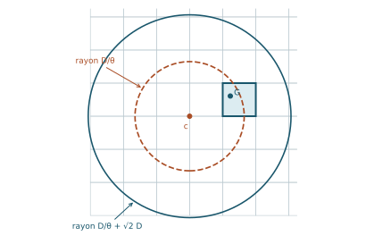

# École polytechnique MP — Informatique (option) 1997 · Corrigé brut

*Corrigé rédigé par IA, non officiel. Signalez toute erreur.*

**Rédaction** · GPT-6.2 Astra Ultra · vitesse non renseignée

**Simulation gravitationnelle et arbres quaternaires.** La partie commune étudie la profondeur des subdivisions. Pour les deux parties de programmation, on suit le choix Caml proposé par l’énoncé. Les coordonnées sont celles du carré initial, centré en l’origine. Les masses des corps sont positives.

## I. Profondeur d’un arbre quaternaire adaptatif

### Question 1.a

La profondeur 3 permet au plus $4^3=64$ corps. On l’atteint avec une grille de $8\times8$ cellules dont chacune contient un corps. Pour le minimum, deux corps suffisent. Dans le carré unité, placer les points $(1/16,1/16)$ et $(3/16,1/16)$. Ils restent ensemble lors des deux premiers partages et se séparent lors du troisième. Avec zéro ou un corps, l’arbre est une feuille de profondeur 0.


### Question 1.b

Une grille uniforme de profondeur $p$ possède $4^p$ cases. Chaque feuille occupée d’un arbre de profondeur au plus $p$ contient au moins une de ces cases, et des feuilles distinctes ont des cases distinctes. Donc $N\le4^p$ et, pour $N\ge1$,
$$p\ge f(N)=\lceil\log_4 N\rceil.$$
Pour chaque $p_0$, remplir les $4^{p_0}$ cases à raison d’un corps par case donne une profondeur exactement $p_0$. Même pour un $N$ imposé, placer les corps dans $N$ cases distinctes de la grille de niveau $\lceil\log_4N\rceil$ réalise la borne, puisque aucune cellule de ce niveau ne peut être subdivisée. Pour $N=0$ la profondeur vaut 0.

### Question 1.c

Pour tout entier $h\ge1$, dans le carré unité, considérons
$$(x_1,y_1)=(2^{-h-1},2^{-h-1}),\qquad (x_2,y_2)=(3\cdot2^{-h-1},2^{-h-1}).$$
Ils sont dans le même carré inférieur gauche jusqu’au niveau $h-1$, puis dans deux cases distinctes au niveau $h$. La profondeur $h$ est arbitraire pour $N=2$. Une borne supérieure qui ne dépendrait que de $N$ est donc impossible.

### Question 1.d

Tous les points d’un carré de côté $D$ sont à distance au plus $D$ pour la norme $\|u\|_\infty=\max(|u_x|,|u_y|)$. Si l’arbre a profondeur $p\ge1$, le parent d’une feuille la plus profonde contient au moins deux corps. Son côté est $D_U2^{-(p-1)}$. La définition du minimum $\delta$ donne $\delta\le D_U2^{-(p-1)}$. Ainsi
$$p\le 1+\left\lfloor\log_2(D_U/\delta)\right\rfloor.$$
L’emploi de l’inégalité large convient aussi aux points situés sur des bords. Pour zéro ou un corps, la profondeur est déjà connue.

### Question 1.e

Dans le modèle de l’énoncé, le pas vaut $2^e$. Deux coordonnées différentes sont séparées d’au moins ce pas. Deux positions distinctes diffèrent sur au moins une coordonnée, d’où $\delta\ge2^e$. Le côté $D_U$, lui aussi homogène à une distance, vaut au plus $(2^m-1)2^e$. Donc $D_U/\delta\le2^m-1<2^m$. La réponse de 1.d donne **$p\le m$**. Ce résultat utilise l’échelle commune imposée aux nombres du problème.

## II. Construction de l’arbre en Caml

### Question 2.a

On choisit la branche Caml du sujet et on emploie la syntaxe d’OCaml. Les types ci-dessous reprennent les champs du sujet.

```ocaml
type vecteur = { x : float; y : float }
type corps = {
  mass : float; mutable pos : vecteur;
  mutable vel : vecteur; mutable acc : vecteur
}
let vecteur_nul = { x = 0.; y = 0. }
let add u v = { x = u.x +. v.x; y = u.y +. v.y }
let sub u v = { x = u.x -. v.x; y = u.y -. v.y }
```

On obtient bien $u+v$ et $u-v$ composante par composante.

### Question 2.b

La multiplication scalaire envoie $(x,y)$ sur $(mx,my)$.

```ocaml
let scal m u = { x = m *. u.x; y = m *. u.y }
```

### Question 2.c

Le carré de la norme vaut $u_x^2+u_y^2$.

```ocaml
let carre u = u.x *. u.x +. u.y *. u.y
```

### Question 3.a

Numérotons les quadrants sud-ouest, sud-est, nord-ouest, nord-est par $0,1,2,3$. La médiane verticale est attribuée à l’est et l’horizontale au nord. Cette convention est utilisée par tous les appels.

```ocaml
type arbre = Noeud of cellule | Feuille of corps | Vide
and cellule = {
  mutable cm_mass : float; mutable cm_pos : vecteur;
  filles : arbre array
}

let indice_fille centre p =
  let est = if p.x >= centre.x then 1 else 0 in
  let nord = if p.y >= centre.y then 2 else 0 in
  est + nord
```

### Question 3.b

La composante horizontale du déplacement du centre vaut $+D/4$ pour un indice impair et $-D/4$ pour un indice pair. La composante verticale vaut $+D/4$ pour les indices 2, 3 et $-D/4$ pour 0, 1.

```ocaml
let position_fille centre taille i =
  let quart = taille /. 4. in
  { x = centre.x +. (if i mod 2 = 1 then quart else -.quart);
    y = centre.y +. (if i >= 2 then quart else -.quart) }
```

### Question 4.a

Dans le cas d’une collision de feuille, plaçons d’abord l’ancien corps dans sa fille, puis insérons le nouveau. Un seul appel récursif par niveau reste ainsi à traiter.

```ocaml
let rec insere_corps c a centre taille =
  let descendre filles =
    let i = indice_fille centre c.pos in
    let q = position_fille centre taille i in
    filles.(i) <-
      insere_corps c filles.(i) q (taille /. 2.)
  in
  match a with
  | Vide -> Feuille c
  | Noeud cell ->
      descendre cell.filles;
      a
  | Feuille ancien ->
      let filles = Array.make 4 Vide in
      filles.(indice_fille centre ancien.pos) <- Feuille ancien;
      descendre filles;
      Noeud { cm_mass = 0.; cm_pos = vecteur_nul; filles }

let construire_arbre univers taille_univers =
  Array.fold_left
    (fun a c -> insere_corps c a vecteur_nul taille_univers)
    Vide univers
```

Le tableau et le côté, globaux dans la boucle imprimée, sont ici passés à cette boucle en arguments. Une ancienne feuille est subdivisée exactement lorsqu’elle contient dorénavant deux corps. Le cas `Noeud` conserve les trois sœurs et tous les corps précédents. Les champs de barycentre seront remplis en 5.

### Question 4.b

Le carré initial contient toutes les positions. Au cours d’une insertion, les seuls appels récursifs suivent les quadrants de la nouvelle position. Chaque appel divise le côté par deux. Si l’arbre était vide au départ, l’insertion est immédiate. Sinon, la distance $\delta_c$ pour la norme du maximum entre le nouveau corps et le plus proche des anciens est strictement positive, car les positions sont distinctes et en nombre fini. Après un nombre fini de divisions, le côté devient inférieur à $\delta_c$. La cellule ne peut alors contenir aucun ancien corps et l’appel termine dans le cas vide. Le même argument justifie la séparation éventuelle des deux corps d’une ancienne feuille.

### Question 4.c

Pour une profondeur finale $p$, chaque insertion visite au plus $p+1$ niveaux. Les opérations locales, y compris la création d’un tableau de quatre filles, coûtent $O(1)$. La construction coûte donc $O(N(1+p))$. Sous 1.e, $p\le m$ avec $m$ fixé, d’où $O(N)$. La boucle traite chacun des $N$ corps, ce qui donne aussi la minoration $\Omega(N)$ et finalement **$\Theta(N)$**.

## III. Barycentres et calcul approché des forces

### Question 5

Associons à une cellule le couple $(M,Q)$ avec $M=\sum m_j$ et $Q=\sum m_jp_j$. La somme de ces couples sur ses quatre filles donne celui de la mère. Pour une cellule interne, non vide et de masse positive, son centre de masse est $Q/M$. On mémorise la masse et le centre après la visite des filles.

```ocaml
let barycentres a =
  let rec bilan = function
    | Vide -> (0., vecteur_nul)
    | Feuille c -> (c.mass, scal c.mass c.pos)
    | Noeud cell ->
        let ajouter (m, q) fille =
          let mi, qi = bilan fille in
          (m +. mi, add q qi)
        in
        let m, q =
          Array.fold_left ajouter (0., vecteur_nul) cell.filles
        in
        cell.cm_mass <- m;
        cell.cm_pos <- scal (1. /. m) q;
        (m, q)
  in
  ignore (bilan a)
```

Pour une feuille, le couple renvoyé est bien celui de son seul corps ou de l’ensemble vide. L’additivité établit la correction de l’appel interne par récurrence sur la hauteur. Chaque cellule est visitée une fois.

### Question 6.a

Pour une source de masse $M$ et de position $q$, posons $d=q-p$. Sa contribution vaut $M d/(\|d\|^2\sqrt{\|d\|^2})$. La feuille du corps cible contribue zéro. Pour éviter d’inclure sa propre masse dans une approximation, on ouvre également toute cellule qui le contient. Avec $0<\theta\le1/\sqrt2$, cette dernière précaution découle déjà du critère imprimé, car $r\le\sqrt2D$ dans cette cellule. Elle permet de garder la somme sur les **autres** corps pour tout seuil positif. Le test équivalent $D<\theta r$ évite une division par $r$ à distance nulle.

```ocaml
let contribution d r2 m =
  scal (m /. (r2 *. sqrt r2)) d

let grav_approx pos arbre taille =
  let rec visite a centre cote contient =
    match a with
    | Vide -> vecteur_nul
    | Feuille c ->
        let d = sub c.pos pos in
        let r2 = carre d in
        if r2 = 0. then vecteur_nul
        else contribution d r2 c.mass
    | Noeud cell ->
        let d = sub cell.cm_pos pos in
        let r2 = carre d in
        if not contient && cote < theta *. sqrt r2 then
          contribution d r2 cell.cm_mass
        else
          let i = indice_fille centre pos in
          let somme = ref vecteur_nul in
          for j = 0 to 3 do
            let q = position_fille centre cote j in
            let v = visite cell.filles.(j) q (cote /. 2.)
                           (contient && i = j) in
            somme := add !somme v
          done;
          !somme
  in
  visite arbre vecteur_nul taille true
```

Comme dans l’appel imprimé, `arbre` désigne ici l’univers centré en l’origine, après calcul de ses barycentres, et `theta` désigne le seuil global. L’indicateur de présence suit exactement une fille sur le chemin du corps cible. Les cellules acceptées et les feuilles traitées couvrent une seule fois les masses sources. L’appel sur chaque fille utilise la moitié du côté. L’égalité au seuil entraîne une subdivision.

### Question 6.b

Fixons la cible $c$ et une taille $D$. Si le test géométrique exige l’ouverture, $r=\|G-c\|\le D/\theta$, où $G$ est le barycentre. Les masses étant positives, $G$ appartient au carré. Tout point du carré se trouve à distance au plus $\sqrt2D$ de $G$, donc à distance au plus $(1/\theta+\sqrt2)D$ de $c$. Si $k$ carrés de cette taille satisfont la condition, leurs intérieurs sont disjoints et
$$ k D^2\le \pi(1/\theta+\sqrt2)^2D^2.$$
On peut ainsi prendre $K_0(\theta)=\lfloor\pi(1/\theta+\sqrt2)^2\rfloor$ pour le seul critère imprimé. Pour le programme de 6.a, on peut prendre $K(\theta)=K_0(\theta)+1$, car il y a au plus **une** cellule supplémentaire de cette taille sur le chemin de la cible. Ce majorant est indépendant de la répartition des corps et de $N$.



### Question 6.c

À un niveau donné, au plus $K(\theta)$ cellules sont ouvertes. Au niveau suivant, au plus $4K(\theta)$ cellules sont donc visitées. Avec la racine, le nombre d’appels est au plus $1+4pK(\theta)$. Un appel effectue un nombre borné d’opérations locales. Sous les hypothèses demandées, $p\le m$ et $\theta>0$ sont fixés. Pour une cible, `grav_approx` coûte donc **$O(1)$ en $N$**. Pour mettre à jour les $N$ accélérations, `ajuste_acc_approx` coûte **$\Theta(N)$**, chaque corps étant visité au moins une fois. La dépendance en $p$ et en $\theta$ explique la portée précise de cette estimation.
