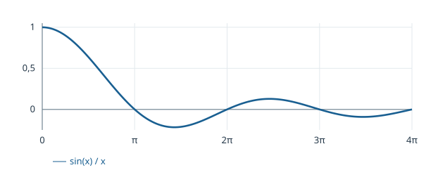

# École polytechnique — Première composition de mathématiques MP 1997 · Corrigé brut

*Corrigé rédigé par IA, non officiel. Signalez toute erreur.*

**Rédaction** · GPT-6.2 Astra Ultra · vitesse non renseignée

Sur $I=[a,b]$, on note $K_\alpha(f)=\sup_{x\ne y}|f(x)-f(y)|/|x-y|^\alpha$ et $E_\alpha$ l’espace où cette quantité est finie. Les fonctions sont à valeurs complexes. Les parties II et III imposent $I=[-\pi,\pi]$ et $f(-\pi)=f(\pi)$. Leur espace $F_\alpha$ se prolonge par périodicité.

## I. Régularité höldérienne et complétude

### Question 1

Pour $x<y$, la somme télescopique sur ces intervalles donne $|f(y)-f(x)|\le nK_\alpha(f)((y-x)/n)^\alpha$. Si $\alpha>1$, le membre de droite tend vers zéro. Les constantes, et elles seules, forment donc $E_\alpha$.

### Question 2.a

Désormais $0<\alpha<1$. L’intégrale de $f'$ donne $|f(y)-f(x)|\le\|f'\|_\infty(b-a)^{1-\alpha}|y-x|^\alpha$. Ainsi $C^1(I)\subset E_\alpha$. Dans $E_\alpha$ le majorant $K_\alpha(f)|y-x|^\alpha$ tend uniformément vers zéro avec $|y-x|$, d’où $E_\alpha\subset C^0(I)$.

### Question 2.b

Avec $c=(a+b)/2$, la fonction $x\mapsto|x-c|$ est lipschitzienne de constante $1$, donc $\alpha$-höldérienne par l’estimation précédente. Ses dérivées latérales en $c$ valent $-1$ et $1$.

### Question 3

Si $0<\alpha<\beta<1$, alors $K_\alpha(f)\le(b-a)^{\beta-\alpha}K_\beta(f)$. L’inclusion $E_\beta\subset E_\alpha$ est stricte. La sous-additivité de $t^\alpha$ sur $\mathbb R_+$, conséquence de sa concavité et de sa valeur nulle en zéro, donne $|u^\alpha-v^\alpha|\le|u-v|^\alpha$. Pour $f(x)=(x-a)^\alpha$, le quotient d’exposant $\beta$ en $a,a+h$ vaut $h^{\alpha-\beta}$, non borné.

### Question 4

$K_\alpha$ est une semi-norme par homogénéité et inégalité triangulaire sur chaque quotient. Sa somme avec la norme uniforme est donc une norme. Une suite de Cauchy $(f_n)$ pour cette norme converge uniformément vers une fonction continue $f$. Pour $\varepsilon>0$ et $m,n\ge N$, $|(f_n-f_m)(x)-(f_n-f_m)(y)|\le\varepsilon|x-y|^\alpha$. En faisant $m\to\infty$, on obtient $K_\alpha(f_n-f)\le\varepsilon$ pour $n\ge N$. Ceci montre à la fois $f\in E_\alpha$ et $\|f_n-f\|_\alpha\to0$.

## II. Une intégrale singulière périodique

### Question 5.a

L’intégrale de $1/y$ sur $[-\pi,-\varepsilon]\cup[\varepsilon,\pi]$ est nulle. Pour $|y|\le\pi$, la différence $f(x-y)-f(x)$ est majorée en module par $H|y|^\alpha$, avec $H=2^{1-\alpha}K_\alpha(f)$. En effet, si un raccord périodique sépare les points, on découpe le segment en deux longueurs $u,v$ et on utilise $u^\alpha+v^\alpha\le2^{1-\alpha}(u+v)^\alpha$. Sinon la constante $K_\alpha(f)$ suffit. Il s’ensuit que
$$
T(f)(x)=\int_{-\pi}^{\pi}\frac{f(x-y)-f(x)}{y}\,dy
$$
existe absolument sous cette forme compensée. Le reste pour $|y|<\varepsilon$ est au plus $2H\varepsilon^\alpha/\alpha$.

### Question 5.b

Pour $\varepsilon$ fixé, $T_\varepsilon(f)$ est continue en $x$ par continuité uniforme de $f$ périodique et intégrabilité du noyau tronqué. L’estimation de 5.a fournit la convergence uniforme de ces fonctions vers $T(f)$, donc sa continuité.

### Question 5.c

La linéarité découle de celle de l’intégration. On a $\|T(f)\|_\infty\le 2^{2-\alpha}\pi^\alpha K_\alpha(f)/\alpha$, donc $\|T\|_{F_\alpha\to C^0}\le2^{2-\alpha}\pi^\alpha/\alpha$ pour la norme $\|f\|_\alpha$.

### Question 5.d

Si $0\le m\le k-1$, les dérivées jusqu’à l’ordre $m$ de l’intégrande compensé sont continues en $x$ pour $y\ne0$, et bornées respectivement par $\|f^{(j+1)}\|_\infty$ pour $j\le m$. Ces constantes sont intégrables sur $[-\pi,\pi]$. La dérivation sous le signe intégral donne $T(f)\in C^{k-1}$ et $T(f)^{(m)}=T(f^{(m)})$.

### Question 6

La majoration de 5.a permet Fubini. Pour tout $y$, $\int_{-\pi}^{\pi}f(x-y)\,dx=\int_{-\pi}^{\pi}f(x)\,dx$ par périodicité. L’intégrale de $T(f)$ sur la période vaut donc zéro.

## III. Multiplicateurs de Fourier

### Question 7

Posons $a_j=\int_0^\pi\sin u/(j\pi+u)\,du$ pour $j\ge0$, avec le prolongement en zéro. Ces nombres sont strictement décroissants et positifs. Alors $\lambda_n=\sum_{j=0}^{n-1}(-1)^ja_j$. Le regroupement par paires montre $\lambda_n\ge a_0-a_1>0$ pour $n\ge2$, et le regroupement à partir de $-a_1$ donne $\lambda_n<a_0=\lambda_1$.

### Question 8.a

Avec la convention $c_n(f)=\int_{-\pi}^{\pi}e^{-inx}f(x)\,dx$, Fubini sur l’intégrale compensée et translation périodique donnent $c_n(Tf)=m_nc_n(f)$ où $m_n=\int_{-\pi}^{\pi}(e^{-iny}-1)/y\,dy$. La partie réelle est impaire. Ainsi $m_0=0$ et $m_n=-2i\,\operatorname{sgn}(n)\lambda_{|n|}$ pour $n\ne0$ par changement de variable.

### Question 8.b

D’après 7, tous les $m_n$ sont non nuls sauf $m_0$. Si $Tf=0$, les coefficients de $f-c_0(f)/(2\pi)$ sont tous nuls. L’unicité des coefficients de Fourier pour les fonctions continues périodiques donne $f$ constante. Réciproquement, toute constante est annulée par 5.a.

### Question 8.c

Parseval donne $\|Tf\|_2^2=(2\pi)^{-1}\sum_n |m_nc_n(f)|^2\le4\lambda_1^2\|f\|_2^2$. La borne $2\lambda_1$ est atteinte pour $f(x)=e^{ix}$.

### Question 8.d

Par intégrations par parties périodiques, $c_n(f^{(k)})=(in)^kc_n(f)$. Ces coefficients sont de carré sommable. Comme $m_n$ est borné, $\sum_{n\ne0}|n|^{k-1}|m_nc_n(f)|<\infty$ par Cauchy–Schwarz et $\sum_{n\ne0}1/n^2<\infty$. La série de Fourier de $Tf$ et ses dérivées jusqu’à l’ordre $k-1$ convergent donc uniformément. L’unicité des coefficients identifie la somme à $Tf$, et la dérivée d’ordre $m$ à $T(f^{(m)})$, leurs coefficients étant $(in)^mm_nc_n(f)$.

### Question 8.e

Le regroupement en 7 donne $|m_n|\ge2(\lambda_2)>0$ pour $n\ne0$, y compris $|n|=1$. Si $Tf$ est $C^k$, Parseval appliqué à $(Tf)^{(k)}$ montre donc $\sum_{n\ne0}|n|^{2k}|c_n(f)|^2<\infty$. Comme en 8.d, Cauchy–Schwarz entraîne $\sum_{n\ne0}|n|^{k-1}|c_n(f)|<\infty$. La série représente $f$ par unicité et se dérive uniformément jusqu’à $k-1$. Le coefficient constant est libre.

## IV. Valeur principale sur un segment

### Question 9

Pour $a<x<b$ et $0<\varepsilon<\min(x-a,b-x)$, la contribution constante $B_\varepsilon=S_\varepsilon(f)-A_\varepsilon$ est $f(x)[\log\varepsilon-\log(x-a)+\log(b-x)-\log\varepsilon]$. Ainsi $B_\varepsilon(x)=f(x)\log((b-x)/(x-a))$.

### Question 10

Après ce changement, le numérateur est $f(x+u)-f(x)$, le dénominateur $u$, et les bornes extérieures sont $a-x,b-x$. Au voisinage d’un $x$ admissible, les intégrandes sont bornés par $2\|f\|_\infty/\varepsilon$ et dépendent continûment de $x$ sur les domaines communs. L’intégrale sur les petits segments correspondant au déplacement des bornes tend vers zéro. Ainsi $A_\varepsilon$ est continue sur son domaine $]a+\varepsilon,b-\varepsilon[$.

### Question 11

Posons $A(x)=\int_a^b (f(y)-f(x))/(y-x)\,dy$. Cette intégrale converge absolument. La différence entre $A$ et $A_\varepsilon$ est majorée par $2K_\alpha(f)\varepsilon^\alpha/\alpha$ en tout point admissible. La convergence est uniforme sur tout compact intérieur où la troncature finit par être définie. Il suit de 10 que $A$ est continue sur $]a,b[$.

### Question 12

Le résultat est $S(f)(x)=A(x)+f(x)\log((b-x)/(x-a))$ avec la même majoration du reste qu’en 11, donc convergence localement uniforme. Posons $L=b-a$. On a $|A(x)|\le2K_\alpha(f)L^\alpha/\alpha$. La substitution $u=(x-a)/L$ donne $\int_a^b|\log((b-x)/(x-a))|\,dx=2L\int_0^{1/2}\log((1-u)/u)\,du=2L\log2$ par les primitives de $\log u$ et $\log(1-u)$. L’intégrabilité absolue en résulte. Finalement $|\int_a^b S(f)|\le C\|f\|_\alpha$ avec $C=\max(2L^{1+\alpha}/\alpha,2L\log2)$.
