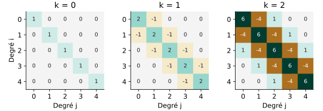
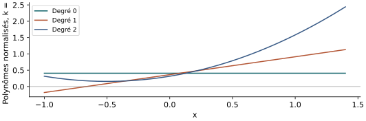

# Deuxième composition de mathématiques — PC 1997 — Corrigé guidé

*Corrigé rédigé par IA, non officiel. Signalez toute erreur.*

**Rédaction** · GPT-6.2 Astra Ultra · vitesse non renseignée · 26 novembre 2026

L’algèbre $E=\mathbb R[X,X^{-1}]$ est réalisée comme algèbre de fonctions sur $\mathbb R^*$. Un élément a un support fini. On note $TC(f)$ le coefficient de $X^0$, $\widetilde f(X)=f(X^{-1})$ et $[X^j]f$ le coefficient d’exposant $j$.

École polytechnique et École supérieure de physique et de chimie industrielles · 3 h. [Énoncé](https://www.sujetsetcorriges.fr/dl/X/Maths/PC/sec-x-1997-maths2-PC.pdf)

## Première partie — Algèbre de Laurent

### 1.a. Stabilité

**Indication.** Vérifier également que l’unité appartient à $E$.

Le monôme $1$ appartient à $E$. Sommes et multiples conservent la finitude du support. Le produit de deux sommes finies est encore une somme finie de monômes $X^{i+j}$ à exposants entiers. Cela établit la propriété de sous-algèbre.

### 1.b. Injection des polynômes

**Indication.** Compter les racines d’un polynôme non nul.

Si $P$ s’annule en tout réel non nul, il possède une infinité de racines et il est nul. La restriction est donc injective. En multipliant une relation finie entre monômes de Laurent par une puissance convenable de $X$, on retrouve aussi l’unicité des coefficients dans $E$.

### 2. Noyau d’un multiplicateur

**Indication.** Séparer le cas $f=0$ avant de considérer les termes extrêmes.

Pour $f=0$, $\ker M_f=E$. Si $f,g$ sont non nuls d’exposants maximaux $a,b$, le coefficient de $X^{a+b}$ dans $fg$ est le produit non nul des deux coefficients dominants. Ainsi $fg=0$ implique $g=0$ lorsque $f\ne0$ et $\ker M_f=\{0\}$.

### 3.a. Involution et terme constant

**Indication.** Suivre l’exposant $j$ sous la substitution.

Le coefficient de $X^j$ devient celui de $X^{-j}$. Deux substitutions rendent chaque exposant initial et l’exposant zéro reste fixe. Donc $\widetilde{\widetilde f}=f$ et $TC(\widetilde f)=TC(f)$.

### 3.b. Somme de carrés

**Indication.** Relever les produits dont les exposants s’annulent.

Dans $f\widetilde f=\sum_{i,j}a_i a_jX^{i-j}$, le terme constant est $\sum_i a_i^2$. Il est strictement positif si $f$ est non nul.

### 3.c. Produit

**Indication.** Évaluer les deux membres en un réel non nul.

Comme $(fg)(x^{-1})=f(x^{-1})g(x^{-1})$, on a $\widetilde{fg}=\widetilde f\,\widetilde g$.

### 4. Unités

**Indication.** La largeur du support s’ajoute dans un produit non nul.

Les exposants minimal et maximal de $fg$ sont les sommes des exposants extrêmes correspondants de $f,g$. S’il vaut $1$, les deux largeurs, entiers positifs ou nuls, ont une somme nulle. Les deux facteurs sont des monômes. Toutes les unités sont donc les $aX^n$, $a\ne0$, $n\in\mathbb Z$, d’inverse $a^{-1}X^{-n}$.

## Deuxième partie — Produits scalaires et adjoints

### 5. Définition positive

**Indication.** Remplacer un polynôme de Laurent par sa suite finie de coefficients.

On pose $D_k=(X-1)^k$ et $f_{[k]}=fD_k$. Par définition $(f\mid g)_k=TC(fD_k\,\widetilde{gD_k})$. C’est la somme des produits des coefficients de mêmes indices de $fD_k$ et $gD_k$, donc une forme bilinéaire symétrique. Le carré vaut la somme des carrés des coefficients de $fD_k$. Il ne s’annule que si $fD_k=0$, donc $f=0$ par la question 2.

### 6. Adjoint d’une multiplication

**Indication.** Déplacer un facteur à travers l’involution.

Les expressions $(M_fg\mid h)_k$ et $(g\mid M_{\widetilde f}h)_k$ sont toutes deux le terme constant de $f g\,\widetilde h\,D_k\widetilde D_k$. Cette identité désigne $M_{\widetilde f}$ comme adjoint de $M_f$.

### 7. Multiplications orthogonales

**Indication.** Utiliser la non-dégénérescence et évaluer l’identité d’opérateurs en $1$.

Par 6, l’égalité des produits scalaires avant et après $M_f$ revient à $(g\mid(M_{\widetilde f f}-I)h)_k=0$ pour tous $g,h$. En choisissant $g=(M_{\widetilde f f}-I)h$, on voit que cet opérateur est nul. Son évaluation en $h=1$ donne $\widetilde f f=1$. Réciproquement cette relation donne l’égalité demandée. Par 4, $f=aX^n$ et $f\widetilde f=a^2$. Ainsi les solutions sont exactement $f=\pm X^n$ et les trois assertions sont équivalentes.

### 8. Multiplications auto-adjointes

**Indication.** Décrire les polynômes de Laurent invariants en groupant les termes opposés.

Par 6 et non-dégénérescence, l’auto-adjonction équivaut à $M_f=M_{\widetilde f}$, donc à $f=\widetilde f$ par évaluation en $1$. Une telle fonction s’écrit $a_0+\sum_{j=1}^N a_j(X^j+X^{-j})$. Pour $T=X+X^{-1}$, posons $C_0=2$, $C_1=T$, $C_{j+1}=TC_j-C_{j-1}$. Par récurrence, $C_j(T)=X^j+X^{-j}$ (la récurrence est prise en l’indéterminée $T$). Ainsi $f$ est un polynôme en $T$. Inversement tout $P(X+X^{-1})$ est invariant.

## Troisième partie — Matrice de Gram et orthogonalisation

### 9.a. Produit scalaire des monômes

**Indication.** Factoriser $D_k\widetilde D_k$ en une puissance de $X-1$.

Puisque $D_k\widetilde D_k=(-1)^kX^{-k}(X-1)^{2k}$, il vient

$$(X^i\mid X^j)_k=(-1)^{i-j}\binom{2k}{k+j-i},$$

avec un coefficient binomial nul si l’indice sort de $[0,2k]$. La symétrie du binôme donne la même valeur en échangeant $i,j$.

### 9.b. Premières diagonales

**Indication.** Classer les termes par $d=|i-j|$.

Pour $k=0$, la valeur vaut $1$ si $d=0$ et $0$ ailleurs. Pour $k=1$, elle vaut successivement $2,-1$ pour $d=0,1$, puis zéro. Pour $k=2$, elle vaut $6,-4,1$ pour $d=0,1,2$, puis zéro.

### 9.c. Identité binomiale

**Indication.** Calculer un coefficient de $(1+T)^k(1+T)^k$ de deux manières.

Le coefficient de $T^{k+\ell}$ vaut $\binom{2k}{k+\ell}$. Dans le produit, prenons dans le premier facteur l’exposant $k-p$, dans le second l’exposant $p+\ell$. Les valeurs admissibles sont $0\leq p\leq k-\ell$ et $\binom{k}{k-p}=\binom{k}{p}$. On obtient la somme demandée.

### 10.a. Famille des monômes

**Indication.** Commencer par la norme du polynôme constant.

Pour $k=0$ on obtient le delta de Kronecker par 9.b. Pour $k\geq1$, même $1$ a une norme au carré $\binom{2k}{k}>1$. La famille n’est orthonormale que pour $k=0$.

### 10.b. Construction au premier ordre

**Indication.** Réécrire le produit scalaire comme l’extraction d’un seul coefficient dans $B_n$.

Pour $B_n=X^{n+2}-\frac{n+2}{n+1}X^{n+1}+\frac1{n+1}$, on a $B_n(1)=B_n'(1)=0$. Ainsi $A_n=B_n/(X-1)^2$ est unitaire de degré $n$. Pour $m\geq0$,

$$(A_n\mid X^m)_1=-[X^{m+1}]B_n=

\begin{cases}(n+2)/(n+1)&m=n,\\-1&m=n+1,\\0&\text{sinon}.\end{cases}$$

Chaque $A_n$ est donc orthogonal aux degrés inférieurs. En développant le second facteur et en utilisant la symétrie, $(A_n\mid A_m)_1=\delta_{nm}(n+2)/(n+1)$. La famille cherchée est $P_n^{(1)}=\sqrt{(n+1)/(n+2)}\,A_n$.

### 10.c. Construction au second ordre

**Indication.** Le coefficient d’indice $m+k$ commande l’orthogonalité au monôme de degré $m$.

Sous (i)–(iii), $A_n^{(k)}$ est unitaire de degré $n$ et

$$(A_n^{(k)}\mid X^m)_k=(-1)^k[X^{m+k}]B_n^{(k)}.$$

Ce coefficient est nul si $m<n$ par (ii), d’où l’orthogonalité aux degrés inférieurs. Pour $k=2$, cherchons $B=X^{n+4}+aX^{n+3}+bX^{n+2}+cX+d$. Les contraintes $B(1)=B'(1)=B''(1)=B'''(1)=0$ imposent

$$a=-\frac{2(n+4)}{n+2},\quad b=\frac{(n+3)(n+4)}{(n+1)(n+2)},\quad c=-\frac{2(n+4)}{(n+1)(n+2)},\quad d=\frac{2}{n+2}.$$

En effet les deux dernières dérivées donnent $a,b$, la première donne $c$ et la valeur en $1$ donne $d$. Les formules satisfont aussi le cas $n=0$. Ce choix réalise les trois contraintes, et $A=B/(X-1)^4$ a norme au carré $[X^{n+2}]B=b$ car il est unitaire. La famille orthonormale est $P_n^{(2)}=B/((X-1)^4\sqrt b)$.

