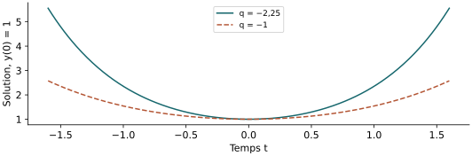
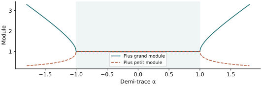

# Première composition de mathématiques — PC 1997 — Corrigé

*Corrigé rédigé par IA, non officiel. Signalez toute erreur.*

**Rédaction** · GPT-6.2 Astra Ultra · vitesse non renseignée · 26 novembre 2026

On cherche les zéros et la croissance des solutions de $y''+qy=0$ sur $\mathbb R$, avec $q$ continue. La donnée de $y(t_0)$ et $y'(t_0)$ détermine une solution unique. « Positive » et « négative » incluent la valeur zéro.

École polytechnique et École supérieure de physique et de chimie industrielles · 4 h. [Énoncé](https://www.sujetsetcorriges.fr/dl/X/Maths/PC/sec-x-1997-maths1-PC.pdf)

## Première partie — Convexité

### 1. La corde entre deux zéros

Si $t=(1-s)t_1+st_2$, $0\leq s\leq1$, alors $0\leq f(t)\leq(1-s)f(t_1)+sf(t_2)=0$. Ainsi $f$ s’annule sur tout le segment.

### 2. Pentes des sécantes sur une demi-droite

Pour $c<s<t$, la convexité donne $p(s)\leq p(t)$ où $p(t)=(f(t)-f(c))/(t-c)$. Si $f\leq M$, alors $p(t)\leq(M-f(c))/(t-c)$. La limite de cette fonction croissante existe, est finie (elle est minorée à partir de $c+1$) et vaut au plus zéro. Donc $p(t)\leq0$ pour tout $t>c$. Appliquons le même raisonnement à la restriction à $[s,\infty[$, pour chaque $s\geq c$. Il vient $f(t)\leq f(s)$ pour tout $t>s$.

### 3. Sur la droite entière

Le résultat précédent rend $f$ décroissante sur toute la droite puisque $c$ est arbitraire. Appliqué à la fonction convexe majorée $t\mapsto f(-t)$, il la rend également croissante. Elle est constante.

## Deuxième partie — Coefficient négatif

### 4. Convexité du carré

Dans cette partie, $q\leq0$ et $q$ n’est pas identiquement nulle. On a $(y^2)''=2(y')^2-2qy^2\geq0$. C’est le carré de la solution qui est convexe.

### 5. Deux zéros

Entre deux zéros, $y^2$ est convexe et positive, donc identiquement nulle. En un point intérieur, $y=y'=0$. La solution nulle vérifie les mêmes conditions initiales, d’où $y=0$ sur $\mathbb R$.

### 6. Solution bornée

Si $y$ est bornée, $y^2$ est convexe et majorée sur $\mathbb R$, donc constante. La formule de la question 4 impose alors $y'=0$ partout. L’équation donne $qy=0$ et $q$ est non nulle en au moins un point. La constante $y$ est nulle.

### 7.a. Minimum d’une solution issue du repos

Avec $y(0)=y_0>0$ et $y'(0)=0$, le carré convexe a une tangente horizontale en zéro, donc $y(t)^2\geq y_0^2$. Par continuité $y$ garde son signe, si bien que $y(t)\geq y_0$. Enfin $y''=-qy\geq0$ prouve sa convexité.

### 7.b. Comparaison à coefficient constant

Si $q\leq-\omega^2$ avec $\omega>0$, la solution à coefficient constant est $Y(t)=y_0\cosh(\omega t)$. La différence $w=y-Y$ vérifie $w''-\omega^2w=h$, $h=(-q-\omega^2)y\geq0$, avec données initiales nulles. Par double dérivation on vérifie $w(t)=\int_0^t \sinh(\omega(t-s))h(s)\,ds/\omega$. Pour $t\geq0$ l’intégrande est positif. Pour $t<0$ il est négatif sur $[t,0]$ et l’orientation de l’intégrale change le signe. Dans les deux cas, $y\geq Y$.

## Troisième partie — Translation d’une période

### 8. Le wronskien

Pour deux solutions, $(yz'-y'z)'=yz''-y''z=-qyz+qyz=0$. Leur wronskien est constant. Dans cette partie, on reprend un coefficient continu de signe quelconque.

### 9. Une base liée aux conditions initiales

L’application $y\mapsto(y(0),y'(0))$ est un isomorphisme par existence et unicité. Les solutions $y_1,y_2$ associées aux colonnes $(1,0),(0,1)$ sont donc une base et $y=y(0)y_1+y'(0)y_2$. Leur wronskien vaut sa valeur initiale, $1$. Un zéro commun le rendrait nul.

### 10. Coefficient pair

Si $q$ est paire, $y_1(-t)$ et $-y_2(-t)$ satisfont l’équation. Chacune possède les données initiales de la fonction correspondante. Ainsi $y_1$ est paire et $y_2$ impaire.

### 11.a. Action de la translation

Si $q(t+\pi)=q(t)$, alors $y''(t+\pi)=-q(t)y(t+\pi)$. La translation $\mu y(t)=y(t+\pi)$ préserve l’espace des solutions et y agit linéairement.

### 11.b. Inverse de la translation

La translation de $-\pi$ préserve également l’équation et ses deux compositions avec $\mu$ sont l’identité. Elle donne $\mu^{-1}$.

### 11.c. Matrice et déterminant

Avec $F(t)=\begin{pmatrix}y_1(t)&y_2(t)\\ y'_1(t)&y'_2(t)\end{pmatrix}$, on trouve $M=F(\pi)$. Son déterminant est le wronskien, donc vaut $1$. Par conséquent

$$M^{-1}=\begin{pmatrix}y'_2(\pi)&-y_2(\pi)\\-y'_1(\pi)&y_1(\pi)\end{pmatrix}.$$

### 11.d. Valeurs en $-\pi$

Les images par $\mu^{-1}$ de $y_1$ et $y_2$ ont pour couples initiaux les colonnes de $F(-\pi)$. Ainsi $M^{-1}=F(-\pi)$.

### 12.a. Égalité des termes diagonaux

Si $q$ est aussi paire, $y_1$ et $y'_2$ sont paires alors que $y_2$ et $y'_1$ sont impaires. Les termes diagonaux de $F(-\pi)$ sont donc $y_1(\pi),y'_2(\pi)$. La formule de 11.c les donne dans l’ordre inverse. Ils sont égaux à un même nombre $\alpha$.

### 12.b. Polynôme caractéristique

La trace vaut $2\alpha$ et le déterminant $1$. Ainsi $\chi_\mu(X)=X^2-2\alpha X+1$.

### 13.a. Deux directions propres

Si $|\alpha|>1$, les racines réelles $\alpha\pm\sqrt{\alpha^2-1}$ sont distinctes, réciproques et de modules différents de $1$. Il existe deux solutions propres indépendantes. Pour chacune, de valeur propre $\lambda$, on choisit $t$ avec $u(t)\ne0$. Alors $u(t+n\pi)=\lambda^n u(t)$ est non bornée dans l’un des deux sens de $n$.

### 13.b. Toute solution bornée

Écrivons $y=au+bv$ avec $|\lambda_u|>1>|\lambda_v|$. Si $a\ne0$, choisir $t$ tel que $u(t)\ne0$ puis faire tendre $n$ vers $+\infty$. Le terme en $v$ tend vers zéro et celui en $u$ diverge en module. Pour $b\ne0$, on raisonne vers $-\infty$ en un point où $v\ne0$. Une solution bornée a donc $a=b=0$.

### 14.a. Valeur propre $1$

Pour $\alpha=1$, le noyau de $\mu-I$ contient un vecteur non nul. La solution correspondante vérifie $y(t+\pi)=y(t)$.

### 14.b. Valeur propre $-1$

Pour $\alpha=-1$, un vecteur propre non nul donne $y(t+\pi)=-y(t)$, puis $y(t+2\pi)=y(t)$. La période annoncée ne doit pas nécessairement être minimale.

### 15.a. Régime elliptique

Lorsque $|\alpha|<1$, les racines s’écrivent $e^{\pm i\theta}$, $0<\theta<\pi$. Si $u+iv$ est un vecteur propre complexe de valeur $e^{i\theta}$, $u,v$ sont indépendants sur $\mathbb R$ car la valeur propre n’est pas réelle. Dans la base $(u,-v)$, la matrice de $\mu$ est la rotation d’angle $\theta$. À $t=s+n\pi$, $s\in[0,\pi]$, le couple des valeurs des deux solutions s’obtient par une rotation ou sa transposée à partir des valeurs en $s$. Sa norme reste bornée par son maximum sur ce compact. Toute combinaison linéaire est bornée.

### 15.b. Une vitesse angulaire

On définit $r=(y_1^2+y_2^2)^{1/2}$. Le wronskien $1$ donne $r>0$. Comme les deux solutions sont bornées, $r\leq C$ pour un $C>0$. Toute primitive $H$ de $1/r^2$ vérifie $H(t)-H(0)\geq t/C^2$ pour $t\geq0$. Elle est non majorée.

### 15.c. Deux zéros de $y_1$

Si $y_1$ ne s’annulait pas sur $[0,\infty[$, la fonction $\arctan(y_2/y_1)$ y aurait pour dérivée $(y_1y'_2-y'_1y_2)/r^2=1/r^2$. Or elle est bornée, contrairement à 15.b. Comme $y_1(0)=1$, elle admet un zéro $t>0$. La parité fournit aussi le zéro $-t$.

## Quatrième partie — Séparation des zéros

### 16.a. Zéro simple

Si $y'(a)=0$ avec $y(a)=0$, l’unicité imposerait $y=0$ partout. Ainsi $y'(a)\ne0$. Par continuité de $y'$, la solution est strictement monotone près de $a$, qui y est son seul zéro.

### 16.b. Zéro suivant

L’ensemble des zéros dans $[a+\varepsilon,a']$ est fermé et non vide si $0<\varepsilon<a'-a$ est choisi dans le voisinage précédent. Son minimum $b$ est un zéro et il n’y en a aucun entre $a$ et $b$.

### 16.c. Entrelacement

Les dérivées $y'(a)$ et $y'(b)$ ont des signes opposés puisque $y$ a un signe constant dans $]a,b[$ et les zéros sont simples. Si $z$ ne s’annulait pas sur $[a,b]$, $z(a)$ et $z(b)$ auraient même signe. Or le wronskien vaudrait à la fois $-y'(a)z(a)$ et $-y'(b)z(b)$, de signes opposés. Cela est impossible.

### 17. Infinité en régime elliptique

Une demi-droite dépourvue de zéro de $y_1$ donnerait sur elle une primitive bornée de $1/r^2$, toujours impossible par la minorisation de 15.b. Ainsi $y_1$ a des zéros arbitrairement grands, isolés par 16.a. On en extrait une infinité d’intervalles disjoints formés chacun de deux zéros consécutifs (on retient une paire sur deux). Par 16.c, toute autre solution a un zéro dans chaque intervalle.

### 18. Coefficient positif périodique

Comme $q\geq0$ est continue, périodique et non identiquement nulle, $A=\int_0^\pi q>0$. Une solution non nulle n’ayant qu’un nombre fini de zéros garderait un signe strict après $T$. Quitte à la changer en son opposée, $y>0$ sur cette demi-droite. Alors $y''=-qy\leq0$. Si $y'$ devenait négative, sa décroissance ferait passer $y$ sous zéro. Donc $y'\geq0$ et $y\geq y(T)>0$. En intégrant jusqu’à $T+n\pi$, on obtient $y'(T+n\pi)\leq y'(T)-ny(T)A$, contradiction. La solution nulle s’annule partout.
