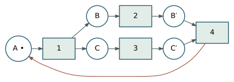
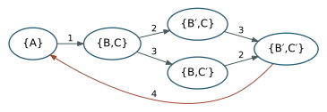
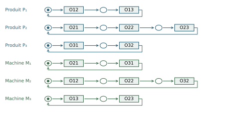
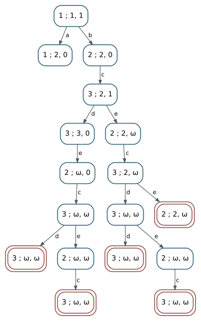
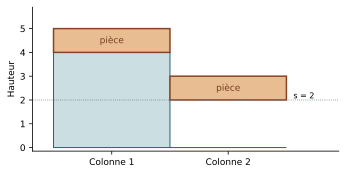

# ENS Ulm-Lyon · Informatique 1998 · Corrigé guidé

*Corrigé rédigé par IA, non officiel. Signalez toute erreur.*

**Rédaction** · GPT-6.2 Astra Ultra · vitesse non renseignée · 25 novembre 2026

Le cahier commun aux groupes C/S, M et I relie réseaux de Petri, configurations à compteurs, séries reconnaissables et hauteur d’un empilement. Dans un semi-anneau max-plus, le poids ordinaire zéro désigne un arc de poids nul et la valeur moins l’infini désigne l’absence d’arc.

## Repères

Dans les deux premières parties, vérifier séparément l’autorisation de tirer et le changement de marquage. Dans la troisième, un mot peut avoir plusieurs parcours et la loi d’addition décide comment combiner leurs poids. Dans la dernière, suivre les hauteurs colonne par colonne avant d’en prendre le maximum.

## I · Modélisation des ateliers

### Question 1 · Synchroniser les deux branches de l’atelier

**Indication.** Faire porter par un jeton l’autorisation d’exécuter une branche. Après la séparation, il faut deux jetons pour permettre les étapes indépendantes.

#### Solution

Notons $A$ la place « prêt à commencer », $B,C$ les autorisations pour 2 et 3, et $B',C'$ les indicateurs de fin correspondants. Les quatre transitions ont pour entrées et sorties

$$
t_1:A\to B+C,\quad t_2:B\to B',\quad t_3:C\to C',\quad t_4:B'+C'\to A .
$$

Le marquage initial est $\{A\}$. Après $t_1$ on a $\{B,C\}$. Les marquages suivants possibles sont $\{B',C\}$ et $\{B,C'\}$. Les deux branches rejoignent $\{B',C'\}$, depuis lequel seul $t_4$ permet de revenir à $\{A\}$. Ces cinq marquages sont tous accessibles et les franchissements indiqués épuisent leurs successeurs.

### Question 2 · Ordres des produits et des machines

**Indication.** Créer une transition par opération et deux familles de places, pour l’avancement de chaque produit et pour le tour de chaque machine.

#### Solution

Notons $O_{ij}$ le traitement du produit $P_i$ par la machine $M_j$. Pour chaque ligne du tableau ci-dessous, placer un jeton dans une place d’entrée, dessiner les transitions dans l’ordre donné et une place entre deux transitions consécutives. Une même transition $O_{ij}$ est **commune à ses deux lignes**. Le tir consomme donc les deux autorisations et produit les deux autorisations suivantes.

| File | Transitions dans l’ordre |
|---|---|
| $P_1$ | $O_{12},O_{13}$ |
| $P_2$ | $O_{21},O_{22},O_{23}$ |
| $P_3$ | $O_{31},O_{32}$ |
| $M_1$ | $O_{21},O_{31}$ |
| $M_2$ | $O_{12},O_{22},O_{32}$ |
| $M_3$ | $O_{13},O_{23}$ |

Pour des productions répétées, refermer chaque ligne sur sa place d’entrée. Pour un seul lot, remplacer le retour par une place terminale sans successeur. Le schéma représente le régime répété et marque d’un point la première autorisation de chaque ligne. Au départ $O_{12}$ et $O_{21}$ peuvent se tirer indépendamment. Aucune machine ne peut passer à son produit suivant sans avoir exécuté l’opération dont elle vient de recevoir l’autorisation.

## II · Systèmes d’addition et réseaux de Petri

### Question 3 · Lemme de l’infini de König

**Indication.** Tester la phrase imprimée sur l’arbre réduit à sa racine avant d’entreprendre la preuve.

#### Solution

L’assertion imprimée oublie l’hypothèse **« l’arbre a une infinité de sommets »**. Une racine seule forme un arbre localement fini qui ne contient aucun chemin infini. Avec cette hypothèse, le sous-arbre de la racine est infini. Si tous ses fils avaient un sous-arbre fini, leur réunion finie et la racine donneraient un ensemble fini. Il existe donc un fils de sous-arbre infini. Répéter ce choix indéfiniment. La profondeur croît d’une unité à chaque arc, donc les sommets obtenus sont tous distincts.

### Question 4 · Extraction croissante pour l’ordre produit

**Indication.** Commencer par une seule coordonnée, où l’on peut distinguer répétition infinie et fuite vers l’infini.

#### Solution

Dans $\overline{\mathbb N}=\mathbb N\cup\{+\infty\}$, si une valeur apparaît infiniment souvent, ces occurrences donnent une sous-suite constante. Sinon, $+\infty$ n’apparaît qu’un nombre fini de fois. Après l’indice courant, on peut choisir une valeur strictement supérieure à la valeur finie $m$ déjà retenue, car les $m+1$ valeurs de 0 à $m$ ne se rencontrent chacune qu’un nombre fini de fois. On obtient une sous-suite strictement croissante. Pour $n$ coordonnées, extraire successivement une sous-suite infinie non décroissante sur la première coordonnée, puis sur la deuxième, jusqu’à la dernière. Les propriétés déjà obtenues sont conservées. La sous-suite finale est croissante pour l’ordre produit.

### Question 5 · Simuler un réseau de Petri par additions de vecteurs

**Indication.** Un prélèvement et un dépôt dans la même place peuvent s’annuler dans le bilan tout en exigeant réellement un jeton.

#### Solution

Fixons l’ordre des places et posons $x(M)=(M(p))_{p\in P}$. Utiliser un état de repos $q$ et un état privé $q_t$ par transition. Dessiner deux arcs

$$
q\xrightarrow{-\mathbf1_{\mathrm{Pre}(t)}}q_t
\xrightarrow{+\mathbf1_{\mathrm{Post}(t)}}q.
$$

Le premier est franchissable exactement si toutes les entrées ont leur jeton. Depuis $q_t$, seul le second arc est offert, toujours franchissable. La paire effectue exactement un tir. Tout chemin de repos à repos est une concaténation de telles paires et tout tir du réseau se traduit par l’une d’elles. Les configurations $(q,x(M))$ sont en bijection avec les marquages. Un unique arc de bilan ne suffirait pas pour une place à la fois en entrée et en sortie.

La condition de faisabilité d’un préfixe se lit $x+v(a_1)+\cdots+v(a_i)\in\mathbb N^{|P|}$. Le $x$ initial a été omis dans la seconde formule imprimée de la question 5. La condition d’activation de la question 6 emploie bien le vecteur courant.

### Question 6 · Arbre de Karp et Miller

**Indication.** Accélérer une coordonnée seulement en comparant avec un ancêtre portant le même état de contrôle.

#### Solution

**a)** Écrivons $\omega=+\infty$. Depuis $(1;1,1)$, l’arc $a$ donne $(1;2,0)$ où plus aucun arc n’est possible. L’arc $b$ donne $(2;2,0)$ et $c$ donne $(3;2,1)$. Après $bce$, le vecteur provisoire $(2,1)$ en l’état 2 domine $(2,0)$, d’où le nœud $(2;2,\omega)$. Sur l’autre branche, $bcd$ donne $(3;3,0)$ et $bcde$ mène à $(2;\omega,0)$. Le dessin poursuit toutes les branches. Un double contour indique une répétition sur la branche courante. Deux nœuds de branches différentes peuvent porter la même étiquette sans que l’un ferme l’autre.

**b)** Pour un système à famille finie d’arcs, l’arbre est localement fini. S’il était infini, la question 3 corrigée donnerait une branche infinie. Une coordonnée passée à $\omega$ n’en redescend jamais. Après un certain rang, l’ensemble de ces coordonnées est donc constant. Dans cette queue, un même état de contrôle apparaît une infinité de fois. Extraire par 4 une sous-suite de vecteurs non décroissants aux occurrences de cet état. S’ils sont égaux en deux positions, la seconde coupe la branche. Sinon une coordonnée finie augmente strictement entre deux de ces positions. Après la stabilisation des coordonnées infinies, aucun nouveau remplacement par $\omega$ n’a lieu, donc la valeur brute au second nœud est sa valeur finale. Le premier nœud aurait alors imposé l’accélération de cette coordonnée, contradiction.

La finitude des arcs est ici nécessaire. La définition imprimée précise seulement un nombre fini de sommets et autorise les arcs parallèles. Avec une infinité de boucles distinctes de poids nul sur un sommet, la racine a une infinité de fils, tous immédiatement terminaux. Le résultat vise les systèmes finis usuels, notamment celui construit en 5.

## III · Automates à multiplicités

### Question 7 · Calcul de la série à multiplicité naturelle

**Indication.** Un parcours acceptant change une fois d’état. Identifier la lettre sur laquelle ce changement peut se produire.

#### Solution

Le vecteur initial porte le poids 1 en état 1, le terminal le poids 5 en état 2. Pour $r=|w|_a$ et $s=|w|_b$, si $r=0$, aucun passage de 1 à 2 n’est possible et le coefficient est nul. Sinon une des $r$ occurrences de $a$ accomplit ce passage au poids 1. Les autres $a$ ont chacun poids 2 et les $b$ poids 3 sur leurs boucles, quel que soit l’état. Chaque parcours pèse $5\,2^{r-1}3^s$. En sommant les $r$ choix,

$$
(S_{\mathcal A_2}\mid w)=5r\,2^{r-1}3^s\quad(r\ge1),\qquad (S_{\mathcal A_2}\mid w)=0\quad(r=0).
$$

En particulier le coefficient du mot vide vaut zéro.

### Question 8 · Retrouver la reconnaissance usuelle

**Indication.** Une alternative entre deux chemins exprime un « ou », une succession d’arcs exprime un « et ».

#### Solution

Prendre le semi-anneau booléen $\{0,1\}$ avec l’addition $\lor$ et le produit $\land$. Mettre 1 sur les états initiaux, les arcs présents et les états finaux, 0 ailleurs. Un produit le long d’un parcours vaut 1 exactement si le parcours est admissible de bout en bout. Le « ou » sur tous les parcours vaut donc 1 exactement pour les mots acceptés, même en présence d’ambiguïté.

### Question 9 · Interpréter un automate max-plus

**Indication.** Commencer par le poids d’un seul chemin. Repérer les deux occurrences qui permettent de quitter chacun des deux premiers états.

#### Solution

**a)** Le poids d’un parcours est la somme ordinaire des poids initial, des arcs et du poids final. Le coefficient est le maximum de ces sommes sur les parcours acceptants étiquetés par le mot. L’absence de parcours donne $-\infty$. Une flèche de poids ordinaire 0 existe et contribue 0 à la somme.

**b)** Le seul moyen de passer de 1 à 3 est de choisir deux $b$ distincts, le premier pour aller de 1 à 2, le second pour aller de 2 à 3. Seules les boucles $a$ dans l’état 2 rapportent un point chacune. S’il y a moins de deux $b$, le coefficient est $-\infty$. Sinon le maximum est le nombre de $a$ strictement entre **le premier et le dernier $b$** de $w$. En effet élargir ainsi l’intervalle d’un choix quelconque ne peut perdre aucun point. Deux $b$ consécutifs sans aucun $a$ entre le premier et le dernier donnent le coefficient ordinaire 0.

### Question 10 · Étoile d’une série propre

**Indication.** Pour le coefficient d’un mot fixé, regarder combien de facteurs non vides peuvent intervenir.

#### Solution

Le produit de Cauchy donne par récurrence $(S^n\mid w)=\sum_{u_1\cdots u_n=w}(S\mid u_1)\cdots(S\mid u_n)$, les facteurs gardant leur ordre. Pour $n=0$, la série unité donne $1_K$ sur le mot vide et $0_K$ ailleurs. Si $n>|w|$, chaque factorisation a un facteur vide. La propreté $(S\mid\varepsilon)=0_K$ et le caractère absorbant de $0_K$ annulent tous ses termes. Ainsi $\sum_{n\ge0}S^n$ se définit coefficient par coefficient avec seulement $n\le |w|$ à considérer et coïncide exactement avec l’étoile demandée.

### Question 11 · Deux expressions rationnelles

**Indication.** Isoler les boucles de chacun des états entre les franchissements obligatoires.

#### Solution

**a)** Sur $\mathbb N$, poser $L=2a+3b$. L’automate de la figure 6 reconnaît $5L^*aL^*$. Les deux étoiles décrivent respectivement les boucles avant et après l’arc $a$ qui change d’état. Chaque choix de cet arc produit un terme distinct dans le coefficient, comme en 7.

**b)** Sur $\mathcal M$, noter $[k]a$ la lettre $a$ affectée du poids ordinaire $k$, et $\oplus$ le maximum. Poser $U=[0]a\oplus[0]b$ et $V=[1]a\oplus[0]b$. La série est

$$
U^*\,([0]b)\,V^*\,([0]b)\,U^* .
$$

Les états extérieurs ne gagnent rien sur leurs boucles. Dans l’état du milieu chaque $a$ gagne un point. Les arguments des étoiles sont propres. Les deux facteurs $b$ ont poids ordinaire 0, élément neutre multiplicatif de $\mathcal M$.

### Question 12 · Construire un automate pour chaque opération rationnelle

**Indication.** Pour un produit de séries, enregistrer le moment où se termine la lecture du premier facteur. Garder l’ordre des coefficients même si leur multiplication ne commute pas.

#### Solution

La lettre $a$ se reconnaît avec deux états et un seul arc $a$ de poids $1_K$, du premier état initial au second état final. Pour une somme, juxtaposer les deux graphes sans les relier, en concaténant les vecteurs initiaux et finaux. Pour une multiplication à gauche par $k$, multiplier à gauche les poids des flèches initiales par $k$. La série unité $\mathbf1$ se reconnaît par un état initial et final de poids $1_K$ sans arc.

**Produit.** Soient $(I,A,F)$ et $(J,B,G)$ deux représentations de $R$ et $S$. Utiliser les états du premier automate puis ceux du second. Pour chaque lettre $a$, poser

$$
I'=\begin{pmatrix}I&(IF)J\end{pmatrix},\qquad
M'_a=\begin{pmatrix}A_a&A_aFJ\\0&B_a\end{pmatrix},\qquad
T'=\begin{pmatrix}0\\G\end{pmatrix}.
$$

Le départ directement dans le second bloc traite un préfixe vide, de poids $IF$. Sinon un arc inter-blocs termine la dernière lettre du premier facteur, multiplie par son poids final et par le poids initial du second. Il y a exactement un mode de traversée pour chaque coupure du mot. La somme donne $(RS\mid w)=\sum_{uv=w}(R\mid u)(S\mid v)$.

**Étoile.** Supposons $R$ propre, donc $IF=0_K$. Conserver $I,F$ et remplacer chaque matrice par $M_a=(\mathrm{Id}+FI)A_a$. Graphiquement, avant une lettre, on peut continuer dans le même facteur ou refermer le facteur précédent avec un poids de $F$ puis redémarrer avec un poids de $I$. Pour un mot non vide, $I(\mathrm{Id}+FI)=I$ car $IF=0_K$. Les choix restants correspondent aux coupures entre lettres successives. On obtient toutes les factorisations en facteurs non vides avec leur produit de poids. Le coefficient vide de cette représentation est zéro. Lui ajouter l’automate de $\mathbf1$ donne $R^*$. Cette construction fonctionne également si le semi-anneau admet des annulations dans ses sommes. Par induction sur l’expression, toute série rationnelle est reconnaissable.

### Question 13 · Extraire une expression rationnelle d’un automate

**Indication.** Mettre une lettre sur chaque entrée de matrice, puis éliminer un état à la fois en factorisant les visites consécutives à cet état.

#### Solution

Posons $M_A=\sum_{a\in A}M_a\,a$, série propre à coefficients dans $M_n(K)$. Pour $w=a_1\cdots a_k$, seul le degré $k$ de $M_A^*$ contribue, et son coefficient est $M_{a_1}\cdots M_{a_k}$. Pour le mot vide, il vaut la matrice identité. D’où $S_A=IM_A^*T$.

Pour prouver la rationalité scalaire des coefficients de cette représentation, ajouter un nouveau départ et une nouvelle arrivée. Du départ à l’état $i$, mettre la série constante $I_i\mathbf1$, et de $i$ à l’arrivée $T_i\mathbf1$. Entre états initiaux de la construction, l’arc $i\to j$ porte la série $R_{ij}=\sum_a (M_a)_{ij}a$. Un arc absent porte la série nulle. Éliminer un état interne $k$ en remplaçant, pour les autres sommets $i,j$,

$$
R_{ij}\ \longleftarrow\ R_{ij}+R_{ik}(R_{kk})^*R_{kj}.
$$

Les chemins nouveaux sont exactement ceux qui passent en $k$, y bouclent zéro ou plusieurs fois, puis en ressortent. La décomposition aux visites de $k$ est unique, ce qui préserve les multiplicités. Les boucles entre états internes sont propres, car tout parcours non vide de l’ancien graphe consomme une lettre. Les étoiles sont donc autorisées. Après la dernière élimination, l’arc départ–arrivée porte $S_A$ et n’a été construit qu’avec des opérations rationnelles. Les constantes se construisent par multiplication scalaire de $\mathbf1=0^*$.

## IV · Jeux de Tetris

### Question 14 · Empilement et matrices max-plus

**Indication.** La cote où se pose une pièce est déterminée par le premier contact avec un sommet déjà présent. Vérifier ensuite dans quel semi-anneau vivent les poids des transitions.

#### Solution

Notons $H_i(w)$ le sommet de la colonne $i$ après $w$, avec $H_i(\varepsilon)=0$. Pour une pièce $t$ de support $D$, son déplacement vertical et les hauteurs résultantes vérifient

$$
s=\max_{i\in D}(H_i(w)-b(t,i)),\qquad
H_j(wt)=\begin{cases}s+h(t,j)&j\in D,\\H_j(w)&j\notin D.\end{cases}
$$

Le minimum des cotes basses sur $D$ vaut zéro, donc $s\ge0$. Sur $\mathbb Z\cup\{-\infty\}$, la matrice pour $t$ a l’entrée $g_{ij}=h(t,j)-b(t,i)$ pour $i,j\in D$, la boucle de poids 0 en chaque $j\notin D$, et $-\infty$ ailleurs. Des poids initiaux et finaux nuls en chaque colonne donnent par maximum le sommet de l’empilement. Cependant les $g_{ij}$ peuvent être négatifs, tandis que le semi-anneau imposé par le sujet est $\mathcal M=\mathbb N\cup\{-\infty\}$. Voici comment conserver la même série dans ce dernier.

Soient $m=|E|$, $B$ le plus grand contour bas sur les supports des pièces, et $D_0=(m-1)B$ (prendre $B=0$ si l’alphabet est vide). Toute transition existante a un poids $g\ge-B$. En chaque colonne, **chaque lettre permet de rester sur place avec un poids non négatif**, puisque $h(t,i)\ge b(t,i)$ sur le support. Pour un mot fixé, choisir un chemin de poids total maximal. Toute sous-marche qui revient à sa colonne a un poids non négatif, sinon on l’améliorerait en restant dans cette colonne pendant les mêmes lettres. Toute portion du chemin perd au plus $D_0$. En effet, aller jusqu’à la dernière visite de sa première colonne, franchir une arête, puis répéter sur le suffixe restant. Les portions avant les dernières visites ont poids non négatif. Après chaque arête de liaison on ne revoit plus la colonne quittée, donc il y a au plus $m-1$ de ces arêtes.

Construire maintenant les états $(i,d)$, $0\le d\le D_0$. Le nombre $d$ est l’écart entre le meilleur poids cumulé déjà atteint sur ce chemin et son poids cumulé présent. Pour un arc $i\to j$ de poids entier $g$, poser

$$
d'=\max(0,d-g),\qquad g'=\max(0,g-d).
$$

Si $d'\le D_0$, mettre un arc $(i,d)\to(j,d')$ de poids **naturel** $g'$ pour la même lettre. Initialiser et terminer aux seuls états de la forme $(i,0)$, avec coefficient ordinaire 0. Les autres coefficients initial et final valent $-\infty$. En partant avec $d=0$, la somme des nouveaux poids mesure le maximum cumulé atteint par l’ancien chemin. À fin $d=0$, elle coïncide avec son poids final. Tout chemin accepté donne donc au plus la vraie hauteur. Inversement, le chemin optimal choisi tient dans la réserve $D_0$ par la borne sur les portions. Il finit avec $d=0$ car une hauteur antérieure strictement plus grande pourrait être conservée jusqu’au bout par les boucles, contredisant l’optimalité. L’automate fini sur $\mathcal M$ reconnaît bien la série des hauteurs. Pour le jeu sans emplacement et sans pièce, la notion de maximum doit d’abord recevoir une convention.

### Question 15 · Réaliser les dates d’un réseau temporisé par des pièces

**Indication.** Faire correspondre à chaque entrée une date de disponibilité requise et à chaque sortie une date de disponibilité produite. Une place commune à l’entrée et à la sortie doit satisfaire les deux conditions.

#### Solution

La durée associée à un mot dépendrait d’attentes arbitraires si l’on pouvait choisir librement toutes les dates. On prend les tirs **au plus tôt**, avec simultanéité possible pour les opérations indépendantes, et les mots effectivement franchissables. Les jetons initiaux sont disponibles à la date 0. Une place initialement vide a une date de libération initiale 0. Sur une place vide ensuite, $f$ désigne la date de libération, c’est-à-dire la frontière temporelle du retrait. Ces conventions donnent une hauteur initiale nulle à toutes les places.

Pour la transition $t$, la pièce occupe $D=\mathrm{Pre}(t)\cup\mathrm{Post}(t)$. Pour $p\in D$, ses deux cotes sont

| Rôle de la place $p$ | $b(t,p)$ | $h(t,p)$ |
|---|---:|---:|
| Entrée seule | $0$ | $0$ |
| Sortie seule | $\tau_t$ | $\tau_t+\tau_p$ |
| Entrée et sortie | $0$ | $\tau_t+\tau_p$ |

Ailleurs les deux cotes valent $-\infty$. En effet, si le début du tir est $s$, il faut $s\ge d(w,p)$ sur les entrées. Sur une sortie seule, le dépôt à $s+\tau_t$ doit avoir lieu après la libération antérieure, donc $s+\tau_t\ge f(w,p)$. La place étant sûre et le mot franchissable, on ne crée pas un second jeton. La plus petite date autorisée est la plus grande de ces contraintes, exactement le calcul de contact de 14. Après le tir, la date vaut $s$ sur une entrée seule et $s+\tau_t+\tau_p$ sur une sortie, et elle ne change pas ailleurs. Ainsi par induction $H_p(w)=T_{\mathcal P}(w)_p$, puis $h_{\mathcal T}(w)=\max_p T_{\mathcal P}(w)_p$.

Un tir sans aucune entrée mais avec une sortie serait répétable arbitrairement dans le réseau ordinaire et contredirait la sûreté. Une transition sans entrée ni sortie laisse le vecteur inchangé et se représente, si nécessaire, par une pièce de hauteur nulle sur une colonne quelconque.

**Figure 1.** Le tableau donne pour chaque pièce ses colonnes occupées, avec le couple (bas, haut). Les autres colonnes sont absentes.

| Pièce | Colonnes et cotes |
|---|---|
| $t_1$ | $p_1:(0,0)$, $p_2:(1,1)$, $p_3:(0,0)$, $p_4:(0,3)$ |
| $t_2$ | $p_1:(2,3)$, $p_2:(0,0)$, $p_3:(2,2)$ |
| $t_3$ | $p_3:(0,0)$, $p_5:(2,2)$, $p_6:(0,0)$ |
| $t_4$ | $p_3:(1,1)$, $p_4:(0,3)$, $p_5:(0,0)$, $p_6:(1,1)$ |

Par exemple $t_1$ peut commencer à 0. Le jeton de $p_2$ est disponible à 1 et celui de $p_4$ à 3. Le tir $t_2$ peut commencer à 1 et rend $p_1$ à nouveau disponible à 4. La hauteur maximale après $t_1t_2$ est donc 4.
