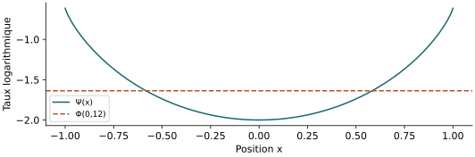
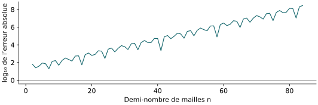

# Maths PSI — PSI 1998 — Corrigé guidé

*Corrigé rédigé par IA, non officiel. Signalez toute erreur.*

**Rédaction** · GPT-6.2 Astra Ultra · vitesse non renseignée · 26 novembre 2026

Sur $I=[a,b]$, les $n$ nœuds d’interpolation $a_1,\ldots,a_n$ sont intérieurs. On pose $S(t)=\prod_{j=1}^n(t-a_j)$ et $h=\max_{0\leq j\leq n}(a_{j+1}-a_j)$ avec $a_0=a$, $a_{n+1}=b$. L’interpolation équidistante de la partie III emploie $2n-1$ nœuds.

École polytechnique et École normale supérieure de Cachan · 4 h. [Énoncé](https://www.sujetsetcorriges.fr/dl/X/Maths/PSI/sec-x-1998-maths-PSI.pdf)

## Préliminaires

### 0.1. Zéro de la dérivée seconde

**Indication.** Appliquer Rolle sur deux intervalles disjoints.

Entre les premier et deuxième zéros, puis entre les deuxième et troisième, $\phi'$ a un zéro. Entre ces deux derniers, $\phi''$ s’annule à son tour.

### 0.2.1. Dérivées hors de l’origine

**Indication.** Dériver un produit en posant $u=1/x$.

Poser $P_0=1$. Puisque $u'=-u^2$, la dérivée de $P_m(u)e^{-u^2}$ est $P_{m+1}(u)e^{-u^2}$ avec $P_{m+1}(u)=-u^2P'_m(u)+2u^3P_m(u)$. Ce sont des polynômes, d’où la récurrence.

### 0.2.2. Prolongement lisse

**Indication.** Contrôler à la fois les dérivées et leurs quotients par $x$.

Tout polynôme en $1/x$, même multiplié par $1/x$, tend vers zéro après multiplication par $e^{-1/x^2}$ lorsque $x\to0$. En partant de $f(0)=0$, cela montre par récurrence que chaque dérivée prolongée vaut zéro et qu’elle est continue en zéro. Ainsi $f\in C^\infty$.

### 0.3. Comparer deux vitesses de croissance

**Indication.** Diviser d’abord la différence par $n$.

On a $(u_n-v_n)/n\to l-l'>0$. Pour $n$ assez grand, $u_n-v_n\geq n(l-l')/2\to+\infty$.

### 0.4. Écart à un rationnel

**Indication.** Multiplier par le facteur conjugué.

Le nombre entier $n^2-2k^2$ est non nul pour $n\geq1$. Puisque $|k/n|\leq1$,

$$\left|\frac1{\sqrt2}-\frac kn\right|\left|\frac1{\sqrt2}+\frac kn\right|=\frac{|n^2-2k^2|}{2n^2}\geq\frac1{2n^2}.$$

On peut prendre $C=1/(2+\sqrt2)$.

## Partie I — Polynôme et erreur d’interpolation

### 1.1. Existence

**Indication.** Construire des polynômes prenant la valeur un en un seul nœud.

Les polynômes $\ell_i(t)=\prod_{j\ne i}(t-a_j)/(a_i-a_j)$ ont degré au plus $n-1$ et $\ell_i(a_j)=\delta_{ij}$. Ainsi $L(f)=\sum_i f(a_i)\ell_i$ convient.

### 1.2. Unicité

**Indication.** Compter les racines de la différence.

Deux candidats de degré au plus $n-1$ ont une différence de même degré maximal avec $n$ racines distinctes. Cette différence est nulle.

### 1.3. Deux nœuds

**Indication.** Écrire les deux fonctions cardinales.

On obtient la fonction affine $L(f)(t)=f(a_1)(a_2-t)/(a_2-a_1)+f(a_2)(t-a_1)/(a_2-a_1)$.

### 1.4. Un degré prescrit

**Indication.** Prendre une fonction déjà reproduite par l’interpolation.

Pour $n\geq2$, $f(t)=t^{n-2}$ convient, même pour $n=2$ où elle vaut $1$. Son degré est $n-2$ et l’unicité donne $L(f)=f$.

### 2.1. Écarter les nœuds

**Indication.** Que deviennent les deux termes du reste aux nœuds ?

Si $x=a_j$ est intérieur, $L(f)(a_j)=f(a_j)$ et $S(a_j)=0$. Toute valeur de $\xi$ convient. Aux autres points, y compris les extrémités, $S(x)\ne0$.

### 2.2. Un seul nœud

**Indication.** Prendre le taux d’accroissement depuis $a_1$.

Le polynôme vaut constamment $f(a_1)$. Par les accroissements finis, il existe $\xi$ entre $a_1$ et $x$ tel que $f(x)-f(a_1)=f'(\xi)(x-a_1)$.

### 2.3.a. Fixer le multiplicateur

**Indication.** Évaluer la fonction auxiliaire au point $x$.

Pour $\phi(t)=f(t)-L(f)(t)-\lambda S(t)$, l’unique choix est $\lambda=(f(x)-L(f)(x))/S(x)$.

### 2.3.b. Trois zéros

**Indication.** Ajouter aux deux nœuds le point imposé.

Les zéros sont $a_1,a_2,x$. Ils sont distincts. Pour $x$ intérieur ils appartiennent tous à $]a,b[$. À une extrémité, les trois zéros se trouvent dans $[a,b]$ et les deux applications de Rolle produisent encore des points strictement intérieurs.

### 2.3.c. Reste pour deux nœuds

**Indication.** Calculer la dérivée seconde de la fonction auxiliaire.

Rolle fournit $\xi$ tel que $\phi''(\xi)=f''(\xi)-2\lambda=0$. Ainsi $f(x)=L(f)(x)+f''(\xi)S(x)/2$.

### 2.4. Reste général

**Indication.** Appliquer Rolle successivement à une même fonction auxiliaire.

Avec le même choix de $\lambda$, $\phi$ possède $n+1$ zéros distincts. En appliquant Rolle $n$ fois, on trouve $\phi^{(n)}(\xi)=0$ avec $\xi\in I$. Comme $L(f)^{(n)}=0$ et $S^{(n)}=n!$, on obtient $f(x)-L(f)(x)=f^{(n)}(\xi)S(x)/n!$.

## Partie II — Majorations uniformes

### 3.1. Petites subdivisions

**Indication.** Classer les facteurs par distance au nœud voisin.

Pour $n=1$, $|x-a_1|\leq h$. Pour deux nœuds, si $x$ est entre eux, les deux facteurs sont majorés en module par $h$. Dans un intervalle extrême, les deux majorants sont $h,2h$. Donc $|S(x)|\leq2h^2$.

### 3.2. Intervalles extrêmes

**Indication.** Compter les intervalles élémentaires à franchir.

Si $a_0\leq x<a_1$, alors $a_p-x\leq ph$. Si $a_n<x\leq a_{n+1}$, alors $x-a_p\leq(n+1-p)h$. Dans chaque cas, la multiplication donne $n!h^n$.

### 3.3. Deux produits à l’intérieur

**Indication.** Numéroter les facteurs à partir du voisin de $x$.

Pour $a_j<x<a_{j+1}$, on a $x-a_p\leq(j+1-p)h$ si $p\leq j$ et $a_q-x\leq(q-j)h$ si $q>j$. Ainsi le produit pour $1\leq p\leq j-1$ est au plus $j!h^{j-1}$ et celui pour $j+1\leq q\leq n$ est au plus $(n-j)!h^{n-j}$. Un produit vide vaut un.

### 3.4. Assemblage

**Indication.** Rétablir le facteur d’indice $j$.

Le facteur restant est $x-a_j\leq h$. Donc $|S(x)|\leq j!(n-j)!h^n\leq n!h^n$. Les points extrêmes sont traités en 3.2, les nœuds annulent $S$.

### 4.1. Sinus et exponentielle

**Indication.** Contrôler simultanément toutes les dérivées par une même constante.

Les dérivées de $\sin(\omega x)$ ont module au plus $|\omega|^m$ pour l’ordre $m$, et celles de $e^{\omega x}$ au plus $|\omega|^m\max_I e^{\omega x}$. Choisir $M=\max(1,|\omega|,\max_I e^{\omega x})$ donne le majorant $M^{m+1}$ pour les deux fonctions.

### 4.2. Polynômes

**Indication.** Seul un nombre fini de normes de dérivées intervient.

Pour un polynôme de degré $d$, prendre $M\geq1$ et $M\geq\max_{0\leq m\leq d}\|P^{(m)}\|_\infty^{1/(m+1)}$. Les dérivées d’ordres supérieurs sont nulles. Le polynôme appartient à $E_M$.

### 4.3. Développement de Taylor

**Indication.** Estimer le reste par une factorielle.

La formule imprimée autour de zéro suppose $0\in I$ pour que $f^{(m)}(0)$ soit défini. Dans ce cas la série est absolument dominée par $M e^{M|x|}$, et le reste de Taylor jusqu’à l’ordre $m$ vaut en module au plus $M(M|x|)^{m+1}/(m+1)!$, qui tend vers zéro. La somme est donc $f(x)$. Pour un intervalle ne contenant pas zéro, le même résultat se formule autour de n’importe quel $x_0\in I$ avec les puissances de $x-x_0$.

### 4.4. Une fonction plate

**Indication.** Comparer la fonction à sa série en zéro.

Toutes les dérivées en zéro de la fonction de 0.2 sont nulles. Si elle était dans $E$, 4.3 l’imposerait identiquement nulle, alors qu’elle est strictement positive ailleurs. Elle n’appartient pas à $E$.

### 5. Convergence sur une maille de pas décroissant

**Indication.** Combiner le reste de I et la majoration de $S$.

Pour $f\in E_M$ et une subdivision de longueur $m$, $\|f-L_m(f)\|_\infty\leq M(Mh(\sigma_m))^m$. Le pas tend vers zéro, donc $Mh(\sigma_m)\leq1/2$ à partir d’un certain rang. Le majorant tend vers zéro.

## Partie III — Interpolation équidistante et phénomène de Runge

### 6.1. Parité du produit nodal

**Indication.** Regrouper les nœuds opposés.

Les facteurs associés aux nœuds non nuls $\pm a_j$ donnent $t^2-a_j^2$. La subdivision symétrique contient le nœud intérieur zéro si et seulement si $n$ est impair. Ainsi $S(-t)=(-1)^n S(t)$.

### 6.2. Identité exacte en degré impair

**Indication.** Évaluer le quotient polynomial en $i\alpha$.

Le polynôme $L=L(f_\alpha)$ est pair par unicité et symétrie. Le polynôme pair $Q=1-(t^2+\alpha^2)L$ s’annule aux $n$ nœuds. Si $n$ est impair, $\deg Q\leq n+1$ ; $Q/S$ est impair et de degré au plus un, donc vaut $ct$. En $i\alpha$, $Q=1$ et $S(i\alpha)\ne0$. Ainsi $Q(t)=tS(t)/(i\alpha S(i\alpha))$.

### 6.3. Cas pair

**Indication.** Utiliser aussi la parité pour améliorer le degré maximal de $L$.

Si $n$ est pair, $L$ est pair et de degré au plus $n-2$. Le quotient $Q/S$ est constant car $\deg Q\leq n$ et vaut $1/S(i\alpha)$. Donc $1-(t^2+\alpha^2)L(t)=S(t)/S(i\alpha)$.

### 7.1. Calcul de $\Phi$

**Indication.** Réduire l’intégrale paire à $[0,1]$ puis intégrer par parties.

Pour $\alpha>0$, on calcule

$$\Phi(\alpha)=\int_0^1\log(t^2+\alpha^2)\,dt=\log(1+\alpha^2)-2+2\alpha\arctan(1/\alpha).$$

La limite en zéro est $-2$. La fonction est strictement croissante, ce qui suit de l’intégrande ou de $\Phi'(\alpha)=2\arctan(1/\alpha)>0$.

### 7.2. Potentiel au point imaginaire

**Indication.** Reconnaître une somme de Riemann.

Pour $P_n(t)=\prod_{k=-n+1}^{n-1}(t-k/n)$, on a $n^{-1}\log|P_n(i\alpha)|=(2n)^{-1}\sum_{k=-n+1}^{n-1}\log(\alpha^2+(k/n)^2)$. La fonction est continue sur $[-1,1]$, et la suppression d’un ou deux termes extrêmes ne modifie pas la limite $\Phi(\alpha)$.

### 8.1. Localiser les voisins du point irrationnel

**Indication.** Prendre la partie entière et utiliser la marge jusqu’aux extrémités.

Posons $x_*=1/\sqrt2$ et $k=\lfloor nx_*\rfloor$. L’irrationalité donne $k<nx_*<k+1$. Comme $k/n\to x_*\in]-1,1[$, pour $n$ assez grand $k+2\leq n-1$ et $k-2\geq-n$.

### 8.2. Potentiel sur l’intervalle

**Indication.** Scinder l’intégrale à la singularité et employer $u\log u-u$.

Avec la convention $0\log0=0$, on trouve

$$\Psi(x)=(1+x)\log(1+x)+(1-x)\log(1-x)-2.$$

Elle est paire et strictement croissante sur $[0,1]$, car $\Psi'(x)=\log((1+x)/(1-x))>0$ pour $0<x<1$. Ainsi $\Psi(x_*)>\Psi(0)=-2$. L’intégrale de $\log|t-x_*|$ entre $(k-1)/n$ et $(k+2)/n$ tend vers zéro par intégrabilité locale, les deux bornes tendant vers $x_*$.

### 8.3. Deux termes les plus proches

**Indication.** Utiliser la minoration diophantienne, même lorsque le point est presque sur la grille.

Pour chacun des deux voisins, $C/n^2\leq|p/n-x_*|\leq1/n$ par 0.4. En divisant le logarithme par $n$, les bornes $(\log C-2\log n)/n$ et $-\log n/n$ tendent vers zéro. Les deux limites sont nulles.

### 8.4. Sommes de rectangles monotones

**Indication.** Sur chaque cellule éloignée de la singularité, ordonner les deux valeurs aux extrémités.

Notons $\psi_p=\psi(p/n)$. À droite, pour $p\geq k+1$, $\psi_{p+1}/n\leq\int_{p/n}^{(p+1)/n}\psi\leq\psi_p/n$. À gauche, pour $p\leq k-1$, la croissance donne $\psi_p/n\leq\int_{p/n}^{(p+1)/n}\psi\leq\psi_{p+1}/n$, avec les indices dans la grille.

### 8.5. Encadrement des deux intégrales

**Indication.** Somme les bornes sur les cellules complètes et retranche le terme de bord convenable.

Posons $R_n=n^{-1}\sum_{p=k+2}^n\psi_p$ et $L_n=n^{-1}\sum_{p=-n}^{k-1}\psi_p$. En sommant à droite et à gauche respectivement, on obtient

$$R_n-\psi_{k+2}/n\leq\int_{(k+2)/n}^1\psi\leq R_n-\psi_n/n,$$

$$L_n-\psi_{k-1}/n\leq\int_{-1}^{(k-1)/n}\psi\leq L_n-\psi_{-n}/n.$$

### 8.6. Convergence de la somme singulière

**Indication.** Prendre l’opposé du logarithme pour respecter les sens de monotonie demandés.

Choisissons $\psi(t)=-\log|t-x_*|$. Elle croît à gauche et décroît à droite. Les termes $\psi_{k-1},\psi_{k+2}$ sont $O(\log n)$ car les distances sont comprises entre $1/n$ et $2/n$. Les deux encadrements et l’intégrale centrale de 8.2 prouvent que la somme des logarithmes sur les deux morceaux, divisée par $n$, tend vers $\Psi(x_*)$. Les deux voisins supprimés ont des contributions nulles à la limite par 8.3 et les extrémités également. On a donc $n^{-1}\log|P_n(x_*)|\to\Psi(x_*)$. La somme imprimée à la fin de la page 6 comporte $p\in\mathbb N$ malgré la borne $-n<p<n$. Pour le produit défini page 5 et l’intégrale sur $[-1,1]$, l’indice est entier relatif. En ne retenant que les naturels, on n’obtient que l’intégrale sur $[0,1]$.

### 9. Divergence de l’erreur

**Indication.** Comparer les taux exponentiels du numérateur et du dénominateur avant de discuter le signe.

Choisissons $\alpha_0>0$ assez petit pour que $\Phi(\alpha_0)<\Psi(x_*)$, possible par 7.1 et 8.2. La formule 6.2 donne pour $x=x_*$ un taux $n^{-1}\log|R_n(f_{\alpha_0})(x)-f_{\alpha_0}(x)|\to\Psi(x)-\Phi(\alpha_0)>0$. L’erreur tend donc vers l’infini **en module**. $f_{\alpha_0}\notin E$ par 5. Si « vers l’infini » est compris comme une limite signée $+\infty$, la demande est fausse. Pour $x\in]0,1[$ irrationnel, le signe de $R_n-f$ est $(-1)^{\lfloor nx\rfloor}$ par appariement des facteurs de $P_n$ en 6.2. Les deux parités reviennent indéfiniment. Pour $x$ rationnel intérieur, l’erreur est nulle sur une sous-suite de grilles. Les points négatifs donnent le même comportement par parité.

### 10. Points ayant une minoration rationnelle

**Indication.** Repérer à quel endroit précis $1/\sqrt2$ a été utilisé.

Pour $x\in A$, $x$ est irrationnel et intérieur. Avec $k=\lfloor nx\rfloor$, la décomposition de 8.1–8.6 reste valable. Les deux logarithmes délicats se minorent cette fois par $\log C-r\log n$ et se majorent par $-\log n$. Leur contribution divisée par $n$ tend encore vers zéro. Le reste est une somme de Riemann découpée de la même façon. On obtient $\lim n^{-1}\log|P_n(x)|=\Psi(x)$.

### 11. Intervalle de convergence

**Indication.** Comparer deux fonctions strictement croissantes, puis justifier la maximalité par la densité de $A$.

Sur $A$, la formule exacte donne convergence lorsque $\Psi(x)<\Phi(\alpha)$ et divergence en module lorsque $\Psi(x)>\Phi(\alpha)$. Comme $\Psi(0)=-2$ et $\Psi(1)=2\log2-2$, si $\Phi(\alpha)<\Psi(1)$ il existe un unique $c_\alpha\in]0,1[$ tel que $\Psi(c_\alpha)=\Phi(\alpha)$ et $J_\alpha=]-c_\alpha,c_\alpha[$. Sinon $J_\alpha=]-1,1[$. La frontière où les taux coïncident ne change pas cette réponse sur les intervalles ouverts. La maximalité vient de la densité de $A$ : les nombres $q+\sqrt2/m$ avec $q\in\mathbb Q$ et $m\in\mathbb N^*$ qui appartiennent à l’intervalle sont des irrationnels quadratiques, donc sont dans $A$ par l’argument de 12.

Pour savoir quand $\alpha\in J_\alpha$, il faut $0<\alpha<1$. Sur cet intervalle $D(\alpha)=\Phi(\alpha)-\Psi(\alpha)$ est strictement concave car $D''=-2/(1+\alpha^2)-2/(1-\alpha^2)<0$. Ses limites aux extrémités sont $0$ et $\pi/2-\log2>0$. La corde donne $D(\alpha)>0$ partout entre les deux. L’ensemble demandé est donc $]0,1[$.

### 12. Nombres algébriques irrationnels

**Indication.** Évaluer le polynôme entier en une fraction, puis isoler la racine considérée.

Dans le domaine $x_0\in[-1,1]$ de définition de $A$, un polynôme entier $Q$ ayant une racine irrationnelle a degré $r\geq2$. Sur un voisinage de $x_0$ ne contenant aucune autre racine, $Q(k/n)\ne0$ et $n^rQ(k/n)$ est entier, donc $|Q(k/n)|\geq n^{-r}$. Les accroissements finis donnent $|Q(k/n)|\leq M|k/n-x_0|$ avec $M=\max_{[-1,1]}|Q'|>0$. Hors du voisinage, la distance à $x_0$ a une minoration indépendante de $n$. Le minimum des constantes obtenues convient. La condition imprimée $Q'(x_0)\ne0$ suffit et l’argument fonctionne même sans elle. Si l’on autorise littéralement $x_0$ hors de $[-1,1]$, l’appartenance à $A$ est impossible par définition, par exemple pour $\sqrt2$.
