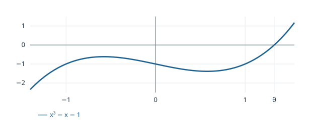

# École polytechnique — Deuxième composition de mathématiques MP 1998 · Corrigé guidé

*Corrigé rédigé par IA, non officiel. Signalez toute erreur.*

**Rédaction** · GPT-6.2 Astra Ultra · vitesse non renseignée

Pour $K\subset\mathbb C$, $K[\alpha]$ est l’image de l’évaluation $K[X]\to\mathbb C$ en $\alpha$, et $I_K(\alpha)$ son noyau. Les parties suivantes relient polynôme minimal, plongements complexes, trace et discriminant.

## I. Polynôme minimal

### Question 1.a

> [!INDICATION]
> Une relation linéaire entre les puissances est une relation polynomiale. Réciproquement, considérer le reste d’une division.

#### Solution

En dimension finie, $1,\alpha,\alpha^2,\ldots$ est liée, donc un polynôme non nul s’annule en $\alpha$. Si $Q(\alpha)=0$ avec $\deg Q=d$, la division de tout polynôme par $Q$ montre que son évaluation appartient à l’espace engendré par $1,\ldots,\alpha^{d-1}$. La dimension est finie.

### Question 1.b

> [!INDICATION]
> Choisir une relation unitaire de degré minimal. Que devient le reste de la division de toute autre relation ?

#### Solution

Choisissons dans $I_K(\alpha)$ un polynôme unitaire $P$ de degré minimal. Pour $Q$ dans cet idéal, le reste modulo $P$ appartient encore à l’idéal, donc est nul par minimalité. Ainsi $I_K(\alpha)=(P)$. Deux générateurs unitaires se divisent mutuellement et coïncident. Si $P=UV$ avec $U,V$ de degrés positifs, l’un des deux s’annule en $\alpha$ puisque $\mathbb C$ est intègre, ce qui contredit la minimalité. Cette unicité porte sur le générateur unitaire annulateur, comme le précise la désignation « polynôme minimal » du sujet.

### Question 1.c

> [!INDICATION]
> Examiner à la fois la liberté et la génération des premières puissances.

#### Solution

Si $\deg P=d$, les puissances $1,\ldots,\alpha^{d-1}$ engendrent $K[\alpha]$ par division euclidienne. Elles sont libres, faute de relation de degré inférieur à $d$. Donc $\dim_KK[\alpha]=d$.

### Question 1.d

> [!INDICATION]
> Trouver l’inverse d’une classe non nulle par Bézout.

#### Solution

Si $Q(\alpha)\ne0$, $P$ ne divise pas $Q$ et l’irréductibilité de $P$ donne $\gcd(P,Q)=1$. Une identité $UP+VQ=1$ donne $V(\alpha)Q(\alpha)=1$. L’anneau $K[\alpha]$ est donc un corps.

### Question 2.a

> [!INDICATION]
> Un polynôme de degré deux sans racine rationnelle est irréductible sur $\mathbb Q$.

#### Solution

$X^2-2$ annule $\sqrt2$. Si une fraction irréductible $a/b$ en était racine, $a^2=2b^2$ forcerait $a$, puis $b$, à être pairs. Donc son polynôme minimal est $X^2-2$.

### Question 2.b

> [!INDICATION]
> Étudier d’abord le carré de $\alpha$ dans $\mathbb Q(\sqrt5)$. Le conjugué réel de ce carré est-il positif ?

#### Solution

Écrivons $\varphi=(1+\sqrt5)/2=\alpha^2$. Alors $\varphi^2-\varphi-1=0$, donc $X^4-X^2-1$ annule $\alpha$. Le corps $F=\mathbb Q[\varphi]=\mathbb Q[\sqrt5]$ a degré deux, car $5$ n’est pas un carré rationnel. Si $\varphi$ était le carré d’un élément de $F$, son image par $u+v\sqrt5\mapsto u-v\sqrt5$ serait un carré réel. Or $(1-\sqrt5)/2<0$. Ainsi $X^2-\varphi$ est irréductible sur $F$ et $\{1,\alpha\}$ est une $F$-base de $F[\alpha]=\mathbb Q[\alpha]$. En développant les coefficients sur la base $(1,\sqrt5)$, on trouve le degré quatre sur $\mathbb Q$. Le polynôme unitaire de degré quatre déjà trouvé est donc minimal.

## II. Plongements et générateurs

### Question 3

> [!INDICATION]
> Comparer un polynôme irréductible à son polynôme dérivé.

#### Solution

En caractéristique zéro, $P'$ est non nul et de degré inférieur à $P$. L’irréductibilité donne $\gcd(P,P')=1$ dans $K[X]$. Leur identité de Bézout exclut toute racine complexe commune, donc toute racine multiple de $P$.

### Question 4.a

> [!INDICATION]
> Vérifier que l’évaluation en $\lambda_i$ ne dépend pas du représentant d’un élément de $K[\alpha]$.

#### Solution

Définissons $\sigma_i(Q(\alpha))=Q(\lambda_i)$. Si deux polynômes ont même valeur en $\alpha$, leur différence est multiple du polynôme minimal, qui s’annule en $\lambda_i$. La formule est donc bien définie et préserve somme, produit et scalaires. Elle envoie $\alpha$ sur $\lambda_i$ et tout morphisme ayant cette propriété vérifie nécessairement la formule, d’où l’unicité.

### Question 4.b

> [!INDICATION]
> Appliquer un morphisme quelconque à la relation minimale de $\alpha$.

#### Solution

Si $\sigma$ est un morphisme de $K$-algèbres, $P_K(\alpha)(\sigma(\alpha))=0$ car ses coefficients sont fixés. Ainsi $\sigma(\alpha)$ est l’une des $n$ racines distinctes et 4.a identifie $\sigma$ au morphisme correspondant. La liste est exhaustive.

### Question 5

> [!INDICATION]
> Combien de racines distinctes doit alors posséder le polynôme minimal de $\beta$ ?

#### Solution

$\beta\in K[\alpha]$ est algébrique par dimension finie. Son polynôme minimal s’annule en chaque $\sigma_i(\beta)$, donc a degré au moins $n$ si ces valeurs sont distinctes. Par 1.c, $K[\beta]\subset K[\alpha]$ a alors dimension au moins $n$, donc les deux corps sont égaux.

### Question 6

> [!INDICATION]
> Écrire $\beta$ comme $t\alpha+(\beta-t\alpha)$. Pour quelles valeurs de $t$ deux images de l’un de ces éléments coïncident-elles ?

#### Solution

Pour $i\ne j$, $\sigma_i(\alpha)-\sigma_j(\alpha)\ne0$. Les images de $\beta-t\alpha$ ne peuvent coïncider que pour $t=(\sigma_i(\beta)-\sigma_j(\beta))/(\sigma_i(\alpha)-\sigma_j(\alpha))$. Il suffit d’exclure ces valeurs et $0$. Le corps $K$ contient $\mathbb Q$, donc possède un $t$ en dehors de cette liste finie. Alors $\beta_1=t\alpha$ engendre $K[\alpha]$ et les images de $\beta_2=\beta-t\alpha$ sont distinctes, donc $\beta_2$ l’engendre aussi par 5. Leur somme est $\beta$.

## III. Trace et discriminant

### Question 7

> [!INDICATION]
> Développer d’abord sur la base $(e_r)$ puis sur les puissances de $\alpha$.

#### Solution

Désormais $K=\mathbb Q[\theta]$, $F=\mathbb Q[\alpha]$, $m=[F:\mathbb Q]$ et $d=[K:F]$. Tout $x\in K$ admet une écriture unique $\sum_r b_re_r$ avec $b_r\in F$. À leur tour les $b_r$ s’écrivent de façon unique $\sum_{p=0}^{m-1}b_{pr}\alpha^p$ avec $b_{pr}\in\mathbb Q$. Les $\alpha^pe_r$ forment donc une $\mathbb Q$-base et $n=md$.

### Question 8.a

> [!INDICATION]
> Ordonner la base précédente par blocs à $r$ fixé puis reconnaître une matrice compagnon.

#### Solution

Soit $P=X^m+c_{m-1}X^{m-1}+\cdots+c_0$ le polynôme minimal de $\alpha$ sur $\mathbb Q$. Sur le sous-espace $\mathbb Q[\alpha]e_r$, $M_\alpha$ décale les puissances, puis $\alpha^me_r=-\sum_{j<m}c_j\alpha^je_r$. Il a pour matrice le compagnon de $P$. Son polynôme caractéristique est $P$ car Cayley–Hamilton fournit un polynôme annulateur unitaire de degré $m$, et l’évaluation en $e_r$ oblige cet annulateur à être divisible par $P$. Les $d$ blocs donnent $\Delta_\alpha=P^d$.

### Question 8.b

> [!INDICATION]
> Utiliser les plongements sur la base $1,\theta,\ldots,\theta^{n-1}$ pour diagonaliser simultanément les multiplications.

#### Solution

Dans cette base, la matrice $V=(\sigma_i(\theta)^{j-1})_{i,j}$ est inversible par Vandermonde et 3. Si $M$ représente $M_\alpha$, appliquer tous les $\sigma_i$ à $\alpha x$ donne $VM=\operatorname{diag}(\sigma_1(\alpha),\ldots,\sigma_n(\alpha))V$. Le passage aux matrices complexes conserve la trace, d’où $\operatorname{Tr}(M_\alpha)=\sum_i\sigma_i(\alpha)$, même lorsque certaines images de $\alpha$ coïncident.

### Question 9

> [!INDICATION]
> Former la matrice des plongements en colonnes et multiplier par sa transposée sans conjugaison.

#### Solution

Soit $B=(\sigma_i(\alpha_j))_{i,j}$. En 8.b, la trace de la multiplication par $\alpha_i\alpha_j$ vaut $\sum_k\sigma_k(\alpha_i)\sigma_k(\alpha_j)$. La matrice de ces traces est donc $B^{\mathsf T}B$ et $D(\alpha_1,\ldots,\alpha_n)=(\det B)^2$.

### Question 10

> [!INDICATION]
> La matrice $A$ agit sur les indices qui énumèrent les éléments de la famille.

#### Solution

Par rationalité de $A$, la matrice des images des $\beta_i=\sum_pA_{i,p}\alpha_p$ est $BA^{\mathsf T}$. En prenant le carré de son déterminant on trouve $D(\beta_1,\ldots,\beta_n)=(\det A)^2D(\alpha_1,\ldots,\alpha_n)$, y compris pour $A$ singulière.

### Question 11

> [!INDICATION]
> Écrire le carré du Vandermonde, puis grouper les facteurs du produit ordonné par paires opposées.

#### Solution

Posons $\lambda_i=\sigma_i(\theta)$. Par 9, $D(1,\theta,\ldots,\theta^{n-1})=\prod_{i<j}(\lambda_j-\lambda_i)^2$. Dans $\prod_{i\ne j}(\lambda_i-\lambda_j)$, chaque paire non ordonnée fournit le négatif de ce carré. Il faut donc multiplier le produit ordonné par $(-1)^{n(n-1)/2}$ pour obtenir $D$.

### Question 12

> [!INDICATION]
> Comparer la famille à la base des puissances de $\theta$.

#### Solution

La base $(1,\theta,\ldots,\theta^{n-1})$ a un discriminant non nul par 11, ses conjugués étant distincts. La formule 10 donne un discriminant non nul pour $(\alpha_i)$ exactement lorsque sa matrice des coordonnées a un déterminant non nul, c’est-à-dire exactement lorsqu’elle est une $\mathbb Q$-base.

### Question 13.a

> [!INDICATION]
> Évaluer le cubique aux deux points critiques.

#### Solution

Pour $P(x)=x^3-x-1$, $P'(x)=3x^2-1$. Le maximum local, en $-1/\sqrt3$, vaut $2/(3\sqrt3)-1<0$ et le minimum local, en $1/\sqrt3$, vaut $-2/(3\sqrt3)-1<0$. La croissance jusqu’au premier point critique, la décroissance entre les deux puis la croissance jusqu’à $+\infty$ donnent une unique racine réelle $\theta$. De plus $P(1)<0<P(2)$.

### Question 13.b

> [!INDICATION]
> Un cubique réductible sur $\mathbb Q$ possède un facteur linéaire.

#### Solution

Les seules racines rationnelles possibles du cubique unitaire à terme constant $-1$ sont $1$ et $-1$. Ni l’une ni l’autre ne l’annule. Il est donc irréductible et le polynôme minimal est $X^3-X-1$.

### Question 13.c

> [!INDICATION]
> Calculer les sommes des puissances des conjugués jusqu’au degré quatre.

#### Solution

Écrivons $s_j=\sum_i\lambda_i^j$. On a $s_0=3$, $s_1=0$ et $s_2=s_1^2-2\sum_{i<j}\lambda_i\lambda_j=2$. De $\lambda_i^3=\lambda_i+1$ résultent $s_3=3$ et $s_4=s_2+s_1=2$. Les traces de 8.b donnent ainsi
$$
D(1,\theta,\theta^2)=\det\begin{pmatrix}3&0&2\\0&2&3\\2&3&2\end{pmatrix}=3(4-9)-8=-23.
$$
Le signe négatif est compatible avec les deux conjugués non réels.
