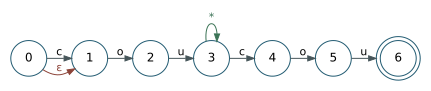
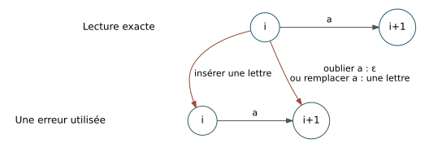

# X MP · Informatique (option) 1998 · Corrigé guidé

*Corrigé rédigé par IA, non officiel. Signalez toute erreur.*

**Rédaction** · GPT-6.2 Astra Ultra · vitesse non renseignée · 25 novembre 2026

L’épreuve dure trois heures. À partir de la question 4, le sujet permet de choisir Caml ou Pascal. Les deux implémentations sont données, en conservant les primitives et les conventions d’indexation de chaque variante.

## Repères

Le motif décrit ce qui peut être lu. Le masque d’états représente toutes les lectures encore possibles après un préfixe fixé du texte. Un arc instantané ne consomme aucune lettre. Avant de modifier un ensemble, identifier si l’on dépense une lettre du motif, une lettre du texte ou les deux.

## I · Motifs et automates

### Question 1 · Langages filtrés et factorisations

**Indication.** Pour chaque motif simple, décrire d’abord l’ensemble des blocs qu’il peut lire. Les coupures entre motifs simples correspondent alors aux coupures entre les blocs du mot.

#### Solution

**a)** Le motif `cl?ou` filtre exactement `clou` et `cou`. Le motif `c?ou*cou` filtre les mots $u\,v\,\mathtt{cou}$ avec $u\in\{\mathtt{ou},\mathtt{cou}\}$ et $v$ un mot quelconque, éventuellement vide. Ainsi les deux parties obligatoires sont consommées successivement. Par exemple `cou` seul est trop court.

**b)** Prendre `**` et le mot `a`. Avec la coupure entre les étoiles, les deux décompositions sont $(\varepsilon,\mathtt a)$ et $(\mathtt a,\varepsilon)$.

**c)** Par induction sur une dérivation de filtrage, si $s_1\cdots s_h$ filtre $m$, alors $m=w_1\cdots w_h$, avec chaque $w_i$ filtré par $s_i$. Pour un simple c’est la définition. Pour une concaténation, on juxtapose les factorisations obtenues sur ses deux fils. Pour le motif vide, la liste des blocs est vide. Réciproquement, toute telle factorisation fournit une dérivation de filtrage par concaténations. À la coupure prescrite $p=p_1p_2$, grouper les $w_i$ en deux listes de longueurs respectives égales aux nombres de simples de $p_1,p_2$. Leurs concaténations donnent $m_1,m_2$, y compris si l’une est vide.

**d)** Les motifs `*?` et `**` sont équivalents à `*`, qui a poids 1. Seul le motif vide aurait un poids inférieur, et il ne filtre aucun mot non vide. Le motif `a???` est équivalent à `a?` de poids 2. Son langage $\{\varepsilon,\mathtt a\}$ n’est celui ni du motif vide, ni d’une lettre, ni de l’étoile, ce qui prouve la minimalité.

### Question 2 · Construire l’automate en ligne

**Indication.** Pour une étoile seule, l’état d’entrée peut être aussi l’état de sortie. Cela évite d’introduire une transition instantanée pour chaque étoile.

#### Solution

**a)** Une lettre $a$ donne deux états et l’arc $0\xrightarrow{a}1$. Pour `*`, un seul état muni d’une boucle étoile suffit. L’état est à la fois initial et final, ce qui permet zéro ou plusieurs lectures. Un simple optionnel issu d’une lettre $a$ a ces mêmes deux états avec, en parallèle, l’arc $0\xrightarrow{\varepsilon}1$. Une seconde option ne change plus le langage. Une étoile optionnelle reste l’étoile. Cette distinction respecte l’obligation de ne faire progresser un arc instantané que d’un seul état.

**b)** Le motif vide donne un unique état initial et final sans transition. Seul le mot vide peut s’y lire.

**c)** Pour $p=p_1p_2$, identifier l’état final du premier automate à l’état initial du second et conserver les transitions. Toute paire de parcours acceptants se concatène. Inversement, les arcs avancent d’un état ou bouclent sur place. Un parcours acceptant peut donc être scindé lors de son passage à l’état commun, en répartissant les boucles étoile à cet état du côté dont elles proviennent. Cela fournit un mot filtré par $p_1$ suivi d’un mot filtré par $p_2$. L’automate reconnaît exactement le langage recherché par 1c.

**d)** Pour `c?ou*cou`, les arcs qui avancent sont étiquetés, dans l’ordre, $c,o,u,c,o,u$. Ajouter un arc $\varepsilon$ de 0 à 1 et une boucle étoile sur 3. L’état initial est 0 et le final 6.



### Question 3 · Une étape sur des ensembles de bits

**Indication.** Le bit de chaque masque de transitions désigne l’état de départ de l’arc. Un arc de lettre avance d’un état et une boucle étoile conserve sa position.

#### Solution

Si $a$ est le masque de départ et $c$ la lettre lue, former

$$
b=((a\mathbin{\&}N_c)\ll1)\mathbin{|}(a\mathbin{\&}N_*).
$$

Pour obtenir la fermeture, remplacer $b$ par $b\mathbin{|}((b\mathbin{\&}N_\varepsilon)\ll1)$ jusqu’à égalité de deux valeurs successives. Une itération ajoute les états accessibles par un arc instantané supplémentaire. La suite est croissante et se stabilise au plus après $n-1$ ajouts successifs le long d’une chaîne. Toute solution close contenant le premier $b$ contient ces itérés. La valeur stabilisée est donc exactement le masque cherché. Par exemple, pour `cl?ou`, lire `c` depuis le masque 1 conduit au masque 6, représentant les états 1 et 2.

## II · Reconnaissance de motifs

### Question 4 · Les primitives de lecture dans les deux langages

**Indication.** Séparer la consommation d’une lettre, la fermeture sans consommation et le test du bit final.

#### Solution

**a, b et d)** Les fonctions ci-dessous utilisent les variables globales du sujet. Les caractères de l’argument de lecture appartiennent à l’alphabet de `a` à `z`. En Caml, les références globales sont déréférencées par `!`. En Pascal, les primitives binaires reçoivent deux arguments.

**Caml**

```ocaml
let indice c = int_of_char c - int_of_char "a".[0];;

let mange etats c =
  ((etats land alpha.(indice c)) lsl 1) lor (etats land !etoile);;

let rec ferme etats =
  let suite = etats lor ((etats land !epsilon) lsl 1) in
  if suite = etats then etats else ferme suite;;

let etape etats c = ferme (mange etats c);;

let etat_final etats =
  (etats land (1 lsl (!n_etats - 1))) <> 0;;
```

**Pascal**

```pascal
function mange(etats: integer; c: char): integer;
begin
  mange := lor(lsl(land(etats, alpha[c]), 1), land(etats, etoile))
end;

function ferme(etats: integer): integer;
var avant: integer;
begin
  repeat
    avant := etats;
    etats := lor(avant, lsl(land(avant, epsilon), 1))
  until etats = avant;
  ferme := etats
end;

function etape(etats: integer; c: char): integer;
begin
  etape := ferme(mange(etats, c))
end;

function etat_final(etats: integer): boolean;
begin
  etat_final := land(etats, lsl(1, n_etats - 1)) <> 0
end;
```

**c)** Dans la représentation de 2, sans simple optionnel, aucune transition instantanée n’est nécessaire, y compris pour une étoile. La fermeture fait un test et l’étape coûte $O(1)$. Si $L$ est la plus grande longueur d’une chaîne d’arcs instantanés successifs, il y a au plus $L$ propagations utiles et un test final. Une étape coûte donc $O(1+L)$ dans le modèle de mots machine du sujet. En particulier $L\le n-1$. Le facteur n’est pas le nombre total d’états dans les cas où les arcs optionnels sont isolés.

### Question 5 · Compiler le motif

**Indication.** Consommer une lettre ou une étoile, puis tous les points d’interrogation qui lui sont immédiatement attachés.

#### Solution

**a)** Invariant au début d’un tour, les états $0$ à $n-1$ représentent le préfixe déjà compilé et $n-1$ est son état final. Une lettre ajoute son arc depuis le dernier état et crée un nouvel état final. Une étoile ajoute une boucle sur le dernier état. Pour une lettre optionnelle, le bit de l’arc instantané est celui de l’ancienne extrémité. Répéter le point d’interrogation réinscrit le même bit. Après une étoile, l’option est redondante. Un point d’interrogation sans simple précédent ou un autre caractère provoque l’échec. Le motif vide conserve l’unique état initial et final.

**Caml**

```ocaml
let construire_auto p =
  for k = 0 to 25 do alpha.(k) <- 0 done;
  etoile := 0;
  epsilon := 0;
  n_etats := 1;
  let i = ref 0 and taille = string_length p in
  while !i < taille do
    let c = p.[!i] in
    let bit = 1 lsl (!n_etats - 1) in
    let k = indice c in
    if c = "*".[0] then etoile := !etoile lor bit
    else if k >= 0 && k < 26 then begin
      alpha.(k) <- alpha.(k) lor bit;
      incr n_etats
    end else echoue "motif incorrect";
    incr i;
    while !i < taille && p.[!i] = "?".[0] do
      if c <> "*".[0] then epsilon := !epsilon lor bit;
      incr i
    done
  done;;
```

**Pascal**

```pascal
procedure construire_auto(p: string);
var c, lettre: char; i, taille, bit: integer; suite: boolean;
begin
  for lettre := 'a' to 'z' do alpha[lettre] := 0;
  etoile := 0;
  epsilon := 0;
  n_etats := 1;
  i := 1;
  taille := length(p);
  while i <= taille do begin
    c := p[i];
    bit := lsl(1, n_etats - 1);
    if c = '*' then etoile := lor(etoile, bit)
    else if (c >= 'a') and (c <= 'z') then begin
      alpha[c] := lor(alpha[c], bit);
      n_etats := n_etats + 1
    end else echoue('motif incorrect');
    i := i + 1;
    suite := true;
    while (i <= taille) and suite do begin
      if p[i] = '?' then begin
        if c <> '*' then epsilon := lor(epsilon, bit);
        i := i + 1
      end else suite := false
    end
  end
end;
```

**b)** Chaque caractère est consommé une fois et testé un nombre borné de fois, y compris à la frontière de deux simples. Le temps est $O(26+|p|)$ et l’espace auxiliaire $O(1)$ pour l’alphabet fixé. Les masques sont réinitialisés pour chaque compilation.

### Question 6 · Reconnaître un mot entier

**Indication.** Initialiser avec la fermeture de l’état 0. Tester l’état final seulement après avoir consommé tout le mot.

#### Solution

**a)** Après $i$ tours, le masque est $A_i$, ensemble des états atteignables en ayant lu exactement les $i$ premières lettres. L’invariant vient de l’initialisation et de la définition de chaque étape. L’appel accepte si l’état final appartient au dernier masque, y compris pour un mot vide.

**Caml**

```ocaml
let filtre p m =
  construire_auto p;
  let a = ref (ferme 1) in
  for i = 0 to string_length m - 1 do
    a := etape !a m.[i]
  done;
  etat_final !a;;
```

**Pascal**

```pascal
function filtre(p, m: string): boolean;
var a, i: integer;
begin
  construire_auto(p);
  a := ferme(1);
  for i := 1 to length(m) do a := etape(a, m[i]);
  filtre := etat_final(a)
end;
```

**b)** Sans option, la compilation et la lecture prennent $O(1+|p|+|m|)$. Dans le cas général, l’initialisation et chaque étape font au plus $1+L$ passages, d’où $O(1+|p|+(|m|+1)(1+L))$. Les 26 masques et les quelques entiers de travail ont une taille constante dans le modèle choisi.

### Question 7 · Trouver et compter des sous-mots

**Indication.** Réintroduire le départ de l’automate après chaque lecture pour autoriser une occurrence qui commence au prochain caractère.

#### Solution

On appelle occurrence l’intervalle de bornes $0\le j\le i\le |m|$ qui porte $m[j:i]$. Cette convention inclut les suffixes et les $|m|+1$ occurrences du mot vide. La définition imprimée en page 1 a des inégalités strictes qui excluraient les occurrences se terminant en bout de chaîne. La question 7 utilise la lecture jusqu’à $A_k$ et le découpage préfixe–sous-mot–suffixe, qui donnent la convention ci-dessus.

**a)** Prendre $q=\mathtt{*}\,p\,\mathtt{*}$. Une factorisation acceptée représente exactement une partie gauche quelconque, une occurrence filtrée par $p$ et une partie droite quelconque. Le code vérifie aussi la validité de $p$ avant d’entourer le motif d’étoiles.

**b)** Par définition $A_i$ a lu le préfixe de longueur $i$. Poser $I=\varepsilon(\{e_0\})$, $B_0=I$ et $B_{i+1}=I\cup\operatorname{etape}(B_i,m_i)$. Par récurrence, $B_i$ est l’union des états atteints en lisant chaque $m[j:i]$, $0\le j\le i$. L’étape distribue sur l’union, et $I$ ajoute le suffixe vide commençant à la nouvelle frontière. Donc l’appartenance de l’état final signifie qu’au moins une occurrence se termine à cette frontière.

**c)** Pour un mot littéral $s$, toute occurrence a la même longueur. À fin fixée il existe au plus un début. On compte donc une unité par $B_i$ acceptant. Ici $I$ se réduit au bit 0, codé par 1. La frontière initiale compte si $s$ est vide. Le temps est $O(1+|s|+|m|)$ et les chevauchements sont autorisés.

**Caml**

```ocaml
let filtre_sous_mot p m =
  construire_auto p;
  filtre ("*" ^ p ^ "*") m;;

let compte_sous_mots s m =
  construire_auto s;
  let b = ref 1 in
  let total = ref (if etat_final 1 then 1 else 0) in
  for i = 0 to string_length m - 1 do
    b := (etape !b m.[i]) lor 1;
    if etat_final !b then incr total
  done;
  !total;;
```

**Pascal**

```pascal
function filtre_sous_mot(p, m: string): boolean;
begin
  construire_auto(p);
  filtre_sous_mot := filtre(concat(concat('*', p), '*'), m)
end;

function compte_sous_mots(s, m: string): integer;
var b, total, i: integer;
begin
  construire_auto(s);
  b := 1;
  total := 0;
  if etat_final(b) then total := 1;
  for i := 1 to length(m) do begin
    b := lor(etape(b, m[i]), 1);
    if etat_final(b) then total := total + 1
  end;
  compte_sous_mots := total
end;
```

**d)** Prenons $p=\mathtt{a*}$. Sur `ab` comme sur `aa`, les trois masques $B_0,B_1,B_2$ valent $1,3,3$ avec la construction de 2. Pourtant `ab` a deux occurrences filtrées, `a` et `ab`, tandis que `aa` en a trois, ses deux lettres prises séparément et le mot entier. La même suite de masques ne conserve donc pas le nombre de débuts distincts.

### Question 8 · Reconnaissance avec une erreur d’édition

**Indication.** Conserver deux ensembles d’états, pour la lecture exacte et pour la lecture à distance au plus un. Un oubli avance dans le motif sans lire le texte.

#### Solution

Ici $p$ et $m$ sont des **mots littéraux**. Les états $0,\ldots,d$ de $A(p)$ désignent les longueurs de préfixes de $p$. Notons $M_c(X)$ l’avance exacte sur la lettre $c$, et $D(X)$ les successeurs sur la ligne quel que soit le caractère attendu, obtenus par décalage d’un bit avec suppression des bits au-delà de $d$.

**a)** Poser $E_0=\{0\}$ et $H_0=E_0\cup D(E_0)$. Après avoir lu $c=m_i$, calculer $E_{i+1}=M_c(E_i)$ et $H_{i+1}=M_c(H_i)\cup D(E_{i+1})$. Dans le premier terme, l’oubli éventuel a déjà eu lieu. Dans le second, il a lieu juste après la nouvelle lecture exacte. L’initialisation traite aussi l’oubli de la première lettre, et le second terme l’oubli de la dernière. Il y a donc au plus un oubli exactement quand le dernier $H$ contient $d$.

**b)** Pour autoriser aussi insertion et substitution, garder l’initialisation et prendre

$$
H_{i+1}=M_c(H_i)\cup E_i\cup D(E_i)\cup D(E_{i+1}).
$$

Dans $E_i$ seul, la nouvelle lettre du texte a été insérée et ne fait pas avancer dans le motif. Dans $D(E_i)$, on la consomme à la place de la prochaine lettre attendue. Les deux autres termes sont ceux de a). La dernière opération, ou l’absence d’erreur, couvre tous les cas. Un chemin ne peut utiliser deux erreurs car chaque branche qui en introduit une part du niveau exact.

**c et d)** La même fonction réalise les deux lectures. En recherche locale, après chaque lettre on ajoute aussi les états de départ des deux niveaux et on conserve un indicateur de succès à **toutes** les frontières. Cela comprend un sous-mot vide à distance 0 ou 1 de $p$. Pour le mot entier, seul l’état final après la dernière lettre décide. Chaque lettre demande un nombre constant d’opérations sur les masques, d’où le même coût $O(1+|p|+|m|)$ dans les deux versions.

**Caml**

```ocaml
let recherche_erreur local mu m =
  construire_auto mu;
  let dernier = 1 lsl (!n_etats - 1) in
  let masque = dernier lor (dernier - 1) in
  let avance x = (x lsl 1) land masque in
  let depart = 1 lor (avance 1) in
  let a = ref 1 and b = ref depart in
  let trouve = ref (etat_final depart) in
  for i = 0 to string_length m - 1 do
    let c = m.[i] in
    let exact = mange !a c in
    let tolere = (mange !b c) lor !a lor (avance !a)
                 lor (avance exact) in
    a := (if local then exact lor 1 else exact);
    b := (if local then tolere lor depart else tolere);
    if etat_final !b then trouve := true
  done;
  if local then !trouve else etat_final !b;;

let filtre_erreur mu m = recherche_erreur false mu m;;
let sous_mot_erreur mu m = recherche_erreur true mu m;;
```

**Pascal**

```pascal
function recherche_erreur(local: boolean; mu, m: string): boolean;
var a, b, exact, tolere, depart, masque, i: integer;
    trouve: boolean;
  function avance(x: integer): integer;
  begin
    avance := land(lsl(x, 1), masque)
  end;
begin
  construire_auto(mu);
  masque := lsl(1, n_etats - 1);
  masque := lor(masque, masque - 1);
  depart := lor(1, avance(1));
  a := 1; b := depart;
  trouve := etat_final(b);
  for i := 1 to length(m) do begin
    exact := mange(a, m[i]);
    tolere := lor(lor(mange(b, m[i]), a), lor(avance(a), avance(exact)));
    a := exact; b := tolere;
    if local then begin a := lor(a, 1); b := lor(b, depart) end;
    if etat_final(b) then trouve := true
  end;
  if local then recherche_erreur := trouve
  else recherche_erreur := etat_final(b)
end;

function filtre_erreur(mu, m: string): boolean;
begin
  filtre_erreur := recherche_erreur(false, mu, m)
end;

function sous_mot_erreur(mu, m: string): boolean;
begin
  sous_mot_erreur := recherche_erreur(true, mu, m)
end;
```


