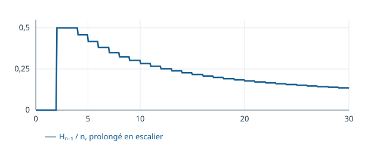

# École polytechnique — Première composition de mathématiques MP 1998 · Corrigé guidé

*Corrigé rédigé par IA, non officiel. Signalez toute erreur.*

**Rédaction** · GPT-6.2 Astra Ultra · vitesse non renseignée

Pour $p\in\mathbb N$, on étudie $L_p(x)=\sum_{n\ge1}x^n/n^p$, puis les séries à plusieurs indices strictement croissants. L’ordre des indices compte dans le critère de convergence au bord.

## I. Séries entières et bord du disque

### Question 1

> [!INDICATION]
> Examiner la racine $n$-ième du coefficient.

#### Solution

$(n^{-p})^{1/n}=\exp(-p\log(n)/n)\to1$. La formule de Cauchy–Hadamard donne $R_p=1$, également pour $p=0$.

### Question 2

> [!INDICATION]
> Sommer une série géométrique, puis prendre une primitive nulle à l’origine.

#### Solution

Sur $]-1,1[$, $L_0(x)=x/(1-x)$. En intégrant $\sum_{n\ge0}x^n=1/(1-x)$ terme à terme depuis zéro, on obtient $L_1(x)=-\log(1-x)$.

### Question 3

> [!INDICATION]
> Multiplier la dérivée par $x$ avant de comparer les coefficients.

#### Solution

Pour $p\ge1$, la dérivation dans le rayon de convergence donne $xL'_p(x)=L_{p-1}(x)$. Ainsi $L'_p(x)=L_{p-1}(x)/x$ pour $x\ne0$, avec $L'_p(0)=1$ par la série.

### Question 4

> [!INDICATION]
> Utiliser le critère des séries de Riemann, y compris les exposants zéro et un.

#### Solution

$\sum_{n\ge1}n^{-p}$ converge exactement pour $p>1$, donc pour les entiers $p\ge2$. Pour $p=0$ le terme ne tend pas vers zéro, et pour $p=1$ la série harmonique diverge.

### Question 5.a

> [!INDICATION]
> Remplacer chaque $z^n$ par une différence de deux sommes partielles.

#### Solution

Avec $A_0=0$, $z^n=A_n-A_{n-1}$. En décalant la seconde somme,
$$
\sum_{n=q}^r\frac{z^n}{n}=-\frac{A_{q-1}}q+
\sum_{n=q}^{r-1}A_n\left(\frac1n-\frac1{n+1}\right)+\frac{A_r}{r}.
$$
On lit $u_{q-1}=-1/q$, $u_n=1/n-1/(n+1)$ pour $q\le n<r$, et $u_r=1/r$. Ces formules couvrent $q=r$.

### Question 5.b

> [!INDICATION]
> Majorer $A_n$ par la formule géométrique sur le disque fermé à distance positive de $1$.

#### Solution

Si $|z|\le1$ et $z\ne1$, $|A_n|=|z(1-z^n)/(1-z)|\le2/|1-z|$. Les valeurs absolues des coefficients de 5.a ont pour somme $2/q$. Le critère de Cauchy donne la convergence en tout point considéré et la convergence uniforme sur chaque ensemble $\{|z|\le1,\ |1-z|\ge\delta\}$, $\delta>0$, donc sur chacun de ses sous-ensembles. Sur le disque ouvert la convergence est également absolue en chaque point.

## II. Série de Dirichlet et développement local

### Question 6

> [!INDICATION]
> Écrire $n^{-z}$ comme une exponentielle.

#### Solution

On a $|n^{-z}|=|\exp(-z\log n)|=n^{-\operatorname{Re}z}$. La convergence absolue équivaut à $\operatorname{Re}z>1$ par le critère de Riemann.

### Question 7

> [!INDICATION]
> Prendre une borne $a>1$ pour les arguments $x$ du compact et absorber la puissance de $\log n$.

#### Solution

Pour tout $k\ge0$, la dérivée d’ordre $k$ de $n^{-x}$ est $(-\log n)^kn^{-x}$. Sur $x\ge a>1$, sa valeur absolue est majorée, à partir d’un certain rang, par $n^{-(a+1)/2}$ car $(\log n)^k=o(n^{(a-1)/2})$. La convergence normale locale à tous les ordres justifie $f\in C^\infty(]1,\infty[)$ et $f^{(k)}(x)=\sum_{n\ge1}(-\log n)^k/n^x$, avec le numérateur égal à $1$ pour $k=0$.

### Question 8.a

> [!INDICATION]
> Pour chaque $n$ fixé, sommer en $k$ les valeurs absolues.

#### Solution

Par sommation positive, $\sum_{n,k}|u_{n,k}|=\sum_n n^{-x}\exp(|h|\log n)=\sum_n n^{-(x-|h|)}$. La famille est sommable exactement lorsque $|h|<x-1$. Aux deux valeurs frontières, cette série de valeurs absolues est harmonique.

### Question 8.b

> [!INDICATION]
> Dans le domaine de sommabilité, intervertir les deux indices et réintroduire le signe de $h$.

#### Solution

Si $|h|<x-1$, Fubini pour les séries et 7 donnent $\sum_{k\ge0}f^{(k)}(x)h^k/k!=\sum_n n^{-x}\exp(-h\log n)=f(x+h)$. La série de Taylor y converge absolument, donc son rayon est au moins $x-1$.

## III. Séries à indices croissants

### Question 9

> [!INDICATION]
> Regrouper les termes selon le dernier indice $n_k$ et compter les choix des indices précédents.

#### Solution

Pour $n\ge k$, posons $a_n=n^{-p_k}\sum_{1\le n_1<\cdots<n_{k-1}<n}\prod_{j<k}n_j^{-p_j}$, avec $a_n=0$ pour $n<k$ et la somme intérieure égale à $1$ pour $k=1$. Comme les exposants sont positifs ou nuls, $a_n\le\binom{n-1}{k-1}\le n^{k-1}$. Pour $|z|<1$, $\sum_n n^{k-1}|z|^n$ converge, d’où sommabilité absolue sur $I$ et $L_{p_1,\ldots,p_k}(z)=\sum_n a_nz^n$.

### Question 10

> [!INDICATION]
> Pour empêcher un rayon supérieur à un, garder seulement les premiers indices $1,2,\ldots,k-1$.

#### Solution

Pour $n\ge k$, on a $a_n\ge c\,n^{-p_k}$ avec $c=\prod_{j<k}j^{-p_j}>0$. Pour $|z|>1$, les termes $a_nz^n$ ne tendent donc pas vers zéro. Avec 9, le rayon vaut $1$.

### Question 11.a

> [!INDICATION]
> Comparer rectangles et intégrales pour la fonction décroissante $x^{-p}$.

#### Solution

Pour $p\ge2$, $\int_{m+1}^{\infty}x^{-p}\,dx\le\sum_{n>m}n^{-p}\le\int_m^\infty x^{-p}\,dx$. Les deux intégrales valent respectivement $1/((p-1)(m+1)^{p-1})$ et $1/((p-1)m^{p-1})$.

### Question 11.b

> [!INDICATION]
> Sommer d’abord sur $n_k>n_{k-1}$. L’exposant du dernier indice restant augmente de $p_k-1$.

#### Solution

La condition nécessaire et suffisante est que, pour chaque $\ell=1,\ldots,k$, on ait $\sum_{j=k-\ell+1}^kp_j>\ell$. Pour $k=1$, c’est la série de Riemann. Si $p_k\le1$, même après fixation des premiers indices la queue en $n_k$ diverge. Si $p_k\ge2$, 11.a et $m+1\le2m$ encadrent la somme sur $n_k>m$ entre deux multiples positifs de $m^{1-p_k}$. La convergence équivaut donc à celle du problème de longueur $k-1$ et d’exposants $(p_1,\ldots,p_{k-2},p_{k-1}+p_k-1)$. Ses inégalités de suffixes sont exactement les inégalités affichées pour $\ell\ge2$. La condition $\ell=1$ est $p_k>1$. La positivité autorise ces regroupements, même si la somme est infinie.

### Question 12

> [!INDICATION]
> Le coefficient du degré $n$ est $H_{n-1}/n$. Vérifier sa décroissance à partir d’un certain rang.

#### Solution

Ici $a_n=H_{n-1}/n$ avec $H_j=\sum_{m=1}^j1/m$. Ce coefficient tend vers zéro et $a_n-a_{n+1}=(H_{n-1}-1)/(n(n+1))\ge0$ pour $n\ge2$. La sommation par parties de 5 s’applique dès ce rang. Si $|z|\le1$ et $|1-z|\ge\delta>0$, la queue de $q$ à $r$ est majorée par $4a_q/\delta$, donc converge uniformément vers zéro. En $z=1$, la série diverge, conformément à 11.b.

## IV. Intégrales itérées

### Question 13

> [!INDICATION]
> Calculer d’abord l’intégrale intérieure. Pour atteindre $1$, considérer des termes positifs après changement de signe.

#### Solution

Pour $0<x<1$, l’intégrale intérieure est $\log(1-x)$ et son quotient par $x$ tend vers $-1$ en zéro. Le développement $-\log(1-x)/x=\sum_{n\ge1}x^{n-1}/n$ a des termes positifs. Par intégration terme à terme, y compris à $t=1$ par convergence monotone, $\Phi_1(t)=-\sum_{n\ge1}t^n/n^2=-L_2(t)$. La somme en $1$ est finie, d’où l’intégrabilité absolue même au bord.

### Question 14

> [!INDICATION]
> Développer ensemble $L_2(y)$ et $1/(1-y)$. Repérer l’indice créé par la primitive.

#### Solution

Le signe de $\Phi_1$ compense celui de $y-1$. Dans le produit $L_2(y)/(1-y)$ apparaissent les termes $y^{m+j}/m^2$ pour $m\ge1,j\ge0$. En posant $n=m+j+1>m$, l’intégration intérieure apporte $x^n/n$ puis l’intégration extérieure de $x^{n-1}$ apporte $t^n/n$. Ainsi $\Phi_2(t)=\sum_{m<n}t^n/(m^2n^2)=L_{2,2}(t)$. Les termes sont positifs et la somme en $1$ est finie par 11.b, ce qui justifie l’intégrabilité sur tout $[0,t]$ et tous les échanges, par convergence monotone.

### Question 15

> [!INDICATION]
> Dans la récurrence, une nouvelle primitive ajoute un indice strictement supérieur au dernier, et le noyau introduit un signe négatif.

#### Solution

Par récurrence $\Phi_k(t)=(-1)^k L_{2,\ldots,2}(t)$, avec $k$ indices. Le rang un est 13. Après suppression du signe, le produit du terme d’indice maximal $m$ par $\sum_{j\ge0}y^j$ puis les deux intégrations donnent un nouvel indice $n=m+j+1>m$, avec facteur $t^n/n^2$ en remplacement de $y^m$. Le dénominateur $y-1$ inverse le signe à chaque rang. Toutes les séries de valeurs absolues sont positives et leur somme intégrée en $t=1$ est finie par 11.b puisque $2\ell>\ell$ pour chaque suffixe. Cela prouve l’existence sur $[0,1]$, y compris $t=0$ où toutes ces intégrales valent zéro.
