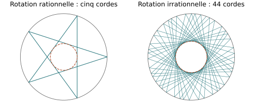
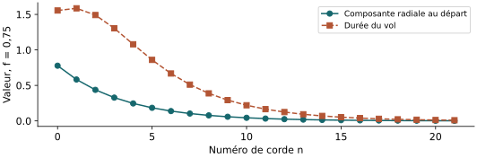

# Deuxième composition de mathématiques — PC 1998 — Corrigé

*Corrigé rédigé par IA, non officiel. Signalez toute erreur.*

**Rédaction** · GPT-6.2 Astra Ultra · vitesse non renseignée · 26 novembre 2026

La boule part de $z_0$ sur le cercle unité, à vitesse de norme un. L’angle orienté de la direction vers le centre à la vitesse initiale est $\alpha\in]-\pi/2,\pi/2[$. La convention de signe de cet angle fixe le sens des rotations dans tout le problème.

École polytechnique et École supérieure de physique et de chimie industrielles · 3 h. [Énoncé](https://www.sujetsetcorriges.fr/dl/X/Maths/PC/sec-x-1998-maths2-PC.pdf)

## Première partie — Réflexion élastique

### 1.a. Points de choc

La vitesse initiale a pour affixe $-z_0e^{i\alpha}$. Le second point de la droite $z_0(1-te^{i\alpha})$ sur le cercle correspond à $t=2\cos\alpha$. Il vaut $-z_0 e^{2i\alpha}$. La réflexion conserve la composante tangentielle et change le signe de la composante radiale. L’angle orienté de départ avec le rayon intérieur redevient donc $\alpha$. Par rotation puis récurrence, $z_n=z_0e^{in\beta}$ avec $\beta=\pi+2\alpha\in]0,2\pi[$.

### 1.b. Durée

Les cordes sont toutes de longueur $\ell=|e^{i\beta}-1|=2\cos\alpha$. La vitesse vaut un, donc chaque parcours dure $\ell$ et le temps d’arrivée en $M_n$ vaut $n\ell$.

### 1.c. Position à toute date

Avec $n=\lfloor t/\ell\rfloor$ et $s=t/\ell-n$, on a $0\leq s<1$ et

$$z(t)=(1-s)z_n+sz_{n+1}=z_0e^{in\beta}\big(1+s(e^{i\beta}-1)\big).$$

L’expression reste correcte aux instants de choc grâce à $s=0$.

### 2.a. Période minimale

Il faut et il suffit que $p\beta\in2\pi\mathbb Z$ pour un entier $p>0$. En effet la vitesse sortante est elle aussi obtenue par cette rotation. Cela équivaut à $\beta/(2\pi)=1/2+\alpha/\pi\in\mathbb Q$. Si la fraction est réduite avec dénominateur $p$, la plus petite période vaut $2p\cos\alpha$.

### 2.b. Trajectoire fermée

La trajectoire périodique est l’image de l’intervalle compact $[0,p\ell]$ par $z$. C’est une réunion finie de segments et un compact du plan, donc un fermé.

## Deuxième partie — Réflexion inélastique

### 3.a. Série des angles

Supposons $0<\alpha=\alpha_0<\pi/2$ et posons $c=\cos\alpha$, $s=\sin\alpha$. Le long d’une corde, la vitesse a les mêmes composantes tangentielles aux deux extrémités et des composantes radiales opposées. Au choc la composante radiale est multipliée en module par $f\in]0,1[$. Au départ de la corde $n$, les modules radial et tangentiel sont ainsi $r_n=cf^n$ et $s$. Donc $\cot\alpha_n=cf^n/s$ et $2\alpha_n-\pi=-2\arctan(cf^n/s)\sim-2cf^n/s$. La série négative converge absolument.

### 3.b. Limite des points de choc

Modulo $2\pi$, l’angle de passage de $z_n$ à $z_{n+1}$ vaut $2\alpha_n-\pi$. La convergence de la série donne $z_n\to Z=z_0\exp(i\sum_{n\geq0}(2\alpha_n-\pi))$. Le point limite est sur le cercle.

### 3.c. Limite en temps fini

La vitesse vaut $v_n=(r_n^2+s^2)^{1/2}$ et la longueur de la corde $2\cos\alpha_n=2r_n/v_n$. Ainsi $T_{n+1}-T_n=2r_n/(r_n^2+s^2)\leq 2cf^n/s^2$. La somme des temps est un nombre fini $T$. Sur chaque corde, la position est une combinaison convexe de $z_n,z_{n+1}$ qui tendent tous deux vers $Z$, donc le prolongement continu vérifie $z(T)=Z$.

### 4.a. Vitesse à l’accumulation des chocs

Sur $[T_n,T_{n+1}[$, la vitesse physique a pour affixe $W_n=z_n(-r_n-is)$. Elle tend vers $-isZ$, d’où l’unique valeur $W(T)=-isZ$ compatible avec la continuité en $T$. Les vitesses sur les chocs sont prises suivant la convention sortante. Dans la troisième puce imprimée, $n\in\mathbb N^*$ laisse libre l’intervalle $]0,T_1[$ si on lit uniquement les quatre puces. La loi physique de mouvement rectiligne uniforme fixe $W=W_0$ sur ce premier vol, ou, de manière équivalente, on fait commencer cette puce en $n=0$ avec $T_0=0$. À la lettre, sans cette loi, les quatre puces seules ne garantissent pas l’unicité.

### 4.b. Mouvement ultérieur

À $T$, la vitesse est tangentielle, de norme $s>0$, dans le sens horaire. La paroi circulaire contraint ensuite la boule à rester au bord et l’absence de frottement conserve sa vitesse tangentielle. Le mouvement de contact est circulaire uniforme, de vitesse angulaire $-s$ puisque le rayon vaut un.

### 4.c. Loi horaire au bord

Pour $t\geq T$, $z'=-is z$ et $z(T)=Z$, si bien que $z(t)=z(T)e^{-i(t-T)\sin\alpha}$.

### 5.a. Retirer le transitoire

Soit $K=\|g\|_\infty$, finie par continuité et périodicité. Pour $t>T$, séparer $[0,T]$ et $[T,t]$ majore la différence des deux moyennes en valeur absolue par $KT/t+K(t-T)|1/t-1/(t-T)|=2KT/t$. Elle tend vers zéro.

### 5.b. Moyenne spatiale

Un argument continu vérifie $\theta(t)=\theta(T)-s(t-T)$ pour $t\geq T$. Pendant un tour d’une durée $2\pi/s$, le changement d’angle donne une intégrale temporelle égale à $s^{-1}\int_0^{2\pi}g(\varphi)\,d\varphi$. Le reste d’un tour est borné en durée et en intégrale. La moyenne tend donc vers $(2\pi)^{-1}\int_0^{2\pi}g$, également pour la moyenne depuis zéro par 5.a.

## Troisième partie — Adhérence des trajectoires non périodiques

### 6.a. Borne inférieure

Le groupe $G$ contient un réel non nul et son opposé. $G^+=G\cap]0,\infty[$ est non vide et minoré par zéro. Il possède une borne inférieure $a\geq0$.

### 6.b. Sous-groupe discret

Pour $a>0$, une suite de $G^+$ tendant vers $a$ est stationnaire à partir d’un rang : deux valeurs de la queue diffèrent de moins de $a$, et toute différence non nulle dans $G$ a un module au moins $a$. Ainsi $a\in G$. Pour tout $x\in G$, le reste $x-a\lfloor x/a\rfloor$ appartient à $G\cap[0,a[$ et vaut zéro. Donc $G=a\mathbb Z$.

### 6.c. Sous-groupe dense

Pour $a=0$, il existe $h_n\in G^+$ avec $h_n\to0$. Pour tout $x\in\mathbb R$, $x_n=h_n\lfloor x/h_n\rfloor\in G$ et $0\leq x-x_n<h_n$. Donc tout réel est adhérent.

### 7.a. Deux pas incommensurables

Le groupe $H_\beta=\beta\mathbb Z+2\pi\mathbb Z$ contient $\beta$ et $2\pi$. S’il était $a\mathbb Z$ pour $a>0$, leur rapport serait rationnel. Comme $\beta/\pi$ est irrationnel, 6.c établit la densité.

### 7.b. Approche de zéro d’un côté

$H_\beta^+=S_\beta\cup S'_\beta$ contient une suite tendant vers zéro. Une infinité de ses termes appartiennent à l’une des deux parties, ce qui donne la sous-suite cherchée.

### 7.c. Supprimer les coefficients négatifs

Écrivons $x_n=-k_n\beta+2\ell_n\pi>0$ avec $x_n\to0$. Si les $k_n$ restaient bornés, les $\ell_n$ le seraient aussi et les $x_n$ n’auraient qu’un nombre fini de valeurs strictement positives. On peut donc extraire des $x_{n_j}$ strictement décroissants avec les $k_{n_j}$ strictement croissants : chaque queue garde des indices non bornés. Les différences $x_{n_j}-x_{n_{j+1}}>0$ sont dans $S_\beta$ puisque le coefficient de $\beta$ est $k_{n_{j+1}}-k_{n_j}>0$. Elles tendent vers zéro.

### 7.d. Approche d’un réel positif

D’après 7.b–c, choisissons $h_n\in S_\beta$ tendant vers zéro. Pour $x>0$, $\lfloor x/h_n\rfloor h_n$ appartient à $S_\beta$ dès que le multiplicateur est positif, et diffère de $x$ de moins de $h_n$. Le cas de zéro vient de la construction précédente.

### 8.a. Densité des points de choc

Le mouvement non périodique donne $\beta/\pi$ irrationnel. Pour $z$ sur le cercle, choisissons $x>0$ avec $e^{ix}=z/z_0$. Par 7.d, $k_n\beta+2\ell_n\pi\to x$ avec $k_n\geq0$. Par continuité $z_{k_n}=z_0e^{ik_n\beta}\to z$.

### 8.b. Adhérence des cordes

Le milieu de la première corde est à distance $|\sin\alpha|$ du centre. Sur cette corde, le module prend toutes les valeurs entre $|\sin\alpha|$ et $1$. Pour $z$ dans la couronne, on choisit un point $w=(1-u)z_0+uz_1$ de même module et une rotation $e^{i\theta}$ envoyant $w$ sur $z$. Par 8.a, des rotations $e^{ik_n\beta}$ tendent vers $e^{i\theta}$. Aux temps $t_n=(k_n+u)\ell$, on a $z(t_n)=e^{ik_n\beta}w\to z$.

### 8.c. Adhérence exacte

Chaque corde est une rotation de la première. Tout point de la trajectoire a donc un module compris entre $|\sin\alpha|$ et $1$, et la couronne ainsi définie est fermée. L’inclusion inverse a été démontrée en 8.b. L’adhérence est exactement cette couronne.
