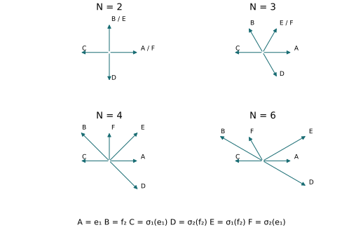
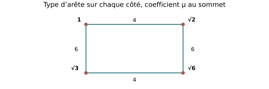

# Première composition de mathématiques — PC 1998 — Corrigé

*Corrigé rédigé par IA, non officiel. Signalez toute erreur.*

**Rédaction** · GPT-6.2 Astra Ultra · vitesse non renseignée · 26 novembre 2026

Dans la base $(e_i)$, la forme bilinéaire symétrique $B$ vérifie $b_{ii}=1$, $b_{ij}=B(e_i,e_j)$. Elle peut être dégénérée. On note $F_i=\ker B(\,\cdot\,,e_i)$ et $\sigma_i(v)=v-2B(v,e_i)e_i$.

École polytechnique et École supérieure de physique et de chimie industrielles · 4 h. [Énoncé](https://www.sujetsetcorriges.fr/dl/X/Maths/PC/sec-x-1998-maths1-PC.pdf)

## Première partie — Réflexions et réseaux entiers

### 1.a. Linéarité

L’application $v\mapsto B(v,e_i)e_i$ est linéaire par bilinéarité. La différence de l’identité et de son double l’est aussi.

### 1.b. Carré

On obtient $B(\sigma_i v,e_i)=B(v,e_i)-2B(v,e_i)=-B(v,e_i)$. Une seconde application de $\sigma_i$ restitue $v$, donc $\sigma_i^2=I$.

### 1.c. Dimension du noyau

La forme $B(\,\cdot\,,e_i)$ prend la valeur $1$ en $e_i$. Son rang vaut un et $\dim F_i=n-1$.

### 1.d. Espaces propres et nature

Tout $v$ s’écrit $(v-B(v,e_i)e_i)+B(v,e_i)e_i$. La première composante appartient à $F_i$, la seconde à $\mathbb Re_i$, et leur intersection est nulle. $\sigma_i$ agit par $+1$ sur le premier espace et par $-1$ sur le second. C’est la symétrie d’hyperplan $F_i$ suivant la direction $e_i$.

### 1.e. Préservation de $B$

Pour $a=B(v,e_i)$ et $c=B(v',e_i)$, les trois termes ajoutés à $B(v,v')$ sont $-2ac,-2ac,4acB(e_i,e_i)$. Leur somme est nulle. La réflexion préserve $B$.

### 2.a. Stabilité du plan

Chaque réflexion $\sigma_i,\sigma_j$ conserve $E_{ij}$ puisqu’elle y ajoute un multiple de $e_i$ ou de $e_j$. En posant $b=b_{ij}$, la matrice de leur produit $\rho_{ij}=\sigma_i\sigma_j|_{E_{ij}}$ est $\begin{pmatrix}4b^2-1&2b\\-2b&-1\end{pmatrix}$, de déterminant $1$.

### 2.b. Cas des coefficients extrêmes

La trace est $2$ si $|b|=1$. La seule valeur propre est $1$ et le noyau de $\rho-I$ est la droite engendrée par $e_i-b e_j$. La matrice diffère de l’identité et son espace propre a dimension un. Elle n’est pas diagonalisable.

### 2.c. Ordre infini

Par Cayley–Hamilton $J=\rho-I$ vérifie $J^2=0$ et $J\ne0$. Pour $k\geq1$, $\rho^k=I+kJ\ne I$. Ainsi aucune puissance strictement positive du produit sur $E$ n’est l’identité.

### 3.a. Positivité sur le plan

Pour $|b|<1$, $B(xe_i+ye_j,xe_i+ye_j)=(x+by)^2+(1-b^2)y^2$. Cette somme est strictement positive hors de l’origine, ce qui donne un produit scalaire sur $E_{ij}$.

### 3.b. Supplémentaire commun

La matrice de Gram $G=\begin{pmatrix}1&b\\b&1\end{pmatrix}$ est inversible. Pour tout $v$, résoudre $G(x,y)^t=(B(v,e_i),B(v,e_j))^t$ détermine de façon unique une composante $xe_i+ye_j$ telle que le reste soit dans $F_i\cap F_j$. C’est la somme directe demandée.

### 4.a. Angle du produit

Si $b=-\cos(\pi/N_{ij})$, dans l’orientation choisie l’angle de $e_i$ vers $e_j$ est $\pi-\pi/N_{ij}$. Les axes de réflexion lui sont respectivement perpendiculaires aux normales $e_i,e_j$ et ont donc le même écart angulaire modulo $\pi$. Appliquer $\sigma_j$ puis $\sigma_i$ produit une rotation d’angle $-2(\pi-\pi/N_{ij})$, soit $2\pi/N_{ij}$ modulo $2\pi$.

### 4.b. Ordre exact

Sur le plan, la rotation d’angle $2\pi/N_{ij}$ a pour ordre $N_{ij}$. Sur $F_i\cap F_j$ les deux réflexions agissent comme l’identité. La somme directe de 3.b montre que la puissance $N_{ij}$ est l’identité sur $E$ et qu’aucune puissance plus petite strictement positive ne convient.

### 5.a. Choix d’échelle en dimension deux

Écrivons $c=2\cos(\pi/N)$. Dans $(e_1,f_2=\mu e_2)$, les matrices sont respectivement $\begin{pmatrix}-1&c\mu\\0&1\end{pmatrix}$ et $\begin{pmatrix}1&0\\c/\mu&-1\end{pmatrix}$. Pour $N=2$, $c=0$ et tout $\mu\in[1,2[$ convient. Pour $N=3,4,6$, $c$ vaut $1,\sqrt2,\sqrt3$ respectivement. Comme $0<c/\mu<2$, son intégralité impose $c/\mu=1$. Le choix unique $\mu=c$ convient car $c\mu=c^2$ vaut $1,2,3$ selon le cas.

### 5.b. Les quatre constructions

On choisit $e_1=(1,0)$, $f_2=\mu(-\cos(\pi/N),\sin(\pi/N))$. Pour $N=2$, prenons $\mu=1$. Les figures indiquent les images $\sigma_1(e_1)=-e_1$, $\sigma_2(f_2)=-f_2$, $\sigma_1(f_2)=f_2+c\mu e_1$ et $\sigma_2(e_1)=e_1+(c/\mu)f_2$. Deux désignations sont accolées lorsqu’elles repèrent la même extrémité.

### 5.c. Condition nécessaire sur $N$

La trace du produit est $2\cos(2\pi/N)$. Pour $N\geq2$, cet entier se situe dans $[-2,2[$. Comme le cosinus est injectif sur $]0,\pi]$, les quatre valeurs entières $-2,-1,0,1$ redonnent respectivement $N=2,3,4,6$. La nécessité vaut même sans imposer la forme diagonale du changement de base.

## Deuxième partie — Produit de toutes les réflexions

### 6.a. Base triangulaire

Notons $S_j=\sigma_1\cdots\sigma_j$, $S_0=I$, de sorte que $\varepsilon_k=S_{k-1}e_k$. Pour tout $v$, $(S_{k-1}-S_k)v=2B(v,e_k)\varepsilon_k$. En sommant de $1$ à $i-1$ pour $v=e_i$, on trouve $e_i=\varepsilon_i+2\sum_{k<i}b_{ik}\varepsilon_k$. Le changement de famille est triangulaire à diagonale unité. Les $\varepsilon_k$ forment une base.

### 6.b. Image d’un vecteur de base

Pour $\tau=S_n$, l’identité précédente donne $\tau(e_i)=e_i-2\sum_{k=1}^n b_{ik}\varepsilon_k$. On remplace $e_i$ par son expression de 6.a et $b_{ii}$ par $1$, d’où $\tau(e_i)=-\varepsilon_i-2\sum_{k>i}b_{ik}\varepsilon_k$.

### 6.c. Matrice du produit

Les colonnes des $e_i$ dans la nouvelle base sont celles de $S=I+C$ et celles des $\tau(e_i)$ sont celles de $-(I+C^t)$. $S$ est triangulaire supérieure à diagonale unité, donc inversible de déterminant un. La matrice cherchée dans la base des $e_i$ est $T=-S^{-1}(I+C^t)$.

### 6.d. Déterminant caractéristique

Comme $\det S=1$, $\det(\lambda I-T)=\det(\lambda S+I+C^t)=\det((\lambda+1)I+\lambda C+C^t)$.

### 7.a. Cycle à trois sommets

En écrivant $d=1+\lambda$, la diagonale donne $d^3$, les trois transpositions donnent $-\lambda d\sum_{i=1}^3\beta_i^2$ et les deux cycles donnent $(\lambda+\lambda^2)\beta_1\beta_2\beta_3$. Leur somme est $P_{(\beta_1,\beta_2,\beta_3)}(\lambda)$.

### 7.b. Terme sous-dominant

Le terme diagonal contribue $n$. Une transposition adjacente sur le cycle contribue $-\beta_i^2$, y compris l’arête entre $1$ et $n$. Un produit de $r\geq2$ transpositions disjointes a degré au plus $n-r$. Les seules autres permutations possibles parcourent tout le cycle, dans un sens ou dans l’autre. Elles donnent $(-1)^{n-1}(\lambda^{n-1}+\lambda)\prod_i\beta_i$. Puisque $n\geq3$, le coefficient demandé vaut

$$n-\sum_{i=1}^n\beta_i^2+(-1)^{n-1}\prod_{i=1}^n\beta_i.$$

Pour $\beta_n=0$, le dernier terme disparaît, comme pour un chemin ouvert.

## Troisième partie — Parité sur le cycle

### 8. Construire un réseau stable

Sur chaque arête du cycle, $c_{ij}=-2b_{ij}$ vaut $1,\sqrt2$ ou $\sqrt3$. On part de $\mu_1=1$. Après avoir parcouru un segment de cycle, notons $a,b\in\{0,1\}$ les parités des nombres d’arêtes de types $4,6$ franchies. Posons au sommet d’arrivée $\mu_i=2^{a/2}3^{b/2}$. Les parités finales étant nulles, le choix est cohérent au retour au premier sommet. Le rapport $\mu_j/\mu_i$ vaut $1$ sur le type 3, $\sqrt2$ ou son inverse sur le type 4, et $\sqrt3$ ou son inverse sur le type 6. Dans la base $(\mu_i e_i)$, $\sigma_i(\mu_j e_j)=\mu_j e_j+c_{ij}(\mu_j/\mu_i)\mu_i e_i$ pour $j\ne i$, avec $c_{ij}=0$ hors des arêtes. Les coefficients sont entiers dans les deux sens, et l’image de $\mu_i e_i$ en est l’opposé.

### 9. Nécessité de la parité

Si les matrices des réflexions sont entières dans une même base, le produit $\tau$ a une trace entière. Dans 6.d, la matrice est celle de la question 7 avec $\beta_i=2b_{i,i+1}$ et $\beta_n=2b_{1n}$. Le coefficient de degré $n-1$ vaut $-\operatorname{tr}\tau$. Or $\sum\beta_i^2=(n-p-q)+2p+3q$ est entier et $\prod_i\beta_i=(-1)^n2^{p/2}3^{q/2}$. L’intégralité impose que $2^p3^q$ soit un carré entier. L’unicité de la factorisation première donne $p,q$ pairs. La construction précédente prouve que cette condition est aussi suffisante.
