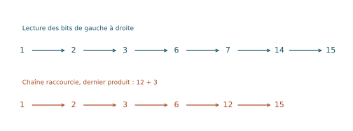
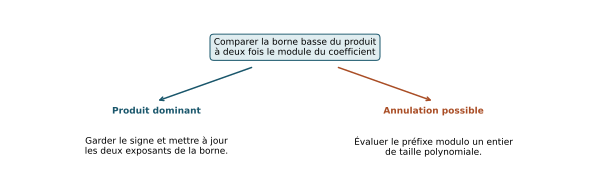

# ENS Lyon et Cachan — Mathématiques-informatique 1999 · Corrigé brut

*Corrigé rédigé par IA, non officiel. Signalez toute erreur.*

**Rédaction** · GPT-6.2 Astra Ultra · vitesse non renseignée

**Révision** · GPT-6.2 Astra Ultra · vitesse non renseignée

**Polynômes creux.** L’épreuve commune aux groupes M, I et MP compte les opérations arithmétiques et leur attribue aussi un coût égal à la somme des tailles de leurs opérandes, avec $\operatorname{taille}(u)=\log_2(2+|u|)$. La représentation creuse garde les couples $(a_j,\beta_j)$ par exposants strictement décroissants. Le cahier original compte six pages. Le registre ne rattache aucun rapport à cette composition.

La section 1 fixe le modèle de coût. Dans l’exemple dense de Horner, après $j$ itérations, $|y|\le(j+1)H\max(1,|x|)^j$ si $H$ majore les valeurs absolues des coefficients. La taille de chaque opérande est donc $O(\log(d+2)+\log(H+2)+d\log(2+|x|))$. Avec $d$ multiplications et $d$ additions, cela justifie le coût polynomial annoncé pour la représentation dense. [Fac-similé du sujet](https://stephane.gonnord.org/Info/lc99.pdf) · [Sommaire](https://stephane.gonnord.org/Info/info.html)

## 2. Calcul de puissances

### Question 2.1.a

Le bit de rang $k$ vaut 1. La valeur minimale est $2^k$ et la maximale est $2^k+\cdots+1=2^{k+1}-1$. Donc $2^k\le n<2^{k+1}$, soit $\log_2 n-1<k\le\log_2 n$ et $k=\lfloor\log_2 n\rfloor$.

### Question 2.1.b

Initialiser $y$ à $x$, correspondant au bit de tête. Pour $j=k-1,k-2,\ldots,0$, remplacer $y$ par $y^2$, puis, si $C[j]=1$, par $y x$. Renvoyer $y$. Si le préfixe déjà lu vaut $u$ et $y=x^u$, la mise à jour donne $x^{2u+C[j]}$, exactement la valeur du préfixe prolongé. Ainsi le résultat est $x^n$. Chaque bit demande un nombre borné d’opérations, donc $O(1+\log n)$ au total, y compris $n=1$.

### Question 2.2

Initialiser $y=1,z=x$. Pour $j=0,\ldots,k$, dans cet ordre, si $C[j]=1$ remplacer $y$ par $yz$, puis remplacer $z$ par $z^2$ dans tous les cas. Renvoyer $y$. À l’entrée du tour $j$, $z=x^{2^j}$ et $y=x^{\sum_{h<j}C[h]2^h}$ (l’initialisation utilise le produit vide). La multiplication conditionnelle incorpore le bit $j$ et le carré prépare le suivant. Les deux invariants après le tour sont donc ceux demandés, soit $z=x^{2^{j+1}}$ et $y=x^{M(j)}$. Le nombre d’opérations est $O(1+\log n)$.

### Question 2.3

Poser $m=n$, $y=1$, $z=x$. Tant que $m>0$, exécuter les opérations suivantes dans cet ordre.

1. Si $m\bmod2=1$, remplacer $y$ par $yz$.
2. Remplacer $z$ par $z^2$ et $m$ par $m\mathbin{\mathrm{div}}2$.

Renvoyer $y$. Si $m=2t+b$, la nouvelle valeur de $y z^m$ est $(y z^b)(z^2)^t$, égale à l’ancienne. Au départ elle vaut $x^n$, et à la sortie elle vaut $y$. Les divisions successives extraient exactement les $k+1$ bits. La complexité est $O(1+\log n)$. Les tests, restes et divisions figurent parmi les opérations autorisées.

### Question 2.4.a

Comme $15=(1111)_2$, l’algorithme 2.1.b effectue trois carrés et trois produits par $x$, donc **six multiplications**. Les versions écrites en 2.2 et 2.3 effectuent chacune quatre carrés et quatre mises à jour $y\leftarrow yz$, donc **huit multiplications**. Dans ces deux décomptes figurent le produit initial par 1 et le tout dernier carré qui calcule $x^{16}$ après que $y=x^{15}$ est connu. Les omettre dans une version optimisée ramène les deux comptes à six. Le dernier carré de 2.2 a été conservé afin de satisfaire l’invariant imposé même au dernier tour.

### Question 2.4.b

Indiquons chaque monôme par son exposant. Pour 2.1.b, la chaîne est $(1,2,3,6,7,14,15)$, de longueur 6. Pour 2.2 et 2.3, la chaîne des résultats utiles est $(1,2,3,4,7,8,15)$, également de longueur 6. Les produits de ces deux versions qui recopient $x$ ou produisent $x^{16}$ après le résultat n’entrent pas dans une chaîne pour $X^{15}$. Une chaîne plus courte est $(1,2,3,6,12,15)$, où $15=12+3$. Elle a longueur 5.

La chaîne de longueur cinq est même minimale. Après trois multiplications le plus grand exposant possible est 8. Pour produire 15 au quatrième rang, il faudrait donc disposer de 8 et de 7. Atteindre 8 en trois multiplications impose les doublements successifs $1,2,4,8$, qui ne produisent pas 7. Quatre multiplications ne suffisent pas.

### Question 2.5

Non. Fixons $n$ et supposons qu’un même algorithme calcule $x^n$ pour tout entier $x$. Choisissons un entier positif $x\ge2$ supérieur aux valeurs absolues de toutes les constantes entières du programme. Au départ la valeur absolue maximale est donc au plus $x$. Si les valeurs absolues sont au plus $M\ge2$, une somme ou une différence a module au plus $2M\le M^2$ et un produit au plus $M^2$. En division euclidienne par un entier non nul, le reste a module inférieur à celui du diviseur et le quotient a module au plus $\max(1,|a|)$ pour un dividende $a$. Un test ou une affectation n’augmente pas la borne. Par récurrence, après $t$ opérations tout entier disponible a module au plus $x^{2^t}$. Produire $x^n$ exige donc $t\ge\log_2 n$. Pour $n=1$, une complexité strictement inférieure à zéro est également impossible.

## 3. Racines d’un polynôme creux

### Question 3.1

Un monôme non nul a au plus une racine réelle distincte. Supposons le résultat établi pour $k-1$ termes et écrivons $f=X^{\beta_k}p$ avec $p(0)=a_k\ne0$. Si $k>1$, $p'$ a exactement $k-1$ monômes. Par Rolle, le nombre de racines réelles distinctes de $p$ est au plus celui de $p'$ augmenté de 1, donc au plus $2(k-1)-1+1=2k-2$. La multiplication par $X^{\beta_k}$ peut ajouter seulement la racine 0. On obtient $2k-1$.

### Question 3.2

Comme les bornes gauches sont entières et strictement croissantes, on a $v'_i\le u'_{i+1}$. Si elles sont égales, l’intervalle ouvert est vide et le produit des deux valeurs est un carré, donc l’équivalence vaut. Sinon, $p'$ n’a aucun zéro dans $]v'_i,u'_{i+1}[$ puisque tous ses zéros sont couverts. Par continuité, $p'$ y a un signe strict constant. Le théorème des accroissements finis donne la stricte monotonie de $p$ sur l’intervalle fermé. Alors $p$ possède une racine **intérieure** exactement lorsque les valeurs aux extrémités ont des signes strictement opposés, et cette racine est unique.

### Question 3.3

Conserver toutes les cellules de $C'$ comme candidates pour $p$, même si certaines ne contiennent finalement aucune racine de $p$. Marquer les bornes $-M,M$ et traiter aussi les espaces entre $-M$ et la première cellule, et entre la dernière et $M$. Si $C'$ est vide, traiter tout $[-M,M]$. Vérifier les extrémités de chaque espace et inclure le singleton correspondant si la valeur de $p$ est nulle. Dans chaque espace de longueur positive où les signes de $p$ aux deux extrémités sont opposés, procéder par dichotomie entière. Tester le milieu arrondi vers le bas, enregistrer le singleton si le signe y est nul, sinon conserver la moitié à signes opposés. S’arrêter lorsque les bornes sont consécutives. Les justifications de 3.2 s’appliquent également aux espaces extérieurs sans zéro de $p'$. Si $\beta_k>0$, ajouter $[0,0]$ pour la racine de $f$.

Trier et supprimer les doublons. Pour deux cellules de même borne gauche, garder la plus longue, qui contient l’autre. Les cellules restent dans $[-M,M]$ et ont longueur 0 ou 1. Tout zéro est couvert, soit par une cellule conservée, soit par un singleton de bord ou par la dichotomie dans un espace. Il y a $O(N+1)$ espaces et $O(1+\log M)$ appels à l’algorithme du signe par espace. Les abscisses ont taille $O(\operatorname{taille}(M))$ et $p$ se construit en soustrayant $\beta_k$ aux exposants. Le tri et l’ensemble des appels ont donc un coût polynomial en les trois paramètres demandés.

### Question 3.4

Si $r\ne0$ est racine de $f=X^{\beta_k}p$, alors $p(r)=0$. Tous les termes de $p(r)$ sauf $a_k$ sont divisibles par $r$, donc $r\mid a_k$. La seule racine entière éventuellement exceptionnelle est 0, présente exactement si $\beta_k>0$.

### Question 3.5.a

Si le plus petit exposant de la liste courante est $b$, supprimer le terme d’exposant $b$ et remplacer chaque autre paire $(a,e)$ par $(a(e-b),e-b-1)$. C’est exactement la dérivée après extraction du facteur $X^b$. Les nouveaux exposants sont distincts, non négatifs et toujours triés. Le nombre de termes décroît d’une unité à chaque passage. Le total des opérations est $O(k+(k-1)+\cdots+1)=O(k^2)$, stockage des listes compris.

### Question 3.5.b

Soient $D=\beta_1$ et $H=\max_j|a_j|$. Les exposants intermédiaires ne dépassent pas $D$, et chaque coefficient est un coefficient original multiplié par au plus $k-1$ entiers de module au plus $D$. Sa taille est donc $O(1+\log(2+H)+k\log(2+D))$. Le nombre $k$, la taille de $D$ et celle de $H$ sont chacun majorés par la taille creuse initiale. Avec les $O(k^2)$ opérations de 3.5.a, on obtient un coût polynomial.

### Question 3.6

Par 3.4, choisir $M=|a_k|\ge1$ couvre toute racine entière de $f$, y compris 0. Construire $d_1,\ldots,d_k$ par 3.5. Le dernier est un monôme. Sa seule racine possible est 0, reconnue par son exposant. À partir de cette liste, remonter jusqu’à $d_1=f$ avec 3.3. Les bornes artificielles $\pm M$ servent de sentinelles et ne sont ajoutées à la sortie comme singletons que si elles sont effectivement racines.

Chaque cellule ajoutée hors des anciennes contient une racine effectivement trouvée du polynôme courant. Les racines intérieures de deux espaces distincts sont distinctes. Les zéros aux bornes déjà dans une ancienne cellule n’exigent aucune cellule supplémentaire. En comptant au plus deux extrémités extérieures et la racine 0, on ajoute donc $O(k)$ cellules par étage, par 3.1. Même si toutes les anciennes sont conservées, leur nombre reste $O(k^2)$ sur les $k$ étages. La taille des polynômes est polynomiale par 3.5.b et le coût de chaque remontée l’est par 3.3. Enfin, tester $f$ aux deux bornes entières de chaque cellule finale, ne garder que les valeurs de signe nul et dédoublonner. Une cellule de longueur au plus 1 n’a pas d’autre entier. On obtient exactement toutes les racines demandées à coût polynomial.

### Question 3.7

Écrivons $f(X)=A X^d+a_{d-1}X^{d-1}+\cdots+a_0$, $A\ne0$. Pour une racine $p/q$ en forme irréductible avec $q>0$, la multiplication de l’égalité par $q^d$ donne $q\mid A p^d$, donc $q\mid A$. En particulier $y=A p/q$ est entier. Construisons
$$g(Y)=A^d f(Y/A)=\sum_{j=0}^d a_j A^{d-j}Y^j,\qquad a_d=A.$$
Les racines rationnelles de $f$ sont exactement les $y/A$ pour $y$ racine entière de $g$. La liste dense donne $d+1$ coefficients et chaque coefficient de $g$ a taille $O(1+\log(2+\max|a_j|)+d\log(2+|A|))$. On construit les puissances successives de $A$, puis la représentation creuse de $g$, en coût polynomial en la taille dense. Appliquer 3.6 à $g$, puis simplifier les fractions par l’algorithme d’Euclide et choisir des dénominateurs positifs. Cette méthode n’exige pas d’énumérer les diviseurs de $A$.

## 4. Signe d’un polynôme creux

### Question 4.1

Initialiser $s=a_1$. Pour $j=2,\ldots,k$, calculer $u=x^{\beta_{j-1}-\beta_j}$ par exponentiation binaire, puis poser $s=su+a_j$. Renvoyer $sx^{\beta_k}$, en donnant à toute puissance d’exposant nul la valeur 1. Après l’étape $j$, on a $s=\sum_{h=1}^j a_h x^{\beta_h-\beta_j}$, par récurrence. La dernière multiplication redonne $f(x)$. Chaque exponentiation demande $O(1+\log(1+\beta_1))$ opérations par la partie 2, d’où $O(k(1+\log(1+\beta_1)))$ opérations pour tout $x$, borne polynomiale en la taille creuse.

### Question 4.2

Prenons $n\ge1$ et $|x|\ge2$, posons $u=x^n$ et $L=\operatorname{taille}(x)$. Le calcul exact du schéma de Horner donne $(u+1)u+1$. Dans la dernière multiplication les opérandes ont taille $\Theta(nL)$ (pour $u=-2$, les constantes sont absorbées). Cela impose un coût $\Omega(nL)$. Pour une majoration serrée, extraire les bits de $n$ par les divisions par 2, d’un coût cumulé $O((1+\log n)^2)$. Au calcul de $x^n$ par lecture des préfixes, les exposants intermédiaires, en remontant depuis le dernier, sont au plus $n, n/2,n/4,\ldots$, à un nombre constant de produits par bit. La somme des tailles des opérandes est donc $O(nL+(1+\log n)^2)$. Les derniers produits et additions coûtent $O(nL)$. Comme $(1+\log n)^2=O(n)$, le coût est **$\Theta(nL)$** pour $|x|\ge2$, avec ou sans réemploi de $u$.

Pour $x\in\{0,1,-1\}$, les puissances utilisées restent bornées. La version qui extrait les bits d’un exposant entier par divisions successives a un coût $\Theta((1+\log n)^2)$, car les entiers divisés ont des longueurs décroissant d’un bit par tour. On peut bien sûr traiter directement ces trois entrées par des tests et le calcul de la parité. Enfin, à $x=2$ fixé la taille creuse de $f_n$ est $\Theta(1+\log n)$ alors que le coût du calcul exact est $\Theta(n)$. Il ne s’agit donc pas d’un coût polynomial en la taille des entrées.

### Question 4.3

Puisque $|f(x)|<T$, on a $T\ge1$. Choisir $m=2T$ et calculer $r=f(x)\bmod m\in\{0,\ldots,2T-1\}$. Utiliser le schéma de 4.1, en réduisant $x$, les coefficients et le résultat après chaque somme ou produit, y compris dans les carrés successifs. Les opérations respectent les congruences : le résultat est bien le reste voulu. Si $r<T$, renvoyer $r$. Dans le cas contraire, renvoyer $r-2T$ (la valeur $r=T$ est exclue par l’hypothèse stricte). Tous les intermédiaires de la partie modulaire ont taille $O(\operatorname{taille}(T))$ après les réductions initiales, même le produit de deux résidus. Le nombre d’opérations est polynomial par 4.1 et les données initiales ont les tailles annoncées. Cela donne le coût demandé.

### Question 4.4

Pour $\alpha=0$ ou $x=1$, renvoyer $l=1$, qui donne $1\le1\le4$. Sinon $x\ge2,\alpha\ge1$. Choisir $n=\lfloor\log_2\alpha\rfloor+3$, calculable en comptant les divisions de $\alpha$ par 2. Avec l’approximation admise, $|\alpha y_n/2^n-\alpha\log_2 x|\le\alpha/2^{n-1}<1/2$. Arrondir $\alpha y_n/2^n$ à l’entier le plus proche (par division entière après ajout de $2^{n-1}$) donne un $l$ à distance strictement inférieure à 1 de $\alpha\log_2 x$. Cette dernière quantité étant au moins 1, $l\ge1$. D’où $2^{l-1}\le x^\alpha\le2^{l+1}$. Le rang $n$ est linéaire en la taille de $\alpha$ et les opérations sur $y_n,\alpha,2^n$ ne manipulent que des entiers de taille polynomiale. L’approximation autorisée a le même caractère polynomial.

### Question 4.5.a

Par définition, $f(x)=x^{\beta_k}s_k$. Comme $x>0$, $\operatorname{signe}f(x)=\operatorname{signe}s_k$. Les signes intermédiaires peuvent changer, de sorte que c’est le dernier qui donne la réponse.

### Question 4.5.b

Le premier préfixe est $s_1=a_1$. Pour $i\ge2$, poser $g=\beta_{i-1}-\beta_i>0$. En ôtant le terme $j=i$ de la somme qui définit $s_i$ et en factorisant $x^g$, on obtient $s_i=s_{i-1}x^g+a_i$.

### Question 4.5.c

Pour un entier non nul $s_i$, enregistrons son signe $\sigma_i$ et deux **exposants** $v_i,V_i$ tels que $2^{v_i}\le |s_i|\le2^{V_i}$ et $0\le V_i-v_i\le3i-2$. Pour un entier connu exactement et non nul, on peut prendre $v_i=\lfloor\log_2|s_i|\rfloor$, $V_i=v_i+1$, par divisions successives par deux. Pour zéro prendre $\sigma_i=0$ et $v_i=V_i=0$. Cela initialise $s_1=a_1$. Si $s_{i-1}=0$, le prochain terme $s_i=a_i$ est déjà connu exactement.

Sinon, appliquer 4.4 à $x$ et $g=\beta_{i-1}-\beta_i$. Le produit signé $P=s_{i-1}x^g$ garde le signe précédent et vérifie
$$2^L\le |P|\le 2^U,\qquad L=v_{i-1}+l-1,\quad U=V_{i-1}+l+1.$$
La largeur $U-L$ est au plus $3(i-1)-2+2=3i-3$. Pour comparer $2^L$ à $2|a_i|$, comparer leurs exposants binaires et, si nécessaire, reconnaître une puissance de deux dans le petit entier $2|a_i|$. Cette opération évite de former $2^L$ quand $L$ est grand.

- **Si $2^L\ge2|a_i|$**, le signe de $s_i=P+a_i$ reste celui de $P$. Lorsque $a_i$ a le même signe, on a $2^L\le|s_i|\le2^{U+1}$. En cas de signes opposés, $2^{L-1}\le|s_i|\le2^U$. Dans les deux cas la largeur augmente d’au plus 1, donc ne dépasse pas $3i-2$. Ici $L\ge1$ puisque $a_i\ne0$.
- **Si $2^L<2|a_i|$**, on a $L<\log_2(2|a_i|)$ et $U\le L+3i-3$. On peut donc former $T=2^U+|a_i|+1$ avec un nombre de bits polynomial en la taille de l’entrée. Le préfixe $s_i$ est la valeur du polynôme entier $\sum_{j\le i}a_j X^{\beta_j-\beta_i}$, et $|s_i|<T$. Le calcul modulaire de 4.3 donne sa valeur exacte. Enregistrer son signe et réinitialiser les bornes à largeur 1, ou à zéro si le préfixe s’annule.

Les exposants conservés eux-mêmes tiennent en peu de bits. En dehors des réinitialisations, la borne supérieure augmente d’au plus $l+2\le g\log_2 x+3$ par tour. Lors des réinitialisations exactes, le maximum des exposants est $O(\log(2+\max_j|a_j|)+k)$ dans la branche modulaire. La somme des écarts $g$ ne dépasse pas $\beta_1$. Ainsi tous les exposants enregistrés sont au plus $O(\beta_1\log_2(2+x)+k+\log_2(2+\max_j|a_j|))$ **en valeur**, donc leur longueur binaire est polynomiale en la taille creuse et celle de $x$. Les $k$ étapes ont chacune un coût polynomial. Le signe de sortie $\sigma_k$ répond à la question par 4.5.a.

Le calcul exact de la seconde branche peut s’observer sur $f(X)=X^5-3X^3-2X^2+1$ en $x=2$. Les préfixes valent successivement $1$, $1\cdot2^2-3=1$, $1\cdot2-2=0$, puis $0\cdot2^2+1=1$. L’exemple fait intervenir l’annulation d’un préfixe non terminal. Le pas suivant doit alors reprendre directement le coefficient courant.

### Question 4.6

Si $x=0$, le résultat est le signe de $a_k$ si $\beta_k=0$, et 0 sinon. Si $x<0$, poser $u=-x>0$ et remplacer $a_i$ par $(-1)^{\beta_i}a_i$, en testant la parité par $\bmod 2$. Le nouveau polynôme évalué en $u$ vaut exactement $f(x)$. Sa taille creuse est inchangée et 4.5.c s’applique. Le cas positif a déjà été traité.
