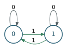
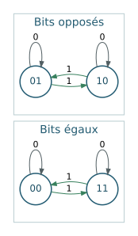
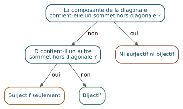
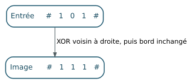

# ENS Ulm-Lyon · Informatique 1999 · Corrigé guidé

*Corrigé rédigé par IA, non officiel. Signalez toute erreur.*

**Rédaction** · GPT-6.2 Astra Ultra · vitesse non renseignée · 25 novembre 2026

Le cahier LUC 321 étudie les automates cellulaires sur la grille entière. On note $F_q$ les configurations qui ne diffèrent de la constante $q$ qu’en un nombre fini de sites, et $P$ les configurations périodiques suivant chacun des axes. Les chemins de graphes sont indexés, de sorte que leur origine compte.

## Repères

Garder une distinction entre un argument sur une boîte fixée, un argument sur toutes les configurations périodiques et un argument sur la grille infinie. Un antécédent périodique peut avoir une période plus grande que celle de son image. Les questions de décision utilisent un graphe fini en dimension un et deux recherches en parallèle en dimension deux.

## 1 · Exemples, périodicité et finitude

### Question 1.1 · Deux antécédents pour le XOR

**Indication.** Fixer la valeur d’un antécédent à l’origine, puis parcourir la droite dans les deux sens.

#### Solution

Une image $y$ étant prescrite, on cherche $x_i+x_{i+1}=y_i$ dans $\mathbb F_2$. Chaque choix de $x_0$ détermine $x_{i+1}=y_i+x_i$ vers la droite et $x_i=y_i+x_{i+1}$ vers la gauche. On construit ainsi deux solutions sur $\mathbb Z$, différentes en 0, et toute solution est déterminée par l’un de ces deux choix. Elles sont complémentaires. Toute image a donc exactement deux antécédents.

### Question 1.2 · Persistance des périodes

**Indication.** Comparer les deux fenêtres d’entrée translatées d’une période.

#### Solution

Pour tout vecteur $t$, notons $\tau_t c(u)=c(u-t)$. La même règle locale s’applique en tout site, d’où $A\tau_t=\tau_t A$. Si $\tau_t c=c$, alors $\tau_t A(c)=A(c)$. Ceci vaut en particulier pour chaque période $p_i e_i$, d’où $A(P_p)\subseteq P_p$ et $A(P)\subseteq P$. Sur deux états, la règle constante zéro envoie tout sur la configuration nulle et ne produit jamais la configuration uniforme 1. Les deux inclusions peuvent donc être strictes, même pour $p_i=1$.

### Question 1.3 · Images des configurations finies sur un fond

**Indication.** Un site de sortie ne voit une anomalie que si son voisinage rencontre un site exceptionnel.

#### Solution

Posons $f(q)=\delta(q,\ldots,q)=q'$. Si $E=\{u:c(u)\ne q\}$ est fini, tout site extérieur à $\bigcup_{v\in V}(E-v)$ ne lit que des $q$. Son image vaut donc $q'$. Cette réunion est finie, d’où $A(F_q)\subseteq F_{f(q)}$.

### Question 1.4 · Itérés et retour à un fond

**Indication.** Dessiner l’arbre des consultations de la règle locale, puis suivre la dynamique sur les seuls états uniformes.

#### Solution

Pour $A^k$, on peut employer le voisinage formé des sommes $v_{i_1}+\cdots+v_{i_k}$. En gardant les indices, les sommes égales consultent la même case. Aux feuilles, placer les états en ces positions. À chaque sommet de l’arbre, appliquer $\delta$ aux valeurs des fils, jusqu’à la racine. Cela définit la règle locale de l’itéré. Par 1.3, $A^k(F_q)\subseteq F_{f^k(q)}$. L’application $f:S\to S$ sur l’ensemble fini non vide a un cycle. Pour $q$ sur un cycle de longueur $k\ge1$, $f^k(q)=q$, ce qui donne l’inclusion demandée.

## 2 · Propriétés générales

### Question 2.1 · Injectivité globale

**Indication.** Appliquer le théorème de Moore et Myhill à une restriction d’une application injective.

#### Solution

Si $A$ est injectif, sa restriction à $F_q$ est injective pour chaque $q$. Le théorème 1 donne la surjectivité globale, donc la bijectivité. L’implication de la bijectivité vers l’injectivité est immédiate.

### Question 2.2 · Changer le fond d’une collision

**Indication.** Conserver les deux configurations sur une boîte qui contient les différences et tous les voisinages pouvant les voir.

#### Solution

Par contraposée, supposons que deux configurations distinctes $a,b\in F_q$ aient même image. Leur ensemble de différences $D$ est fini. Seuls les sites de $U=D-V$ voient une différence. Conservons les deux configurations sur $D\cup(U+V)$ et posons-les toutes deux égales à $q_0$ partout ailleurs. Elles restent différentes et sont désormais $q_0$-finies. Sur $U$ les fenêtres ont été conservées, donc les sorties sont égales. Hors de $U$ les deux fenêtres sont identiques. La collision a donc lieu sur $F_{q_0}$. L’injectivité sur un fond entraîne celle sur tous les fonds.

### Question 2.3 · Injectivité sur les configurations périodiques

**Indication.** Une seule boîte fondamentale suffit pour décrire une configuration de périodes prescrites.

#### Solution

$P_p$ a $|S|^{p_1\cdots p_n}$ éléments. Si $A|_P$ est injectif, $A|_{P_p}$ est un endomorphisme injectif de cet ensemble fini par 1.2. Il le permute. Toute configuration périodique, prise dans l’un de ces ensembles, a donc un antécédent périodique. La réciproque demandée est la restriction de l’énoncé « bijectif implique injectif » au domaine $P$.

### Question 2.4 · Extraction diagonale d’un antécédent

**Indication.** À chaque nouveau site, ne conserver qu’une sous-suite infinie sur laquelle sa valeur est fixée.

#### Solution

**a)** La suite $d_k(x_0)$ prend ses valeurs dans l’ensemble fini $S$. L’une des valeurs apparaît sur un ensemble infini $I_0$ d’indices. On la note $d(x_0)$.

**b)** Appliquer le même argument aux indices de $I_0$ et au point $x_1$ donne $I_1\subseteq I_0$ infini et une valeur $d(x_1)$.

**c)** Énumérer $\mathbb Z^n$ en $x_0,x_1,\ldots$ et itérer. Choisir $k_j\in I_j$ strictement croissants. Pour chaque site $x_h$, $d_{k_j}(x_h)=d(x_h)$ dès $j\ge h$. Au site $u$, les finitement nombreux voisins utilisés par $A$ se stabilisent donc simultanément. De plus $k_j$ est finalement assez grand pour que $c_{k_j}(u)=c(u)$. Il vient $A(d)(u)=A(d_{k_j})(u)=c_{k_j}(u)=c(u)$. Cela vaut en tout $u$.

### Question 2.5 · Deux familles d’images denses

**Indication.** Faire coïncider une configuration cible avec une configuration admissible sur chaque boîte de rayon croissant.

#### Solution

**a)** Avec $q'=f(q)$, prendre $c_k=c$ sur $B_k$ et $q'$ ailleurs. Ces configurations sont $q'$-finies. La surjectivité de $F_q$ dans $F_{q'}$ leur donne à chacune un antécédent. La question 2.4 donne $c\in\operatorname{Im} A$.

**b)** Répéter périodiquement le bloc de $c$ sur $[-k,k]^n$, de période $2k+1$ en chaque direction. On obtient $c_k\in P$ et $c_k=c$ sur $B_k$. La surjectivité de $A|_P$ fournit les antécédents, puis 2.4 donne le résultat global.

### Question 2.6 · Les antécédents d’une configuration finie

**Indication.** Translater des défauts de l’antécédent à l’origine en repoussant les défauts de l’image vers l’infini.

#### Solution

**a)** L’ensemble des sites où $b\ne q$ est infini. Soit $E$ l’ensemble fini où $a\ne q'$. Pour chaque $k$, choisir $z_k$ avec $b(z_k)\ne q$ et $(z_k+B_k)\cap E=\varnothing$. Poser $d_k(u)=b(u+z_k)$ et $c_k(u)=a(u+z_k)$. Par commutation aux translations, $A(d_k)=c_k$, et $c_k$ vaut $q'$ sur $B_k$. L’extraction de 2.4, commencée à l’origine, donne $d(0)\ne q$ et $A(d)=\overline{q'}$. C’est un antécédent distinct de $\bar q$.

**b)** Supposons $A$ bijectif. Pour $a\in F_{q'}$, son unique antécédent $b$ doit appartenir à $F_q$, sinon a) contredirait l’injectivité sur l’image uniforme. La restriction $A:F_q\to F_{q'}$ est donc surjective et injective pour chaque $q$.

### Question 2.7 · Le diagramme des implications

**Indication.** Lire séparément le groupe des propriétés globales, puis ceux des configurations finies et périodiques.

#### Solution

La bijectivité globale équivaut à l’injectivité par 2.1. Elle entraîne la bijectivité sur tout $F_q$ par 2.6 et l’injectivité sur $P$ par restriction. Sur $P$, injectivité et bijectivité sont équivalentes par 2.3, et la bijectivité entraîne la surjectivité. La surjectivité sur $P$ entraîne la surjectivité globale par 2.5b.

S’il existe un fond donnant une restriction bijective, cette restriction est surjective. Inversement, une restriction surjective donne la surjectivité globale par 2.5a. Le théorème 1 puis 2.2 imposent l’injectivité sur tous les fonds, en particulier celui de départ, donc cette restriction y est bijective. Enfin les trois propriétés du bas de la figure 1 sont équivalentes par le théorème 1, par 2.2 et par l’existence d’au moins un état. Toutes les flèches composées s’obtiennent en suivant ces liens. Les réciproques barrées seront distinguées en 5.1.

## 3 · Algorithmes en dimension un

### Question 3.1 · Graphe de de Bruijn du XOR

**Indication.** Pour chaque paire de bits, tracer l’arc du premier vers le second et l’étiqueter par leur somme modulo deux.

#### Solution

Les sommets sont $0$ et $1$. Les boucles $0\to0$ et $1\to1$ portent 0. Les arcs $0\to1$ et $1\to0$ portent 1. Le nom du sommet est le bit d’entrée, tandis que l’étiquette de l’arc fournit le bit de sortie.

### Question 3.2 · Configurations et chemins indexés

**Indication.** Faire glisser une fenêtre de longueur $r-1$ sur une configuration. Garder une origine temporelle sur le chemin.

#### Solution

À $c$, associer $x_i=c_i\cdots c_{i+r-2}$ pour $i\in\mathbb Z$. Deux fenêtres successives se recouvrent sur $r-2$ lettres, d’où l’arc $x_i\to x_{i+1}$. Réciproquement, tout chemin ainsi indexé impose les recouvrements. Prendre pour $c_i$ la première lettre de $x_i$ restitue toutes les fenêtres et donne une bijection. Les configurations de période $p$ correspondent aux répétitions d’une marche fermée de longueur $p$. Les $q$-finies correspondent aux chemins constamment en $q^{r-1}$ hors d’un intervalle fini. L’étiquette du $i$-ième arc vaut $\delta(c_i,\ldots,c_{i+r-1})=A(c)_i$.

La définition par couples de sommets suppose ici $r\ge2$. Si $r=1$, traiter directement la règle lettre à lettre, ou lui adjoindre une seconde entrée ignorée. Une représentation par un seul sommet demanderait des boucles multiples distinguées.

### Question 3.3 · Forte connexité de de Bruijn

**Indication.** Depuis un mot arbitraire, ajouter successivement les lettres du mot cible.

#### Solution

Pour passer de $x$ à $y=y_1\cdots y_{r-1}$, décaler la fenêtre et ajouter $y_1$, puis $y_2$, jusqu’à $y_{r-1}$. Au bout de $r-1$ arcs, toutes les lettres de $x$ ont quitté la fenêtre et le sommet est $y$. Cette construction vaut pour tout couple.

### Question 3.4 · Antécédent périodique d’une image périodique en dimension un

**Indication.** Suivre le chemin d’un antécédent par paquets de la longueur d’une période de l’image.

#### Solution

Le sens de la surjectivité sur $P$ vers la surjectivité globale vient de 2.5b. Dans l’autre sens, soit $y$ de période $p$ et prenons un chemin bi-infini d’antécédent. Parmi ses sommets d’indices $0,p,2p,\ldots$, deux sont égaux, aux indices $ip<jp$. Répéter la marche comprise entre ces deux sommets donne un chemin périodique dont les étiquettes sont les $p$ lettres de $y$ répétées avec la bonne phase. Son antécédent est de période divisant $(j-i)p$, éventuellement plus grande que $p$.

### Question 3.5 · Graphe produit du XOR

**Indication.** Les deux bits doivent changer ensemble ou rester tous les deux fixes pour produire la même étiquette.

#### Solution

Les sommets $00,11,01,10$ désignent ici des **paires** de sommets. L’étiquette 0 donne une boucle en chacun. L’étiquette 1 échange $00$ et $11$ dans les deux sens, et échange $01$ et $10$ dans les deux sens. Il y a deux composantes. Dans la première les configurations sont égales, dans la seconde elles sont complémentaires.

### Question 3.6 · Construire le sous-graphe des chemins bi-infinis

**Indication.** Une extrémité morte ne peut appartenir à un chemin ayant à la fois un passé et un avenir infinis.

#### Solution

Construire les $s^{r-1}$ sommets et les $s^r$ arcs de de Bruijn, étiquetés par la table locale. Former les couples ordonnés d’arcs de même étiquette et les joindre entre les couples de sommets correspondants. On examine au plus $s^{2r}$ couples. Enregistrer les listes d’arcs entrants et sortants et leurs degrés.

Mettre dans une file tous les sommets de degré entrant ou sortant nul. Retirer chacun d’eux avec ses arcs incidents, actualiser les deux degrés des voisins et enfiler tout nouveau sommet privé d’entrée ou de sortie. Un sommet d’un chemin bi-infini garde son prédécesseur et son successeur et ne disparaît jamais. Inversement, en fin de traitement, tout sommet conservé possède une entrée et une sortie conservées. On peut donc prolonger un chemin indéfiniment dans les deux sens. Le graphe induit restant est $\mathcal D$. Chaque sommet et chaque arc ne sont traités qu’un nombre borné de fois. Le coût total est $O(s^{2r})$ dans le modèle de l’énoncé.

### Question 3.7 · Reconnaître l’injectivité globale dans le produit

**Indication.** Un sommet hors diagonale sur un chemin bi-infini traduit un désaccord entre deux antécédents.

#### Solution

Écrivons $\widetilde G$ pour la diagonale et $C$ pour sa composante fortement connexe maximale. La diagonale est une copie de $G$ et elle est fortement connexe. Un sommet hors diagonale de $\mathcal D$ appartient à un chemin bi-infini. Ses deux projections représentent deux configurations distinctes de même image. La réciproque se lit sur les fenêtres de deux configurations en collision. Ainsi $A$ est injectif exactement quand $\mathcal D=\widetilde G$. Cette égalité entraîne $C=\widetilde G$ et l’unicité de $C$. Réciproquement chaque sommet d’un graphe appartient à une composante fortement connexe maximale, y compris un singleton. Si $C$ est l’unique composante et si $C=\widetilde G$, tout $\mathcal D$ est diagonal.

### Question 3.8 · Reconnaître l’injectivité sur un fond

**Indication.** Une collision à support fini correspond à une excursion hors diagonale qui peut revenir sur la diagonale.

#### Solution

Si deux $q$-finies distinctes ont même image, leur chemin dans le produit est au sommet diagonal $(q^{r-1},q^{r-1})$ aux deux extrémités et passe par un sommet non diagonal. Ce sommet est donc dans $C$ et $C\ne\widetilde G$.

Inversement, si $C$ contient un sommet hors diagonale, fixer $q$ et joindre dans $C$ le sommet $(q^{r-1},q^{r-1})$ à ce sommet, puis revenir. Prolonger les deux extrémités par la boucle constante en $q$. Les deux projections donnent deux $q$-finies distinctes de même image. Cela marche pour chaque $q$. L’existence d’un fond injectif équivaut donc bien à $C=\widetilde G$.

### Question 3.9 · Décider les trois cas

**Indication.** Combiner le test de la composante diagonale et le théorème de Moore et Myhill.

#### Solution

Construire $\mathcal D$ par 3.6 puis déterminer $C$. Deux parcours, depuis un sommet diagonal dans le graphe et dans le graphe transposé, suffisent. Leur intersection est la composante cherchée.

1. Si $C$ contient un sommet hors diagonale, répondre **ni l’un ni l’autre**. Par 3.8 et le théorème 1, l’automate n’est pas surjectif.
2. Sinon, $C=\widetilde G$ et l’automate est surjectif. Si $\mathcal D$ contient encore un sommet hors diagonale, répondre **surjectif**. Ce sommet donne une collision globale par 3.7.
3. Sinon, répondre **bijectif** par 3.7 et 2.1.

Après la construction, les parcours sont linéaires en nombre de sommets et d’arcs, donc le total reste $O(s^{2r})$. Pour $r=1$, la surjectivité et la bijectivité sont toutes deux équivalentes à la permutation des $s$ états par la table locale. Ce test direct respecte lui aussi la borne.

### Question 3.10 · Une collision périodique révèle la non-injectivité en dimension un

**Indication.** Dans un graphe fini, tout sommet d’un chemin bi-infini est accessible depuis un cycle et peut rejoindre un cycle.

#### Solution

Si $A$ est bijectif, la restriction à $P$ est injective, donc bijective par 2.3. Supposons inversement $A|_P$ injectif. Aucun cycle du graphe produit ne peut passer par un sommet hors diagonale, car sa répétition donnerait deux configurations périodiques distinctes ayant même image.

Si $A$ n’était pas injectif, un chemin bi-infini de $\mathcal D$ passerait par un sommet hors diagonale $v$. Dans son passé et son avenir, la finitude fournit un sommet sur un cycle de chaque côté. Ces deux cycles sont diagonaux d’après l’argument précédent. On a donc un chemin d’un sommet diagonal à un autre via $v$. La forte connexité de la diagonale permet de refermer ce chemin. Sa répétition donne la contradiction voulue, même si la marche fermée visite certains sommets plusieurs fois. Ainsi $A$ est injectif, donc bijectif.

## 4 · Indécidabilité en dimension deux

### Question 4.1 · Reconnaître une collision périodique en dimension deux

**Indication.** Deux configurations totalement périodiques ont toujours des périodes axiales communes.

#### Solution

Énumérer tous les couples $(p_1,p_2)$ d’entiers positifs, par somme croissante. Sur le tore de ces dimensions, énumérer les tableaux d’états, calculer les images par lecture modulo les deux périodes et détecter deux tableaux distincts de même image. Dès qu’une collision est trouvée, s’arrêter et répondre **non**. Elle se prolonge en une vraie collision sur $P$. Réciproquement, si deux périodiques distinctes entrent en collision, les PPCM de leurs périodes respectives dans chaque direction fournissent un tore dans cette énumération. En l’absence de collision, la recherche continue indéfiniment.

### Question 4.2 · Reconnaître l’existence d’un inverse local

**Indication.** Une égalité d’automates de voisinages finis se vérifie sur une seule table finie.

#### Solution

Pour $k=0,1,\ldots$, énumérer les tables locales $B$ de voisinage $[-k,k]^2$. Chaque inverse cellulaire possible apparaîtra, car on peut ignorer des voisins supplémentaires. Pour une table donnée, les sorties à l’origine de $A\circ B$ et de $B\circ A$ dépendent d’une boîte finie calculable, contenant les sommes des voisinages. Ajouter l’origine à cette boîte. Tester sur **tous** ses motifs que les deux compositions rendent l’état central. Si tous les tests réussissent, répondre **oui** et s’arrêter. L’échec d’une table fait passer à la suivante. Le théorème 2 garantit qu’une table réussit exactement dans le cas bijectif.

### Question 4.3 · Pourquoi l’équivalence de la dimension un échoue

**Indication.** Entrelacer les pas de deux recherches semi-décidables de conclusions opposées.

#### Solution

La bijectivité globale entraîne toujours celle sur $P$. Si l’autre implication était vraie en dimension 2, les procédures 4.1 et 4.2 pourraient être exécutées alternativement, un pas de chacune à la fois. Pour un automate bijectif, la seconde finit avec **oui**. Pour un automate non bijectif, $A|_P$ ne serait pas bijectif, donc pas injectif par 2.3, et la première finirait avec **non**. On aurait décidé la bijectivité, contrairement au théorème 3 de Kari. Il existe donc en dimension 2 un automate bijectif sur les périodiques et non bijectif globalement.

## 5 · Contre-exemples et conclusion

### Question 5.1 · Deux contre-exemples pour les flèches barrées

**Indication.** Le XOR seul conserve une parité des défauts finis. Introduire ensuite un état séparateur pour que des îlots finis puissent se décoder.

#### Solution

**Flèches 1 et 2.** Le XOR est surjectif globalement par 1.1 et sur $P$ par 3.4. Les deux configurations uniformes 0 et 1 ont la même image, donc $A|_P$ n’est pas injectif (flèche 2). Pour chacun des fonds $q=0,1$, posons $z_i=x_i+q$ pour $x\in F_q$. La suite $z$ est de support fini et $A(x)_i=z_i+z_{i+1}$, d’où $\sum_i A(x)_i=0\pmod 2$. Une configuration avec un seul 1 est 0-finie et n’a d’antécédent sur aucun de ces deux fonds. La surjectivité sur $P$ n’entraîne donc pas la surjectivité sur un fond (flèche 1).

**Flèche 3.** Sur $S=\{\#,0,1\}$, conserver les séparateurs $\#$. En un site binaire $i$, rendre $x_i+x_{i+1}$ modulo deux si le voisin de droite est binaire, et rendre $x_i$ si ce voisin est $\#$. Sur le fond $\#$, les îlots binaires sont finis et leurs frontières restent fixes. On retrouve chaque îlot depuis sa dernière lettre, inchangée, puis de droite à gauche par soustraction binaire. La restriction à $F_{\#}$ est donc bijective. Les configurations périodiques tout-zéro et tout-un ont pourtant toutes deux l’image tout-zéro. La bijectivité sur un fond n’entraîne pas la bijectivité sur $P$, ni la bijectivité globale. Ces deux exemples réfutent aussi les réciproques non numérotées indiquées par composition.

### Question 5.2 · Périodes indépendantes et périodes axiales

**Indication.** Passer aux rationnels et annuler les dénominateurs des coordonnées des vecteurs de base.

#### Solution

Une famille de vecteurs entiers est libre sur $\mathbb Z$ exactement quand elle est libre sur $\mathbb Q$. Toute relation rationnelle se transforme en relation entière par multiplication par un dénominateur commun. La dimension de $\mathbb Q^n$ majore donc le cardinal d’une famille libre par $n$, et la base canonique atteint $n$.

Soit $U$ la matrice entière à colonnes les $n$ périodes indépendantes. Son déterminant $d$ est un entier non nul. Comme $U\operatorname{adj}(U)=dI$, chaque $d e_i$ est une combinaison entière de ces périodes. L’ensemble des vecteurs qui laissent une configuration invariante est un sous-groupe additif, donc $|d|e_i$ est aussi une période pour chaque $i$. La configuration est totalement périodique au sens du sujet.

### Question 5.3 · Les trois implications marquées d’un trèfle

**Indication.** Distinguer la flèche réfutée par indécidabilité des trois questions de recherche du dernier diagramme.

#### Solution

En dimension 2, la figure 2 demande si les implications suivantes subsistent.

| Marque du sujet | Hypothèse | Conclusion demandée |
|---|---|---|
| Trèfle vers le haut | $A$ surjectif | $A|_P$ surjectif |
| Trèfle vers la droite | Surjectivité de $F_q$ vers $F_{f(q)}$ pour un fond $q$ | $A|_P$ surjectif |
| Trèfle vers la gauche | $A|_P$ injectif (donc bijectif) | Existence d’un fond donnant une restriction bijective |

Ce sont les trois implications laissées **ouvertes** dans le diagramme multidimensionnel. Le théorème de Kari employé en 4.3 réfute la flèche en forme de cœur qui remonterait directement de l’injectivité sur $P$ à l’injectivité globale. Son argument ne réfute aucun de ces trois trèfles. En dimension un, le cycle extrait dans un graphe fini donne un antécédent périodique. La répétition d’une suite de fenêtres ne suffit pas à refermer un pavage dans les deux directions du plan. Un antécédent apériodique d’une image périodique ne serait pas non plus un contre-exemple au premier trèfle, puisqu’un autre antécédent pourrait être périodique. On peut observer que le premier trèfle, s’il était établi, entraînerait le deuxième grâce à 2.5a.

Ces distinctions sont aussi documentées chez J. Kari, *Theory of cellular automata: a survey*, problème ouvert 2 (2005), et dans ses notes de 2025, figure 9 et corollaire 21. [Article de Kari](https://doi.org/10.1016/j.tcs.2004.11.021) · [Notes de l’université de Turku](https://users.utu.fi/jkari/wp-content/uploads/sites/1251/2025/12/fullnotes.pdf)
