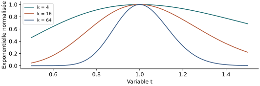
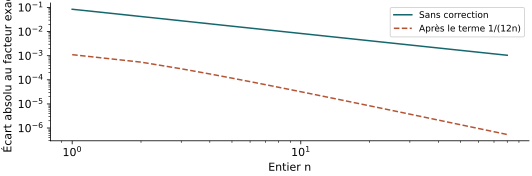

# Maths PSI — PSI 1999 — Corrigé guidé

*Corrigé rédigé par IA, non officiel. Signalez toute erreur.*

**Rédaction** · GPT-6.2 Astra Ultra · vitesse non renseignée · 26 novembre 2026

La méthode de Laplace détermine quelle part d’une intégrale provient du voisinage du maximum de sa phase. La largeur utile est de l’ordre de $k^{-1/2}$ lorsque la dérivée seconde y est strictement négative. Le fac-similé passe directement de la question 5 à la question 7.

École polytechnique et École normale supérieure de Cachan · 4 h. [Énoncé](https://www.sujetsetcorriges.fr/dl/X/Maths/PSI/sec-x-1999-maths-PSI.pdf)

## Partie I — Intégrales gaussiennes

### 1.a. Du carré au disque

**Indication.** Comparer les intégrales sur les deux carrés aux carrés d’intégrales en une variable.

La fonction $e^{-x^2}$ est intégrable sur la droite, car $x^2 e^{-x^2}\to0$ aux deux infinis. Sur un carré $[-r,r]^2$, le produit $e^{-x^2}e^{-y^2}$ a pour intégrale $(\int_{-r}^r e^{-x^2}dx)^2$. Pour le disque de rayon $a$, les carrés inscrit et circonscrit correspondent à $r=a/\sqrt2$ et $r=a$. Par positivité et encadrement, l’intégrale sur le disque tend vers $I^2$. Les disques croissent jusqu’au plan entier, d’où l’existence de $J$ et $J=I^2$.

### 1.b. Coordonnées polaires

**Indication.** Intégrer sur une couronne de rayons $\varepsilon_0$ et $a$, puis faire tendre les deux rayons vers leurs limites.

La coupure suivant un rayon a une aire nulle. Avec le jacobien $r$, l’intégrale sur la couronne vaut $2\pi\int_{\varepsilon_0}^a r e^{-r^2}dr=\pi(e^{-\varepsilon_0^2}-e^{-a^2})$. En faisant tendre $\varepsilon_0$ vers zéro et $a$ vers l’infini, on obtient $J=\pi$. L’intégrale $I$ est strictement positive, donc $I=\sqrt{\pi}$.

### 2. Changement d’échelle

**Indication.** Poser $u=\sqrt{\varepsilon}\,x$.

Pour $\varepsilon>0$, ce changement de variable ramène l’intégrale absolument convergente à $\varepsilon^{-1/2}I=\sqrt{\pi/\varepsilon}$.

### 3.a. Borne de la transformée

**Indication.** Prendre le module avant d’intégrer.

Pour $a$ réel, $|e^{iax-\varepsilon x^2}|=e^{-\varepsilon x^2}$. La question 2 donne la convergence absolue de $F_\varepsilon(a)$ et la borne uniforme $|F_\varepsilon(a)|\leq\sqrt{\pi/\varepsilon}$.

### 3.b. Équation différentielle

**Indication.** Relier la dérivée en $a$ à une dérivée en $x$ dont l’intégrale est nulle.

La dérivée en $a$ de l’intégrande est dominée par $|x|e^{-\varepsilon x^2}$, intégrable sur la droite. On peut donc dériver sous l’intégrale. L’intégrande tend vers zéro aux deux infinis, et sa dérivée en $x$, $(ia-2\varepsilon x)e^{iax-\varepsilon x^2}$, est intégrable. Son intégrale est nulle. En multipliant par $-i/(2\varepsilon)$, on trouve $F_\varepsilon'(a)+aF_\varepsilon(a)/(2\varepsilon)=0$.

### 3.c. Valeur explicite

**Indication.** Multiplier la solution par le facteur intégrant et utiliser la valeur en zéro.

La quantité $e^{a^2/(4\varepsilon)}F_\varepsilon(a)$ a une dérivée nulle. Sa valeur en zéro vient de la question 2, d’où $F_\varepsilon(a)=\sqrt{\pi/\varepsilon}\,e^{-a^2/(4\varepsilon)}$.

### 4. Translation réelle

**Indication.** Compléter le carré une première fois avec $\varepsilon/2$, puis avec $\varepsilon$.

L’inégalité $(\sqrt{\varepsilon}x-b/\sqrt{\varepsilon})^2\geq0$ donne $bx-\varepsilon x^2/2\leq b^2/(2\varepsilon)$. La gaussienne restante donne $G_\varepsilon(b)\leq\sqrt{2\pi/\varepsilon}\,e^{b^2/(2\varepsilon)}$, ce qui prouve la convergence. Cette borne dépend de $b$. Plus précisément,

$$bx-\varepsilon x^2=-\varepsilon(x-b/(2\varepsilon))^2+b^2/(4\varepsilon).$$

Par translation, $G_\varepsilon(b)=\sqrt{\pi/\varepsilon}\,e^{b^2/(4\varepsilon)}$. Pour $\varepsilon$ fixé, la fonction croît sans borne lorsque $|b|$ tend vers l’infini, donc aucun majorant uniforme fini n’existe.

### 5. Argument complexe

**Indication.** Translater la variable réelle pour absorber la partie imaginaire du paramètre.

Écrivons $z=u+iv$. Le module de l’intégrande vaut $e^{-vx-\varepsilon x^2}$, intégrable d’après 4 pour tout $v$. Le domaine de convergence absolue est $\mathbb C$. La translation $y=x+v/(2\varepsilon)$ laisse le facteur oscillant $e^{iuy}$ et donne

$$\widetilde F_\varepsilon(z)=e^{v^2/(4\varepsilon)-iuv/(2\varepsilon)}F_\varepsilon(u)=\sqrt{\pi/\varepsilon}\,e^{-z^2/(4\varepsilon)}.$$

## Partie II — Concentration et développement gaussiens

### 7.a. Constante optimale

**Indication.** Chercher le maximum sur la demi-droite positive.

Pour $x>0$, la dérivée de $x^Ne^{-x^2/2}$ a le signe de $N-x^2$. La fonction tend vers zéro en zéro et à l’infini. Sur la demi-droite négative elle prend, selon la parité, les valeurs opposées ou égales à celles du côté positif. Le plus petit majorant est donc $(N/e)^{N/2}$, atteint en $\sqrt N$.

### 7.b. Queue gaussienne

**Indication.** Sur $x\geq A$, transférer le facteur $A^n$ dans l’intégrande.

Pour $A\geq0$, $A^n\int_A^\infty e^{-x^2}dx\leq\int_0^\infty x^n e^{-x^2}dx$. D’après 7.a, $x^n e^{-x^2/2}$ est bornée, et l’autre facteur $e^{-x^2/2}$ est intégrable. L’intégrale de droite est donc une constante finie indépendante de $A$.

### 7.c. Queue avec un moment

**Indication.** Sur $[A,\infty[$, majorer le produit $A^n x^m$.

Pour $A\geq1$ et $m,n\geq0$, le produit est majoré par $x^{n+m}$. L’intégrale de cette puissance contre $e^{-x^2}$ sur $[1,\infty[$ est finie par comparaison à $C e^{-x^2/2}$. Pour des exposants réels, on peut prendre dans 7.a l’entier supérieur à $n+m$, avec la constante $1$ si les deux exposants sont nuls. On obtient le majorant $M$ demandé.

### 7.d. Décroissance pour un seuil fixe

**Indication.** Garder une gaussienne intégrable et majorer le reste au point $A$.

Pour $A>0$ et $k\geq1$, l’intégrale pondérée par $k^n$ est comprise entre zéro et $k^ne^{-(k-1)A^2}\int_A^\infty x^m e^{-x^2}dx$. Le seuil positif assure la convergence aussi pour un entier $m$ négatif. L’exponentielle l’emporte sur toute puissance de $k$, d’où la limite nulle.

### 8. Troncature d’une gaussienne centrée

**Indication.** Retrancher de l’intégrale complète les deux queues de longueurs initiales fixes.

Après translation par $x_0$, l’écart en valeur absolue est la somme des queues commençant en $x_0-a_1>0$ et $a_2-x_0>0$. Pour $k\geq1$, la question 7.d les borne par une constante fois $k^{-q}$ pour tout $q\geq1$ (prendre un entier supérieur à $q$). Pour $0<k\leq1$, leur somme est au plus $\sqrt{\pi/k}\leq\sqrt{\pi}\,k^{-q}$. Une même constante $D_q$ convient donc sur toute la demi-droite.

### 9.a. Deux points d’un même niveau

**Indication.** Séparer un petit voisinage où la dérivée seconde conserve son signe et son complément compact.

Le maximum intérieur vérifie $\phi'(x_0)=0$ et $\phi''(x_0)\leq0$. La non-dégénérescence donne $\phi''(x_0)<0$. Sur un petit segment autour de $x_0$, on a encore $\phi''<0$, donc $\phi$ y croît strictement à gauche et décroît strictement à droite. Sur le complément extérieur de ce voisinage ouvert dans $[a_1,a_2]$, le maximum est strictement inférieur à $\phi(x_0)$ par compacité et unicité. Choisissons $\alpha_0>0$ inférieur à cet écart. Le niveau $\phi(x_0)-\alpha_0$ a ainsi exactement deux antécédents $x_-<x_0<x_+$, et $\phi''<0$ entre eux. On lit le segment du sujet comme $[a_1,a_2]$, ses bornes définies.

### 9.b. Contribution des intervalles extérieurs

**Indication.** Minorer la perte sur la phase et majorer l’amplitude sur le segment entier.

Sur chacun des deux intervalles extérieurs, $\phi(x)\leq\phi(x_0)-\alpha_0$, par le choix en 9.a et la monotonie locale. Chaque contribution normalisée $e^{-k\phi(x_0)}I_\pm^M(k)$ est donc en module au plus $(a_2-a_1)\|a\|_\infty k^M e^{-k\alpha_0}$, qui tend vers zéro.

### 9.c. Rôle des deux hypothèses

**Indication.** Tester séparément un minimum strict non dégénéré et un maximum plat au second ordre.

Si l’on garde seulement (ii), $\phi(x)=x^2$ sur $[-1,1]$ avec $x_0=0$ n’atteint jamais le niveau négatif requis. Si l’on garde seulement (i), $\phi(x)=-x^4$ a un unique maximum intérieur, mais sa dérivée seconde s’annule en ce point. Chacune des suppressions fait donc échouer au moins une des conclusions requises simultanément.

### 9.d. Factorisation de la perte de phase

**Indication.** Appliquer Taylor avec reste intégral au second ordre autour de $x_0$.

Comme $\phi'(x_0)=0$, on a $\phi(x)=\phi(x_0)-(x-x_0)^2l(x)^2/2$ avec

$$l(x)=\left[-2\int_0^1(1-t)\phi''(x_0+t(x-x_0))dt\right]^{1/2}.$$

La dérivée seconde est strictement négative sur le segment choisi. La quantité entre crochets est donc strictement positive et continue, par continuité uniforme de l’intégrande sur le rectangle compact. En $x_0$, elle vaut $-\phi''(x_0)$.

### 10. Terme principal de Laplace

**Indication.** Ramener exactement la phase à $-y^2/2$ par une variable locale signée.

Posons $\lambda=-\phi''(x_0)>0$ et $y=(x-x_0)l(x)$. Si $\phi$ est $C^4$, la formule intégrale rend $l$ de classe $C^2$. Au centre $y'(x_0)=\sqrt{\lambda}$. Ailleurs $y'=-\phi'/y>0$ par monotonie. La transformation a donc un inverse $g$ de classe $C^2$ et envoie $[x_-,x_+]$ sur $[-B,B]$, $B=\sqrt{2\alpha_0}$. Après extraction de $e^{k\phi(x_0)}$, l’amplitude est $h(y)=a(g(y))g'(y)$, de classe $C^1$, avec $h(0)=a(x_0)/\sqrt{\lambda}$. La différence $|h(y)-h(0)|$ est au plus $C|y|$, d’où une erreur intégrée au plus $2C/k$.

L’intégrale du terme constant vaut $h(0)\sqrt{2\pi/k}$ à une erreur exponentiellement petite près par 7.d. Les contributions extérieures sont exponentiellement petites par 9.b. Ainsi l’intégrale normalisée vaut $a(x_0)\sqrt{2\pi/(k\lambda)}+O(k^{-1})$. Dans la convention du sujet, le terme entre crochets est $a(x_0)+k^{-1/2}R(a,\phi,k)$ avec $R$ borné pour $k\geq1$.

### 11.a. Moments pairs normalisés

**Indication.** Intégrer par parties en dérivant la puissance et en intégrant $x e^{-kx^2/2}$.

Pour $k>0$ tous les moments absolus existent car la gaussienne domine chaque puissance. Les termes aux bornes sont nuls. L’intégration par parties donne $I_{p+1}=I_p/((2p+2)k)$, et $I_0=\sqrt{2\pi/k}$. En itérant, $I_p=\sqrt{2\pi/k}/(2^p p!k^p)$.

### 11.b. Intégrale d’un polynôme

**Indication.** Regrouper les termes pairs et les termes impairs sur la droite.

Chaque monôme impair a une intégrale nulle par parité et convergence absolue. En appliquant 11.a aux degrés $2p$, l’intégrale du polynôme $\sum_{j=0}^n a_jx^j/j!$ contre $e^{-kx^2/2}$ vaut $\sqrt{2\pi/k}\sum_{p=0}^{\lfloor n/2\rfloor}a_{2p}/(2^p p!k^p)$.

### 12. Échelle d’un moment local

**Indication.** Borner $f$ sur le segment et dilater la variable par $\sqrt{k}$.

En module l’intégrale est au plus $\|f\|_{\infty,[-A,A]}k^{-(n+1)/2}\int_{\mathbb R}|u|^n e^{-u^2/2}du$ après la substitution $u=\sqrt{k}x$ et l’extension du domaine. Le dernier facteur est fini et indépendant de $k>0$.

### 13. Amplitude de régularité finie

**Indication.** Soustraire le polynôme de Taylor, puis contrôler séparément le reste local et les queues du polynôme.

Pour $h\in C^n$, $h(x)=P_n(x)+x^n f(x)$, où $P_n$ est le polynôme de Taylor en zéro et $f$ se prolonge continûment en zéro par zéro. La question 12 borne l’intégrale du reste, après multiplication par $\sqrt{k}$, par $Ck^{-n/2}$. Pour $k\geq1$ l’extension du polynôme à la droite ajoute deux queues exponentiellement petites par 7.d. La question 11.b donne alors exactement la somme soustraite dans $R_n$. Pour $0<k\leq1$, l’intégrale sur le segment, multipliée par $\sqrt{k}$, est bornée, et chaque puissance $k^{-p}$ de la somme est au plus $k^{-n/2}$. On obtient $|R_n|\leq E^1k^{-n/2}$ pour tout $k>0$.

## Partie III — Développement de Stirling et phase générale

### 14.a. Représentation intégrale de la factorielle

**Indication.** Établir une récurrence puis substituer $x=nt$.

L’intégrale de $x^n e^{-x}$ sur $[0,\infty[$ converge car l’exponentielle domine toutes les puissances à l’infini. Pour $n=0$, elle vaut un. Pour $n\geq1$, une intégration par parties, avec $x^n e^{-x}$ nul aux deux bornes, donne $n$ fois l’intégrale du rang précédent. Elle vaut donc $n!$. Pour $n\geq1$, le changement $x=nt$ donne $n!=n^{n+1}\int_0^\infty e^{n\phi_0(t)}dt$, où $\phi_0(t)=\log t-t$.

### 14.b. Deux queues pour la phase logarithmique

**Indication.** À droite du maximum, conserver le facteur $e^{\phi_0(t)}$ afin d’intégrer sur une demi-droite.

La dérivée $1/t-1$ est positive sur $]0,1[$, négative sur $]1,\infty[$. Sur $]0,1/2]$ l’intégrale est donc au plus $e^{n\phi_0(1/2)}/2$. Sur $[3/2,\infty[$, on majore $e^{(n-1)\phi_0(t)}$ par $e^{(n-1)\phi_0(3/2)}$. Le facteur restant a une intégrale égale à $\int_{3/2}^\infty te^{-t}dt=(5/2)e^{-3/2}<1$. Cela prouve la seconde borne, y compris pour $n=1$.

### 14.c. Formule usuelle de Stirling

**Indication.** Appliquer la question 10 sur le segment central et comparer les phases aux deux extrémités à $\phi_0(1)$.

L’unique maximum est en $1$ avec $\phi_0(1)=-1$ et $\phi_0''(1)=-1$. La question 10, pour $a=1$, donne sur $[1/2,3/2]$ l’intégrale $e^{-n}(\sqrt{2\pi/n}+O(n^{-1}))$. Après extraction de $e^{-n}$, les deux queues de 14.b décroissent exponentiellement puisque $\phi_0(1/2),\phi_0(3/2)<-1$. En multipliant par $n^{n+1}$, on trouve $n!=n^ne^{-n}(\sqrt{2\pi n}+O(1))$.

### 15. Variable régulière au maximum

**Indication.** Utiliser le reste intégral de Taylor pour $x-1-\log x$, puis examiner la dérivée en $1$ et de chaque côté.

Posons $q(x)=x-1-\log x$. On a $q(1)=q'(1)=0$, $q''(x)=x^{-2}$. Taylor donne pour la racine signée du sujet

$$\psi(x)=(x-1)\left(\int_0^1\frac{1-t}{(tx+1-t)^2}dt\right)^{1/2}.$$

Sur $[1/2,3/2]$, le dénominateur reste uniformément éloigné de zéro. En dérivant sous l’intégrale à tout ordre, puis en prenant la racine d’une fonction strictement positive, on obtient $\psi\in C^\infty$ et $\psi'(1)=1/\sqrt2$. Pour $x\ne1$, $\psi'(x)=(x-1)/(2x\psi(x))>0$. C’est donc un difféomorphisme du segment sur son image. On note $\tau$ son inverse.

### 16. Coefficients locaux et première correction

**Indication.** Développer $\tau'$ dans l’intégrale gaussienne et obtenir ses dérivées par inversion de séries.

Pour $y=\psi(t)$ l’intégrale centrale multipliée par $\sqrt n\,e^{-n\phi_0(1)}$ devient $\sqrt n\int_{\psi(1/2)}^{\psi(3/2)}e^{-ny^2}\tau'(y)dy$. Prenons un petit segment symétrique $[-b,b]$ dans l’image. Le reste de l’image a une contribution exponentiellement petite. Pour $j=\lfloor N/2\rfloor$, appliquons Taylor à $\tau'$ jusqu’au degré $2j+1$, avec reste $O(|y|^{2j+2})$. Les termes impairs s’annulent, le reste intégré est $O(n^{-j-1})$ par 12, et les moments pairs peuvent être étendus à la droite par 7.d. La question 11.a donne pour tout $n\geq1$

$$\sqrt n\,e^n\int_{1/2}^{3/2}e^{n\phi_0(t)}dt=\sqrt{2\pi}\sum_{p=0}^{j}\frac{b_p}{n^p}+O(n^{-j-1}),\qquad b_p=\frac{\tau^{(2p+1)}(0)}{\sqrt2\,4^p p!}.$$

La série de Taylor de $\psi(1+s)$ vient de $s-\log(1+s)$, et l’identité $\psi(\tau(y))=y$ détermine les coefficients de $\tau$ l’un après l’autre. Plus précisément, en posant $w=\sqrt2\,y$, on a $w=s-s^2/3+7s^3/36+O(s^4)$, d’où $s=w+w^2/3+w^3/36+O(w^4)$. Ainsi $\tau(y)=1+\sqrt2\,y+2y^2/3+\sqrt2\,y^3/18+O(y^4)$, ce qui donne $b_0=1$ et $b_1=1/12$.

### 17. Contrôle du reste de Stirling

**Indication.** Combiner le développement du centre et les deux queues estimées séparément.

À l’ordre $j$, la question 16 fournit une erreur $O(n^{-j-1})$ sur l’intégrale centrale normalisée en prenant $N=2j$. Les bornes de 14.b donnent pour les deux queues, après multiplication par $\sqrt n e^n$, une erreur $O(\sqrt n e^{-cn})$ pour un $c>0$. La même estimation au rang zéro provient de la question 16 avec $N=1$. En divisant par $\sqrt{2\pi}$ et en utilisant 14.a, on obtient

$$n!=n^n e^{-n}\sqrt{2\pi n}\left(1+\sum_{p=1}^j b_p n^{-p}+R_j(n)\right),\qquad |R_j(n)|\leq C_j n^{-j-1}.$$

La constante peut être augmentée pour inclure tout entier $n\geq1$.

### 18. Calcul direct dans la variable dilatée

**Indication.** Développer l’exponentielle après $T=\sqrt n(t-1)$ sur un intervalle croissant assez lentement pour y contrôler le reste.

Écrivons $w=n^{-1/2}$. Après extraction de $e^{-n}$, la phase dans l’exponentielle est $-T^2/2+H(w,T)$, avec

$$H(w,T)=\frac{\log(1+wT)-wT+(wT)^2/2}{w^2}=\sum_{r\geq1}\frac{(-1)^{r+1}}{r+2}\,T^{r+2}w^r.$$

Définissons $P_s(T)$ comme le coefficient de $w^s$ de $e^{H(w,T)}$. Ainsi $P_0=1$, $P_1=T^3/3$, $P_2=-T^4/4+T^6/18$. Chaque monôme de $P_s$ a la parité de $s$ car $r+2$ a celle de $r$.

Pour justifier l’intégration terme à terme à un ordre fixé, limitons d’abord $|T|$ à $n^{1/12}$. Écrivons $H(v,T)=vT^3 h(vT)$, où $h$ est analytique près de zéro. Pour $0\leq v\leq w$, $|vT^3|$ reste borné, $|vT|$ tend uniformément vers zéro, et chaque dérivée en $v$ de $H$ d’ordre fixé est bornée par un polynôme en $|T|$ indépendant de $n$. Les dérivées de $e^H$ ont la même propriété car $e^H$ est bornée sur ce domaine. Taylor en $v$ à l’ordre $2j+1$ donne alors un reste majoré par $Cw^{2j+2}(1+|T|)^d$. Son intégrale contre $e^{-T^2/2}$ est $O(w^{2j+2})$.

Sur le reste du segment $[1/2,3/2]$, Taylor et $\phi_0''(t)=-1/t^2\leq-4/9$ majorent la vraie exponentielle normalisée par $e^{-2T^2/9}$. Au-delà de $|T|=n^{1/12}$, cette queue et les queues polynomiales gaussiennes sont plus petites que toute puissance de $n^{-1}$. Les intervalles hors du segment relèvent de 14.b. On peut donc intégrer chaque $P_s$ sur la droite avec le poids gaussien. Seuls les indices $2p$ subsistent et leur contribution normalisée est $b_p n^{-p}$, avec $b_p=(2\pi)^{-1/2}\int_{\mathbb R}P_{2p}(T)e^{-T^2/2}dT$. Ces coefficients coïncident avec ceux de 16 par unicité du développement asymptotique. Par exemple $b_1=-3/4+15/18=1/12$, et le reste est $O(n^{-j-1})$ comme en 17.

### 19. Expansion d’une phase générale

**Indication.** Reprendre la variable de la question 10 en comptant les dérivées disponibles pour l’amplitude transformée.

Si $\phi\in C^{2n+3}$, la formule intégrale de 9.d donne $l\in C^{2n+1}$. Le changement $y=(x-x_0)l(x)$ et son inverse $g$ sont $C^{2n+1}$. Ainsi $h=(a\circ g)g'$ est $C^{2n}$ quand $a\in C^{2n}$. Les intervalles extérieurs sont exponentiellement petits après extraction de $e^{k\phi(x_0)}$. Sur le segment central, la question 13 à l’ordre $2n$ donne

$$\sqrt{k}\int_{-B}^B h(y)e^{-ky^2/2}dy=\sqrt{2\pi}\sum_{p=0}^{n-1}\frac{h^{(2p)}(0)}{2^p p!k^p}+O(k^{-n}).$$

Le terme d’indice $n$ a été absorbé dans le reste de même ordre. Pour $\lambda=-\phi''(x_0)$, on a $h(0)=a(x_0)/\sqrt{\lambda}$. En extrayant $\sqrt{2\pi/(k\lambda)}e^{k\phi(x_0)}$, on obtient donc les crochets demandés, $a(x_0)+\sum_{p=1}^{n-1} b_p(a,\phi,x_0)/(p!k^p)+k^{-n}R_n(a,\phi,k)$, avec $R_n$ borné pour $k\geq1$. Chaque coefficient dépend des dérivées locales puisque les dérivées de l’inverse en zéro se déterminent en différenciant l’identité de changement de variable au point $x_0$.
