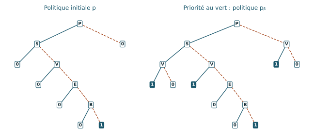
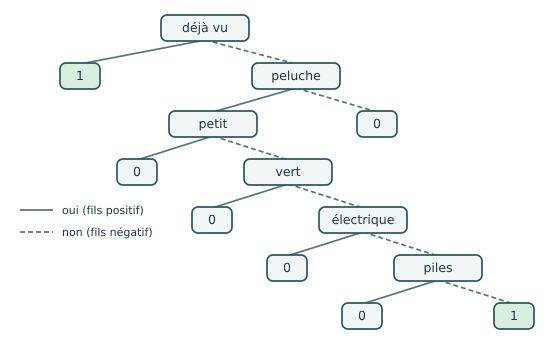

# École polytechnique MP — Informatique (option) 1999 · Corrigé guidé

*Corrigé rédigé par IA, non officiel. Signalez toute erreur.*

**Rédaction** · GPT-6.2 Astra Ultra · vitesse non renseignée

**Révision** · GPT-6.2 Astra Ultra · vitesse non renseignée · 26 novembre 2026

**Arbres de décision pour les fonctions booléennes.** Les dix questions passent des tables de vérité à une affiche qui énumère des chemins acceptants. Les programmes en Caml (syntaxe OCaml) et en Pascal se lisent dans l’ordre des questions.

## I. Fonctions booléennes

### Question 1

> [!INDICATION]
> Pour chaque connecteur, fixer le premier argument et déterminer ce qui reste du second.

#### Solution

Les tables de la première page fixent le sens des noms. Si le premier argument est faux, la conjonction est fausse, la disjonction vaut le second argument et l’implication est vraie. S’il est vrai, ces trois résultats sont respectivement le second argument, vrai et le second argument. Cela donne les définitions demandées avec la seule conditionnelle.

```ocaml
let et x0 x1 = if x0 then x1 else false
let ou x0 x1 = if x0 then true else x1
let implique x0 x1 = if x0 then x1 else true
```

#### Pascal · Connecteurs par conditionnelle

Les seuls résultats écrits sont les valeurs des paramètres ou les constantes booléennes. La table fournie fixe le sens respectif des noms.

```pascal
function et(x0, x1: boolean): boolean;
begin
  if x0 then et := x1 else et := false
end;

function ou(x0, x1: boolean): boolean;
begin
  if x0 then ou := true else ou := x1
end;

function implique(x0, x1: boolean): boolean;
begin
  if x0 then implique := x1 else implique := true
end;
```

### Question 2.a

> [!INDICATION]
> Identifier précisément le seul couple qui rend une implication fausse.

#### Solution

1. **Vrai.** L’antécédent ne peut être à la fois vrai et identique à un conséquent faux. Ainsi $x_0\Rightarrow x_0$ vaut toujours 1.
2. **Vrai.** De part et d’autre, la valeur est 1 exactement sur le couple $(1,0)$.
3. **Faux.** Une tautologie vaut 1 sur chacun des $2^n$ vecteurs, donc en particulier sur le vecteur nul.
4. **Faux.** Si $\neg g$ est toujours vraie, $g$ est toujours fausse. La fonction constante nulle donne un contre-exemple.

### Question 2.b

> [!INDICATION]
> Un antécédent faux suffit, quelle que soit la valeur de la seconde implication.

#### Solution

Le triplet $(0,0,0)$ convient. L’implication intérieure $0\Rightarrow0$ vaut 1 et l’implication extérieure $0\Rightarrow1$ vaut 1.

### Question 3.a

> [!INDICATION]
> Examiner d’abord la taille du train et le statut de peluche.

#### Solution

Oscar doit laisser son train à l’extérieur. Ce jouet est grand et ne constitue pas une peluche, il viole donc la première règle. Le fait qu’il soit muni de piles satisfait la troisième règle.

### Question 3.b

> [!INDICATION]
> Traduire les cinq règles dans l’ordre et les relier par des conjonctions. « Grand » signifie « non petit ».

#### Solution

Notons $P,S,V,E,B$ les cinq caractéristiques dans l’ordre imprimé (peluche, petit, vert, électrique, piles). Pour la première règle, « sauf les peluches » autorise toute taille pour une peluche. L’admission est donc décrite par
$$
\begin{aligned}
p={}&(P\lor S)\land(V\lor\neg S)\land(E\Rightarrow B)\\
 &\land\neg(B\land P)\land\bigl(V\Rightarrow(P\land E)\bigr).
\end{aligned}
$$
La disjonction de la seconde règle est inclusive. La dernière implication porte sur les deux propriétés de sa conclusion.

## II. Arbres de décision

### Question 4.a

> [!INDICATION]
> Écrire le fils du cas vrai en premier. Conserver l’ordre des indices même si une formule écrite échange ses facteurs.

#### Solution

Notons $T_i(u,v)=\mathrm{test}_{x_i}(u,v)$. L’arbre de $x_0$ est $T_0(1,0)$ et celui de $\neg x_1$ est $T_1(0,1)$. Pour chacune des trois dernières fonctions on obtient
$$T_0(T_1(0,1),0).$$
En effet elles sont vraies exactement lorsque $x_0=1$ et $x_1=0$. L’ordre fixé impose de tester $x_0$ avant $x_1$.

### Question 4.b

> [!INDICATION]
> Sous une racine donnée, les affectations des indices suivants peuvent être choisies librement dans chaque branche.

#### Solution

Raisonnons par récurrence sur la hauteur. La seule feuille tautologique est 1. Si un nœud $T_i(v,f)$ représentait une tautologie, fixons arbitrairement les autres variables. Le choix $x_i=1$ impose que $v$ vaille 1, celui de $x_i=0$ que $f$ vaille 1. Comme $v,f$ ne testent que des indices supérieurs à $i$, chacun représente une tautologie. Par l’hypothèse de récurrence, ils seraient tous deux la feuille 1. L’exigence de deux fils distincts exclut ce nœud. Il reste seulement la feuille 1.

### Question 4.c

> [!INDICATION]
> Construire les deux restrictions à la première variable, puis décider s’il est nécessaire de garder le nœud.

#### Solution

Par récurrence sur le nombre de variables disponibles, en autorisant zéro variable pour l’initialisation. Une fonction sur le seul tuple vide est constante, donc représentée par une feuille. Pour $n$ variables, fixer la première à 1 puis à 0. Par récurrence, les deux fonctions sur les $n-1$ variables restantes ont des arbres $a_1,a_0$. Si ces arbres sont identiques, garder $a_1$, qui convient aux deux valeurs. Sinon, construire $T_0(a_1,a_0)$. Les deux fils sont alors distincts et tous leurs indices sont strictement supérieurs à celui de la racine. Sur chaque entrée, la branche choisie représente la bonne restriction. La récurrence s’applique avec le même ordre aux suffixes de la liste des variables.

### Question 5.a

> [!INDICATION]
> Suivre le seul chemin vers 1, puis contrôler son interprétation à partir des cinq règles.

#### Solution

Le seul jouet admis est **une grande peluche, non verte, non électrique et sans piles**. Plusieurs objets physiques peuvent évidemment avoir ces mêmes cinq caractéristiques. Pour le retrouver algébriquement, un jouet vert devrait être une peluche électrique, donc accompagné de piles, interdites à une peluche. Ainsi $V=0$. La deuxième règle impose $S=0$, la première impose $P=1$, la quatrième impose $B=0$, puis la troisième impose $E=0$. Réciproquement, ce profil satisfait les cinq règles.

### Question 5.b

> [!INDICATION]
> Distinguer une obligation supplémentaire d’une autorisation qui l’emporte sur toutes les règles.

#### Solution

Pour $p_a=p\land(P\Rightarrow V)$, le seul profil admis par $p$ avait $P=1$ et $V=0$. Aucun jouet ne convient. L’arbre de $p_a$ est la feuille **0**.

Pour $p_b=p\lor V$, tout jouet vert est admis. Parmi les jouets non verts, seul le profil de 5.a convient. En gardant l’ordre $P,S,V,E,B$, posons $G=T_V(1,0)$ et $H=T_E(0,T_B(0,1))$. L’arbre demandé est
$$T_P\bigl(T_S(G,T_V(1,H)),G\bigr).$$
En effet, sans peluche ou avec une petite peluche, il faut exactement que le jouet soit vert. Pour une grande peluche, le vert suffit, et à défaut il faut à la fois $E=0$ et $B=0$. Les deux occurrences de $G$ désignent deux sous-arbres identiques situés sur des branches différentes.



### Question 5.c

> [!INDICATION]
> Placer en tête la variable qui décide à elle seule dans le cas favorable.

#### Solution

Adoptons l’ordre « déjà vu », puis $P,S,V,E,B$. Si $A$ est l’arbre de $p$ donné dans le sujet, $T_{\mathrm{deja\_vu}}(1,A)$ représente la nouvelle politique. Un jouet déjà vu est admis immédiatement, alors qu’un jouet nouveau passe par les cinq règles. Les fils diffèrent, puisque $A$ refuse entre autres le train d’Oscar.



### Question 6.a

> [!INDICATION]
> Distinguer les deux valeurs de la projection et appliquer la négation dans la branche retenue.

#### Solution

En notant $g_b=g_{i\leftarrow b}$, on obtient
$$g=\mathrm{test}(x_i,g_1,g_0),\qquad
\neg g=\mathrm{test}(x_i,\neg g_1,\neg g_0).$$
Sur une entrée dont le bit $i$ vaut $b$, $g_b$ a exactement la valeur de $g$ sur cette entrée. Les deux identités suivent sur chacune des deux branches.

### Question 6.b

> [!INDICATION]
> Restreindre simultanément les trois arguments à la même valeur du bit.

#### Solution

Posons $u_b=\mathrm{test}(g_{i\leftarrow b},g'_{i\leftarrow b},g''_{i\leftarrow b})$. Alors
$$\mathrm{test}(g,g',g'')=\mathrm{test}(x_i,u_1,u_0).$$
Pour un vecteur de bit $i$ égal à $b$, le membre droit choisit $u_b$. Les trois fonctions restreintes coïncident au point considéré avec $g,g',g''$. L’évaluation sélectionne donc la même branche puis la même valeur que le membre gauche.

## III. Programmation des arbres de décision

### Question 7.a

> [!INDICATION]
> Une projection renvoie la valeur du test lui-même.

#### Solution

Voici la branche Caml en syntaxe OCaml. Le fils positif est toujours placé à gauche. Les indices sont ceux de l’énoncé, à partir de zéro.

```ocaml
type variable = int
type abd = Bool of bool | Test of variable * abd * abd

let abd_proj i = Test (i, Bool true, Bool false)
```

#### Pascal · Projection et constructeurs imposés

Le type discriminé est celui de la composition. L’alias `type_nature` évite une ambiguïté de Free Pascal entre le nom du type et celui du champ `nature`. Les primitives `fait_bool(val: boolean): abd` et `fait_test(testee: variable; pos, neg: abd): abd` sont fournies. Toute création de feuille ou de nœud dans les réponses Pascal passe par elles. La projection choisit vrai sur le fils positif et faux sur le fils négatif.

```pascal
type
  variable = integer;
  type_nature = (Test, Bool);
  abd = ^cellule;
  cellule = record
    case nature: type_nature of
      Bool: (val: boolean);
      Test: (testee: variable; pos, neg: abd)
  end;
  nature = type_nature;
```

Les constructeurs fournis prennent place après le type précédent. La réponse à la question est la fonction suivante.

```pascal
function abd_proj(i: variable): abd;
begin
  abd_proj := fait_test(i, fait_bool(true), fait_bool(false))
end;
```

### Question 7.b

> [!INDICATION]
> Complémenter les feuilles sans changer les indices. Comment prouver que deux fils distincts restent distincts ?

#### Solution

La fonction suivante change le booléen à chaque feuille. Une induction sur l’arbre montre qu’elle calcule le complément, car le test de chaque nœud sélectionne le même chemin.

```ocaml
let rec abd_neg = function
  | Bool b -> Bool (not b)
  | Test (i, v, f) -> Test (i, abd_neg v, abd_neg f)
```

Appliquée deux fois, cette transformation rend exactement l’arbre initial (même induction). Elle est donc injective sur les arbres structurés. Deux fils distincts restent distincts, et les indices sur chaque chemin conservent leur ordre. Le parcours termine sur les sous-arbres stricts.

#### Pascal · Complément structurel

Les champs lus dépendent du discriminant. L’inversion des feuilles est involutive, donc injective sur les structures. Deux branches distinctes le restent, dans le même ordre de variables.

```pascal
function abd_neg(g: abd): abd;
begin
  case g^.nature of
    Bool: abd_neg := fait_bool(not g^.val);
    Test: abd_neg := fait_test(g^.testee,
                               abd_neg(g^.pos), abd_neg(g^.neg))
  end
end;
```

### Question 8.a

> [!INDICATION]
> Comparer les constructeurs puis, pour deux nœuds, la variable et les deux paires de fils.

#### Solution

Les seules comparaisons primitives portent sur des booléens ou des entiers. Les deux appels récursifs descendent sous les racines. Par induction, la réponse est vraie exactement lorsque les deux représentations ont les mêmes constructeurs, étiquettes et orientations à tous les emplacements.

```ocaml
let rec abd_egal a b =
  match a, b with
  | Bool x, Bool y -> x = y
  | Test (i, v, f), Test (j, w, h) ->
      i = j && abd_egal v w && abd_egal f h
  | _ -> false
```

#### Pascal · Égalité de structure

Deux appels indépendants à `abd_proj(0)` peuvent allouer des nœuds distincts qui représentent exactement la même structure. La comparaison ci-dessous descend dans les fils par paires.

```pascal
function abd_egal(a0, a1: abd): boolean;
begin
  if a0^.nature <> a1^.nature then abd_egal := false
  else case a0^.nature of
    Bool: abd_egal := a0^.val = a1^.val;
    Test: abd_egal :=
      (a0^.testee = a1^.testee) and abd_egal(a0^.pos, a1^.pos)
                                 and abd_egal(a0^.neg, a1^.neg)
  end
end;
```

### Question 8.b

> [!INDICATION]
> Comparer l’indice fixé à l’indice de la racine. Après un appel récursif, deux fils autrefois distincts peuvent coïncider.

#### Solution

La construction auxiliaire élimine un test dont les deux branches sont identiques.

```ocaml
let noeud i v f =
  if abd_egal v f then v else Test (i, v, f)

let rec abd_partiel i b a =
  match a with
  | Bool _ -> a
  | Test (j, v, f) ->
      if j > i then a
      else if j = i then (if b then v else f)
      else noeud j (abd_partiel i b v) (abd_partiel i b f)
```

Si $j>i$, la variable fixée est absente de tout le sous-arbre. Si $j=i$, elle ne revient dans aucun fils, il suffit donc d’en choisir un. Pour $j<i$, l’hypothèse de récurrence garantit les bonnes restrictions dans les deux fils. Un éventuel effacement par `noeud` conserve la même fonction. La procédure ajoute seulement des indices qui existaient à la même place, et chaque récursion porte sur des sous-arbres stricts.

#### Pascal · Restriction et réduction

Le constructeur auxiliaire compare les branches structurellement. Quand elles sont égales, il rend l’une d’elles. Les arbres sont traités comme immuables, ce qui permet de partager une branche existante sans modifier l’arbre d’entrée.

```pascal
function noeud(i: variable; v, f: abd): abd;
begin
  if abd_egal(v, f) then noeud := v
                    else noeud := fait_test(i, v, f)
end;

function abd_partiel(i: variable; b: boolean; g: abd): abd;
begin
  if g^.nature = Bool then abd_partiel := g
  else if g^.testee > i then abd_partiel := g
  else if g^.testee = i then begin
    if b then abd_partiel := g^.pos else abd_partiel := g^.neg
  end else
    abd_partiel := noeud(g^.testee, abd_partiel(i, b, g^.pos),
                                    abd_partiel(i, b, g^.neg))
end;
```

### Question 8.c

> [!INDICATION]
> Scinder sur le plus petit indice qui apparaisse en tête de l’un des trois arbres. Le retrouver dans la condition seule ne suffit pas.

#### Solution

Pour une condition constante, on renvoie directement la branche prescrite. Sinon la racine de la condition fournit un premier indice, abaissé si la racine de l’une des deux branches vient plus tôt.

```ocaml
let racine_ou i = function
  | Bool _ -> i
  | Test (j, _, _) -> min i j

let rec abd_test c v f =
  match c with
  | Bool b -> if b then v else f
  | Test (j, _, _) ->
      let i = racine_ou (racine_ou j v) f in
      let branche b =
        abd_test (abd_partiel i b c)
                 (abd_partiel i b v)
                 (abd_partiel i b f)
      in
      noeud i (branche true) (branche false)
```

Tous les indices apparents sont au moins $i$. Un arbre dont la racine porte $i$ est remplacé par un fils, un arbre dont la racine est plus grande reste entier. Sur chaque appel, au moins une racine disparaît et la somme des tailles des trois arbres diminue strictement. La récursion termine. L’identité de 6.b prouve la correction en supposant les deux appels justes. Les arbres produits sous la racine n’utilisent que des indices supérieurs à $i$, et `noeud` assure la condition de fils distincts.

#### Pascal · Construction du test conditionnel

Choisir le plus petit indice des trois racines internes. La condition est ici interne dès que les deux cas constants ont été écartés. Au moins un des trois arguments perd sa racine dans chaque appel récursif et les autres gardent leur arbre ou perdent aussi leur racine.

```pascal
function abd_test(c, v, f: abd): abd;
var i: variable; oui, non: abd;
  procedure abaisser(g: abd);
  begin
    if g^.nature = Test then
      if g^.testee < i then i := g^.testee
  end;
begin
  if c^.nature = Bool then begin
    if c^.val then abd_test := v else abd_test := f
  end else begin
    i := c^.testee;
    abaisser(v);
    abaisser(f);
    oui := abd_test(abd_partiel(i, true, c), abd_partiel(i, true, v),
                    abd_partiel(i, true, f));
    non := abd_test(abd_partiel(i, false, c), abd_partiel(i, false, v),
                    abd_partiel(i, false, f));
    abd_test := noeud(i, oui, non)
  end
end;
```

### Question 8.d

> [!INDICATION]
> Reprendre les trois conditionnelles de la première question et remplacer le test de machine par le test sur les arbres.

#### Solution

La valeur de $f$ choisit entre $g$ et faux pour la conjonction, entre vrai et $g$ pour la disjonction, entre $g$ et vrai pour l’implication. Les appels utilisent la représentation réduite obtenue en 8.c.

```ocaml
let abd_et f g = abd_test f g (Bool false)
let abd_ou f g = abd_test f (Bool true) g
let abd_implique f g = abd_test f g (Bool true)
```

#### Pascal · Connecteurs entre arbres

Les trois opérations utilisent le test conditionnel et les deux feuilles que construisent les primitives du sujet.

```pascal
function abd_et(f, g: abd): abd;
begin abd_et := abd_test(f, g, fait_bool(false)) end;

function abd_ou(f, g: abd): abd;
begin abd_ou := abd_test(f, fait_bool(true), g) end;

function abd_implique(f, g: abd): abd;
begin abd_implique := abd_test(f, g, fait_bool(true)) end;
```

### Question 9

> [!INDICATION]
> Repartir des règles numérotées plutôt que de coder le profil déjà simplifié.

#### Solution

On attribue successivement les indices 0 à 4 aux caractéristiques. Les définitions `r1` à `r5` traduisent séparément les cinq phrases. Les deux extensions de la question 5.b agissent une fois la politique initiale construite.

```ocaml
let peluche = abd_proj 0
let petit = abd_proj 1
let vert = abd_proj 2
let electrique = abd_proj 3
let piles = abd_proj 4

let r1 = abd_ou peluche petit
let r2 = abd_ou vert (abd_neg petit)
let r3 = abd_implique electrique piles
let r4 = abd_neg (abd_et piles peluche)
let r5 = abd_implique vert (abd_et peluche electrique)

let p = abd_et r1 (abd_et r2 (abd_et r3 (abd_et r4 r5)))
let pa = abd_et p (abd_implique peluche vert)
let pb = abd_ou p vert
```

#### Pascal · Assemblage des politiques

Le corps de `construire_politiques` fournit les instructions demandées. Après son appel, les trois variables globales contiennent les résultats. L’ordre des indices correspond à celui du document.

```pascal
var p, pa, pb: abd;

procedure construire_politiques;
var peluche, petit, vert, electrique, piles: abd;
    r1, r2, r3, r4, r5: abd;
begin
  peluche := abd_proj(0); petit := abd_proj(1); vert := abd_proj(2);
  electrique := abd_proj(3); piles := abd_proj(4);
  r1 := abd_ou(peluche, petit);
  r2 := abd_ou(vert, abd_neg(petit));
  r3 := abd_implique(electrique, piles);
  r4 := abd_neg(abd_et(piles, peluche));
  r5 := abd_implique(vert, abd_et(peluche, electrique));
  p := abd_et(r1, abd_et(r2, abd_et(r3, abd_et(r4, r5))));
  pa := abd_et(p, abd_implique(peluche, vert));
  pb := abd_ou(p, vert)
end;
```

### Question 10.a

> [!INDICATION]
> Mémoriser les décisions du chemin et n’imprimer qu’à la feuille vraie. Les variables sautées sont libres.

#### Solution

On utilise le tableau `nom` fourni par le sujet. Le chemin est mémorisé à l’envers pour permettre l’ajout en tête. La fonction écrit une ligne par feuille 1 et restitue les caractéristiques dans l’ordre des tests.

```ocaml
let abd_solutions p =
  let rec visite chemin = function
    | Bool false -> ()
    | Bool true ->
        let ligne =
          match chemin with
          | [] -> "Tous les jouets"
          | _ -> String.concat ", " (List.rev chemin)
        in
        print_endline ligne
    | Test (i, v, f) ->
        visite (nom.(i) :: chemin) v;
        visite (("non " ^ nom.(i)) :: chemin) f
  in
  visite [] p
```

Chaque chemin est fini et ses indices sont strictement croissants. Chaque caractéristique y apparaît donc au plus une fois. Ses conditions décrivent précisément les entrées qui le suivent, quels que soient leurs bits non testés. Les lignes des feuilles vraies sont ainsi disjointes et, ensemble, décrivent tous les jouets admis. L’arbre constant vrai imprime une ligne même pour le chemin vide.

#### Pascal · Affichage des chemins acceptants

Le tableau global `nom[0..4]` est fourni par le sujet. Les tableaux locaux gardent les indices et les signes du chemin en cours. Une récursion ne modifie que les positions correspondant à sa profondeur ou aux profondeurs suivantes. Au retour, il suffit donc de changer le dernier signe pour visiter la branche négative.

```pascal
procedure abd_solutions(p: abd);
var indices: array[0..4] of variable;
    signes: array[0..4] of boolean;
  procedure visite(g: abd; profondeur: integer);
  var j: integer;
  begin
    case g^.nature of
      Bool: if g^.val then begin
        if profondeur = 0 then write('Tous les jouets');
        for j := 0 to profondeur - 1 do begin
          if j <> 0 then write(', ');
          if not signes[j] then write('non ');
          write(nom[indices[j]])
        end;
        writeln
      end;
      Test: begin
        indices[profondeur] := g^.testee;
        signes[profondeur] := true;
        visite(g^.pos, profondeur + 1);
        signes[profondeur] := false;
        visite(g^.neg, profondeur + 1)
      end
    end
  end;
begin
  visite(p, 0)
end;
```

### Question 10.b

> [!INDICATION]
> Compter les feuilles vraies de l’arbre pour l’ordre imposé, pas les affectations complètes.

#### Solution

Les affiches de $p,p_a,p_b$ et de la constante vraie ont respectivement **1, 0, 4 et 1 lignes**. Pour $p$, un seul chemin est accepté. Pour $p_a$, aucune feuille n’est vraie. Pour $p_b$, la figure de 5.b donne les quatre chemins acceptés, écrits ici dans l’ordre du parcours.

| Caractéristiques présentes sur la ligne | Nombre de profils complets |
|---|---:|
| peluche, petit, vert | 4 |
| peluche, non petit, vert | 4 |
| peluche, non petit, non vert, non électrique, non piles | 1 |
| non peluche, vert | 8 |

Au total ces quatre lignes couvrent $4+4+1+8=17$ des 32 profils. La politique laxiste a une seule feuille, qui représente les 32 profils à la fois.

## Vérification des programmes

Les blocs publiés ont été extraits séparément des éditions brute et guidée. Les quatre vérifications de cette épreuve ont utilisé Free Pascal 3.2.2 ou OCaml 5.3.0. Pour chaque édition et chaque langage, les 4 096 triplets de fonctions de deux variables ont été évalués sur les quatre profils binaires. La négation et les restrictions des 256 fonctions de trois variables, l’ordre des indices et la réduction des branches ont également été contrôlés. Sur les 32 profils de jouets, les quatre affiches produisent 1, 0, 4 et 1 lignes. Le banc Pascal fournit les deux constructeurs de l’énoncé et le tableau des noms.
