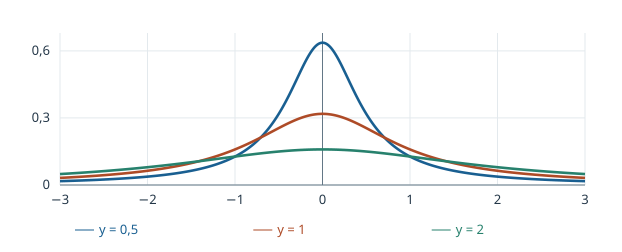

# École polytechnique — Première composition de mathématiques MP 1999 · Corrigé guidé

*Corrigé rédigé par IA, non officiel. Signalez toute erreur.*

**Rédaction** · GPT-6.2 Astra Ultra · vitesse non renseignée

Dans le demi-plan $\Pi_+=\{(x,y):y>0\}$, le noyau du sujet est $K(x,y)=y/(\pi(x^2+y^2))$. On considère des fonctions complexes, avec la norme du supremum. Le prolongement au bord sera noté $\overline{\Phi}_f$.

## I. Le noyau du demi-plan

### Question 1

> [!INDICATION]
> Fixer $y>0$ et poser $u=x/y$.

#### Solution

La substitution donne $\int_{\mathbb R}K(x,y)\,dx=\pi^{-1}\int_{\mathbb R}du/(1+u^2)=1$, par la primitive $\arctan u$.

### Question 2

> [!INDICATION]
> Dériver en conservant $D=x^2+y^2$ comme dénominateur commun.

#### Solution

On obtient $\partial_1K=-2xy/(\pi D^2)$ et $\partial_2K=(x^2-y^2)/(\pi D^2)$. Puis $\partial_1^2K=2y(3x^2-y^2)/(\pi D^3)$ et $\partial_2^2K=2y(y^2-3x^2)/(\pi D^3)$. Leur somme est nulle.

### Question 3

> [!INDICATION]
> En dérivant un quotient $P/D^r$, examiner le degré en $x$ des deux termes du nouveau numérateur.

#### Solution

Au rang $m+n=0$, $P_{0,0}=y/\pi$ a degré zéro en $x$. Pour $r=m+n+1$, la dérivation en $s=x$ ou $y$ remplace $P$ par $D\partial_sP-rP\partial_sD$ et $D^r$ par $D^{r+1}$. Le degré en $x$ du numérateur augmente d’au plus deux. La récurrence donne la forme demandée avec $\deg_xP_{m,n}\le2(m+n)$.

## II. Intégrale de Poisson et continuité au bord

### Question 4

> [!INDICATION]
> Comparer l’intégrande à un translaté positif du noyau de masse un.

#### Solution

Pour $f$ continue bornée, $M=\|f\|_\infty$ et $(x,y)\in\Pi_+$, $|f(t)K(x-t,y)|\le MK(x-t,y)$, d’intégrale $M$ par 1. L’intégrale définissant $\Phi_f$ converge absolument.

### Question 5.a

> [!INDICATION]
> Réécrire $\Phi_f$ avec une mesure d’intégration indépendante de $x$ et de $y$.

#### Solution

Par $u=(x-t)/y$,
$$
\Phi_f(x,y)=\frac1\pi\int_{\mathbb R}\frac{f(x-yu)}{1+u^2}\,du.
$$
La continuité de $f$ et la domination par $M/(\pi(1+u^2))$ donnent la continuité en $(x,y)$. La même formule donne $|\Phi_f(x,y)|\le M$.

### Question 5.b

> [!INDICATION]
> Tester l’estimation sur une fonction constante.

#### Solution

La linéarité de l’intégrale et 5.a donnent la continuité de $f\mapsto\Phi_f$ de $E$ dans $F$ et une norme au plus $1$. Pour $f=1$, $\Phi_f=1$ par 1. La norme opératorielle vaut donc $1$.

### Question 6

> [!INDICATION]
> Employer la forme rationnelle de 3 sur des rectangles compacts du demi-plan.

#### Solution

Sur $|x|\le R$ et $a\le y\le b$ avec $a>0$, les expressions $\partial_1^m\partial_2^nK(x-t,y)$ sont uniformément bornées pour $t$ borné. Pour $|t|>2R+1$, le numérateur est $O((1+|t|)^{2(m+n)})$ et le dénominateur de degré $2(m+n)+2$ est minoré par un multiple de $|t|^{2(m+n)+2}$. Ainsi chaque dérivée est dominée par $C/(1+t^2)$ sur tout le rectangle. $f$ étant bornée, on peut dériver à tous ordres sous l’intégrale. Cela donne $\Phi_f\in C^\infty$ et $\partial_1^2\Phi_f+\partial_2^2\Phi_f=0$ par 2.

### Question 7

> [!INDICATION]
> Comparer en valeur absolue les deux dérivées premières du noyau à $K/y$.

#### Solution

Les formules de 2 et $2|xy|\le D$, $|x^2-y^2|\le D$ donnent $|\partial_jK|\le K/y$. Sur $y\ge a$, les dérivées premières de $\Phi_f$ sont donc bornées par $M/a$ par 1 et 6. En intégrant le long du segment entre deux points du demi-plan fermé $y\ge a$, on obtient le majorant $(M/a)(|\Delta x|+|\Delta y|)$, donc la continuité uniforme.

### Question 8

> [!INDICATION]
> Dans la formule de 5.a, isoler $|u|\le R$ puis contrôler les arguments $x-yu$ proches de $x_0$.

#### Solution

Choisissons $R\ge1$ assez grand pour que $2M\int_{|u|>R}du/(\pi(1+u^2))\le\varepsilon/2$. Prenons $\delta>0$ tel que $|s-x_0|\le\delta$ entraîne $|f(s)-f(x_0)|\le\varepsilon/2$. Posons $\eta=\delta/(1+R)$. Sous les deux bornes du sujet, $|x-yu-x_0|\le\delta$ sur $|u|\le R$. L’intégrale de la différence est donc majorée par $\varepsilon/2+\varepsilon/2$. Cela établit la continuité du prolongement prenant $f(x_0)$ au bord.

### Question 9.a

> [!INDICATION]
> Identifier la seule constante de 8 qui dépend a priori de $x_0$.

#### Solution

La queue dépend uniquement de $M$. Si $f$ est uniformément continue, on choisit $\delta$ avec $|s-s'|\le\delta\Rightarrow |f(s)-f(s')|\le\varepsilon/2$ pour tout couple. Le même $\eta=\delta/(1+R)$ convient à tous les $x_0$.

### Question 9.b

> [!INDICATION]
> Utiliser la même troncature pour la différence de deux intégrales évaluées en des points arbitraires du demi-plan fermé.

#### Solution

La formule de 5.a vaut encore pour $y=0$, puisque la masse vaut un. Avec $R,\delta$ pris en 9.a, si $|x-x'|+R|y-y'|\le\delta$, alors $|(x-yu)-(x'-y'u)|\le\delta$ pour $|u|\le R$. Les contributions du centre et de la queue à $|\overline{\Phi}_f(x,y)-\overline{\Phi}_f(x',y')|$ sont chacune au plus $\varepsilon/2$. C’est la continuité uniforme sur $\overline{\Pi}_+$.

## III. Modes exponentiels et coefficients de Fourier

### Question 10.a

> [!INDICATION]
> Sortir le facteur exponentiel qui dépend de la translation $x$.

#### Solution

Pour $f(x)=e^{i\alpha x}$ avec $\alpha>0$, la formule 5.a donne $\Phi_f(x,y)=e^{i\alpha x}g(y)$ avec $g(y)=\pi^{-1}\int_{\mathbb R}e^{-i\alpha yu}\,du/(1+u^2)$. On a $|g|\le1$ et $g(0)=1$ par continuité au bord.

### Question 10.b

> [!INDICATION]
> Insérer cette séparation des variables dans l’équation de Laplace et utiliser les deux conditions obtenues en 10.a.

#### Solution

Dans $\Pi_+$, $g''-\alpha^2g=0$ par 6. Les solutions sont $Ae^{\alpha y}+Be^{-\alpha y}$. La bornitude impose $A=0$, et $g(0)=1$ impose $B=1$. Donc $\Phi_f(x,y)=e^{i\alpha x-\alpha y}$.

### Question 11

> [!INDICATION]
> Identifier d’abord la transformée du noyau, puis séparer les deux demi-droites de l’intégrale en $p$.

#### Solution

Pour $p>0$, 10 en $x=0$, $y=a$ donne $\psi(p)=(\pi/a)e^{-ap}$. La parité du dénominateur donne la même formule avec $|p|$ pour $p<0$, et 1 la confirme en zéro. Il vient
$$
\int_{\mathbb R}e^{-ipy}\psi(p)\,dp
=\frac{\pi}{a}\left(\frac1{a+iy}+\frac1{a-iy}\right)
=\frac{2\pi}{a^2+y^2}.
$$
Les deux intégrales sont absolument convergentes.

### Question 12.a

> [!INDICATION]
> Dans $h(x)$, faire porter la translation d’une période sur l’argument de $f$.

#### Solution

À hauteur $y_0>0$, $h(x)=\int_{\mathbb R}f(x-t)K(t,y_0)\,dt$. Remplacer $x$ par $x+2\pi$ laisse l’intégrande inchangé. Donc $h$ est $2\pi$-périodique.

### Question 12.b

> [!INDICATION]
> Tronquer d’abord l’intégrale en $t$ uniformément en $x$, puis changer la variable de l’intégrale de Fourier.

#### Solution

L’erreur de troncature à $[-A,A]$ est au plus $M\int_{|t|>A}K(t,y_0)\,dt$, indépendamment de $x$. Ainsi $\widehat h(n)$ est bien la limite annoncée des intégrales doubles avec facteur $1/(2\pi)$. Sur le domaine tronqué on permute les intégrales. La substitution $v=x-t$ et la périodicité de $e^{-inv}f(v)$ donnent $\int_0^{2\pi} e^{-inx} f(x-t)\,dx=2\pi e^{-int}\widehat f(n)$. En faisant $A\to\infty$, 11 avec $a=y_0$ donne $\widehat h(n)=e^{-|n|y_0}\widehat f(n)$, y compris $n=0$.

## IV. Données s’annulant à l’infini

### Question 13

> [!INDICATION]
> Déduire la continuité uniforme de $f$ de sa petitesse sur les deux queues et de la compacité au centre.

#### Solution

Pour $\varepsilon>0$, choisir $R$ tel que $|f|\le\varepsilon/2$ hors de $[-R,R]$. Sur $[-R-1,R+1]$, $f$ est uniformément continue. Prenons un pas inférieur à $1$ convenant à $\varepsilon$ sur ce compact. Deux points séparés de moins de ce pas y sont tous deux, ou bien ils sont tous deux hors de $[-R,R]$. Dans les deux cas l’écart des valeurs est au plus $\varepsilon$. La question 9.b donne la continuité uniforme de $\overline{\Phi}_f$.

### Question 14

> [!INDICATION]
> Isoler les données sur $[-R,R]$. Majorer le noyau tantôt par $1/(\pi y)$, tantôt par une borne uniforme en $y$.

#### Solution

Prenons $R\ge1$ tel que $|f(t)|\le\varepsilon/2$ pour $|t|\ge R$. Pour $y>0$, la contribution extérieure vaut au plus $\varepsilon/2$. Celle du segment central est au plus $2RM/(\pi y)$. Si $|x|>R$, elle est aussi majorée par $RM/(\pi(|x|-R))$, car $y/(s^2+y^2)\le1/(2|s|)$ et $|x-t|\ge|x|-R$. On peut prendre $a=1+4RM/(\pi\varepsilon)$ et $u=R+1+2RM/(\pi\varepsilon)$. L’une ou l’autre des hypothèses $y\ge a$ ou $|x|\ge u$ suffit. Au bord $y=0$, seule la seconde est possible, et $|f(x)|\le\varepsilon/2$ y donne le résultat.

### Question 15

> [!INDICATION]
> À partir de quelle valeur de $|x|+y$ l’un des deux seuils de 14 est-il forcément atteint ?

#### Solution

Si $|x|+y\ge u+a$, alors $|x|\ge u$ ou $y\ge a$. La question 14 fournit une borne $\varepsilon$ pour tout tel point. La limite cherchée est donc zéro.

### Question 16

> [!INDICATION]
> Comment retrouver la norme de $f$ depuis le demi-plan ouvert lorsque les points du bord ne font pas partie de $F$ ?

#### Solution

On sait que $\|\Phi_f\|_\infty\le\|f\|_\infty$. En faisant $y\downarrow0$ à $x$ fixé, on obtient $|f(x)|\le\|\Phi_f\|_\infty$, puis l’inégalité inverse en prenant le supremum. L’opérateur est isométrique sur $E_0$, espace contenant par exemple $x\mapsto e^{-x^2}\ne0$. Sa norme vaut $1$.
