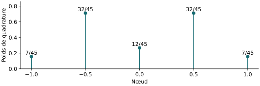
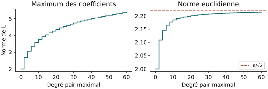

# Deuxième composition de mathématiques — PC 1999 — Corrigé

*Corrigé rédigé par IA, non officiel. Signalez toute erreur.*

**Rédaction** · GPT-6.2 Astra Ultra · vitesse non renseignée · 26 novembre 2026

Sur $E=\mathbb R_n[X]$, on étudie la forme $L(P)=\int_{-1}^1P(x)\,dx$. Les normes de la deuxième et de la troisième partie portent sur les coefficients du polynôme.

École polytechnique et École supérieure de physique et de chimie industrielles · 3 h. [Énoncé](https://www.sujetsetcorriges.fr/dl/X/Maths/PC/sec-x-1999-maths2-PC.pdf)

## Première partie — Formules de quadrature

### 1. Image, noyau et base

Pour $P=\sum_{p=0}^n a_pX^p$, $L(P)=2\sum_{0\leq2j\leq n}a_{2j}/(2j+1)$. Puisque $L(1)=2$, le rang est un et le noyau a dimension $n$. Pour $p=1,\ldots,n$, posons $Q_p=X^p-L(X^p)/2$. Ces $n$ polynômes du noyau ont des degrés distincts, donc en forment une base (vide si $n=0$).

### 2.a. Polynômes cardinaux

Posons $P_i(X)=\prod_{j\ne i}(X-x_j)/(x_i-x_j)$. Les dénominateurs sont non nuls. Ces polynômes de degré au plus $n$ vérifient exactement $P_i(x_j)=\delta_{ij}$, y compris pour un seul nœud grâce au produit vide.

### 2.b. Poids de quadrature

La différence entre $P$ et $\sum_{i=0}^nP(x_i)P_i$ s’annule aux $n+1$ nœuds et a degré au plus $n$. Elle est nulle. Appliquer $L$ donne les poids $\lambda_i=L(P_i)$. Toute autre famille satisfaisant la formule prend ces mêmes valeurs en la testant sur les $P_i$.

### 3. Symétrie et degré d’exactitude

Pour $x_{n-i}=-x_i$, l’unicité de l’interpolation donne $P_{n-i}(x)=P_i(-x)$ et l’intégration $\lambda_{n-i}=\lambda_i$. Quand $n$ est pair, la puissance supplémentaire $X^{n+1}$ est impaire. Son intégrale et sa somme pondérée sont nulles par symétrie. Par linéarité la quadrature est exacte jusqu’au degré $n+1$.

### 4.a. Borne sur l’erreur

Soit $T_n$ le polynôme de Taylor de $f$ en zéro. Il est intégré exactement et $|f(x)-T_n(x)|\leq M_{n+1}|x|^{n+1}/(n+1)!$. L’intégrale du majorant est $2M_{n+1}/(n+2)!$. La contribution des nœuds est au plus $M_{n+1}\sum|\lambda_i|/(n+1)!$. On peut donc prendre $\alpha=2/(n+2)!$, $\beta=1/(n+1)!$.

### 4.b. Borne améliorée en degré pair

Avec les hypothèses de symétrie, le même argument sur le reste de $T_{n+1}$ donne $M_{n+2}\big(2/(n+3)!+\sum|\lambda_i|/(n+2)!\big)$.

### 5.a. Cinq points équidistants

Notons $a,b,c$ les poids aux points $1,1/2,0$. Les équations sont $2a+2b+c=2$, $2a+b/2=2/3$, $2a+b/8=2/5$. On trouve $(\lambda_0,\ldots,\lambda_4)=(7,32,12,32,7)/45$. Les moments impairs sont automatiquement exacts.

### 5.b. Application à l’exponentielle

Pour $f(x)=e^{x^2/16}$, les dérivées se calculent par $f^{(m)}=p_m f$, $p_0=1$, $p_{m+1}=p'_m+xp_m/8$. Ainsi $p_6=x^6/262144+15x^4/32768+45x^2/4096+15/512$. Le maximum du module est atteint en $|x|=1$, d’où $M_6=10681e^{1/16}/262144$. Comme $\sum|\lambda_i|=2$, 4.b fournit une erreur au plus $M_6(2/7!+2/6!)$, soit moins de $1,38\times10^{-4}$.

## Deuxième partie — Normes en dimension finie

### 6.a. Atteinte de la norme

Toutes les normes sont équivalentes sur $E$ et $L$ y est continue. $|L|$ atteint donc son maximum sur la boule unité fermée. Il est positif car $L(1)\ne0$. Un maximiseur $Q$ non nul de norme strictement inférieure à un pourrait être dilaté pour augmenter $|L(Q)|$. Ainsi $N(Q)=1$.

### 6.b. Constante optimale

De $|L(P)|\leq KN(P)$ on déduit $|L(P)|\leq K$ sur la boule unité, donc $N(L)\leq K$. S’il existe $Q$ de norme un pour lequel $|L(Q)|=K$, le supremum vaut exactement $K$.

### 7. Comparer les normes des coefficients

On a $N_\infty(P)\leq N_2(P)\leq\sqrt{n+1}\,N_\infty(P)$. Les deux constantes sont atteintes, par un monôme puis par un polynôme dont tous les coefficients ont même module non nul.

### 8.a. Maximiser sous la norme du maximum

Posons $h=\lfloor n/2\rfloor$ et $Q_\infty=\sum_{j=0}^h X^{2j}$. Sa norme vaut un. Par la formule de 1, pour toute boule unité, $|L(P)|\leq2\sum_{j=0}^h(2j+1)^{-1}$ et $Q_\infty$ réalise l’égalité. C’est la valeur de $N_\infty(L)$.

### 8.b. Maximiser sous la norme euclidienne

Écrivons $c_{2j}=2/(2j+1)$, $c_{2j+1}=0$, pour les indices entre $0$ et $n$. Alors $L(P)=\sum a_p c_p$. Cauchy–Schwarz donne $N_2(L)=\|c\|_2=2(\sum_{j=0}^h(2j+1)^{-2})^{1/2}$ et le polynôme $Q_2=\sum(c_p/\|c\|_2)X^p$ en est un maximiseur unitaire.

## Troisième partie — Degré non borné

### 9.a. Divergence sur la boule unité

Les $P_k=\sum_{j=0}^k X^{2j}$ vérifient $N_\infty(P_k)=1$ et $L(P_k)=2\sum_{j=0}^k(2j+1)^{-1}\to+\infty$ par comparaison avec la série harmonique.

### 9.b. Continuité

Pour $N_\infty$, une forme linéaire continue est bornée sur la boule unité, contrairement à 9.a. Ainsi $L$ est discontinue pour cette norme. Pour $N_2$, la réponse change comme le montre 10.a.

### 10.a. Supremum euclidien

La suite des moments est de carré sommable. Cauchy–Schwarz, appliqué à chaque polynôme de support fini, donne $|L(P)|\leq 2(\sum_{j\geq0}(2j+1)^{-2})^{1/2} N_2(P)$. Les polynômes de 8.b de degré croissant tendent vers cette borne en valeur d’image. Elle est donc le supremum cherché. En utilisant $\sum_{m\geq1}m^{-2}=\pi^2/6$, sa valeur est $\pi/\sqrt2$.

### 10.b. Absence de maximiseur polynomial

Pour un polynôme unitaire de degré $d$, la borne de 8.b ne fait intervenir que les moments d’indices au plus $d$. La queue de la série des carrés contient encore des termes strictement positifs. Cette borne est donc strictement inférieure au supremum sur $F$. Aucun polynôme de norme un ne le réalise.

