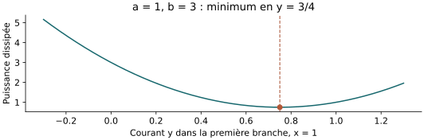
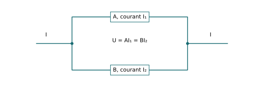

# Première composition de mathématiques — PC 1999 — Corrigé guidé

*Corrigé rédigé par IA, non officiel. Signalez toute erreur.*

**Rédaction** · GPT-6.2 Astra Ultra · vitesse non renseignée · 26 novembre 2026

On note $q_M(x)=x^tMx$ pour une matrice symétrique réelle. La somme parallèle étend au cas matriciel la résistance équivalente de deux branches parcourues par des courants dont la somme est fixée.

École polytechnique et École supérieure de physique et de chimie industrielles · 4 h. [Énoncé](https://www.sujetsetcorriges.fr/dl/X/Maths/PC/sec-x-1999-maths1-PC.pdf)

## Première partie — Matrices symétriques

### 1. Extrema sur la sphère

**Indication.** Identifier un compact et une fonction continue.

La sphère unité est fermée et bornée en dimension finie, donc compacte. La fonction polynomiale $q_M$ y est continue. Elle est bornée et atteint ses deux extrema.

### 2. Valeurs propres extrêmes

**Indication.** Exprimer $x$ dans une base orthonormée de vecteurs propres.

Par le théorème spectral, $q_M(x)=\sum_j\lambda_j x_j^2$ dans cette base. Pour $\|x\|=1$, c’est une moyenne pondérée des valeurs propres. Les extrema $\lambda_{\min}$ et $\lambda_{\max}$ sont atteints par des vecteurs propres unitaires correspondants.

### 3.a. Positivité

**Indication.** Utiliser l’homogénéité du quotient de Rayleigh.

$q_M(x)\geq0$ partout équivaut à la même condition sur la sphère. Son minimum est $\lambda_{\min}$, d’où l’équivalence à $\lambda_{\min}\geq0$.

### 3.b. Positivité définie

**Indication.** Le minimum sur la sphère est atteint.

La stricte positivité sur les vecteurs non nuls équivaut à $\min_{\|x\|=1}q_M(x)>0$, donc à $\lambda_{\min}>0$.

### 3.c. Inversibilité

**Indication.** Examiner la valeur propre zéro.

Dans le cas positif, toutes les valeurs propres sont positives ou nulles. L’inversibilité exclut zéro, donc caractérise la positivité définie parmi les matrices positives. Réciproquement une matrice définie positive est positive et inversible.

### 4.a. Point critique

**Indication.** Différencier la forme quadratique en une direction quelconque.

La différentielle de $q_M(x)+2(c\mid x)+r$ appliquée à $h$ vaut $2(Mx+c\mid h)$. Elle s’annule en toute direction exactement lorsque $Mx=-c$. Le point critique unique est $x_0=-M^{-1}c$.

### 4.b. Valeur minimale

**Indication.** Translater au point critique et compléter le carré.

On a $f_M(x)=q_M(x-x_0)+r-c^tM^{-1}c$. Le premier terme est positif ou nul et s’annule seulement en $x_0$. Le minimum vaut $f_M(x_0)=r-c^tM^{-1}c$.

## Deuxième partie — Addition parallèle

### 5.a. Principe de minimisation scalaire

**Indication.** Éliminer $z$ par la contrainte de somme.

Pour $a,b\geq0$ et $a+b>0$, $ay^2+b(x-y)^2=(a+b)(y-bx/(a+b))^2+abx^2/(a+b)$. L’infimum est donc $(a//b)x^2$ avec $a//b=ab/(a+b)$.

### 5.b. Courants minimisants

**Indication.** Annuler le carré précédent.

Le couple est unique et vaut $(y_0,z_0)=(bx/(a+b),ax/(a+b))$. La formule inclut le cas d’une branche de résistance nulle.

### 5.c. Interprétation électrique

**Indication.** Traduire la contrainte et la condition d’optimalité.

La somme $y+z=x$ exprime la loi des nœuds. La puissance Joule totale $ay^2+bz^2$ est minimale pour le partage précédent, où $ay_0=bz_0$ est la tension commune. La résistance vue par le courant total est $a//b$.

### 6.a. Identités matricielles

**Indication.** Garder l’ordre des facteurs, en introduisant $S=A+B$.

Dans la suite $A,B$ sont positives et l’une est définie positive. Alors $q_S=q_A+q_B>0$ hors de zéro et $S$ est inversible. En écrivant $B=S-A$, $AS^{-1}B=A-AS^{-1}A$ est symétrique, donc vaut sa transposée $BS^{-1}A$. En écrivant $A=S-B$, cette dernière vaut $B-BS^{-1}B$. Cela prouve toute la chaîne.

### 6.b. Minimum matriciel

**Indication.** Fixer $x$ et minimiser en $y$.

La quantité à minimiser est $q_S(y)-2(Bx\mid y)+q_B(x)$. Par 4.a–b, le minimum en $y_0=S^{-1}Bx$ est $q_M(x)$ pour $M=B-BS^{-1}B=AS^{-1}B$. Cette matrice est symétrique par 6.a et positive car le minimum porte sur une somme de deux termes positifs ou nuls.

### 6.c. Dimension un

**Indication.** Identifier les matrices d’ordre un à leurs coefficients.

On retrouve $M=[ab/(a+b)]$, c’est-à-dire la somme parallèle des deux résistances scalaires.

### 7.a. Commutativité

**Indication.** Comparer les deux produits de 6.a.

L’échange de $A$ et $B$ ne change ni le problème de minimisation ni la formule $AS^{-1}B=BS^{-1}A$. Donc $A//B=B//A$.

### 7.b. Une seule matrice inversible

**Indication.** Factoriser $A+B$ à droite par $A$.

Si $A$ est définie positive, $I+BA^{-1}=SA^{-1}$ est inversible. Ainsi $(I+BA^{-1})^{-1}B=AS^{-1}B=A//B$.

### 7.c. Deux matrices inversibles

**Indication.** Inverser le produit $AS^{-1}B$.

Son inverse est $B^{-1}(A+B)A^{-1}=B^{-1}+A^{-1}$. Donc $A//B=(A^{-1}+B^{-1})^{-1}$, elle-même définie positive.

### 8.a. Matrices diagonales

**Indication.** Lire chaque coordonnée dans 6.a.

Pour $A=\operatorname{diag}(a_i)$, $B=\operatorname{diag}(b_i)$, $a_i+b_i>0$ pour tout $i$ et $A//B=\operatorname{diag}(a_i b_i/(a_i+b_i))$.

### 8.b. Matrices qui commutent

**Indication.** Chaque espace propre de $A$ est alors stable par $B$.

On diagonalise $B$ orthogonalement dans les espaces propres de $A$. Dans la base orthonormée commune, la somme parallèle est diagonale et ses valeurs propres sont les $a_i//b_i$ pour les couples de valeurs propres portés par les mêmes vecteurs. Elle commute avec $A$ et $B$.

### 9. Associativité

**Indication.** Écrire un seul problème à trois branches, y compris lorsque $C$ est singulière.

Pour $A,B$ définies positives et $C$ positive, $A//B$ est définie positive par 7.c. Les deux parenthésages existent, $A$ étant définie positive pour le second. Dans les deux cas la forme quadratique obtenue en $x$ est l’infimum de $q_A(u)+q_B(v)+q_C(w)$ sous $u+v+w=x$. Éliminer d’abord $u,v$ ou d’abord $v,w$ donne les deux expressions. Leur égalité en tout $x$ entraîne l’égalité des matrices symétriques par polarisation.

### 10. Répartition unique

**Indication.** Exploiter la stricte convexité de la fonction en $y$ et calculer les tensions.

D’après 6.b, $y_0=S^{-1}Bx$ et $z_0=x-y_0=S^{-1}Ax$ forment l’unique couple minimisant. Les identités de 6.a donnent $Ay_0=AS^{-1}Bx=(A//B)x=BS^{-1}Ax=Bz_0$. Ce couple réalise simultanément les trois conditions.

### 11. Réseaux à plusieurs bornes

**Indication.** Traduire chaque égalité en termes de courant, tension et puissance.

La somme vectorielle des courants des branches vaut le courant injecté. Le vecteur tension est commun, $U=AI_1=BI_2=(A//B)I$, et la puissance totale $(U\mid I)$ est la somme des puissances dissipées dans les deux branches. Pour un courant total imposé, la répartition réelle est celle de puissance minimale et elle est unique. L’associativité permet de remplacer deux des trois branches par leur réseau équivalent avant de connecter la troisième, quel que soit le regroupement.

## Troisième partie — Inégalités et spectre

### 12.a. Restriction des partages

**Indication.** Imposer $y=tx$ et $z=(1-t)x$ lors de la minimisation.

L’infimum sur tous les partages est au plus celui sur ces partages colinéaires. Par 5.a ce dernier vaut $q_A(x)//q_B(x)$. Pour $x=0$, les deux termes sont nuls et l’on prolonge la définition par $0//0=0$, convention aussi nécessaire en 12.c.

### 12.b. Regroupement de deux paires

**Indication.** Appliquer les deux inégalités de minimum à la même décomposition.

Pour $y+z=x$, $q_{A//C}(x)+q_{B//D}(x)\leq q_{A+B}(y)+q_{C+D}(z)$. En minimisant à droite, on obtient $q_{A//C}(x)+q_{B//D}(x)\leq q_{(A+B)//(C+D)}(x)$. Physiquement, un montage de deux couples parallèles en série autorise un partage des courants différent à chaque étage. Supprimer la liaison intermédiaire impose le même courant dans les deux tronçons de chaque branche et peut accroître la puissance minimale dissipée pour un même courant total.

### 12.c. Plusieurs paires scalaires

**Indication.** Utiliser une même variable de partage pour toutes les paires.

Pour tout $t$, $\sum_i(\alpha_i//\beta_i)\leq t^2\sum_i\alpha_i+(1-t)^2\sum_i\beta_i$. Minimiser en $t$ donne $(\sum_i\alpha_i)//(\sum_i\beta_i)$. Avec $0//0=0$, les paires nulles se suppriment et la formule inclut aussi le cas entièrement nul.

### 12.d. Traces

**Indication.** Sommer les formes quadratiques sur une base orthonormée.

Par 12.a, $\operatorname{Tr}(A//B)\leq\sum_i q_A(e_i)//q_B(e_i)$. La question 12.c majore cette somme par $(\operatorname{Tr}A)//(\operatorname{Tr}B)$.

### 13.a. Direction propre commune

**Indication.** Suivre l’action du produit de 6.a sur la droite donnée.

Si $Av=av$, $Bv=bv$, $v\ne0$, alors $S^{-1}v=(a+b)^{-1}v$ et $(A//B)v=(a//b)v$. Toute droite propre commune est donc conservée.

### 13.b. Valeur propre minimale

**Indication.** Remplacer chacune des formes par sa borne spectrale inférieure.

Soient $a=\lambda_{\min}(A)$, $b=\lambda_{\min}(B)$. Pour $y+z=x$, $q_A(y)+q_B(z)\geq a\|y\|^2+b\|z\|^2$. En minimisant coordonnée par coordonnée, la dernière expression a pour minimum $(a//b)\|x\|^2$. Minimiser ensuite sur la sphère donne l’inégalité demandée.

### 13.c. Exemple strict

**Indication.** Faire porter les deux plus petites valeurs propres par des axes différents.

Prenons $A=\operatorname{diag}(1,2)$ et $B=\operatorname{diag}(2,1)$. Leur somme parallèle est $(2/3)I$, alors que $\lambda_{\min}(A)//\lambda_{\min}(B)=1/2$. L’inégalité peut donc être stricte.
