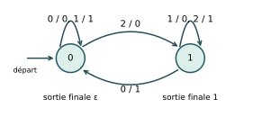
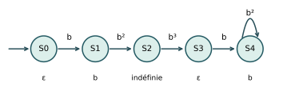

# ENS Ulm–Lyon–Cachan 2000 — Informatique · Corrigé brut

*Corrigé rédigé par IA, non officiel. Signalez toute erreur.*

**Rédaction** · GPT-6.2 Astra Ultra · vitesse non renseignée

## Graphes pondérés et séquentialité des transducteurs

## I. Circuits de poids positif

### Question 1.1 — Émonder entre deux sommets

Construire les listes d’adjacence directes et inverses. Marquer par parcours depuis $i$ dans le graphe direct l’ensemble $R$ des sommets accessibles, puis depuis $j$ dans le graphe inversé l’ensemble $C$ de ceux qui mènent à $j$. Garder $R\cap C$ et parcourir une dernière fois les arcs pour retenir ceux dont les deux extrémités sont gardées. La concaténation des deux chemins caractérise exactement les sommets d’un trajet de $i$ à $j$, y compris le trajet vide lorsque $i=j$. Temps et espace $O(n+m)$.

### Question 1.2.a — Extraire un circuit élémentaire

Un circuit possédant un sommet répété en dehors de la fermeture se décompose en deux circuits non vides plus courts. Les poids s’ajoutent, donc si leur somme est positive, au moins une composante est positive. En répétant, on trouve un circuit positif sans répétition interne, de longueur au plus $n$. La réciproque est immédiate, et une boucle positive est déjà un témoin.

### Question 1.2.b — Interpréter les puissances bornées

$U_{ij}(1)=W_{ij}$ est le maximum des poids de chemins de longueur au plus un, avec $-\infty$ pour l’ensemble vide. Si cette interprétation vaut au rang $k-1$, la dernière étape donne $U_{ij}(k)=\max_l(U_{il}(k-1)+W_{lj})$. Les deux morceaux se concatènent, et tout chemin de longueur au plus $k$ admet ce découpage (dernier morceau éventuellement vide). Ainsi une diagonale positive fournit un véritable circuit non vide. Réciproquement 1.2.a fournit un circuit de longueur $k\le n$, donc une diagonale positive au rang $k$ et, par monotonie, au rang $n$.

### Question 1.2.c — Détection par calcul successif

Initialiser le tableau par $W$, tester sa diagonale, puis calculer successivement les tableaux jusqu’au rang $n$, en testant à chaque fois la diagonale. Retourner oui dès la première valeur positive, sinon non. Le critère de 1.2.b prouve la réponse. Chaque rang exige $O(n^3)$ opérations, soit $O(n^4)$ au total et deux tableaux de taille $n^2$.

### Question 1.3 — Puissances rapides dans l’algèbre max-plus

Les deux coefficients $[(P\otimes Q)\otimes R]_{ij}$ et $[P\otimes(Q\otimes R)]_{ij}$ valent $\max_{k,l}(P_{ik}+Q_{kl}+R_{lj})$, également en présence de $-\infty$. L’associativité autorise le calcul binaire de $W^{\otimes n}$ par carrés successifs et produits des puissances dont le bit est présent. L’élément neutre a des zéros sur la diagonale et $-\infty$ ailleurs. Tester la diagonale de ce seul produit suffit par 1.2.b. Coût $O(n^3\log(n+1))$.

### Question 1.4 — Récurrence par sommets intermédiaires

Initialiser $D^0=W$ et poser $D^k_{ij}=\max(D^{k-1}_{ij},D^{k-1}_{ik}+D^{k-1}_{kj})$. Toute valeur finie est le poids d’un chemin, par concaténation. De plus, tout chemin dont les sommets internes sont distincts et d’indice au plus $k$ a un poids minorant $D^k_{ij}$. Par récurrence, soit $k$ est absent de son intérieur, soit il y apparaît une fois et le coupe en deux chemins d’indices internes plus petits. Ceci s’applique aux circuits élémentaires, et une boucle est déjà dans $D^0$. Une diagonale positive est donc nécessaire et suffisante par 1.2.a. Les $n$ tableaux de $n^2$ cases demandent $O(n^3)$ opérations et deux tableaux en mémoire.

### Question 1.5 — Justifier les relaxations en place

Après $r$ balayages, chaque valeur majore les poids des chemins d’au plus $r$ arcs arrivant au sommet, par récurrence sur le dernier arc. Toute valeur effectivement écrite est elle-même le poids d’un chemin partant d’un sommet quelconque. En l’absence de circuit positif, le maximum s’atteint sur un chemin simple de longueur au plus $n-1$. Les valeurs ont donc atteint leurs maxima et aucun arc ne peut les améliorer. En présence d’un circuit positif, les inégalités de stabilité $V(v)\ge V(u)+\varphi(u,v)$ se contrediraient par sommation autour du circuit. Le test final détecte alors un arc améliorable, indépendamment de l’ordre du balayage. Temps $O(n+m+nm)$, soit $O(nm)$ si $m\ge1$. Le graphe sans arcs se décide immédiatement.

## II. Construire des transducteurs

### Question 2.1 — Décider la parité à la fin

Prendre deux composantes disjointes, chacune avec les états pair et impair, et faire basculer la parité sur chaque $a$. Les deux états pairs sont initiaux. Sur la branche B, chaque pas émet $b$ et seul l’état pair est final. Sur la branche C, chaque pas émet $c$ et seul l’état impair est final. Toutes les étiquettes initiales et finales sont vides. Pour $a^n$ une seule branche accepte, avec sortie $b^n$ si $n$ est pair, $c^n$ sinon, y compris la sortie vide pour $n=0$.

### Question 2.2 — Produire tous les facteurs

Prendre trois états avant, dedans, après, tous finaux, avec avant seul initial et sorties de bord vides. Sur chaque lettre $x$, autoriser avant→avant avec sortie vide, avant→dedans et dedans→dedans avec sortie $x$, dedans→après et après→après avec sortie vide. Une branche qui reste avant produit le facteur vide. Sinon, les lettres copiées sont exactement celles d’un intervalle non vide, et tout tel intervalle se réalise en entrant et quittant dedans aux bornes convenables.

### Question 2.3 — Addition en lecture directe ou miroir

Pour la lecture des poids faibles d’abord, prendre deux états $c=0,1$, avec $0$ seul initial. Sur le symbole $s$, émettre $(s+c)\bmod2$ et aller en $\lfloor(s+c)/2\rfloor$. Les deux états sont finaux avec sorties respectives $\varepsilon$ et $1$. Après $k$ pas, la valeur des $k$ colonnes lues est la somme des bits déjà écrits pondérés par $2^i$, plus $2^kc$ (récurrence par division par deux). La sortie finale donne ainsi le miroir de la somme canonique sur les entrées du sujet. Pour les poids forts d’abord, retourner toutes les flèches, miroiter leurs sorties, échanger initial et final en renversant aussi les étiquettes de bord. Le renversement met en bijection les chemins réussis et renverse à la fois entrée et sortie.

### Question 2.4 — Décrire le transducteur unaire à quatre états

La figure de l’énoncé a pour états initiaux $1,4$ et pour seul final $1$. Poser $h(1)=h(4)=0$, $h(2)=-1$, $h(3)=1$. Sur chacun des six arcs $p\to q$, l’exposant de $b$ vaut $2+h(q)-h(p)$ (par exemple $1\to3$ donne 3 et $2\to3$ donne 4). Un chemin réussi de longueur $n$ émet donc nécessairement $b^{2n}$ par télescopage. Les longueurs 0 et 1 sont admises. À longueur 2, les seuls états accessibles sont $2,3,4$. Les cycles depuis $1$ de longueurs 3 et 4, et le départ en $4$ suivi de $4\to1$, fournissent 3, 4 et 5, puis toutes les longueurs supérieures par ajout de 3. La transduction est fonctionnelle, de domaine $a^*\setminus\{a^2\}$.

### Question 2.5 — Obtenir le carré de la longueur

Utiliser comme alphabet de sortie les quatre parties de $\{1,2\}$, chacune représentant une lettre. L’état $S$ mémorise l’ensemble des marques déjà posées. Sur chaque lettre d’entrée, choisir $D\subseteq\{1,2\}\setminus S$, émettre la lettre $D$ et aller en $S\cup D$. Commencer en $\varnothing$, terminer en $\{1,2\}$, avec sorties de bord vides. Chaque sortie est en bijection avec les positions de 1 et 2, donc il y en a $n^2$, y compris zéro à longueur nulle. Sur un alphabet de sortie unaire, toute sortie a une longueur au plus $C+nM$, où $C$ borne les deux bords cumulés et $M$ une transition. Il y a donc au plus $C+nM+1$ sorties distinctes, insuffisant pour tout $n$.

## III. Déterminiser et décider la séquentialité

### Question 3.1 — Distance de préfixe et contre-exemple

Le chemin simple de $u$ à $v$ dans cet arbre remonte à leur dernier ancêtre commun $u\wedge v$ puis redescend. Sa longueur est exactement $|u|+|v|-2|u\wedge v|$. La distance de graphe est symétrique, positive, nulle seulement sur la diagonale et vérifie l’inégalité triangulaire par concaténation des chemins. Dans 2.1, $a^{2n}$ et $a^{2n+1}$ sont à distance 1, tandis que $b^{2n}$ et $c^{2n+1}$ sont à distance $4n+1$. La variation est non bornée.

### Question 3.2 — Tester le jumelage sur un alphabet unaire

Construire le graphe des couples $(p,q)$ accessibles depuis les couples initiaux. Pour chaque paire de transitions lisant la même lettre, créer un arc entre les couples, de poids longueur de la première sortie moins longueur de la seconde. Un circuit accessible représente exactement deux boucles de même entrée précédées de chemins de même entrée. Sur une sortie unaire, les deux mots infinis de la condition de jumelage coïncident automatiquement si les longueurs de boucle sont égales et non nulles. Il suffit donc de rejeter si un circuit est de poids non nul. Appliquer 1.4 aux poids puis à leurs opposés (garder le maximum en cas d’arcs parallèles pour chaque test). Le graphe a au plus $n^2$ sommets, donnant $O(n^6)$ pour les deux tests, plus la préparation $O(|A|n^4)$ à alphabet fixé et longueurs connues.

### Question 3.3 — Variation d’une fonction séquentielle

Sur le préfixe commun $p$ de deux entrées réussies $pu,pv$, le trajet déterministe est identique et émet une même sortie. Les suffixes peuvent produire au total au plus $M(|u|+|v|)+2L$ lettres, où $L$ borne les sorties finales. La distance des sorties est au plus ce nombre, car enlever le préfixe commun ne la change pas. Pour des entrées à distance au plus $k$, prendre $K=Mk+2L$.

### Question 3.4 — Sens de lecture de l’addition

Le premier dispositif de 2.3 a une seule transition par lettre et un seul état initial. Sa fonction est séquentielle. Dans l’autre sens, comparer $1^r0$ et $1^r2$, à distance 2, avec $r\ge2$. Ce sont bien des sommes colonne par colonne de deux entiers positifs (répartir les 1 entre les deux entiers). Les sorties sont $1^r0$ et $10^{r+1}$, dont le préfixe commun a longueur 1. Leur distance $2r+1$ diverge. D’après 3.3, aucun transducteur séquentiel ne réalise cette seconde fonction.

### Question 3.5 — Effacer deux boucles jumelées

Supposons $w_1=v_1x$ et $xw_2=v_2x$. Alors $w_1w_2w_3=v_1v_2xw_3$. En enlevant $v_1v_2$ dans le premier couple de mots, la distance vaut $d(v_3,xw_3)$. Dans le second couple, enlever $v_1$ donne la même expression. L’autre alternative échange les rôles de $v$ et $w$ et s’obtient par symétrie.

### Question 3.6 — Borner le retard entre deux chemins

Suivre les couples de sommets le long des deux trajets synchrones. Lors d’une répétition, décomposer les sorties en préfixe, boucle et suffixe. Si les sorties de boucle sont vides on peut les supprimer. Sinon le jumelage et 3.5 permettent de les supprimer sans changer la distance finale. Après itération, les couples sont distincts et il reste au plus $n^2-1$ transitions sur chaque trajet. Les sorties initiales sont vides, d’où $d(v,w)\le |v'|+|w'|\le 2(n^2-1)M\le2n^2M$.

### Question 3.7 — Relier jumelage et variation bornée

Sous le jumelage, appliquer 3.6 aux deux trajets sur le préfixe commun de deux entrées, puis prolonger par leurs suffixes et sorties finales. L’inégalité triangulaire donne la borne $2n^2M+kM+2L$. Inversement, fixer deux chemins jumelables avec sorties de préfixe $v_1,w_1$ et de boucle $v_2,w_2$. L’émondage fournit des terminaisons fixes jusqu’à deux états finaux. Après $r$ tours, les entrées complètes ont un préfixe commun contenant ces tours, puis deux suffixes fixes. Leur distance est bornée indépendamment de $r$. Par fonctionnalité et variation bornée, les sorties complètes sont à distance bornée. Retirer les deux terminaisons fixes augmente la borne au plus de leur longueur totale. Ainsi $d(v_1v_2^r,w_1w_2^r)$ reste bornée. Les longueurs des deux boucles sont égales, sinon leur écart croît linéairement. Si elles sont non nulles, les longueurs des préfixes communs tendent vers l’infini, donc $v_1v_2^\omega=w_1w_2^\omega$. Si elles sont nulles l’autre clause suffit. C’est la définition équivalente du jumelage.

### Question 3.8 — Calculer les ensembles de résidus

Écrire $(p,j)$ pour l’état $p$ et le résidu $b^j$. Les états successifs sont $S_0=\{(1,0),(4,0)\}$, $S_1=\{(1,1),(2,0),(3,2)\}$, $S_2=\{(2,0),(3,2),(4,1)\}$, $S_3=\{(1,0),(3,1),(4,0)\}$, $S_4=\{(1,1),(2,0),(3,2),(4,1)\}$. Sur $a$, ils émettent respectivement $b,b^2,b^3,b,b^2$ et vont à l’état suivant, le dernier bouclant sur lui-même. Par exemple la première liste brute est $(2,1),(3,3),(1,2)$, donc son minimum vaut 1. Les sorties finales sont $\varepsilon,b$, indéfinie, $\varepsilon,b$ dans cet ordre (seul le résidu de l’état 1 compte). On retrouve $b^{2n}$ pour chaque $n\ne2$.

### Question 3.9 — Prouver la finitude sous l’hypothèse de jumelage

Après toute transition, le préfixe commun de tous les résidus a été enlevé, donc il est vide dans le nouvel état, comme à l’origine. Pour chaque $v$ non vide, un autre résidu est vide ou commence par une lettre différente. Pour $v$ vide prendre le même couple. Ainsi $v\wedge w=\varepsilon$ pour un résidu $w$. Par construction inductive, une entrée menant à cet ensemble réalise deux sorties partielles $zv,zw$ sur les chemins d’origine, $z$ étant la sortie déjà émise. D’après 3.6, $|v|\le |v|+|w|=d(zv,zw)\le 2n^2M$. Il n’existe qu’un nombre fini de mots aussi courts, puis de couples $Q\times B^{\le2n^2M}$ et de leurs sous-ensembles.

### Question 3.10 — Construire le transducteur et décider

Partir de l’ensemble initial, parcourir les ensembles nouveaux selon la construction de l’énoncé et ne créer aucune transition si la liste de successeurs est vide. Après lecture de $u$, si $z$ est la sortie émise, l’ensemble atteint contient exactement les $(p,v)$ tels que le transducteur d’origine arrive en $p$ sur $u$ avec sortie $zv$ (induction sur les lettres). Pour toute composante finale, former $vF(p)$. Si la liste est non vide, la fonctionnalité impose une valeur unique et on la prend comme sortie finale. Si elle est vide l’état est non final. L’invariant prouve l’égalité des transductions. Pour décider sur un transducteur quelconque émondé à sorties initiales vides, arrêter avec non si deux sorties finales sont incompatibles ou si un résidu dépasse $2n^2M$. Le premier cas atteste une non-fonction. Dans le second, une réalisation séquentielle impliquerait fonctionnalité, variation bornée (3.3), jumelage (3.7), puis la borne de 3.9, contradiction. Sous la borne, seuls un nombre fini d’ensembles sont possibles. Si le parcours s’achève sans rejet, la machine construite est la réponse. Pour une transduction vide, un état initial sans état final suffit.
