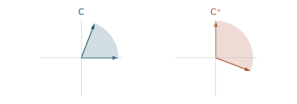
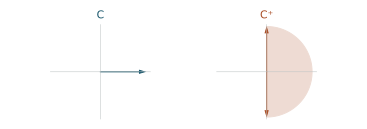
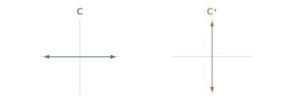

# École polytechnique — Deuxième composition de mathématiques MP 2000 · Corrigé brut

*Corrigé rédigé par IA, non officiel. Signalez toute erreur.*

**Rédaction** · GPT-6.2 Astra Ultra · vitesse non renseignée

**Révision (tour 1)** · GPT-6.2 Astra Ultra · vitesse non renseignée · 26 novembre 2026

Le produit scalaire définit le cône dual par des inégalités positives ou nulles. Les quatre parties relient générateurs, projections, faces et intersections de demi-espaces. La dernière question appelle une précision sur le cône réduit à zéro.

## I. Premiers cônes, duaux et faces

### Question 1

Si $(b_1,\ldots,b_k)$ est une base du sous-espace non nul $V$, la famille $(b_1,-b_1,\ldots,b_k,-b_k)$ l’engendre à coefficients positifs ou nuls : écrire chaque coefficient réel comme différence de ses parties positive et négative. Ainsi $V$ est un cône à faces.

### Question 2

Les trois configurations sont représentées ci-dessous. Dans les figures, le bleu représente $C$, l’orange son dual $C^+$ ; les directions des deux générateurs déterminent le cône, leurs longueurs n’interviennent pas.

**Faces.** $\{0\}$, $\mathbb R_+c_1$, $\mathbb R_+c_2$, $C$. Le secteur primal a l’angle $\alpha\in]0,\pi[$ ; le dual a l’angle $\pi-\alpha$, du côté où les deux produits scalaires sont positifs ou nuls.

**Faces.** $\{0\}$ et $C=\mathbb R_+c_1$. Le dual est le demi-plan $\{w:(w\mid c_1)\ge0\}$.

**Faces.** $C$ seule. On a $C=\mathbb Rc_1$ et $C^+=c_1^\perp$, donc chaque $w\in C^+$ est orthogonal à toute la droite.

### Question 3

Le cône est l’octant $C=\{\sum t_ic_i:t_i\ge0\}$. Si $w=\sum s_ic_i$, les conditions $(w\mid c_i)\ge0$ équivalent à $s_i\ge0$, donc $C^+=C$. Ses huit faces sont le sommet $\{0\}$, les trois demi-droites $\mathbb R_+c_i$, les trois secteurs engendrés par deux vecteurs et $C$ tout entier.

## II. Fermeture des cônes finiment engendrés

### Question 4.a

Si $K$ est vide, l’ensemble engendré ici est vide et fermé. Sinon $d=\min_{x\in K}\|x\|>0$. Pour une suite convergente $\lambda_n x_n$ avec $x_n\in K$, on a $0\le\lambda_n\le\|\lambda_n x_n\|/d$, donc les $\lambda_n$ sont bornés. Extrayons une sous-suite telle que $x_n\to x\in K$ et $\lambda_n\to\lambda\ge0$. Sa limite est $\lambda x$ et appartient à l’ensemble, qui est fermé.

### Question 4.b

Dans $\mathbb R^2$, $K_1=\{(n,1):n\ge1\}$ est fermé et ne contient pas zéro. Les points $(1,1/n)$ sont des multiples d’éléments de $K_1$ et tendent vers $(1,0)$, qui n’est pas un tel multiple. Pour le second cas, $K_2=\{(1/n,1/n^2):n\ge1\}\cup\{0\}$ est compact ; les mêmes points $(1,1/n)$ appartiennent aux demi-droites qu’il engendre et leur limite en est exclue. Aucune des deux hypothèses affaiblies ne suffit en général.

La dimension du contre-exemple intervient. En dimension un, tout ensemble obtenu par ces dilatations est, selon les signes présents dans la partie initiale, vide, réduit à zéro, une demi-droite fermée ou la droite entière. L’échec dans le plan suffit à répondre à la question posée pour les espaces euclidiens de dimension quelconque.

### Question 5.a

L’ensemble $K=\{\sum_i\lambda_ic_i:\lambda_i\ge0,\sum\lambda_i=1\}$ est l’image continue du simplexe compact. Si $0=\sum_i\lambda_ic_i$, choisissons $j$ avec $\lambda_j>0$. Alors $-c_j=\sum_{i\ne j}(\lambda_i/\lambda_j)c_i\in C$ et $C$ contient la droite de $c_j\ne0$, contradiction. Tout élément non nul de $C$ s’écrit comme somme des coefficients fois un point de $K$. Ainsi $C=\mathbb R_+K$ est fermé par 4.a.

### Question 5.b

Pour $c\in C$, $P(c)=c-(c-P(c))$ appartient à $C$ puisque $-(c-P(c))\in V\subset C$ et que $C$ est stable par addition. La linéarité de $P$ donne $P(C)=\operatorname{cone}(P(c_i))$. On retire les générateurs nuls ; au moins un reste car sinon $C\subset V$, contrairement à l’hypothèse. Donc $P(C)$ est un cône à faces contenu dans $C\cap V^\perp$.

### Question 5.c

Si $\ell\subset P(C)$ est une droite vectorielle, $V+\ell$ est un sous-espace de $C$ par stabilité par addition. Comme $\ell\subset V^\perp$ est non nulle, la somme est directe et contient strictement $V$.

### Question 5.d

Choisissons $V\subset C$ de dimension maximale. Si $C=V$, il est fermé. Sinon $P(C)$ ne contient aucune droite par 5.c et est un cône à faces par 5.b, donc est fermé par 5.a. On a $C=P^{-1}(P(C))$ : pour tout $x$ tel que $P(x)\in P(C)\subset C$, la différence $x-P(x)\in V\subset C$ donne $x\in C$. La préimage d’un fermé par $P$ est fermée.

## III. Projection et bidual

### Question 6.a

Puisque $0\in C$, l’infimum est au plus $\|a\|$. Il suffit de chercher dans $C\cap\overline B(a,\|a\|)$, compact non vide par 5.d. Le minimum est atteint. Pour deux minimiseurs $p,q$ à distance $d$ de $a$, le milieu est dans le cône convexe et sa distance au carré vaut $d^2-\|p-q\|^2/4$. La minimalité impose $p=q$.

### Question 6.b

Écrivons $p=p(a)$. Si $c\in C$, $p+tc\in C$ pour $t\ge0$. La dérivée à droite en zéro de $\|p+tc-a\|^2$ est positive ou nulle, donc $(p-a\mid c)\ge0$. En particulier $(p-a\mid p)\ge0$. Mais $(1-t)p\in C$ pour $0\le t\le1$ donne l’inégalité inverse, donc $(p-a\mid p)=0$.

### Question 6.c

Par définition de la dualité $C\subset(C^+)^+$. Si $a\notin C$, $w=p(a)-a$ est non nul et appartient à $C^+$ par 6.b. De plus $(w\mid a)=(w\mid p-w)=-\|w\|^2<0$. Ainsi $a\notin(C^+)^+$, ce qui établit l’égalité.

## IV. Frontière, faces et représentation par demi-espaces

### Question 7

Si $C$ engendre $E$, on peut choisir parmi ses générateurs une base $b_1,\ldots,b_n$. L’image de $]0,\infty[^n$ par l’isomorphisme de coordonnées correspondant est un ouvert non vide contenu dans $C$. Réciproquement un sous-espace propre a un intérieur vide et ne peut contenir de boule ouverte de $E$. Un cône d’intérieur non vide engendre donc $E$.

### Question 8.a

Si $x\in F=C\cap w^\perp$ et $F\ne C$, alors $w\ne0$. Toute boule autour de $x$ contient des points où le produit par $w$ est négatif, donc $x$ est sur la frontière du fermé $C$. Inversement prenons $a_n\notin C$ tendant vers un point frontière $x$. Posons $p_n=p(a_n)$, $w_n=(p_n-a_n)/\|p_n-a_n\|$. Comme $\|p_n-a_n\|\le\|x-a_n\|$, on a $p_n\to x$. Une sous-suite des $w_n$ converge vers un unitaire $w$. Les inégalités de 6.b donnent $w\in C^+$ et $(w\mid x)=\lim(w_n\mid p_n)=0$. La face $C\cap w^\perp$ est propre car $C$ engendre $E$ et $w\ne0$.

### Question 8.b

Si $H=\operatorname{Vect}(C)\ne E$, tout $C$ est dans sa frontière dans $E$. L’implication « appartenir à une face propre entraîne être sur la frontière » subsiste. Sa réciproque peut échouer : pour une demi-droite du plan, tout point non nul est sur la frontière dans le plan et sa seule face propre est le sommet. Dans $H$, l’équivalence se rétablit pour la frontière relative en appliquant 8.a dans cet espace.

Pour identifier précisément les faces de la section relative, décomposons $w=w_H+w_\perp$ suivant $E=H\oplus H^\perp$. Pour $c\in C$, $(w\mid c)=(w_H\mid c)$. Ainsi chaque normale ambiante définit la même face que sa projection sur $H$, et une normale relative fournit une normale ambiante par inclusion. Les points de la frontière relative sont exactement ceux des faces propres, même lorsqu’une normale ambiante non nulle orthogonale à $H$ expose tout $C$.

### Question 8.c

Soit $x_0$ intérieur et $x\notin C$. Par fermeture et convexité, le segment $x_t=(1-t)x_0+tx$ sort de $C$ en un dernier point $x_{t_*}$ avec $0<t_*<1$. Ce point est frontière. Choisissons par 8.a une face propre $F$ qui le contient. Pour chaque $w\in C^+$ exposant $F$, $w\ne0$ et $(w\mid x_0)>0$ (sinon une boule autour de $x_0$ contiendrait des produits négatifs). Comme $(w\mid x_{t_*})=0$, on obtient $(w\mid x)=-(1-t_*)(w\mid x_0)/t_*<0$ pour tous ces $w$.

### Question 9.a

Si $w\in C^+$, chaque $(w\mid c_i)$ est positif ou nul. Pour $x=\sum_i t_i c_i$ avec $t_i\ge0$, $(w\mid x)=0$ impose $t_i=0$ dès que $(w\mid c_i)>0$. La face est donc engendrée par le sous-ensemble des générateurs orthogonaux à $w$, avec la convention que la somme vide vaut zéro. Il y a au plus $2^r$ tels sous-ensembles, donc un nombre fini de faces.

### Question 9.b

Si $C$ engendre $E$, choisissons pour chaque face propre $F$ un $w_F\in C^+$ qui l’expose. On a $C\subset\bigcap_F\{w_F\}^+$ et tout point extérieur est exclu par au moins l’un de ces demi-espaces d’après 8.c. La famille est finie par 9.a. Si $H=\operatorname{Vect}(C)$ est propre, appliquons cette représentation dans $H$, en gardant les normales dans $H$. Dans $E$, ajoutons les demi-espaces définis par les deux signes de chaque vecteur d’une base de $H^\perp$ : leur intersection est exactement $H$. Le cas $C=E$ correspond à une intersection vide.

Plus explicitement, si $u_1,\ldots,u_s$ est une base de $H^\perp$, les deux contraintes $(x\mid u_j)\ge0$ et $(x\mid -u_j)\ge0$ imposent $(x\mid u_j)=0$. Leur conjonction pour tout $j$ donne $x\in H$. On peut alors tester sur $x$ les normales choisies dans $H$.

### Question 10

Écrivons $C=\bigcap_{i=1}^k\{w_i\}^+$ comme en 9.b. Pour $k>0$, le cône $K$ engendré par les normales non nulles vérifie $K^+=C$, donc $C^+=(K^+)^+=K$ par 6.c. Ainsi le dual est finiment engendré pour tout cône propre de $E$.

**Cas limite de la définition imprimée.** Le sujet impose $r>0$ et des générateurs tous non nuls. Il autorise $C=E$ d’après 1, mais $E^+=\{0\}$ ne peut être engendré par une telle famille. Avec ces conventions strictes, la conclusion de 10 admet donc cette exception. Avec la convention usuelle du cône engendré par la famille vide, $\{0\}$ est bien un cône finiment engendré et la conclusion vaut aussi pour $C=E$.
