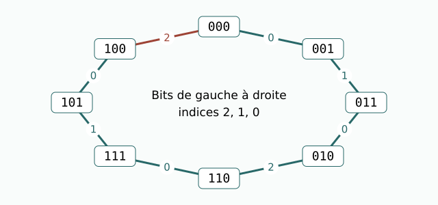

# X · MP · Informatique (option) 2000 — Corrigé brut

*Corrigé rédigé par IA, non officiel. Signalez toute erreur.*

**Rédaction** · GPT-6.2 Astra Ultra · vitesse non renseignée

Composition de quatre heures. Les programmes sont en OCaml, dans le style du Caml proposé par le cahier. Une partie est une liste strictement croissante d’indices. Un interrupteur baissé appartient à la partie. Les deux exemplaires concordent sur les treize questions. Le rapport du jury de cette session n’a pas été retrouvé.

## I. Parties d’un ensemble

### 1. Cardinal d’une partie

```ocaml
type indice = int
type partie = indice list

let rec card = function
  | [] -> 0
  | _ :: suite -> 1 + card suite
```

La liste vide représente l’ensemble vide. Dans l’autre cas, la tête représente un indice distinct de tous les suivants. On compte donc exactement un élément par maillon, en temps linéaire.

### 2. Différence symétrique

```ocaml
let rec delta p q =
  match p, q with
  | [], r | r, [] -> r
  | x :: xs, y :: ys ->
      if x = y then delta xs ys
      else if x < y then x :: delta xs q
      else y :: delta p ys
```

Des têtes égales appartiennent aux deux ensembles et sont éliminées. Sinon, la plus petite appartient à un seul argument et précède tout élément du résultat restant. Chaque appel consomme au moins un maillon, d’où le coût $O(m+n)$.

### 3. Changer de configuration

```ocaml
let emet i = Printf.printf "%d " i

let test p q =
  List.iter emet (delta p q);
  print_newline ()
```

Les indices de $P\triangle Q$ doivent changer une fois. Les autres ont déjà l’état final voulu. Le programme imprime donc toutes les commutations nécessaires et se termine par un saut de ligne.

## II. Énumération par incrément

### 4. Successeur

```ocaml
let succ p =
  let rec retenue i reste =
    match reste with
    | x :: xs when x = i -> retenue (i + 1) xs
    | _ -> i :: reste
  in
  retenue 0 p
```

Au rang $i$, tous les indices inférieurs ont été rencontrés et retirés. À la première absence, le suffixe ne contient que des indices plus grands que $i$. On ajoute donc $i$ devant lui. La variation de la valeur codée est $2^l-(2^l-1)=1$. Le nombre d’opérations est $O(l+1)$, constant si $l=0$ et linéaire en $l$ dès que $l\geq1$.

### 5.a. Test complet

```ocaml
let test_incr n =
  let rec parcours p =
    let q = succ p in
    if q = [n] then test p []
    else (test p q; parcours q)
  in
  parcours []
```

Le compteur passe par tous les entiers de $0$ à $2^N-1$. Au dernier, on commute directement vers la partie vide sans jamais actionner l’indice $N$. Pour $N=0$, aucun indice n’est imprimé.

### 5.b. Nombre de commutations

Sur un cycle de $2^N$ incréments modulo $2^N$, le bit $j$ change à chaque multiple de $2^j$, y compris lors du retour à zéro. Son nombre de changements est $2^{N-j}$. Le coût total est donc

$$
\sum_{j=0}^{N-1}2^{N-j}=2^{N+1}-2.
$$

## III. Énumération par code de Gray

### 6.a. Suite des indices

$T(4)=(0,1,0,2,0,1,0,3,0,1,0,2,0,1,0)$.

### 6.b. Configurations successives

| $i$ | $S_i$ | $i$ | $S_i$ |
|---:|:---|---:|:---|
| 0 | $\varnothing$ | 8 | $\{2,3\}$ |
| 1 | $\{0\}$ | 9 | $\{0,2,3\}$ |
| 2 | $\{0,1\}$ | 10 | $\{0,1,2,3\}$ |
| 3 | $\{1\}$ | 11 | $\{1,2,3\}$ |
| 4 | $\{1,2\}$ | 12 | $\{1,3\}$ |
| 5 | $\{0,1,2\}$ | 13 | $\{0,1,3\}$ |
| 6 | $\{0,2\}$ | 14 | $\{0,3\}$ |
| 7 | $\{2\}$ | 15 | $\{3\}$ |



### 7.a. Dernière configuration

Pour $n=0$, $S_0=\varnothing$. Pour $n\geq1$, on a $S_{2^n-1}=\{n-1\}$. En effet, les deux copies de $T(n-1)$ ont un effet total nul par parité. Seule la commutation centrale $n-1$ subsiste.

### 7.b. Décalage de la seconde moitié

Pour $n>0$, l’état au rang $2^n$ est $\{n-1\}\triangle\{n\}=\{n-1,n\}$. À partir de là, les $i$ mouvements suivants sont les $i$ premiers de $T(n)$, dont l’effet à partir du vide est $S_i$. Par associativité, $S_{2^n+i}=S_i\triangle\{n-1,n\}$ pour $0\leq i<2^n$.

### 7.c. Exhaustivité

Pour $n=0$, seule la partie vide apparaît. Pour $n=1$, la liste est $\varnothing,\{0\}$. Supposons l’énoncé vrai au rang $n\geq1$. Les $2^n$ premiers états sont les parties sans $n$. Sur les suivants, l’opération $P\mapsto P\triangle\{n-1\}$ permute ces parties, puis l’adjonction de $n$ fournit chacune des parties contenant $n$, une fois. Les deux blocs sont disjoints et couvrent toutes les parties de $I_{n+1}$.

### 8.a. Test par code de Gray

```ocaml
let test_gray n =
  let rec mot m =
    if m > 0 then (mot (m - 1); emet (m - 1); mot (m - 1))
  in
  mot n;
  if n > 0 then emet (n - 1);
  print_newline ()
```

L’impression de $T(N)$ finit sur le singleton de 7.a. La dernière instruction de commutation enlève cet indice.

### 8.b. Coût minimal

Si $N>0$, le mot a $2^N-1$ lettres et le retour coûte un mouvement. Un circuit de $L$ mouvements ne peut présenter que $L$ états différents, car son dernier état répète son premier. Pour en visiter $2^N$, il faut donc $L\geq 2^N$. Le programme atteint cette borne. Si $N=0$, l’unique état est déjà testé et le coût vaut zéro.

### 9.a. Prochain indice aux rangs impairs

Notons $v_2(a)$ l’exposant de 2 dans $a>0$. La suite vérifie $t_i=v_2(i+1)$. En effet, autour de $i+1=2^n$, la lettre centrale est $n$ et $v_2(2^n+j)=v_2(j)$ pour $1\leq j<2^n$. C’est exactement la récurrence de $T$.

Si $b_j$ est le bit $j$ du rang $i$, les bits de $S_i$ sont $g_j=b_j\mathbin{\mathrm{xor}} b_{j+1}$. Au départ ils sont nuls. Lors de l’incrément, les bits $0$ à $r=v_2(i+1)$ de $i$ basculent. Dans les différences entre voisins, seul $g_r$ bascule, ce qui prouve la formule pour tout $i$. Lorsque $i$ est impair, il se termine par $r\geq1$ bits 1, précédés d’un 0. Les $g_j$ sont nuls jusqu’au rang $r-2$ et $g_{r-1}=1$. Donc $t_i=r=1+\min S_i$. Pour $i$ pair, $t_i=0$.

### 9.b. Successeur de Gray

```ocaml
let gray p =
  match p with
  | [] -> [0]
  | x :: _ ->
      let j = if card p mod 2 = 0 then 0 else x + 1 in
      delta p [j]
```

Le cardinal de $S_0$ est pair et change de parité à chaque pas. Sa parité est donc celle de $i$. Le programme applique exactement le résultat de 9.a.

## IV. Système défaillant

### 10. Trajet le plus court entre deux états sûrs

```ocaml
let test_sur p q =
  let d = delta p q in
  let rec commun a b =
    match a, b with
    | [], _ | _, [] -> []
    | x :: xs, y :: ys ->
        if x = y then x :: commun xs ys
        else if x < y then commun xs b else commun a ys
  in
  List.iter emet (commun p d);
  List.iter emet (commun q d);
  print_newline ()
```

On retire d’abord $P\setminus Q$, puis on ajoute $Q\setminus P$. Le cardinal décroît jusqu’à $|P\cap Q|$ puis croît jusqu’à $|Q|$. Il reste au plus égal à $K$ puisque les deux extrémités sont sûres. Le coût $|P\triangle Q|$ est minimal, chaque indice de cette différence devant changer au moins une fois.

### 11.a. Longueur du mot contraint

Avec la convention $\binom ab=0$ pour $b>a$, on obtient, pour $n,k\geq1$,

$$
l_{n,k}=s_{n,k}-1+\binom{n-1}{k},\qquad
s_{n,k}=\sum_{j=0}^{\min(n,k)}\binom nj .
$$

En effet, pour $n=1$ le mot a une lettre et il y a deux parties. Pour $k=1$, sa longueur croît de deux à chaque nouveau rang et vaut $2n-1$. La formule donne bien $(n+1)-1+(n-1)$. Pour $n,k\geq1$, la récurrence des mots donne $l_{n+1,k+1}=l_{n,k+1}+1+l_{n,k}$. La séparation des parties suivant la présence de $n$ donne $s_{n+1,k+1}=s_{n,k+1}+s_{n,k}$. La formule proposée satisfait ces deux égalités par l’identité de Pascal, ce qui achève la récurrence.

### 11.b. États effectivement visités

Montrons simultanément que le mot, lu depuis le vide, visite exactement les parties de taille au plus $k$ et finit en $\{n-1\}$. Pour $n=1$, on passe de $\varnothing$ à $\{0\}$. Pour passer de $n$ à $n+1$ avec $k=1$, les deux mouvements supplémentaires enlèvent $n-1$ puis ajoutent $n$. Le nouveau singleton est atteint en passant seulement par le vide.

Pour la borne $k+1$, le premier bloc $T(n,k+1)$ visite toutes les parties admissibles sans $n$ et finit en $\{n-1\}$. On ajoute alors $n$. En gardant $n$ fixé, la lecture à rebours de $T(n,k)$ part du singleton $\{n-1\}$ sur les anciens indices et retrace ses états jusqu’au vide. On visite donc toutes les parties contenant $n$ et au plus $k$ anciens indices. Aucune ne dépasse $k+1$. Le terme final est $\{n\}$, comme annoncé. Les répétitions permises expliquent le terme correctif de 11.a.

### 12. Impression du parcours contraint

```ocaml
let test_panne n k =
  let rec mot m borne envers =
    if m = 1 then emet 0
    else if borne = 1 then
      if envers then
        (emet (m - 1); emet (m - 2); mot (m - 1) 1 true)
      else
        (mot (m - 1) 1 false; emet (m - 2); emet (m - 1))
    else
      let gauche, droite =
        if envers then borne - 1, borne else borne, borne - 1
      in
      mot (m - 1) gauche false;
      emet (m - 1);
      mot (m - 1) droite true
  in
  if n > 0 && k > 0 then (mot n k false; emet (n - 1));
  print_newline ()
```

Le mot inverse du cas général commence par $T(m-1,k-1)$ lu en avant et finit par $T(m-1,k)$ lu en arrière. Le dernier mouvement imprimé en dehors de la récursion enlève l’unique indice encore baissé. Le programme émet donc $l_{N,K}+1$ indices sur le domaine du sujet. Si $K=0$ ou $N=0$, seule la configuration vide est permise.

### 13. Optimalité du parcours contraint

Notons $E$ et $O$ les nombres de configurations admissibles de cardinal pair et impair. Chaque commutation change la parité. Un circuit non vide de longueur $L$, avec l’état terminal identifié à l’état initial, offre donc exactement $L/2$ positions de chaque parité. Il faut $L\geq2\max(E,O)=E+O+|E-O|$.

Or $E+O=s_{N,K}$. Par la relation de Pascal et annulation des termes consécutifs,

$$
E-O=\sum_{j=0}^K(-1)^j\binom Nj=(-1)^K\binom{N-1}{K}.
$$

Ainsi, pour $N,K\geq1$, la borne inférieure est $s_{N,K}+\binom{N-1}{K}=l_{N,K}+1$, précisément le coût du programme. Par exemple, à $K=1$, chaque singleton exige un aller-retour par le vide et le coût vaut $2N$.

[Sujet](https://www.wikiprepa.fr/concours/data/x_option-info_mp_2000.pdf) · [Autre exemplaire](https://www.doc-solus.fr/prepa/sci/adc/pdf/enonces.pdf/2000/MP_INFO_X_1_2000.enonce.pdf)
