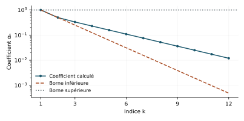

# École polytechnique — Première composition de mathématiques MP 2000 · Corrigé guidé

*Corrigé rédigé par IA, non officiel. Signalez toute erreur.*

**Rédaction** · GPT-6.2 Astra Ultra · vitesse non renseignée

**Révision** · GPT-6.2 Astra Ultra · vitesse non renseignée

Les trois premières parties portent sur une équation triangulaire de séries entières à terme de convolution. La dernière étudie une équation différentielle singulière et distingue l’analyticité de la régularité indéfinie en zéro.

## I. Majorations pour les séries entières

### Question 1.a

> [!INDICATION]
> Utiliser la convergence en un point intérieur non nul ou une série géométrique.

#### Solution

Si $r(u)>0$, choisissons $0<\rho<r(u)$. Les $|u_k|\rho^k$ sont bornés par un $C\ge1$, donc $|u_k|\le C\rho^{-k}\le(C/\rho)^k$ pour $k\ge1$. Inversement $|u_k|\le M^k$ entraîne la convergence absolue de $\sum u_kx^k$ pour $M|x|<1$. Ainsi $r(u)\ge1/M>0$.

### Question 1.b

> [!INDICATION]
> Tester le terme général au-delà du rayon annoncé.

#### Solution

Si $|x|>1/M$, on a $|u_kx^k|\ge(M|x|)^k$, qui ne tend pas vers zéro. La série diverge et $r(u)\le1/M$.

### Question 2

> [!INDICATION]
> Séparer la somme en deux moitiés symétriques.

#### Solution

Pour $i\le k/2$, $(k-i)^{-2}\le4/k^2$. La symétrie donne $\sum_{i=1}^{k-1}1/[i^2(k-i)^2]\le(8/k^2)\sum_{i\ge1}1/i^2$. Par exemple $\sum_{i\ge1}i^{-2}\le1+\int_1^\infty t^{-2}dt=2$, donc $\gamma=16$ convient.

## II. Opérateur diagonal sur les coefficients

### Question 3

> [!INDICATION]
> Chercher les indices pour lesquels le facteur k+a s’annule.

#### Solution

Si $a\notin-\mathbb N^*$, tous les facteurs sont non nuls. L’inverse envoie $v$ sur $(v_k/(k+a))_{k\ge1}$, donc noyau nul et image $E$. Si $a=-m$ avec $m\ge1$, le noyau est $\mathbb C e_m$ et l’image est $\{v:v_m=0\}$. On résout aux autres indices par division et la coordonnée $m$ de l’antécédent est libre.

### Question 4

> [!INDICATION]
> Les facteurs diagonaux et leurs inverses ont une racine k-ième tendant vers 1.

#### Solution

La condition $r(u)\ge R$ définit un sous-espace, par convergence absolue des combinaisons linéaires sur $|x|<R$. Pour $a\notin-\mathbb N^*$, $|k+a|^{1/k}\to1$ et $|k+a|^{-1/k}\to1$. La formule de Cauchy–Hadamard montre donc que multiplier ou diviser $u_k$ par $k+a$ conserve le rayon, y compris zéro et l’infini. L’inverse de 3 restreint ainsi un isomorphisme de $E_R$ sur lui-même.

## III. Terme quadratique et inversion

### Question 5.a

> [!INDICATION]
> Le coefficient de degré k du carré ne dépend que des coefficients de degrés inférieurs.

#### Solution

Le premier coefficient donne $u_1=v_1/(1+a)$. Pour $k\ge2$,
$$u_k=\frac{v_k-c\sum_{i=1}^{k-1}u_i u_{k-i}}{k+a}.$$
Le dénominateur est non nul par hypothèse.

### Question 5.b

> [!INDICATION]
> Construire successivement toutes les coordonnées, sans imposer de convergence.

#### Solution

Pour toute suite $v\in E$, la récurrence de 5.a définit une unique suite $u$ ; l’identité $Tu=v$ est alors satisfaite à chaque indice. L’application $T$ est donc à la fois injective et surjective sur $E$.

### Question 6.a

> [!INDICATION]
> Identifier les coefficients du produit de deux séries convergentes.

#### Solution

Si $u\in E_+$, sa série converge absolument à l’intérieur d’un disque non trivial. Sur ce disque, la série du produit $u*u$ est le carré de sa somme par le produit de Cauchy. Le terme $A_au$ y converge aussi par 4. Leur somme $Tu$ possède donc un rayon strictement positif.

### Question 6.b

> [!INDICATION]
> Choisir les constantes dans leur ordre de dépendance et absorber k² dans une exponentielle.

#### Solution

Les nombres $|k+a|$ sont non nuls et tendent vers l’infini. Leur minimum $\delta>0$ convient pour (1). Prenons par exemple $M_0=\delta/[2\gamma(1+|c|)]$, qui assure (2). Puisque $v\in E_+$, 1.a donne $M>0$ tel que $|v_k|\le M^k$. Posons $L=\max(1,2/(\delta M_0))$ et $M_1=4ML$. Comme $k^2\le4^k$ et $L^k\ge2/(\delta M_0)$ pour $k\ge1$, on a $2k^2M^k\le\delta M_0M_1^k$. En particulier (4) suit de $k=1$, et les cinq conditions sont satisfaites.

En particulier $2|c|\gamma M_0=\delta |c|/(1+|c|)\le\delta$. Pour (4), l’inégalité (5) prise à $k=1$ donne même $2M\le\delta M_0M_1$. Le choix des constantes ne fait intervenir aucun coefficient encore inconnu de $u$.

### Question 6.c

> [!INDICATION]
> Montrer la borne par récurrence en réservant la moitié du majorant à chacun des deux termes.

#### Solution

Pour $k=1$, $|u_1|\le M/\delta\le M_0M_1$. Si la borne est acquise aux indices inférieurs, 2 donne $\sum_{i=1}^{k-1}|u_i u_{k-i}|\le\gamma M_0^2 M_1^k/k^2$. Par (5), $|v_k|\le\delta M_0M_1^k/(2k^2)$ ; par (2), $|c|\gamma M_0^2\le\delta M_0/2$. En substituant dans 5.a et en divisant par au moins $\delta$, on obtient $|u_k|\le M_0M_1^k/k^2$.

### Question 6.d

> [!INDICATION]
> Appliquer le critère de rayon à l’unique antécédent construit dans E.

#### Solution

La borne de 6.c donne la convergence pour $|x|<1/M_1$, donc l’antécédent de tout $v\in E_+$ appartient à $E_+$. Avec 6.a et la bijectivité de 5.b, la restriction $T:E_+\to E_+$ est bijective.

### Question 7.a

> [!INDICATION]
> Extraire λ à chaque étape et induire simultanément les deux bornes positives.

#### Solution

On a $u_1=\lambda$, donc $\alpha_1=1$. Pour $k\ge2$, la récurrence se réduit à $ku_k=\sum_{i=1}^{k-1}u_i u_{k-i}$. En posant $u_k=\alpha_k\lambda^k$, il reste $\alpha_k=k^{-1}\sum_{i=1}^{k-1}\alpha_i\alpha_{k-i}>0$. Si les bornes sont connues avant $k$, chaque produit est au plus $1$ et au moins $2^{2-k}$. Ainsi $\alpha_k\le(k-1)/k\le1$ et $\alpha_k\ge((k-1)/k)2^{2-k}\ge2^{1-k}$.

Les quatre premiers coefficients normalisés sont $1,1/2,1/3,11/48$. Par exemple $4\alpha_4=2\alpha_1\alpha_3+\alpha_2^2=11/12$. Ces valeurs fixent les premiers points de la courbe.

### Question 7.b

> [!INDICATION]
> Appliquer les deux tests de la première partie.

#### Solution

La majoration $u_k\le\lambda^k$ donne $r(u)\ge1/\lambda$. La minoration $u_k\ge2^{1-k}\lambda^k\ge(\lambda/2)^k$ donne $r(u)\le2/\lambda$ par 1.b.

## IV. Solutions lisses de l’équation singulière

### Question 8

> [!INDICATION]
> Intégrer séparément sur chacune des deux composantes de la droite privée de zéro.

#### Solution

Sur $t>0$, $(t^af(t))'=t^{a-1}(tf'+af)$, donc les solutions maximales sur cette demi-droite sont $f(t)=C_+t^{-a}$ pour tout $t\in]0,\infty[$. Sur $t<0$, le changement $t=-s$ conduit à $f(t)=C_-|t|^{-a}$ sur $]-\infty,0[$. Les constantes complexes sont indépendantes sur ces deux intervalles de régularité.

### Question 9

> [!INDICATION]
> Tester l’exposant de la puissance pour une extension lisse à l’origine.

#### Solution

Si $a>0$, toute branche non nulle diverge en zéro. Si $a<0$, écrivons $b=-a>0$. Pour $b$ non entier, la dérivée d’ordre $\lfloor b\rfloor+1$ d’une branche non nulle de $|t|^b$ est non bornée près de zéro, ce qui exclut une extension lisse. Pour $b=m$ entier strictement positif, $f(t)=t^m$ est une solution globale non nulle qui s’annule en zéro. Plus précisément la continuité de la dérivée d’ordre $m$ impose $C_-=(-1)^m C_+$, donnant les multiples de $t^m$. Les valeurs cherchées sont donc les entiers strictement négatifs.

### Question 10

> [!INDICATION]
> Multiplier par le facteur intégrant tᵃ et conserver la constante initiale.

#### Solution

L’équation équivaut à $(t^af(t))'=t^{a-1}g(t)$. La solution unique vaut
$$f(t)=t^{-a}\left(t_0^a\alpha+\int_{t_0}^t s^{a-1}g(s)\,ds\right).$$
L’intégrale entre points de $I$ existe et dépend de façon lisse de $t$. La formule donne donc la solution maximale sur tout $I=]0,\theta[$.

### Question 11

> [!INDICATION]
> Identifier les coefficients de la seule solution analytique possible.

#### Solution

Comme $a\ne0$, le terme constant d’une solution analytique doit être nul. Pour les autres coefficients, $(k+a)u_k=v_k$, et 4 assure un rayon au moins $\theta$ (pour $\theta=\infty$, appliquer 4 à tout $R$ fini). Le choix unique est donc $\alpha=\sum_{k\ge1}v_k t_0^k/(k+a)$. La série correspondante satisfait l’équation par dérivation et la condition initiale, donc coïncide avec 10.

### Question 12.a

> [!INDICATION]
> Séparer l’intégrale près de zéro, où g est petit, et sur une partie fixe.

#### Solution

Écrivons $b=-a>0$. Choisissons $0<\eta<t_0$ tel que $|g(s)|\le\varepsilon$ si $0<s\le\eta$. Pour $0<t<\eta$, la formule de 10 donne $f(t)=t^b[K-\int_t^\eta s^{-b-1}g(s)ds]$ avec $K$ constant. Le terme fixe tend vers zéro et le module du terme intégral est au plus $\varepsilon t^b(t^{-b}-\eta^{-b})/b\le\varepsilon/b$. Ainsi $f(t)\to0$ pour tout choix initial.

### Question 12.b

> [!INDICATION]
> Annuler la constante associée à la solution homogène singulière.

#### Solution

La dérivabilité à droite avec $g(0)=0$ donne $g(s)=O(s)$ en zéro, d’où la convergence de $\int_0^{t_0}s^{a-1}g(s)ds$. Choisissons $\alpha=t_0^{-a}\int_0^{t_0}s^{a-1}g(s)ds$. Alors $f(t)=t^{-a}\int_0^t s^{a-1}g(s)ds=O(t)$, donc $f(t)\to0$. Toute autre valeur ajoute un multiple non nul de $t^{-a}$ qui diverge en module.

Plus précisément, si $d=g'_+(0)$, écrivons $g(s)=ds+s\eta(s)$ avec $\eta(s)\to0$. Alors $t^{-a}\int_0^t s^{a-1}g(s)\,ds=dt/(a+1)+o(t)$, car l’erreur est majorée par $t\sup_{0<s\le t}|\eta(s)|/(a+1)$. Cela vérifie directement le retour à zéro pour la valeur initiale trouvée.
