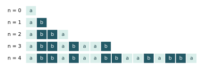
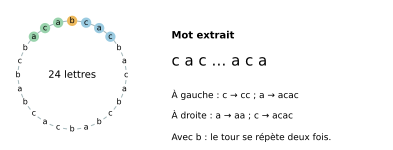

# ENS Ulm–Lyon–Cachan 2001 — Informatique · Corrigé guidé

*Corrigé rédigé par IA, non officiel. Signalez toute erreur.*

**Rédaction** · GPT-6.2 Astra Ultra · vitesse non renseignée

## Morphismes, hiérarchie des L-systèmes et répétitions

## I. Morphismes et systèmes de Lindenmayer

### Question 1.1 — Image d’un mot

**Indication.** Appliquer la loi aux deux facteurs vides, puis détacher les lettres.

$f(\varepsilon)=f(\varepsilon)^2$ entraîne $|f(\varepsilon)|=0$. Pour $w=x_1\ldots x_r$, la loi donne par récurrence $f(w)=f(x_1)\cdots f(x_r)$. Réciproquement cette formule, avec produit vide égal à $\varepsilon$, prolonge toute liste d’images de lettres et respecte la concaténation.

### Question 1.2 — Un langage, deux ordres d’apparition

**Indication.** Échanger simultanément les noms des lettres et l’axiome.

Prendre $G_2=(\{a,b\},a\mapsto bb,\ b\mapsto a,\ b)$, où le dernier $b$ est l’axiome. Les termes de rangs $2j,2j+1$ sont $b^{2^j},a^{2^j}$. Le langage coïncide avec celui du sujet mais les premiers termes sont échangés.

### Question 1.3 — Les premiers mots de Thue–Morse

**Indication.** L’échange des deux lettres commute avec la substitution.

Les cinq premiers termes sont $a$, $ab$, $abba$, $abbabaab$, $abbabaabbaababba$. Si $\iota$ échange $a,b$, alors $\iota\theta=\theta\iota$ par vérification sur les lettres. Ainsi $u_{n+1}=u_n\iota(u_n)$ et $|u_n|=2^n$. Si le langage était rationnel, son image par le codage des deux lettres en $a$ serait rationnelle. Sur un seul symbole, la suite des états d’un automate déterministe devient périodique, donc ses longueurs acceptées seraient ultimement périodiques. Les écarts entre puissances de deux sont non bornés, contradiction.

### Question 1.4 — Le rôle du codage final

**Indication.** Calculer séparément le mot interne et son image unaire.

Avec $f(a)=ab,f(b)=b$, on obtient $f^n(a)=ab^n$. Le codage donne $a^{n+1}$, donc toutes les longueurs strictement positives. Dans un D0L de même langage, tous les termes sont unaires. L’axiome est $a^d$ avec $d\ge1$ et $f(a)$ ne peut contenir une autre lettre. Pour $f(a)=a^k$, les longueurs sont $dk^n$. Les cas $k=0,1$ ont une orbite finie et les cas $k\ge2$ manquent des longueurs. Aucun tel D0L n’existe.

## II. Mots infinis

### Question 2.1 — Unicité et existence d’un langage générateur

**Indication.** Sur un alphabet fini, il y a seulement un nombre fini de mots de longueur bornée.

Un langage infini a des mots arbitrairement longs. Si tous sont préfixes de deux suites, ils imposent à ces suites la même lettre à chaque position. Réciproquement, la famille de tous les préfixes finis d’une suite infinie est infinie et l’engendre.

### Question 2.2 — Comparer les préfixes deux à deux

**Indication.** Définir la lettre d’indice $i$ avec un élément du langage de longueur supérieure à $i$.

Deux préfixes d’un même mot sont nécessairement comparables. Réciproquement, si le langage est infini et totalement ordonné par préfixe, choisir à chaque position $i$ un mot assez long. La comparabilité garantit que la lettre à cette position est indépendante du témoin. La suite ainsi construite a chaque mot du langage pour préfixe.

### Question 2.3 — Engendrer la suite alternée

**Indication.** Une substitution uniforme peut répéter le bloc $ab$.

Prendre l’axiome $ab$ et les règles $a\mapsto ab$, $b\mapsto ab$. Les termes sont $(ab)^{2^n}$, dont les préfixes imposent $q_{2i}=a$, $q_{2i+1}=b$.

### Question 2.4 — Critère sur les deux premiers termes

**Indication.** Un morphisme conserve la relation de préfixe, même s’il efface des lettres.

Si $u_0$ est préfixe de $u_1$, les applications successives de $f$ rendent tous les termes emboîtés et 2.2 conclut sous l’hypothèse d’infinitude. Réciproquement, la génération impose leur comparabilité. Si $u_1$ était préfixe strict de $u_0$, tous les termes suivants seraient des préfixes de $u_0$ par conservation de l’ordre. Le langage serait fini.

### Question 2.5 — Extinction en trois étapes

**Indication.** Construire une chaîne de trois lettres.

Avec $a\mapsto b$, $b\mapsto c$, $c\mapsto\varepsilon$ et l’axiome $a$, la suite vaut $a,b,c,\varepsilon,\varepsilon,\ldots$. Le langage est $\{a,b,c,\varepsilon\}$, donc il n’engendre pas de mot infini.

### Question 2.6 — Croissance puis stabilisation

**Indication.** Ajouter une lettre qui survit un pas avant de disparaître.

Choisir $a\mapsto ab$, $b\mapsto c$, $c\mapsto\varepsilon$, avec axiome $a$. Les termes sont $a,ab,abc,abc,\ldots$. Les deux premières inclusions sont strictes, puis le langage se stabilise à $\{a,ab,abc\}$ et n’engendre pas de mot infini.

### Question 2.7 — Un langage infini incompatible

**Indication.** Faire alterner la première lettre tout en augmentant la longueur.

L’axiome $a$ et les règles $a\mapsto bb,b\mapsto aa$ donnent des mots unaires de longueurs $2^n$, alternativement sur $a$ et sur $b$. Le langage est infini, mais ses deux premiers mots sont incomparables.

### Question 2.8 — La croissance survit-elle ?

**Indication.** Développer l’itéré de $u_0$ en produit des itérés du suffixe ajouté.

Dans 2.6 seule $a$ est immortelle. Si $f(u_0)=u_0v$, alors $f^n(u_0)=u_0v f(v)\cdots f^{n-1}(v)$. Une lettre immortelle dans $v$ rend tous les facteurs ajoutés non vides, donc les longueurs divergent. Sinon prendre le maximum des temps d’extinction des lettres de $v$. Au-delà, les facteurs sont tous vides, et l’orbite est finie.

### Question 2.9 — Identifier les lettres mortelles

**Indication.** La longueur restante de l’image d’une lettre compte les occurrences encore inexpliquées.

$N[x,y]$ est le nombre d’occurrences de $x$ dans $f(y)$. Pour chaque lettre non traitée, $L[y]$ compte les occurrences de son image hors de l’ensemble $M$ déjà éliminé. $T$ contient les lettres en attente de traitement à compteur nul. Initialement ce sont les lettres d’image vide. Retirer $x$ et soustraire sa ligne maintient cet invariant. Une lettre ajoutée est mortelle puisque toutes ses descendantes directes le sont. Réciproquement, par récurrence sur la première génération vide, toute lettre mortelle finit par être ajoutée. Chaque lettre est traitée une fois, avec au plus $k$ soustractions. Initialiser la matrice, la remplir et exécuter la boucle coûte $O(k^2+m)$, où $m=\sum_x|f(x)|$.

### Question 2.10 — Calculer un préfixe à la demande

**Indication.** Tester l’existence avant d’itérer, y compris quand la longueur demandée est nulle.

Calculer $u_1$. Si $u_0$ n’en est pas un préfixe strict, rejeter par 2.4 et par stationnarité en cas d’égalité. Sinon écrire $u_1=u_0v$, appliquer 2.9 et rejeter si $v$ ne contient aucune lettre immortelle. Dans les autres cas, itérer $u\leftarrow f(u)$ depuis $u_0$ jusqu’à $|u|\ge\ell$, puis renvoyer ses $\ell$ premières lettres. Les longueurs augmentent d’au moins une à chaque pas par 2.8, et ces termes sont tous des préfixes. Pour $\ell=0$ la sortie acceptée est vide.

### Question 2.11 — Deux lettres de même image

**Indication.** Tout mot infini a la même image par ce morphisme.

Comme chaque lettre produit le bloc $ab$, $\zeta(y)=(ab)^\omega$ pour tout mot infini $y$. Cette suite est fixe et non triviale, et elle est l’unique point fixe.

### Question 2.12 — Un morphisme qui fixe une lettre

**Indication.** Compter les $b$ qui précèdent la première lettre modifiée.

$\eta^n(a)=(ab)^{2^n-1}a$, par récurrence. Les suites $(ab)^\omega$ et $b(ab)^\omega$ sont fixes non triviales. Plus généralement, $b^k(ab)^\omega$ convient pour tout $k\ge0$. Tout point fixe non trivial contient un premier $a$ après $k$ lettres $b$. Ses préfixes incluent donc $b^k\eta^n(a)$ pour tout $n$, imposant cette même suite. Le seul cas restant est le point fixe trivial $b^\omega$.

### Question 2.13 — Tout point fixe non trivial provient d’un D0L

**Indication.** S’arrêter à la première lettre changée du mot infini.

Écrire $y=uxz$ où chaque lettre de $u$ est fixée et $f(x)\ne x$. L’égalité $f(y)=y$ et l’absence d’effacement imposent $f(x)=xv$ avec $v$ non vide. Les itérés de $ux$ sont des préfixes emboîtés de $y$ qui grandissent à chaque pas, car $f$ est non effaçant. Ainsi $(A,f,ux)$ engendre $y$. Si aucune lettre n’est fixée, $u$ est vide et la première lettre détermine le mot infini, d’où au plus $|A|$ possibilités.

### Question 2.14 — Coder une prépériode et une période

**Indication.** Utiliser une lettre spéciale pour émettre le préfixe une seule fois.

Le système de 2.3 engendre le mot périodique $(ab)^\omega$. Pour une suite $UV^\omega$ avec $V\ne\varepsilon$, prendre deux lettres auxiliaires $s,t$, l’axiome $s$, les règles $s\mapsto st,t\mapsto t$ et le morphisme de sortie $s\mapsto U,t\mapsto V$. Les images $UV^n$ sont les préfixes voulus de longueurs non bornées, y compris lorsque $U$ est vide.

### Question 2.15 — Calcul direct et apériodicité de Thue–Morse

**Indication.** Examiner le bit de poids faible de l’indice.

Les termes de 1.3 sont emboîtés et de longueurs $2^n$, donc engendrent $t$. En codant $a=0,b=1$, $t_{2i}=t_i$ et $t_{2i+1}=1-t_i$. Ainsi $t_i$ est la parité du nombre de 1 dans l’écriture binaire de $i$, calculable en $O(\log(i+2))$. Une période ultime paire $2q$ fournirait la période $q$ en examinant les indices pairs. Il reste à exclure une période ultime impaire $2q+1$. Les comparaisons des indices $2i$ et $2i+1$ avec leurs translatés donnent $t_i=1-t_{i+q}$ et $1-t_i=t_{i+q+1}$ pour tout $i$ assez grand. La suite serait finalement constante, alors que $t_{2i}$ et $t_{2i+1}$ diffèrent toujours.

### Question 2.16 — Un codage ternaire de la même suite

**Indication.** Vérifier une commutation sur les trois lettres plutôt que sur les mots longs.

Sur $a,b,c$, les deux morphismes $\psi\mu$ et $\theta\psi$ donnent respectivement $abbaba$, $abba$, $ab$. Ils coïncident donc sur tout mot. Ainsi $\psi(\mu^n(a))=\theta^n(abb)$, préfixe de $t$ puisque $abb$ est préfixe de $t$ et $\theta(t)=t$. Leurs longueurs $3\cdot2^n$ divergent, d’où la génération de $t$.

### Question 2.17 — Comparer deux pas d’itération

**Indication.** Les multiples communs des deux exposants fournissent une sous-suite partagée.

Pour chacun des deux systèmes générateurs, le critère 2.4 rend ses itérés emboîtés et leurs longueurs tendent vers l’infini. La sous-suite commune $f^{kmn}(u_0)$ a donc aussi des longueurs arbitrairement grandes et impose le même mot infini aux deux systèmes.

## III. Hiérarchie des familles

### Question 3.1 — Une séparation sur trois lettres

**Indication.** Projeter les cubes après avoir effacé les $c$, puis exploiter les séparateurs $ccc$.

Poser $h(a)=abccc,h(b)=baccc$ et $\pi(a)=a,\pi(b)=b,\pi(c)=\varepsilon$. Le morphisme interne est $h\pi$ et $\pi h=\theta$, donc, sauf l’axiome, les termes sont $h(\theta^n(a))$. La limite est $y=h(t)$ et $\pi(y)=t$. Supposons que $y$ soit engendré par un morphisme non effaçant $g$. Le passage à la limite donne $g(y)=y$. Puisque $ccc$ apparaît, $\pi(g(c))^3$ est facteur de $t$. L’absence de cube impose $g(c)=c^j$ avec $j\ge1$ et les plages de $c$ ont exactement longueur 3, donc $j=1$. Écrire $A=g(a),B=g(b)$. Les blocs $ab$ et $ba$ sont chacun encadrés par $ccc$ dans $y$. Ainsi $AB$ et $BA$ commencent et finissent par une lettre autre que $c$, et leurs deux premières lettres sont autres que $c$ puisque les séparateurs délimitent des groupes de deux lettres. Si $|A|\ge2$, ses deux premières lettres sont donc binaires. Dans $BA$, elles suivraient la dernière lettre binaire de $B$, créant trois lettres binaires consécutives, impossible. De même $|B|=1$. Les trois images ont longueur un, donc l’orbite de tout axiome est finie. Sur deux lettres, si un morphisme est effaçant, avec $f(b)=\varepsilon$, tous les termes après le premier sont des puissances de $f(a)$. Une limite infinie est alors purement périodique. Un mot $v^\omega$ est engendré sans effacement en prenant l’axiome $v$ et chaque lettre d’image $vv$. Aucun contre-exemple binaire n’existe.

### Question 3.2 — Doubler les lettres dépasse le D0L binaire

**Indication.** Les changements de lettre de la suite doublée ont tous la même parité d’indice.

Les images $\varphi(\theta^n(a))$ tendent vers $y=\varphi(t)$. Prouvons que $y$ ne contient aucun cube $v^3$ de période $|v|\ge2$. Si $v$ est constant, un tel cube demanderait une plage de longueur au moins 6, alors que $t$ a des plages de longueur au plus 2. Si $v$ est mixte, une transition entre lettres différentes se répète à distance $|v|$, nécessairement paire puisque les lettres sont doublées. Pour une période paire et un début aligné sur une paire, décoder chaque paire donnerait un cube dans $t$. Si le début est décalé d’une position, le caractère précédent égale le premier, et le dernier caractère de $v$ égale son premier car ils se touchent au milieu d’une paire entre deux copies. Décaler le cube d’une position à gauche donne alors un cube aligné de même période. Or $a^4,b^4$ apparaissent dans $y$ puisque $aa,bb$ apparaissent dans $t$. Si un D0L de morphisme $g$ engendrait $y$, le cas effaçant donnerait un mot périodique par 3.1, impossible puisque décoder un mot doublé ultimement périodique donne une suite ultimement périodique. Dans le cas non effaçant $g(y)=y$, donc $g(a)^4,g(b)^4$ apparaissent. Le résultat sur les cubes impose $|g(a)|=|g(b)|=1$, incompatible avec une orbite infinie.

### Question 3.3 — Éliminer les lettres d’image vide du morphisme interne

**Indication.** Factoriser $f=hg$ à travers l’alphabet des lettres dont l’image est non vide.

Soit $B$ le sous-alphabet des lettres conservées, $g$ la projection qui efface les autres et $h(x)=f(x)$ pour $x\in B$. Alors $f^n(u)=h(gh)^{n-1}g(u)$ pour $n\ge1$. En remplaçant le système interne par $(B,gh,g(u))$ et la sortie initiale $p$ par $ph$, on reproduit la suite de sortie privée de son premier terme. Une suite de préfixes engendrant un mot infini l’engendre encore après cette suppression. Si $p$ est non effaçant, $ph$ l’est aussi. Si $gh$ efface encore, recommencer. L’alphabet diminue strictement à chaque étape et ne devient pas vide dans un système générateur. On obtient un morphisme interne non effaçant. Avec $p$ identité cela donne D0L inclus dans NPD0L. Avec $p$ général, ou non effaçant, on obtient respectivement HD0L = HPD0L et ND0L = NPD0L, les autres inclusions étant immédiates.

### Question 3.4 — Éliminer l’effacement du morphisme final

**Indication.** Stabiliser les alphabets d’itérés à un pas multiple d’une période.

Sur l’ensemble fini des parties de $B$, l’application $S\mapsto\bigcup_{x\in S}\operatorname{Alph}(f(x))$ a des trajectoires finalement périodiques. Prendre $N>0$ multiple de toutes leurs périodes et au-delà des parties transitoires. Alors $\operatorname{Alph}(f^N(x))=\operatorname{Alph}(f^{2N}(x))$ pour tout $x$. Parmi les classes modulo $N$, en choisir une où les longueurs des sorties sont non bornées. Fixer son représentant $r$, poser $F=f^N$, $G=g f^N$, $v=f^r(u_0)$. Les sorties $GF^j(v)$ sont encore des préfixes de longueurs non bornées du mot cherché. Pour toute lettre, $G(F(x))=\varepsilon$ équivaut à $G(x)=\varepsilon$. Effacer par une projection $e$ les lettres d’image vide par $G$. Sur les lettres restantes définir $F'(x)=eF(x)$ et $G'(x)=G(x)$. Ces deux images sont non vides, et pour les lettres supprimées $eF(x)=\varepsilon$. Donc $eF=F'e$ et $G=G'e$, d’où $G'(F')^j(e(v))=GF^j(v)$. C’est le NPD0L demandé.

### Question 3.5 — Remplacer la sortie par un codage lettre à lettre

**Indication.** Éclater chaque lettre en autant de positions que la longueur de son image finale.

Pour des morphismes internes et finals non effaçants $f,g$, on peut choisir $F=f^p$, $G=gf^s$ tels que $|G(F(x))|\ge |G(x)|$ pour chaque lettre. En effet, $|f^j(x)|$ est non décroissante. Une trajectoire de longueur bornée est finalement périodique parce qu’elle parcourt un ensemble fini de mots. Choisir $s$ après les transitoires de toutes ces trajectoires, puis $p$ multiple de leurs périodes et assez grand pour les lettres dont les itérés grandissent sans borne. Sur celles-ci $|gf^{s+p}(x)|\ge |f^{s+p}(x)|$. Les nouveaux termes de sortie forment une sous-suite de préfixes de longueurs tendant vers l’infini puisque le système initial croît sans borne et $g$ est non effaçant. Remplacer $x$ par le bloc $E(x)=(x,1)\dots(x,|G(x)|)$, et coder chaque position par la lettre correspondante de $G(x)$. Découper $E(F(x))$ en $|G(x)|$ morceaux non vides, images successives des positions de $E(x)$. L’identité $F'E=EF$ prouve le résultat avec axiome $E(u_0)$. Pour 3.2, prendre $E(a)=a_1a_2,E(b)=b_1b_2$. Les images de $a_1,a_2,b_1,b_2$ sont respectivement $a_1a_2,b_1b_2,b_1b_2,a_1a_2$, l’axiome est $a_1a_2$ et on oublie les indices.

### Question 3.6 — Conclure sur toutes les inclusions

**Indication.** Regrouper les six familles qui admettent un morphisme de sortie.

Les inclusions du diagramme et 3.3 à 3.5 donnent une unique classe commune CD0L = CPD0L = ND0L = NPD0L = HD0L = HPD0L. Avec une seule lettre, le seul mot infini est $a^\omega$ et toutes les classes coïncident. Avec deux lettres, PD0L = D0L par 3.1 et cette classe est strictement incluse dans la classe commune par 3.2. Avec au moins trois lettres, PD0L est strictement incluse dans D0L par 3.1, et D0L est strictement incluse dans la classe commune par 3.2. Les exemples sur des sous-alphabets restent séparateurs. Si la suite est engendrée sur un alphabet agrandi, chaque lettre qui apparaît dans un itéré appartient au mot limite, et son image n’introduit donc aucune lettre extérieure.

## IV. Éviter les répétitions

### Question 4.1 — Mots binaires sans carré

**Indication.** Un mot sans double lettre est alterné.

À longueur 4, un mot alterné commence par $abab$ ou $baba$, qui est un carré. À longueur au plus 3 il suffit d’éviter les lettres consécutives égales. La liste complète est $\varepsilon,a,b,ab,ba,aba,bab$.

### Question 4.2 — Détecter un carré

**Indication.** Pour deux moitiés décalées de $p$ positions, compter les comparaisons égales consécutives.

Pour $p=1,\ldots,\lfloor n/2\rfloor$, parcourir $i=0,\ldots,n-p-1$ avec un compteur initialement nul. Si $w_i=w_{i+p}$ l’incrémenter, sinon le remettre à zéro. Une valeur $p$ certifie deux blocs adjacents égaux de longueur $p$, et toute occurrence est reconnue lors du parcours de son décalage. En l’absence de succès conclure à l’absence de carré. Temps $O(n^2)$, espace auxiliaire $O(1)$.

### Question 4.3 — Énumérer sans engendrer tous les mots

**Indication.** Le seul nouveau carré après un ajout se termine par la dernière lettre.

Émettre le mot vide, puis explorer récursivement ses extensions. Pour chaque préfixe sans carré de longueur inférieure à $\ell$, tenter les $k$ lettres. Pour chaque candidat, comparer les deux derniers blocs de longueur $p$ pour $1\le p\le\lfloor |w|/2\rfloor$. Si une égalité apparaît, écarter cette branche, sinon émettre le mot et poursuivre. Chaque mot sans carré est atteint une seule fois depuis son père et le test des suffixes suffit par l’invariant du préfixe. Les tests coûtent $O(\ell^2)$ par tentative et il y a au plus $km$ tentatives, soit $O(k\ell^2m)$ pour $\ell\ge1$. Pour $\ell=0$ émettre seulement le mot vide.

### Question 4.4 — Injectivité de la substitution ternaire

**Indication.** Regarder les toutes premières lettres des trois images.

Les mots $abc,ac,b$ forment un code préfixe. En tête d’une image, $b$ code $c$, $ab$ impose le bloc $abc$ et code $a$, tandis que $ac$ code $b$. Décoder de gauche à droite donne un unique antécédent, y compris pour le mot vide.

### Question 4.5 — Préservation des cinq interdictions

**Indication.** Lister les débuts et les fins des blocs $abc,ac,b$.

Tout $a$ commence un bloc et tout $c$ en termine un. Ainsi $aa$ et $cc$ sont impossibles. Le seul $b$ interne est celui de $abc$ et il est encadré par $a,c$. Un $bb$ requiert deux blocs unitaires voisins, soit $cc$ dans le mot initial. Un $ab$ est le début de $abc$, donc $aba$ est exclu. Dans $cbc$, le $b$ ne peut être interne après $c$. S’il forme un bloc unitaire, le symbole suivant commence un bloc et ne peut être $c$. Ainsi $\mu(V)\subseteq V$.

### Question 4.6 — Retrouver les bords d’un facteur

**Indication.** Les lettres $a$ et $c$ balisent respectivement début et fin de bloc.

Pour un facteur $v$ autre que $\varepsilon,b$, retirer à gauche le suffixe incomplet $x=c$ s’il débute par $c$, $x=bc$ s’il débute par $bc$, et rien sinon. En effet, hors de $bc$, un $b$ initial est un bloc complet. À droite retirer $z=a$ si le facteur finit par $a$, $z=ab$ s’il finit par $ab$, et rien sinon. Un $b$ final hors de $ab$ est un bloc complet. Ces règles s’appliquent aussi aux fragments $a,c,ab,bc$ dont le milieu est vide. Le reste est constitué de blocs complets. Leur décodage unique par 4.4 fournit $y$ facteur de $w$ et $v=x\mu(y)z$. Les extrémités imposent ces choix, donc le triplet est unique.

### Question 4.7 — Ramener un carré à l’antécédent

**Indication.** Entre deux copies de $v=x\mu(y)z$, le raccord $zx$ reconstitue un bloc.

Pour $v=b$, un carré $bb$ provient de $cc$ et l’on a fini. Sinon appliquer 4.6 aux deux occurrences. Si les coupures sont sur des frontières, $x=z=\varepsilon$ et $yy$ est un carré de $w$. Si la coupure est intérieure, $zx$ est un bloc complet. Les seuls couples $(z,x)$ sont $(ab,c),(a,bc),(a,c)$. Dans le premier cas le bloc central est $\mu(a)$ et le dernier bloc partiel commence par $ab$, donc correspond encore à $a$ : on lit $(ya)^2$. Dans le deuxième cas, le premier bloc partiel se termine par $bc$ et est $\mu(a)$, donc on lit $(ay)^2$. Dans le troisième cas le bloc central est $\mu(b)$, avec à gauche et à droite de $yby$ une lettre de $\{a,b\}$. Si l’une est $b$, on lit $(by)^2$ ou $(yb)^2$. Sinon on obtient $aybya$.

### Question 4.8 — Exclure le facteur exceptionnel

**Indication.** Exploiter les deux voisins du premier et du dernier symbole de $y$.

Si $y=\varepsilon$, le motif est $aba$, interdit. Sinon la première lettre de $y$ suit à la fois $a$ et $b$ dans le facteur. Comme $aa,bb$ sont interdits, cette lettre est $c$. De même, la dernière précède à la fois $a,b$, donc c’est $c$. Le $b$ central est alors dans $cbc$, également interdit.

### Question 4.9 — Des mots ternaires sans carré arbitrairement longs

**Indication.** Conserver simultanément les cinq interdictions et l’absence de carré.

Si $w\in V$ est sans carré, 4.5 donne $\mu(w)\in V$. Un carré dans l’image imposerait par 4.7 un carré ou le facteur exceptionnel dans $w$, deux impossibilités par hypothèse et 4.8. L’axiome $a$ appartient à cette intersection, donc tous les itérés par $\mu$ y appartiennent. Ils sont emboîtés et croissent strictement puisque $\mu(a)=abc$ et les images de $bc$ aux rangs suivants sont non vides. Le D0L $(A_3,\mu,a)$ a donc un langage infini sans carré.

### Question 4.10 — Deux familles de mots prolongeables ou bloqués

**Indication.** Pour obtenir des mots bloqués arbitrairement longs, enlever une lettre près d’une jonction choisie dans deux tours d’un mot circulaire.

Pour chaque longueur $k$, prendre des facteurs centraux de longueur $k$ dans les mots arbitrairement longs de 4.9. L’un des $3^k$ facteurs revient avec des marges non bornées des deux côtés. Il est indéfiniment prolongeable. À l’inverse, $abacaba$ est bloqué aux deux bouts : ajouter à droite $a,b,c$ crée un carré de racine $a,ab,abac$ respectivement, et la symétrie conclut à gauche. Pour construire une infinité de tailles, poser $C_j=\mu^j(abc)$ et lire $C_j$ périodiquement dans les deux directions. Cet écrit périodique respecte $V$ et ses carrés ont tous une racine de longueur au moins $|C_j|$. Au rang 0, une égalité de deux blocs dans $(abc)^\omega$ impose un décalage multiple de 3. Pour l’hérédité, 4.5 conserve $V$ (l’argument est local). La preuve de 4.7, avec 4.8, fait remonter tout carré de racine $v$ à un carré de racine $s$ dans le rang précédent, avec $|v|=|\mu(s)|$ : c’est un bloc complet, ou la somme des blocs de $y$ et du bloc du raccord. Le cas $v=b$ est exclu par $V$. Par induction $|s|\ge |C_j|$, et un tour complet du mot périodique se trouve dans $s$, éventuellement à rotation près. Ainsi $|\mu(s)|\ge|C_{j+1}|$. Enfin $C_3=abcacbabcbacabcacbacabcb$ contient $aca\,b\,cac$, motif conservé dans les $C_j$ suivants car ils sont emboîtés. Tourner le cycle de longueur $L=|C_j|$ pour qu’il commence après ce $b$, puis lire $2L-1$ lettres, soit deux tours privés de ce dernier $b$. Le mot obtenu est sans carré par la borne prouvée. Il commence par $cac$ et finit par $aca$. Ajouter $a$ ou $c$ crée à chaque extrémité un carré de longueur 2 ou 4. Ajouter $b$ restitue deux tours complets à droite ou à gauche. Ces mots sont donc bloqués et leurs longueurs divergent.

### Question 4.11 — Un cube binaire produirait un carré ternaire

**Indication.** Les blocs du codage $\psi$ commencent tous par $a$, suivi de zéro, un ou deux $b$.

Posons $z=\lim\mu^n(a)$, sans carré par 4.9, et $t=\psi(z)$ par 2.16. Dans $t$, chaque $a$ est exactement un début de bloc, et le nombre de $b$ qui le suivent détermine la lettre source ($0,1,2$ correspondent à $c,b,a$). Un cube $v^3$ entièrement en $b$ est impossible puisqu’il n’y a pas $bbb$. Sinon choisir un $a$ dans la première copie. Les $a$ correspondants des deuxième et troisième copies délimitent deux segments consécutifs identiques, non vides et alignés sur des frontières de blocs. Leur décodage donne deux facteurs identiques consécutifs de $z$, contradiction. Ainsi $t$ est sans cube.
