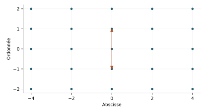

# École polytechnique — Deuxième composition de mathématiques MP 2001 · Corrigé brut

*Corrigé rédigé par IA, non officiel. Signalez toute erreur.*

**Rédaction** · GPT-6.2 Astra Ultra · vitesse non renseignée

**Révision (tour 1)** · GPT-6.2 Astra Ultra · vitesse non renseignée · 26 novembre 2026

Le problème établit la structure des sous-groupes discrets des espaces euclidiens puis l’applique aux groupes finis de matrices rationnelles et aux isométries affines d’un réseau.

## I. Structure des sous-groupes discrets

### Question 1.a

La nécessité suit de $0\in L$. Réciproquement, si $B(0,\varepsilon)\cap L=\{0\}$, tout $x\in L$ vérifie $B(x,\varepsilon)\cap L=\{x\}$ en soustrayant $x$. En particulier deux éléments distincts sont distants d’au moins $\varepsilon$.

### Question 1.b

Si $x_k\in L$ converge dans $E$, les différences $x_j-x_k$ sont de norme strictement inférieure au rayon d’isolement de 1.a pour $j,k$ assez grands. Elles sont donc nulles. La suite est stationnaire et sa limite appartient à $L$, d’où la fermeture.

### Question 1.c

Le groupe nul est $0\mathbb Z$. Pour un sous-groupe discret non nul, $S=L\cap]0,\infty[$ est non vide et son infimum $a$ est strictement positif par isolement de zéro. Une suite de $S$ tend vers $a$, qui appartient à $L$ par 1.b. Pour $x\in L$, $x-\lfloor x/a\rfloor a$ appartient à $L\cap[0,a[$ et vaut donc zéro. Ainsi $L=a\mathbb Z$. Réciproquement ces sous-groupes sont discrets, deux multiples distincts d’un $a>0$ étant distants d’au moins $a$.

### Question 2

Si $\alpha=p/q$ est rationnel avec $q>0$, alors $L\subset q^{-1}\mathbb Z$, donc $L$ est discret. Si $L$ est discret, il est de la forme $a\mathbb Z$ avec $a>0$ puisqu’il contient $1$. On a $1=ka$ et $\alpha=\ell a$ pour des entiers $k\ne0,\ell$ ; donc $\alpha=\ell/k$ est rationnel.

### Question 3

Prenons $L=\{(m+n\sqrt2,n):m,n\in\mathbb Z\}$. Un vecteur non nul a norme au moins un, puisque $n\ne0$ ou bien $n=0$ et $m\ne0$. Ce groupe est discret. Sa projection est $\mathbb Z+\sqrt2\mathbb Z$, non discrète d’après 2.

### Question 4.a

Le parallélépipède fermé $K=\{\sum_i\lambda_ia_i:0\le\lambda_i\le1\}$ est compact, image d’un cube compact. Une infinité de points de $P\subset K$ admettrait une sous-suite convergente de points distincts, incompatible avec la séparation uniforme de 1.a. Ainsi $P$ est fini.

### Question 4.b

Si $x=\sum_i t_i a_i$, posons $y=\sum_i\lfloor t_i\rfloor a_i\in L'$ et $z=x-y\in L$. Les coefficients de $z$ sont dans $[0,1[$ donc $z\in P$. L’unicité résulte de celle, pour chaque réel, de l’écriture entier plus élément de $[0,1[$.

### Question 4.c

Les $z_k$ appartiennent à l’ensemble fini $P$, donc $z_k=z_\ell$ pour deux indices $k>\ell$. Alors $(k-\ell)x=y_k-y_\ell\in L'$ et $d=k-\ell>0$. En considérant $k=1,\ldots,|P|+1$, on peut choisir $d\le|P|$.

### Question 4.d

Posons $N=|P|!$. Pour tout $x\in L$, un $d\in\{1,\ldots,|P|\}$ vérifie $dx\in L'$, et donc $Nx\in L'$. L’application $x\mapsto Nx$ est un morphisme injectif de $L$ dans $L'\simeq\mathbb Z^m$, l’isomorphisme étant fourni par les coordonnées sur les $a_i$. Le groupe nul est couvert par $m=0$.

La question 4.b donne aussi une lecture en termes de classes. Deux éléments de $P$ qui diffèrent d’un élément de $L'$ ont les mêmes coordonnées fractionnaires, donc sont égaux. Ainsi $P$ est un système de représentants de $L/L'$, dont l’ordre est $|P|$. Le théorème de Lagrange fournit alors directement $|P|x\in L'$ pour tout $x$. L’argument par factorielle donne un multiple commun sans faire appel à ce théorème.

### Question 5.a

Si l’image est nulle, prenons $k=0$ et $x^\circ=0$. Sinon le plus petit entier positif $k$ de $\pi(L)$ engendre ce sous-groupe par division euclidienne. Par définition de l’image, il existe $x^\circ\in L$ de dernière coordonnée $k$, ce qui donne $\pi(L)=k\mathbb Z=\pi(x^\circ)\mathbb Z$.

### Question 5.b

Pour $k>0$, on a $p=\pi(x)/k\in\mathbb Z$. Posons $\widehat x=x-px^\circ$. Cet élément de $L$ a sa dernière coordonnée nulle. Appliquer $\pi$ à toute telle écriture détermine forcément $p$, puis $\widehat x$ est déterminé par soustraction.

### Question 5.c

Pour $m=0$, le seul sous-groupe est $\mathbb Z^0$. Si $\pi(L)=0$, on se ramène à un sous-groupe de $\mathbb Z^{m-1}$. Sinon 5.b donne $L=\mathbb Z x^\circ\oplus(L\cap\ker\pi)$, le second terme étant inclus dans $\mathbb Z^{m-1}$. L’induction fournit dans les deux cas un groupe libre $\mathbb Z^r$ avec $r\le m$. Par 4.d cela s’applique à tout sous-groupe discret de $E$. Si $m$ est la dimension de son enveloppe réelle, il faut aussi $r\ge m$, car une famille de $r$ générateurs engendre cette enveloppe. Ainsi $r=m$.

### Question 6

Écrivons les $v_j$ dans la $\mathbb Z$-base $u$, puis les $u_i$ dans la base $v$. Les deux matrices de coefficients sont inverses dans $M_2(\mathbb Z)$ par unicité des coordonnées. Leurs déterminants sont donc $\pm1$. La valeur absolue du déterminant géométrique des deux vecteurs, donc l’aire du parallélogramme, est la même dans les deux bases.

## II. Groupes finis de matrices rationnelles

### Question 7.a

Il y a un nombre fini de coordonnées rationnelles dans les $g(e_i)$, puisque $G$ et la base sont finis. Un multiple commun $d>0$ de leurs dénominateurs rend toutes ces colonnes entières. Il en est de même de leurs combinaisons à coefficients entiers ; donc $dL(GB)\subset L(B)$.

### Question 7.b

Le groupe $L(GB)\subset d^{-1}\mathbb Z^n$ est discret et contient $B$ car l’identité appartient à $G$. Il engendre donc $E$. D’après 5.c il possède une $\mathbb Z$-base de $n$ vecteurs qui est aussi une base réelle. Chaque $g\in G$ permute l’ensemble $GB$, donc préserve le réseau. Les images de ses vecteurs de base ont des coordonnées entières dans cette base, comme demandé.

### Question 8.a

Le groupe des puissances de $A$ est fini et rationnel. La question 7.b rend $A$ semblable à une matrice entière. Son polynôme caractéristique, invariant par similitude et calculable comme un déterminant sur $\mathbb Z[X]$, a donc des coefficients entiers.

### Question 8.b

Comme $X^r-1$ est scindé à racines simples sur $\mathbb C$, $A$ est diagonalisable et ses valeurs propres sont de module un. Si elles sont réelles, elles valent $\pm1$ et $r\in\{1,2\}$. Sinon elles valent $e^{\pm i\theta}$ ; la trace entière $2\cos\theta$ est strictement entre $-2$ et $2$, donc vaut $-1,0$ ou $1$. Ces cas donnent respectivement $r=3,4,6$. Pour $r=1,2$, prenons $I,-I$. Pour $r=3,4,6$, prenons respectivement $t=-1,0,1$ dans $A_t=\left(\begin{smallmatrix}0&-1\\1&t\end{smallmatrix}\right)$. Son polynôme est $X^2-tX+1$ ; ses deux racines ont exactement l’ordre annoncé, donc la matrice aussi.

On peut contrôler les ordres des trois exemples sans calculer leurs angles. Pour $t=-1$, $A_t^2+A_t+I=0$ entraîne $A_t^3=I$ et $A_t\ne I$. Pour $t=0$, $A_t^2=-I$. Pour $t=1$, $A_t^2-A_t+I=0$ donne $A_t^3=-I$, et $A_t^2=A_t-I\ne I$. Les ordres sont donc exactement $3,4,6$.

## III. Isométries affines préservant un réseau

### Question 9

Dans une base orthonormale, $O(E)=\{U:U^{\mathsf T}U=I\}$ est fermé comme préimage de $I$ par une application continue. Ses colonnes sont unitaires, donc tous les coefficients sont bornés. En dimension finie, cet ensemble fermé borné est compact.

### Question 10.a

On a $(u,a)(v,b)=(uv,ub+a)$, ce qui est encore de la forme requise. L’associativité vient de la composition, le neutre est $(e,0)$ et $(u,a)^{-1}=(u^{-1},-u^{-1}a)$ avec $u^{-1}$ orthogonal. C’est bien un groupe.

### Question 10.b

On a $(u,a)(e,b)=(u,ub+a)$, puis la composition avec $(u^{-1},-u^{-1}a)$ donne $(e,ub)$. La conjugaison agit donc sur le vecteur de translation par sa partie linéaire.

### Question 11.a

Si $g(L)=L$, alors $a=g(0)\in L$. La translation $(e,a)$ et son inverse préservent donc $L$. En composant $g$ avec la translation $(e,-a)$ à gauche, on obtient $(u,0)$ qui conserve aussi le réseau.

### Question 11.b

Choisissons une base réelle $v_1,\ldots,v_n$ contenue dans $L$. Pour tout $u\in\rho(G)$, 11.a donne $u(v_i)\in L$ et l’orthogonalité impose $\|u(v_i)\|=\|v_i\|$. Chaque sphère compacte ne contient qu’un nombre fini de points uniformément séparés du réseau, comme en 4.a. Un $u$ est déterminé par ces $n$ images ; il n’y a donc qu’un nombre fini de possibilités.

### Question 11.c

Dans $L=2\mathbb Z\times\mathbb Z$, les seuls vecteurs unitaires sont $(0,1)$ et $(0,-1)$. Une isométrie linéaire du réseau préserve donc l’axe vertical, et par orthogonalité l’axe horizontal. Elle est de la forme $\operatorname{diag}(\varepsilon_1,\varepsilon_2)$ avec $\varepsilon_i=\pm1$, et chacune de ces quatre matrices convient. Par 11.a toutes les transformations cherchées sont exactement
$$(x,y)\longmapsto(\varepsilon_1x+2k,\varepsilon_2y+\ell),\qquad k,\ell\in\mathbb Z,\quad \varepsilon_i\in\{-1,1\}.$$

Dans ces paramètres, composer une transformation de signes $(\varepsilon_1,\varepsilon_2)$ et translation $(2k,\ell)$ après une transformation de signes $(\delta_1,\delta_2)$ et translation $(2m,n)$ donne les signes $(\varepsilon_1\delta_1,\varepsilon_2\delta_2)$ et la translation $(2(k+\varepsilon_1m),\ell+\varepsilon_2n)$. Les quatre transformations linéaires agissent donc sur les translations par changement des deux signes.
