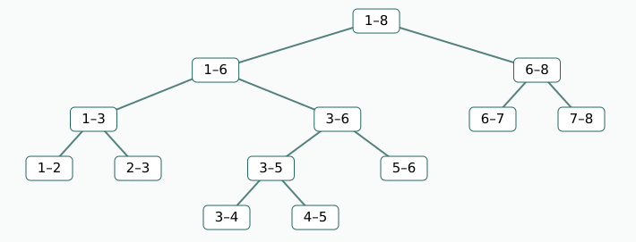

# X · MP · Informatique (option) 2001 — Corrigé brut

*Corrigé rédigé par IA, non officiel. Signalez toute erreur.*

**Rédaction** · GPT-6.2 Astra Ultra · vitesse non renseignée

Épreuve de quatre heures. On additionne les valeurs des enfants modulo 4 et l’on exige une somme non nulle à chaque nœud interne. Les programmes sont en OCaml. On emploie les préconditions du cahier, notamment l’ordre des feuilles et la validité des triangulations fournies. Les calculs de dénombrement supposent, comme les indices de rang du sujet, des entiers représentables. Aucun rapport propre à cette session n’a été retrouvé.

## I. Vérification de la compatibilité

### 1. Compter les feuilles

```ocaml
type arbre = Feuille | Interne of arbre * arbre
type flot = int array

let rec compte_feuilles = function
  | Feuille -> 1
  | Interne (g, d) -> compte_feuilles g + compte_feuilles d
```

Le cas de base et la somme correspondent exactement à la définition récursive de l’ensemble des feuilles.

### 2. Vérifier un flot avec arrêt immédiat

```ocaml
exception Somme_nulle

let compatible a f =
  let rang = ref 0 in
  let rec valeur = function
    | Feuille ->
        let v = f.(!rang) in
        incr rang;
        v
    | Interne (g, d) ->
        let x = valeur g in
        let y = valeur d in
        let s = (x + y) mod 4 in
        if s = 0 then raise Somme_nulle else s
  in
  try ignore (valeur a); true with Somme_nulle -> false
```

À chaque entrée dans une feuille, le compteur désigne sa case du tableau, numéroté depuis zéro. Au premier échec, l’exception remonte directement à l’appel externe. On ne fait aucune addition supplémentaire.

### 3.a. Nombre de nœuds internes

Une feuille possède zéro nœud interne. Un arbre composé de deux sous-arbres en possède $(p-1)+(q-1)+1=p+q-1$. Un arbre à $n$ feuilles a donc $n-1$ nœuds internes.

### 3.b. Couples possibles

| Valeur du père | Couples ordonnés gauche, droite |
|---:|:---|
| 1 | $(2,3)$ et $(3,2)$ |
| 2 | $(1,1)$ et $(3,3)$ |
| 3 | $(1,2)$ et $(2,1)$ |

### 3.c. Nombre de flots compatibles

Pour chaque valeur imposée $v$, une feuille admet un unique flot. Pour un père de sous-arbres à $p$ et $q$ feuilles, chaque couple de 3.b donne $2^{p-1}2^{q-1}$ choix par récurrence. Les deux couples étant distincts, $F(a,v)=2^{p+q-1}=2^{n-1}$. En laissant varier $v$, on obtient $3\cdot2^{n-1}$ flots compatibles.

### 4.a. Échec à la première addition

Pour $n\geq2$, les deux feuilles de la première addition peuvent recevoir $(1,3),(2,2)$ ou $(3,1)$. Les $n-2$ autres valeurs sont libres, donc $\nu_1(a)=3^{n-1}$. La forme de l’arbre influe sur la position de ces feuilles, mais le nombre est le même.

### 4.b. Loi du premier échec

Soit $a'$ l’arbre obtenu en remplaçant ce premier père par une feuille. Pour avoir un premier échec au rang $k\geq2$, la première addition doit réussir. Attribuons sa somme à la feuille contractée. Les additions suivantes sur $a$ sont maintenant celles de $a'$, dans le même ordre. Chaque flot réduit, échouant au rang $k-1$, a deux antécédents d’après 3.b. Ainsi $\nu_k(a)=2\nu_{k-1}(a')$, et finalement

$$
\nu_k(a)=2^{k-1}3^{n-k},\qquad 1\leq k\leq n-1.
$$

### 4.c. Complexité moyenne

La première addition a toujours lieu si $n\geq2$. Après $j$ succès, une contraction successive donne un facteur $2^j$ pour le relèvement de chaque flot à $n-j$ feuilles. La probabilité de ces $j$ succès vaut donc $(2/3)^j$. Par somme des probabilités de queue,

$$
\mathbb E[N_+]=\sum_{j=0}^{n-2}(2/3)^j
=3\left(1-(2/3)^{n-1}\right).
$$

Pour une feuille la somme est vide et vaut zéro. La moyenne tend vers 3, alors qu’un flot compatible exige $n-1$ additions.

## II. Triangulations

### 5. Nombre de cordes

Si $p$ cordes ne se croisent pas, leur ajout successif divise à chaque fois une face en deux. Il y a $p+1$ faces. Dans une triangulation, $3(p+1)=n+2p$, donc $p(n)=n-3$.

### 6. Décider si des cordes triangulent

```ocaml
type segment = int * int
type segments = segment list

let croisent (a, b) (c, d) =
  (a < c && c < b && b < d) || (c < a && a < d && d < b)

let triangulation n cordes =
  let rec sans_croisement = function
    | [] -> true
    | x :: suite ->
        not (List.exists (croisent x) suite) && sans_croisement suite
  in
  List.length cordes = n - 3 && sans_croisement cordes
```

La taille maximale de l’entrée est le nombre de paires de sommets, soit $O(n^2)$. Si le nombre de cordes est incorrect, seule la longueur a été calculée. S’il est correct, on compare $O(n^2)$ paires de cordes. Le critère admis garantit alors l’équivalence avec une triangulation. Les inégalités strictes autorisent un sommet commun.

### 7.a. Exemple de l’octogone

La racine $(1,8)$ a pour enfants $(1,6)$ et $(6,8)$. La première de ces branches se coupe en $(1,3)$ et $(3,6)$, la seconde en $(6,7)$ et $(7,8)$. Le nœud $(3,6)$ se coupe en $(3,5)$ et $(5,6)$. Les segments $(1,3)$ et $(3,5)$ portent chacun deux feuilles. Les sept feuilles, de gauche à droite, sont les côtés $(i,i+1)$.



### 7.b. Construction générale

Si $j=i+1$, l’intervalle est une feuille. Sinon, un unique triangle de la triangulation s’appuie sur cette base du côté de l’intervalle. Son troisième sommet $k$ est strictement entre $i$ et $j$. Les deux fils sont les arbres obtenus sur $(i,k)$ et $(k,j)$. Les longueurs diminuent, chaque côté consécutif est atteint exactement une fois et l’ordre gauche-droite est celui des côtés initiaux. On part de $(1,n)$.

### 7.c. De la triangulation à l’arbre

```ocaml
let triangle_arbre n t =
  let present = Array.make_matrix (n + 1) (n + 1) false in
  List.iter (fun (i, j) -> present.(i).(j) <- true) t;
  let rec construire i j =
    if j = i + 1 then Feuille
    else
      let rec sommet k =
        if present.(i).(k) && present.(k).(j) then k
        else sommet (k + 1)
      in
      let k = sommet (i + 1) in
      Interne (construire i k, construire k j)
  in
  construire 1 n
```

L’argument est une triangulation complète, côtés inclus. Deux candidats distincts produiraient deux cordes croisées entre les extrémités de la base. L’existence et l’unicité données en 7.b justifient l’arrêt de la recherche de $k$.

### 8. De l’arbre à la triangulation

```ocaml
let arbre_triangle a =
  let segments = ref [] in
  let rec visite i arbre =
    let j =
      match arbre with
      | Feuille -> i + 1
      | Interne (g, d) ->
          let k = visite i g in
          visite k d
    in
    segments := (i, j) :: !segments;
    j
  in
  ignore (visite 1 a);
  !segments
```

L’appel renvoie le sommet final de l’intervalle traité et consigne exactement le segment qui lui correspond. Les segments des fils ont déjà été consignés. La racine fournit le côté $(1,n)$ et les feuilles fournissent tous les autres côtés.

## III. Générations et quatre couleurs

### 9.a. Produit cartésien

Posons $c=|E|$ et $d=|E'|$. Au rang $k<cd$, associer $(\varphi(\lfloor k/d\rfloor),\varphi'(k\bmod d))$. Le couple de rangs $(i,j)$ a pour unique antécédent $id+j$. Si un facteur est vide, il n’y a aucun rang à évaluer.

### 9.b. Union disjointe

Pour $0\leq k<c$, renvoyer $\varphi(k)$. Pour $c\leq k<c+d$, renvoyer $\varphi'(k-c)$. Les deux images sont disjointes et les deux blocs les épuisent.

### 9.c. Deux ensembles disjoints de même taille

Au rang $2j$, renvoyer $\varphi(j)$ et au rang $2j+1$, renvoyer $\varphi'(j)$. Le quotient entier et le reste par 2 suffisent, sans connaître $c$.

### 10.a. Nombre d’arbres

$N_a(1)=1$ et, pour $n\geq2$,

$$
N_a(n)=\sum_{i=1}^{n-1}N_a(i)N_a(n-i).
$$

Dans la classe $i$, les arbres des deux enfants se choisissent librement et leur ordre compte. Le tableau global ci-dessous est dimensionné à la demande.

```ocaml
let na = ref [|0; 1|]

let calcule_na n =
  let t = Array.make (n + 1) 0 in
  t.(1) <- 1;
  for m = 2 to n do
    for i = 1 to m - 1 do
      t.(m) <- t.(m) + t.(i) * t.(m-i)
    done
  done;
  na := t
```

### 10.b. Retrouver l’arbre de rang donné

```ocaml
let int_arbre n rang =
  let t = !na in
  let rec arbre m k =
    if m = 1 then Feuille
    else
      let rec classe i r =
        let droite = t.(m-i) in
        let taille = t.(i) * droite in
        if r >= taille then classe (i + 1) (r - taille)
        else Interne (arbre i (r / droite), arbre (m-i) (r mod droite))
      in
      classe 1 k
  in
  arbre n rang
```

On appelle préalablement `calcule_na n`. Les classes de 10.a forment une partition. Dans la classe retenue, la division détermine un couple unique de rangs valides. La récurrence sur le nombre de feuilles donne la bijection.

### 11. Générer les flots compatibles de valeur imposée

```ocaml
let enfants v bit =
  match v, bit with
  | 1, 0 -> 2, 3
  | 1, _ -> 3, 2
  | 2, 0 -> 1, 1
  | 2, _ -> 3, 3
  | _, 0 -> 1, 2
  | _, _ -> 2, 1

let int_flot n a v k =
  let resultat = Array.make n 0 in
  let rang = ref k and feuille = ref 0 in
  let rec remplir arbre valeur =
    match arbre with
    | Feuille ->
        resultat.(!feuille) <- valeur;
        incr feuille
    | Interne (g, d) ->
        let x, y = enfants valeur (!rang mod 2) in
        rang := !rang / 2;
        remplir g x;
        remplir d y
  in
  remplir a v;
  resultat
```

Les $n-1$ bits sont affectés en ordre préfixe, le bit faible à la racine. Chaque arbre étiqueté obtenu est compatible et possède la valeur prescrite. Réciproquement, les étiquettes des feuilles déterminent toutes les sommes internes, donc le choix du couple à chaque père. Ainsi deux rangs distincts donnent deux flots distincts et les $2^{n-1}$ flots de 3.c sont atteints.

### 12.a. Trouver un flot commun

```ocaml
let trouve_compatible n a b =
  let taille = 1 lsl (n - 1) in
  let rec cherche v k =
    let f = int_flot n a v k in
    if compatible b f then f
    else if k + 1 = taille then cherche (v + 1) 0
    else cherche v (k + 1)
  in
  cherche 1 0
```

Pour les racines successives $1,2,3$, la boucle parcourt les flots compatibles avec $a$ une seule fois chacun. Le résultat admis dans le cahier assure au moins un succès sur $b$ avant la fin du troisième bloc. L’algorithme termine donc après au plus $3\cdot2^{n-1}$ essais.

### 12.b. Expérience sur deux arbres

```ocaml
let quatre_couleurs n =
  calcule_na n;
  let hasard () = Random.full_int (!na).(n) in
  let a = int_arbre n (hasard ()) in
  let b = int_arbre n (hasard ()) in
  trouve_compatible n a b
```

`Random.full_int` joue le rôle de `random_int` du sujet. Deux tirages successifs produisent les deux arbres. Le flot renvoyé a ensuite subi la vérification de 12.a. Cette expérience construit un témoin pour le couple tiré.

[Sujet](https://www.wikiprepa.fr/concours/data/x_option-info_mp_2001.pdf) · [Autre exemplaire](https://www.doc-solus.fr/prepa/sci/adc/pdf/enonces.pdf/2001/MP_INFO_X_1_2001.enonce.pdf)
