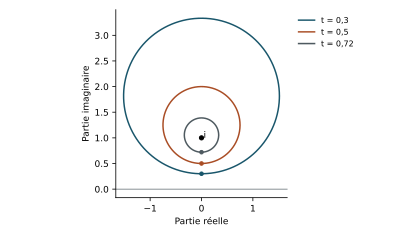

# École polytechnique — Première composition de mathématiques MP 2001 · Corrigé brut

*Corrigé rédigé par IA, non officiel. Signalez toute erreur.*

**Rédaction** · GPT-6.2 Astra Ultra · vitesse non renseignée

**Révision** · GPT-6.2 Astra Ultra · vitesse non renseignée

Une même équation différentielle apparaît sous forme de série entière puis comme équation radiale sur le demi-plan de Poincaré. Les puissances de nombres positifs utilisent le logarithme réel, même lorsque le paramètre est complexe.

## I. Série entière et équation différentielle

### Question 1

Le coefficient de $x^n$ dans le membre gauche est $(n+1)(2n+2s+1)a_{n+1}-[2n(n-1)+(2s+3)n+s]a_n$. Le crochet se factorise en $(n+s)(2n+1)$. Pour $s\in S$ le dénominateur ne s’annule pas, et
$$a_{n+1}(s)=\frac{(n+s)(2n+1)}{(n+1)(2n+2s+1)}a_n(s),\qquad a_0=1.$$

### Question 2

Si $s\notin-\mathbb N$, les numérateurs successifs sont non nuls, donc tous les $a_n$ sont non nuls. Le quotient de 1 est une fraction rationnelle en $n$ dont les termes dominants sont $2n^2$ en haut et en bas. Sa limite est $1$.

### Question 3

Pour $s=-N$ entier négatif ou nul, $a_{N+1}=0$ puis tous les termes suivants sont nuls. La série est un polynôme de rayon infini. Pour les autres $s\in S$, la limite du quotient donne le rayon $1$. À l’intérieur du disque de convergence les dérivations terme à terme sont légitimes et tous les coefficients du membre gauche de $(E_s)$ s’annulent par 1. Le polynôme satisfait de même l’identité partout.

### Question 4

Les coefficients $a_n(s)$ sont continus sur $S$ par récurrence. Sur tout compact $K\subset S$, le multiplicateur de 1 tend uniformément vers $1$, par division du numérateur et du dénominateur par $2n^2$ et bornitude de $s$. Pour $0<r<1$, choisissons $q>1$ tel que $rq<1$. À partir d’un rang commun, $|a_{n+1}(s)|\le q|a_n(s)|$, y compris aux indices où le produit termine. Les premiers coefficients étant bornés sur $K$, $|a_n(s)x^n|\le C(qr)^n$ sur $K\times[-r,r]$. La convergence localement uniforme donne la continuité conjointe.

### Question 5.a

Posons $x=t^2$ et $t^s=e^{s\ln t}$. On a $F'=st^{s-1}f+2t^{s+1}f'$ et $F''=s(s-1)t^{s-2}f+(4s+2)t^sf'+4t^{s+2}f''$. Après substitution dans $(E'_s)$, les termes en $s(s-1)t^s(1-t^2)f$ s’annulent. Il reste $2t^{s+2}$ fois
$$2x(1-x)f''+[2s+1-(2s+3)x]f'-sf.$$
Comme $t>0$, les deux équations sont équivalentes par ce changement de fonction.

### Question 5.b

La quantité $s(1-s)$ est inchangée sous $s\mapsto1-s$. L’hypothèse assure que $s$ et $1-s$ appartiennent à $S$. D’après 5.a, $\Phi_s$ et $\Phi_{1-s}$ sont solutions. Puis $f_s(t^2)=1+O(t^2)$, $\frac{d}{dt}f_s(t^2)=O(t)$ et de même pour $1-s$. En formant $\Phi_s\Phi_{1-s}'-\Phi_s'\Phi_{1-s}$, les puissances de $t$ se compensent et le résultat vaut $1-2s+O(t^2)$, non nul près de zéro. Sur $]0,1[$ le coefficient dominant de l’équation ne s’annule pas et l’espace des solutions est de dimension deux. Ces deux solutions en constituent une base.

L’exclusion de $s=1/2$ intervient dans le wronskien. Même lorsque $\Re(s)=1/2$, son terme constant $1-2s$ reste non nul dès que $s\ne1/2$. Comparer seulement les modules des deux solutions n’aurait pas permis de traiter ce cas.

## II. Action de rotations sur le demi-plan

### Question 6.a

Si $\sin\theta=0$, le dénominateur vaut $\pm1$ ; sinon son annulation imposerait $z=-\cot\theta\in\mathbb R$, exclu. En multipliant par son conjugué et en utilisant $\cos^2\theta+\sin^2\theta=1$, on trouve $\operatorname{Im}A_\theta(z)=\operatorname{Im}z/|z\sin\theta+\cos\theta|^2>0$.

### Question 6.b

La matrice de $A_\theta$ est $\left(\begin{smallmatrix}\cos\theta&-\sin\theta\\ \sin\theta&\cos\theta\end{smallmatrix}\right)$. Les formules d’addition donnent $A_\theta A_\eta=A_{\theta+\eta}$ et $A_0=I$. D’après 6.a il s’agit d’une action sur $H$.

### Question 6.c

Les termes mixtes s’annulent dans $|z\cos\theta-\sin\theta|^2+|z\sin\theta+\cos\theta|^2=|z|^2+1$. En divisant par $|z\sin\theta+\cos\theta|^2$ puis par deux fois la partie imaginaire de 6.a, on obtient $c(A_\theta z)=c(z)$.

### Question 6.d

Par 6.b, $A_\theta(z)=A_{\theta'}(z)$ équivaut à $A_{\theta-\theta'}(z)=z$. Après multiplication, cette dernière relation devient $(1+z^2)\sin(\theta-\theta')=0$. Le seul zéro de $1+z^2$ dans $H$ est $i$. Pour $z\ne i$, la condition est donc exactement $\theta-\theta'\in\pi\mathbb Z$.

### Question 7.a

Écrivons $c_0=c(z_0)$. L’égalité $c(x+iy)=c_0$ équivaut à $x^2+(y-c_0)^2=c_0^2-1$. On a $c_0-1=|z_0-i|^2/(2\operatorname{Im}z_0)>0$. Le cercle de centre $ic_0$ et de rayon $\sqrt{c_0^2-1}<c_0$ reste donc dans $H$. Par 6.c il contient toute l’orbite.

### Question 7.b

Posons $w=(z-i)/(z+i)$, bijection de $H$ sur le disque unité d’inverse $z=i(1+w)/(1-w)$. Un calcul donne $w(A_\theta z)=e^{-2i\theta}w(z)$ et $|w(z)|^2=(c(z)-1)/(c(z)+1)$. Tous les points d’un même cercle de niveau $c_0$ correspondent ainsi à tous les arguments d’un même module. Les facteurs $e^{-2i\theta}$ les parcourent tous, d’où l’égalité avec l’orbite.

Pour préciser le sens de rotation, le numérateur de $w(A_\theta z)$ est proportionnel à $(\cos\theta-i\sin\theta)(z-i)$ et son dénominateur à $(\cos\theta+i\sin\theta)(z+i)$. Cela donne le facteur $e^{-2i\theta}$ utilisé ci-dessus.

### Question 8.a

Écrivons $d=it\sin\theta+\cos\theta$. La dérivation de l’homographie de déterminant un donne $U_t=i/d^2$ ; la dérivation en $\theta$ donne $U_\theta=-(1+(it)^2)/d^2=(t^2-1)/d^2$. Donc $J=\operatorname{Im}(\overline{U_t}U_\theta)=(1-t^2)/|d|^4$, soit $(1-t^2)/(\cos^2\theta+t^2\sin^2\theta)^2>0$.

### Question 8.b

On a $c(it)=(t+t^{-1})/2$, strictement décroissante de $+\infty$ vers $1$ pour $0<t<1$. Pour $z\ne i$ dans $H$, le nombre $c(z)>1$ détermine donc un unique $t$ de cet intervalle, et 7.b assure $z=A_\theta(it)$. Le point $i$, de niveau un, est exclu. Si $U(t,\theta)=U(t',\theta')$, l’invariance impose $t=t'$, puis 6.d impose $\theta-\theta'\in\pi\mathbb Z$. Réciproquement ces deux conditions suffisent.

L’unique paramètre se lit aussi sur le dessin. Résoudre $t^2-2c(z)t+1=0$ donne $t=c(z)-\sqrt{c(z)^2-1}$ pour la racine inférieure à $1$. C’est l’ordonnée du point bas du cercle, l’autre racine étant $1/t$.

## III. Opérateur différentiel invariant et symétrie du paramètre

### Question 9

La composition $V\varphi=\varphi\circ U$ est linéaire, lisse et $\pi$-périodique en $\theta$, et elle est injective puisque $U$ est surjective sur $H'$. Pour toute $\psi$ lisse périodique, définissons $\varphi(z)=\psi(t,\theta)$ pour un antécédent de $z$. La périodicité et 8.b rendent cette définition indépendante du choix. Le jacobien de 8.a ne s’annule pas, donc $U$ admet des inverses locaux lisses. Localement, $\varphi$ est composée avec un tel inverse ; elle est lisse partout. On a ainsi l’isomorphisme voulu.

### Question 10.a

On a $U(t,\eta+\theta)=A_\theta(U(t,\eta))$ par 6.b. La composition par $\varphi$ donne $(V\varphi)\circ\tau_\theta=V(\varphi\circ A_\theta)$.

### Question 10.b

Écrivons $\psi=V\varphi$. Alors $\widetilde D(\psi\circ\tau_\theta)=VD(\varphi\circ A_\theta)=V((D\varphi)\circ A_\theta)=(VD\varphi)\circ\tau_\theta=(\widetilde D\psi)\circ\tau_\theta$, grâce à 10.a.

### Question 11

Pour $\omega(z)=y^s=e^{s\ln y}$, $D\omega=y^2\partial_y^2 y^s=s(s-1)\omega$. Sur tout compact de $H$, les fonctions $\omega(A_\theta z)$ et toutes leurs dérivées en $x,y$ sont continues et bornées uniformément pour $0\le\theta\le\pi$, d’où la dérivation sous l’intégrale à tout ordre. La composition par $A_\eta$ translate l’angle de $\eta$ dans une intégrale sur une période, donc laisse $\varphi_s$ inchangée. La commutation admise donne $D\varphi_s=s(s-1)\varphi_s$ sur $H'$ et par continuité également en $i$.

### Question 12

Comme $A_{\pi/2}(it)=-1/(it)=i/t$, l’invariance de 11 donne $F_s(1/t)=F_s(t)$ pour $t>0$.

### Question 13

Par 6.a, $F_s(t)=\int_0^\pi[t/(\cos^2\theta+t^2\sin^2\theta)]^s d\theta$. Le changement $u=\cot\theta$ donne
$$F_s(t)=t^s\int_{\mathbb R}(1+u^2)^{s-1}(u^2+t^2)^{-s}du.$$
L’intégrande est pair et de taille $O(u^{-2})$ à l’infini, les puissances étant définies par les logarithmes réels. Sur la demi-droite positive, substituons $u=t/v$. Les facteurs et le jacobien transforment cette expression en $t^{1-s}\int_{\mathbb R}(1+v^2)^{-s}(v^2+t^2)^{s-1}dv=F_{1-s}(t)$.

### Question 14

L’invariance donne $V\varphi_s(t,\theta)=F_s(t)$. Le calcul radial admis et 11 montrent sur $]0,1[$ que $t^2(1-t^2)F_s''-2t^3F_s'+s(1-s)(1-t^2)F_s=0$. D’après 5.b, $F_s=A_s\Phi_s+B_s\Phi_{1-s}$ de manière unique. En remplaçant $s$ par $1-s$ puis en utilisant 13, on obtient $B_s=A_{1-s}$. Le choix $\lambda_s=A_s$ donne la famille demandée.

### Question 15

Si $\sigma=\operatorname{Re}s<1/2$, alors $t^{-s}\Phi_s(t)\to1$ et $t^{-s}\Phi_{1-s}(t)=t^{1-2s}f_{1-s}(t^2)\to0$. Ainsi $\lambda_s=\lim_{t\downarrow0}t^{-s}F_s(t)$. Dans l’intégrale de 13, le quotient est $(\cos^2\theta+t^2\sin^2\theta)^{-s}$. Pour $0<t<1$, son module est au plus $1$ si $\sigma\le0$, et au plus $|\cos\theta|^{-2\sigma}$ si $0<\sigma<1/2$. Ce dernier majorant est intégrable près de $\pi/2$. Par convergence dominée,
$$\lambda_s=\int_0^\pi |\cos\theta|^{-2s}\,d\theta.$$
