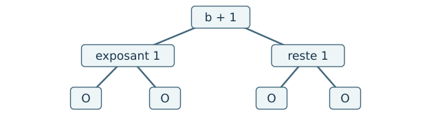
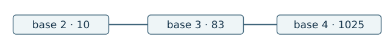
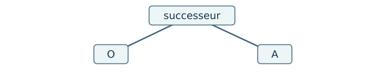

# ENS · MP-PC · Informatique 2002 — corrigé brut

*Corrigé rédigé par IA, non officiel. Signalez toute erreur.*

**Rédaction** · GPT-6.2 Astra Ultra · vitesse non renseignée · 25 novembre 2026

Une base b est toujours un entier au moins égal à deux. O est la feuille et X · Y un arbre binaire. Les deux ordres sur les arbres sont distingués par les symboles  $>$ et $\succ$ dans le texte ; les équations sont interprétées avec l’ordre indiqué dans chaque partie.

## Partie I. Ordres et listes

### Question I.1 · Asymétrie

Si $xRy$ et $yRx$, la transitivité entraînerait $xRx$, contraire à l’irréflexivité. Ainsi $xRy$ exclut $yRx$ ; en particulier la relation est antisymétrique. La relation large associée est également antisymétrique.

### Question I.2 · Accumuler les arbres

```text
tant que L non vide :
    A ← tête(L) · A
    L ← queue(L)
renvoyer A
```

Chaque itération remplace la paire d’arguments par celle de l’appel récursif du sujet. La longueur restante décroît ; temps $O(|L|)$.

## Partie II. Décomposition héréditaire et arithmétique

### Question II.1 · 4 et 83 en base trois

Poser $u=3^0=1$. Alors $4=3^u+u$ et $83=3^{3^u+u}+u+u$. On a décomposé l’exposant 4 aussi bien que les coefficients : $83=81+1+1$.

### Question II.2 · Opérations nécessaires

Pour $n>0$, prendre le plus grand $p$ tel que $b^p\le n$, puis $q=n-b^p$. On a $p<n$ et $q<n$ puisque $b\ge2$. Par récurrence forte, $p$ et $q$ ont déjà de telles expressions. La formule $b^p+q$ en est une pour $n$, avec $0$ comme base de la récurrence et $b$ comme symbole fixé.

### Question II.3 · Construire les arbres

Noter $U=O\cdot O$ et $V=U\cdot O$. Les arbres de $1,b,b+1,b^b$ sont respectivement $U,V,U\cdot U,V\cdot O$. En général
$$T_b(0)=O,\qquad T_b(n)=T_b(p)\cdot T_b(q)\quad(n>0),$$
avec $(p,q)=\mathrm{dec1}(b,n)$ et $p$ maximal. Les deux appels réduisent strictement $n$.



### Question II.4 · Interpréter la pile

Un cadre est un couple $(q,L)$ avec $q\in\mathbb N$ et $L$ une liste d’arbres. La pile est une liste de cadres ; courant est un cadre et liste_res sa deuxième composante. Pour une décomposition en cours, $q$ est le reste à analyser et $L$ contient en ordre inverse les arbres des exposants maximaux déjà calculés. En descendant dans un exposant, on suspend le reste et sa liste. Quand $q=0$, renv$(L)$ reconstruit la chaîne des termes de gauche à droite ; on la consigne dans le cadre appelant. Après dépilement de la sentinelle, courant vaut $(0,[T_b(n)])$, y compris pour $n=0$.

### Question II.5 · Évaluation

Poser $E_b(O)=0$, et $E_b(X\cdot Y)=b^{E_b(X)}+E_b(Y)$. La récurrence structurelle et II.3 donnent $E_b(T_b(n))=n$. Pour un arbre de taille $h$, les $h$ nœuds binaires et $h+1$ feuilles sont visités une fois. Dans le modèle à somme et puissance unitaires, le coût est $\Theta(h+1)$.

### Question II.6 · Premiers termes et très grande valeur

Pour remonter à $g_2$, observer que $g_3+1=84=3^{3^{3^0}+3^0}+3^{3^0}$. Le même arbre en base deux vaut $2^{2^1+1}+2=10$. C’est bien l’écriture canonique de 10 en base deux. L’unicité suit de la croissance stricte du changement de base démontrée en III.8. Depuis $g_3=83$, $g_4=4^{4+1}+2-1=1025$.

À la base 5 il vient $g_5=5^{6}$. À la base 6, $g_6=6^7-1$, de terme dominant $5\cdot6^6$. Il contient donc assez de marge pour réserver $6^6+2000$. Plus formellement, de $g_k\ge k^k+r$ avec $0\le r< k^k$ on déduit $g_{k+1}\ge(k+1)^{k+1}+r-1$, par croissance du relèvement et par relèvement de $r$ au moins égal à $r$. Partir de $r=2000$ au rang 6 donne $g_{1001}\ge1001^{1001}+1005>1000^{1000}$.



### Question II.7 · Addition

La solution directe est $T_b(E_b(A)+E_b(B))$. Pour garder les nombres grands sous forme d’arbres, lire chaque chaîne droite comme une liste d’exposants décroissants. Calculer une unité supplémentaire sur un exposant $p$ par la même arithmétique des chiffres : partir du chiffre des unités, remettre à zéro chaque chiffre maximal traversé et propager une retenue de 1 ; les positions elles-mêmes sont des arbres. Une version récursive précise est la suivante. Pour insérer un terme d’exposant $p$ dans une liste normalisée, le placer au bon endroit par comparaison structurelle (III.8). Dès que $b$ copies de $p$ sont réunies, les retirer et insérer un terme d’exposant $p+1$. Pour calculer $p+1$, appliquer cette même insertion d’un terme d’exposant $O$ au nombre représenté par $p$. Sur un chiffre maximal utiliser le test « déjà $b-1$ » et une retenue, sans jamais accumuler le nombre $b$ dans une case. Insérer tous les termes de $B$ dans $A$. Une montée de retenue sur un même niveau réduit de $b$ à un le nombre des termes impliqués, et les appels arithmétiques sur un exposant concernent des valeurs strictement plus petites que la valeur normalisée au niveau supérieur. L’algorithme termine et conserve la valeur par $b\, b^p=b^{p+1}$.

### Question II.8 · Produit

Pour chaque occurrence d’exposant $p$ dans $A$ et chaque occurrence $q$ dans $B$, calculer par II.7 l’arbre de $p+q$ et insérer une occurrence de cet exposant dans le résultat initialement $O$. Les insertions normalisent les retenues. C’est la distributivité et $b^p b^q=b^{p+q}$. Les parcours utilisent des listes, et les seules opérations numériques portent sur des chiffres strictement inférieurs à $b$. Un arbre $O$ produit une liste de termes vide, donc un produit nul.

## Partie III. L’ordre lexicographique sur les arbres

### Question III.1 · Ordre strict

Écrire $A>B$ pour l’ordre de cette partie. $O$ est le minimum et les nœuds non nuls se comparent d’abord par leur fils gauche, puis à égalité par leur fils droit. L’irréflexivité suit par induction sur la taille. Pour la transitivité, raisonner sur la somme des tailles des trois arbres : dans $A>B>C$, si les trois sont non nuls et si une des comparaisons de fils gauches est stricte, transitivité ou égalité sur les fils donne $A_1>C_1$. Si les trois fils gauches coïncident, appliquer l’induction aux trois fils droits. Le cas $C=O$ est immédiat. De même la comparaison récursive décide exactement un des trois signes.

### Question III.2 · Descente infinie

Soit $U=O\cdot O$, $A_0=U\cdot O$ et $A_{i+1}=O\cdot A_i$. On a $A_0>A_1$ car $U>O$. En plaçant la même feuille gauche $O$ des deux côtés, $A_i>A_{i+1}$ entraîne $A_{i+1}>A_{i+2}$. Ceci donne une descente infinie.

### Question III.3 · Produit lexicographique

L’irréflexivité se lit sur la première composante, puis sur la seconde en cas d’égalité. Pour la transitivité, une baisse stricte de la première composante sur l’un des deux pas donne une baisse stricte sur le composé ; sinon les trois premières composantes coïncident et la seconde décide. Sur une descente infinie, les premières composantes ne pourraient baisser strictement une infinité de fois, sinon en extraire une descente. Elles sont donc constantes à terme et les secondes composantes décroîtraient alors strictement à l’infini. Contradiction.

### Question III.4 · Mots décroissants

Pour chaque lettre $a$, soit $W_a$ l’ensemble des mots décroissants dont toutes les lettres sont $\le a$. Par induction bien fondée sur $a$, supposons les $W_b$ bien fondés pour $b<a$. Un mot non vide de $W_a$ s’écrit $a^r v$ avec $v$ vide ou de première lettre $<a$. Sur une descente, le nombre $r$ ne peut qu’être non croissant car la première lettre suivante est inférieure à $a$ ou absente. Une fois $r$ constant, les queues devraient décroître. La première queue non vide commence par $b<a$ et une descente à partir d’elle reste dans $W_b$, contradiction. Une descente quelconque part d’un mot de première lettre $a$ et reste dans $W_a$. Réciproquement les mots de longueur un reproduisent l’ordre de l’alphabet.

### Question III.5 · Successeur ordonné

Lire l’épine droite de l’arbre comme une liste décroissante de fils gauches ; $O$ correspond à la liste vide. Le successeur est la même liste prolongée par $O$, le plus petit terme possible. Elle reste décroissante et est la plus petite liste strictement plus grande : tout changement avant la fin dépasse ce prolongement, toute autre extension est au moins celui-ci. Formellement $s_>(O)=O\cdot O$ et $s_>(X\cdot Y)=X\cdot s_>(Y)$.

### Question III.6 · Segment initial

Pour $A=O$, son segment est réduit à $O$. Pour $A=X\cdot Y$, tout arbre ordonné $B\le A$ se représente comme une liste décroissante dont les lettres sont des arbres ordonnés $\le X$ : sa tête est $\le X$ par comparaison avec $A$, et la liste est décroissante. L’ordre entre ces arbres est exactement l’ordre du dictionnaire de leurs listes. Ainsi le segment s’identifie à un sous-ensemble des mots décroissants sur $\mathcal O_X$. Par induction structurelle sur $A$, cet alphabet est bien fondé ; III.4 puis la restriction à un sous-ensemble concluent. On n’a pas besoin que $A$ soit ordonné.

### Question III.7 · Bonne fondation

Toute descente infinie dans $\mathcal O$ aurait un premier terme $A$. Tous les suivants seraient dans $\mathcal O_A$, bien fondé par III.6. Contradiction.

### Question III.8 · Ordre des entiers et des arbres

Les exposants maximaux successifs de l’écriture en base $b$ sont non croissants et un même exposant figure au plus $b-1$ fois. Par récurrence forte simultanée sur le plus grand entier considéré, leurs arbres sont ordonnés et conservent leurs comparaisons, car les exposants sont strictement plus petits. L’arbre obtenu est donc ordonné. Pour comparer deux entiers, comparer lexicographiquement les listes décroissantes de leurs exposants répétés : après suppression du préfixe commun, la première puissance restante la plus grande dépasse toute la somme des puissances strictement inférieures de l’autre liste (au plus $b^p-1$ sous $b^p$). Si une liste s’arrête, l’autre est strictement plus grande. L’induction sur les exposants donne exactement la comparaison des arbres.

### Question III.9 · Terminaison de Goodstein

Pour un arbre canonique en base $k$, le relire en base $k+1$ donne encore un arbre canonique : les coefficients restent $<k+1$ et les listes d’exposants gardent leur ordre. Cela se montre par induction sur l’arbre, en appliquant III.8 aux exposants déjà relus. Ainsi $T_{k+1}(E_{k+1}(T_k(g_k)))=T_k(g_k)$. Soustraire 1 ensuite rend strictement plus petit l’entier en base $k+1$, donc son arbre par III.8. Si aucun terme n’était nul, ces arbres formeraient une descente infinie dans $\mathcal O$, contraire à III.7.

## Partie IV. L’ordre récursif sur tous les arbres

### Question IV.1 · Comparabilité et transitivité

Notons $F_x(y)=x\cdot y$ et $\succ$ le nouvel ordre. Les clauses disent pour $A=F_x(y)$, $B=F_u(v)$ : $x\succ u$ et $A\succ v$, ou $x=u$ et $y\succ v$, ou $y\succeq B$. Un fait élémentaire utilisé ci-dessous est $F_x(y)\succ y$ : clause 3 si $y\ne O$, et règle du zéro sinon.

Prouvons sur $|A|+|B|$ que deux arbres donnent exactement un des trois résultats. Les cas de $O$ sont immédiats. Si $x\succ u$, la règle pour $B\succ A$ se réduit à $v\succeq A$. Si $A\preceq v$, on a $y\prec A\preceq v\prec B$ dans le sens nécessaire sans supposer la transitivité générale : pour le voir, si $A\preceq v$, la comparaison inductive de $v$ avec $y$ est stricte vers $v$ car tout arbre qui atteint ou domine un composé domine son fils droit. Ce dernier fait se lit dans les clauses par induction : si $P\succ F_u(v)$ par la clause 1 il domine explicitement $v$, par la clause 2 son fils droit domine $v$, par la clause 3 ce fils domine $F_u(v)$ ou lui est égal, et l’on remonte la domination du fils par la clause 3. Par conséquent $B\succ A$ et non $A\succ B$. Si $A\succ v$, on obtient $A\succ B$ par la clause 1 et pas l’inverse. Le cas $u\succ x$ est symétrique. Si $x=u$, comparer $y,v$ : $y\succ v$ donne $A\succ B$ par 2. Le sens inverse ne saurait venir de 3, car $v\succeq A$ impliquerait $v\succ y$ par le fait précédent. Même raisonnement à égalité ou dans le sens contraire. Ceci donne aussi l’irréflexivité.

Pour la transitivité, faire une induction sur $|A|+|B|+|C|$ avec $A\succ B\succ C$. Si $A$ domine $B$ par son fils droit, transmettre $B\succ C$ à ce fils par induction, puis utiliser 3. Si $B$ domine $C$ par son fils droit $v$, on sait $A\succ v$ par le fait précédent ; l’induction donne $A\succ C$. Il reste les comparaisons par têtes (clauses 1 et 2). Si une tête baisse, la tête de $A$ domine celle de $C$ par induction et $A$ domine la queue de $C$ par induction à partir de $A\succ B\succ C_2$. Utiliser 1. Si les trois têtes sont égales, la transitivité sur les queues puis 2 concluent. Cela établit un ordre strict total.

### Question IV.2 · Domination des sous-arbres

Tout nœud $A=F_x(y)$ domine son fils droit. Il domine aussi $x$, par induction sur la taille du composé : si $x=F_u(v)$, l’hypothèse donne $x\succ u$ et $x\succ v$. Si $A$ ne dominait pas $x$, on aurait $x\succeq A$, avec $A\prec x$ ou égalité. Plus directement, pour appliquer la clause 1 il suffit de $A\succ v$ ; cela découle par induction **sur les sous-arbres de $x$**, car chaque tel $v$ a une tête plus petite que $x$ et une queue encore plus petite structurellement. Formellement fixer $x,y$ et établir $A\succ z$ pour $z=x$ et ses sous-arbres, en les traitant des feuilles vers la racine : $z=O$ est immédiat ; pour $z=F_u(v)$, $x\succ u$ puisque $u$ est un sous-arbre strict de $x$ (induction extérieure sur $|A|$, avec transitivité dans $x$), et $A\succ v$ vient de l’induction intérieure. Enfin la transitivité propage des fils immédiats à tous les descendants stricts.

### Question IV.3 · Comparaison récursive

```text
compare(A,B) :
    si A = O ou B = O : renvoyer le signe donné par O minimal
    écrire A = x · y et B = u · v
    h ← compare(x,u)
    si h = 0 : renvoyer compare(y,v)
    si h > 0 : renvoyer +1 si compare(A,v) > 0, sinon -1
    renvoyer -1 si compare(B,y) > 0, sinon +1
```

Le test demandé est compare$(A,B)>0$. Chaque appel récursif diminue la somme des tailles ; IV.1 justifie les branches.

### Question IV.4 · Successeur

Le successeur de $A$ vaut $O\cdot A$, qui le domine par la troisième clause du nouvel ordre (ou règle du zéro). Soit $B=F_u(v)\succ A$. Si $u=O$, le fait $F_O(v)\succ A$ implique $v\succeq A$ ou bien $A=F_O(w)$ avec $v\succ w$. Dans ce second cas, par induction sur la taille de $A$, $v\succeq F_O(w)=A$ puisque $F_O(w)$ est le successeur de $w$. Ainsi $B\succeq F_O(A)$. Si $u\succ O$, la clause 1 et $B\succ A$ donnent $B\succ F_O(A)$. Pour $A=O$, $F_O(O)$ est le minimum des composés par le même test. Ainsi aucun intermédiaire n’existe.



### Question IV.5 · Argument de mauvaise suite minimale

Supposons choisie la suite minimale du sujet. Aucun $A_i$ ne vaut $O$, qui n’a pas de plus petit élément. Aucun sous-arbre strict $B$ de $A_i$ ne peut commencer une descente infinie : remplacer $A_i$ par $B$ puis cette descente respecte le préfixe, puisque $A_{i-1}\succ A_i\succ B$ si $i>0$, en contradiction avec le choix de taille minimale. Il n’existe donc aucune descente infinie parmi les sous-arbres stricts des $A_i$.

Écrire $A_i=F_{x_i}(y_i)$. La clause 3 ne peut justifier $A_i\succ A_{i+1}$, car $y_i\succeq A_{i+1}$ permettrait de prolonger $y_i$ par la descente existante. Ainsi $x_i\succeq x_{i+1}$ pour tout $i$. S’il y a une infinité de baisses strictes, en extraire une descente de sous-arbres. Sinon, la tête est constante à terme et la clause 2 impose une descente stricte des queues. Dans chaque cas on peut remplacer le premier arbre concerné par un sous-arbre plus petit en taille, contradiction.

### Question IV.6 · L’identité est croissante

Pour deux arbres ordonnés $A=F_x(y)>B=F_u(v)$, raisonner par induction sur la taille totale. À têtes égales utiliser l’induction sur les queues puis la clause 2. Sinon $x>u$. Toutes les têtes successives de $v$ le long de l’épine droite sont $\le u$, donc strictement inférieures à $x$ ; l’induction sur les paires plus petites les rend toutes strictement inférieures à $x$ pour $\succ$. En partant de la fin de cette épine, la clause 1 donne successivement $A\succ v$ puis $A\succ B$. Le cas $B=O$ est immédiat.

### Question IV.7 · Autre preuve de terminaison de l’ordre

Une descente infinie stricte dans $(\mathcal O,>)$ en donnerait une dans $(\mathcal A,\succ)$ par IV.6, impossible par IV.5. Donc $(\mathcal O,>)$ est bien fondé.

### Question IV.8 · Images des trois limites

La fonction $\psi$ associe à chaque arbre ordonné l’élément de **même rang** dans le second bon ordre, tant que ce rang est atteint. En effet, le zéro, les successeurs et les bornes aux rangs limites déterminent un segment initial par récurrence. On emploie $\omega$ pour le type de $\mathbb N$, $\omega^r$ pour les $r$ chiffres naturels ordonnés du plus significatif au moins significatif, et $\omega^\omega=\sup_r\omega^r$. Ces notations résument ici des listes et des produits lexicographiques.

Dans le premier ordre, la liste décroissante des têtes de rangs $e_1,\ldots,e_h$ a rang $\omega^{e_1}+\cdots+\omega^{e_h}$. Pour le vérifier, comparer au premier exposant inégal ; une liste finissant par l’exposant zéro suit immédiatement celle privée de ce zéro, et une dernière puissance d’exposant non nul est la borne des listes plus petites qui l’approchent. Équivalemment, les listes décroissantes sur un segment de type $\alpha$ ont type $\omega^\alpha$ : en ajoutant une lettre maximale on ordonne les listes par le nombre de cette lettre, puis par la liste restante ; à une limite on prend l’union des segments. Les trois arbres d’entrée ont donc pour rangs $\omega,\omega^\omega,\omega^{\omega^\omega}$.

Voici le calcul de ces rangs dans le second ordre. Poser $S(A)=O\cdot A$, $H=S(O)$, $P=H\cdot O$, $Q=P\cdot O$. **(a)** Les seuls arbres sous $P$ sont les $S^r(O)$ : une tête au moins $H$ donnerait une valeur au moins $P$ et une tête $O$ donne simplement un successeur. Ces arbres ont les rangs finis, donc $\psi(P)=P$.

Pour les autres cas, noter qu’un arbre est strictement sous $F_a(O)$ exactement si toutes ses têtes le long de son épine droite sont $\prec a$ (avec $O$ représenté par la liste vide). C’est la clause 1 appliquée de proche en proche. Les listes n’ont ici **aucune** obligation d’être décroissantes. Soit $T_\alpha$ le type de ces listes sur un segment de têtes de type $\alpha$. À un rang limite, $T_\lambda=\sup_{\beta<\lambda}T_\beta$ car chaque liste est finie. Lorsqu’on ajoute une tête maximale $h$, découper la liste en blocs sur les anciennes têtes, séparés par les occurrences de $h$. Le nombre de $h$ est la clé principale. À nombre égal, comparer les blocs depuis la droite, dans l’ancien ordre. Pour le voir directement, écrire chaque liste non vide en $h$ sous la forme $U\,h\,V$ avec $U$ sur les anciennes têtes. Entre $U\,h\,V$ et $U'\,h\,V'$, une inégalité stricte entre $V,V'$ suffit : dans le sens $V\succ V'$, le suffixe $h\,V$ domine $h\,V'$ par la clause 2, puis toute son extension $U'\,h\,V'$ par la clause 1 ; la clause 3 permet de remettre $U$. À $V=V'$, comparer les préfixes $U,U'$ revient à l’ancien ordre par induction sur leurs longueurs, la queue commune $h\,V$ dominant toute combinaison d’anciennes têtes placées devant une queue inférieure. Une liste sans $h$ est inférieure à toute liste qui en contient. Cela prouve la description par blocs. Ainsi
$$T_0=1,\quad T_1=\omega,\qquad T_{\alpha+1}=\sum_{r\ge0} T_\alpha^{\,r+1}=T_\alpha^\omega\quad(\alpha\ge1).$$

**(b)** Pour les $m\ge1$ premiers rangs, $T_m=\omega^{\omega^{m-1}}$. En particulier $T_2=\omega^\omega$. Le rang 2 des têtes correspond à $S(H)=O\cdot H$, donc $\psi(Q)=S(H)\cdot O$.

**(c)** Poser $D=T_\omega=\omega^{\omega^\omega}$. La cible $\omega^{\omega^\omega}$ est donc $T_\omega$. La tête de rang $\omega$ est $P$ par (a). Par conséquent $\psi(Q\cdot O)=P\cdot O=Q$.

## Partie V. Bons ordres partiels et mots

### Question V.1 · Quatre caractérisations

$(a)\Rightarrow(b)$. L’ordre lui-même est bien fondé par (a). Sur une antichaîne infinie dénombrée $a_0,a_1,\dots$, ajouter les comparaisons $a_i>a_{i+1}$ et prendre la clôture transitive. Elle reste stricte : un cycle utilisant des arcs ajoutés devrait parcourir entre deux de ces éléments un chemin ancien non trivial, contraire à l’antichaîne (ou remonter les indices en n’utilisant que les nouveaux arcs). Cela donnerait une extension possédant une descente infinie.

$(b)\Rightarrow(d)$. Pour une suite infinie, colorer chaque paire $i<j$ selon $x_i\le x_j$, $x_i>x_j$, ou incomparabilité. Il existe une sous-suite dont toutes les paires ont même couleur : choisir un premier indice et une infinité de suivants de même couleur depuis lui, puis réitérer dans cet ensemble ; extraire ensuite les indices dont la couleur retenue est la même. Les deux dernières couleurs donneraient une descente infinie ou une antichaîne infinie. Il reste la sous-suite faiblement croissante.

$(d)\Rightarrow(c)$ par les deux premiers indices de la sous-suite. $(c)\Rightarrow(a)$ : une descente infinie pour une extension stricte ne peut contenir $i<j$ avec $x_i\le x_j$ pour l’ordre originel, car égalité et comparaison croissante contredisent toutes deux l’asymétrie de l’extension. Ce serait une mauvaise suite.

### Question V.2 · Ordre de plongement des mots

L’ordre large visé est le plongement par sous-suite : $b_1\dots b_r\le a_1\dots a_s$ s’il existe $i_1<\cdots<i_r$ avec $b_j\le_A a_{i_j}$. Son strict retire l’égalité. On peut ignorer une lettre de gauche ou apparier deux têtes comparables et poursuivre sur les queues. La formulation imprimée est incomplète pour les cas d’égalité : « $\alpha\succ\varepsilon$ » nécessite $\alpha\ne\varepsilon$ et l’appariement doit permettre des queues égales quand les têtes sont strictement comparées, pour réaliser l’extension annoncée de $>_A$. Sous cette lecture, les mots d’une lettre induisent l’ordre d’origine : le sens nécessaire découle de V.1(c).

Supposons $A$ bel ordre et choisissons, s’il en existe, une mauvaise suite $w_0,w_1,\ldots$ de mots, de longueur minimale à chaque indice parmi les prolongements possibles du préfixe fixé. Aucun terme n’est vide, puisqu’il se plongerait dans le suivant. Écrire $w_i=a_i u_i$. Extraire $i_0<i_1<\dots$ avec $a_{i_j}$ faiblement croissante. La suite
$$w_0,\ldots,w_{i_0-1},u_{i_0},u_{i_1},\ldots$$
ne peut être mauvaise par minimalité du premier remplacement. Mais une bonne paire dans le préfixe est déjà interdite ; une bonne paire du préfixe vers une queue se prolongerait en un plongement vers le mot entier ; une bonne paire de queues permettrait d’apparier aussi leurs deux têtes comparables. Dans tous les cas la suite originelle serait bonne. Contradiction : le plongement des mots est un bel ordre.
