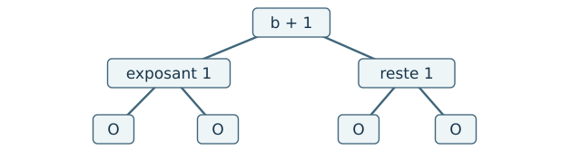
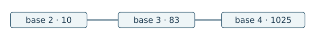
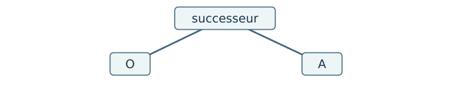

# ENS · MP-PC · Informatique 2002 — corrigé guidé

*Corrigé rédigé par IA, non officiel. Signalez toute erreur.*

**Rédaction** · GPT-6.2 Astra Ultra · vitesse non renseignée · 25 novembre 2026

Une suite de Goodstein peut d’abord croître très vite. Sa terminaison se démontre en suivant la forme de son écriture en base, puis en comparant des arbres. On prendra soin de distinguer valeur numérique, taille d’un arbre et rang dans un ordre.

## Partie I. Ordres et listes

### Question I.1 · Asymétrie

Une boucle de longueur deux donnerait une boucle de longueur un par transitivité. Un ordre strict les interdit donc toutes les deux. Pour l’ordre large, la seule possibilité d’avoir les deux sens est l’égalité.

### Question I.2 · Accumuler les arbres

L’arbre accumulé est le deuxième fils de chaque nouveau nœud, et le prochain élément de la liste son premier fils. Après avoir lu $X,Y$, par exemple, l’accumulateur vaut $Y\cdot(X\cdot A)$. La liste vide laisse l’arbre intact.

L’algorithme itératif initialise l’accumulateur à $A$. Tant que $L$ est non vide, remplacer dans cet ordre $A$ par $\mathrm{tête}(L)\cdot A$, puis $L$ par sa queue. Renvoyer $A$ après la dernière itération.

## Partie II. Décomposition héréditaire et arithmétique

### Question II.1 · 4 et 83 en base trois

Le plus grand terme qui tient dans 83 est $3^4$. Le reste comporte deux unités. Pour effacer le chiffre 4 de l’exposant, remplacer 4 par $3^{3^0}+3^0$. À la fin, les seules feuilles numériques sont des zéros et la base elle-même est le paramètre des puissances.

En posant $u=3^0$, les résultats sont $4=3^u+u$ et $83=3^{3^u+u}+u+u$.

### Question II.2 · Opérations nécessaires

La soustraction dans le calcul du reste sert à construire l’écriture et n’apparaît pas dans le résultat. De même, chercher un exposant n’ajoute pas une opération à l’expression finale : une fois son arbre construit, on ne lit que des zéros, des sommes et des puissances de la base.

Plus formellement, initialiser au naturel zéro. Pour $n>0$, si $p$ est maximal tel que $b^p\le n$ et $q=n-b^p$, construire l’expression $b^{E(p)}+E(q)$. Les deux arguments $p,q<n$ justifient la récurrence.

### Question II.3 · Construire les arbres

À chaque nœud, placer à gauche l’arbre de l’exposant et à droite celui du reste. Une puissance pure a donc $O$ pour fils droit. Pour $b+1$ les deux fils sont l’arbre de 1 ; pour $b^b$ le fils gauche est déjà celui de $b$, qui a lui-même celui de 1 à gauche.

En notant $U=O\cdot O$ et $V=U\cdot O$, la liste demandée est $U,V,U\cdot U,V\cdot O$. Pour tout $n>0$ et $(p,q)=\operatorname{dec1}(b,n)$, $T_b(n)=T_b(p)\cdot T_b(q)$, avec $T_b(0)=O$.

### Question II.4 · Interpréter la pile

Les cadres séparent deux niveaux : calculer le prochain exposant, ou reprendre la liste de termes de son parent. Les résultats sont consés en tête, donc le dernier exposant achevé arrive en premier dans liste_res. Replier cette liste sur $O$ rétablit les plus grands termes en tête de l’arbre. La pile vide signifie qu’on vient de rendre un seul arbre au cadre fictif initial.

Précisément, un cadre appartient à $\mathbb N\times\operatorname{Liste}(\mathcal A)$, courant est un cadre, pile une liste de cadres, et liste_res une liste d’arbres. À la sortie, courant vaut $(0,[T_b(n)])$.

### Question II.5 · Évaluation

Lire le nœud comme « une puissance, plus le reste ». L’évaluation des deux fils fournit les deux nombres nécessaires à cette opération. L’hypothèse sur le coût arithmétique permet de compter les visites seules, même si la valeur du résultat est très grande.

Les équations de l’algorithme sont $E_b(O)=0$ et $E_b(X\cdot Y)=b^{E_b(X)}+E_b(Y)$. Un arbre de $h$ nœuds binaires contient $h+1$ feuilles, d’où un temps $\Theta(h+1)$ dans le modèle indiqué.

### Question II.6 · Premiers termes et très grande valeur

D’abord **ajouter** 1 pour inverser le premier pas : on cherche l’arbre binaire dont le relèvement en base trois vaut 84. L’écriture $84=3^{3+1}+3$ se relit $2^{2+1}+2=10$ car les deux exposants 1 sont des unités. Dans l’autre sens $83=3^{3+1}+2$ se relève à $4^{4+1}+2$, puis on retire 1, d’où 1025. Le pas suivant laisse $5^{5+1}$, puis $g_6=6^7-1$.

Le changement de base conserve l’ordre et ne diminue aucune valeur avant soustraction. Au rang 6, mettre en réserve $6^6$ comme premier grand terme et au moins 2000 unités de reste. Tant que ce crédit est positif, le terme $k^k$ se relève en $(k+1)^{k+1}$ et le reste se relève au moins à lui-même ; la soustraction dépense au plus une unité du crédit. Ainsi au rang 1001 il reste au moins $2000-(1001-6)=1005$ unités au-delà de $1001^{1001}$. La justification que la somme témoin $k^k+r$ a bien ce terme de tête est $r<k^k$, vérifiée à chaque étape.

### Question II.7 · Addition

Traiter les exposants comme des positions de chiffres, sans les convertir en entiers. Pour ajouter une occurrence à une position, chercher son groupe de puissances égales. Si ce groupe a moins de $b-1$ éléments, en insérer un ; sinon l’effacer et envoyer une retenue à l’exposant suivant. Le compteur local est un chiffre entre 0 et $b-1$. Le suivant d’un exposant se construit lui-même en ajoutant une unité à son arbre ; ses propres exposants sont plus petits. On peut aussi éviter toute manipulation d’entiers de position avec une liste témoin de $b-1$ marques pour reconnaître le groupe plein. L’évaluation avant-après démontre la correction et la forme décroissante normalisée redonne l’arbre canonique.

### Question II.8 · Produit

Développer le produit en sommes de puissances. Le calcul des exposants est précisément une addition d’arbres déjà disponible. Ajouter les termes obtenus au fur et à mesure évite de constituer un coefficient numérique potentiellement supérieur à la base.

## Partie III. L’ordre lexicographique sur les arbres

### Question III.1 · Ordre strict

Le premier endroit où deux écritures diffèrent fournit leur ordre. Pour éviter une induction circulaire, appliquer l’hypothèse sur des fils strictement plus petits : on compare trois fils gauches en priorité, ou les trois fils droits quand les gauches sont identiques. Aucun arbre ne peut être strictement avant lui-même.

### Question III.2 · Descente infinie

Un premier nœud à gauche non nul domine tout arbre dont la gauche est nulle. Après cette première baisse, repousser sans cesse le lieu de différence d’un niveau vers la droite. La taille des arbres augmente alors que leur ordre diminue.

Un témoin explicite est $U=O\cdot O$, $A_0=U\cdot O$ et $A_{i+1}=O\cdot A_i$. La première comparaison se gagne à gauche ; ensuite préfixer la même feuille transporte chaque inégalité au rang suivant.

### Question III.3 · Produit lexicographique

Observer la première coordonnée en oubliant les répétitions successives : une infinité de changements contredirait sa bonne fondation. À partir du dernier changement, la décroissance des paires doit se lire entièrement sur la seconde coordonnée, elle aussi bien fondée.

### Question III.4 · Mots décroissants

Dans un mot décroissant, une même lettre maximale forme un seul bloc en tête. Dans une descente lexicographique de mots tous bornés par cette lettre, ce bloc finit par avoir une longueur constante. Ôter ce préfixe commun ramène à des mots dont la plus grande lettre est strictement plus petite. Cette réduction justifie une induction sur l’ordre bien fondé des lettres et fonctionne aussi si l’alphabet n’est pas totalement ordonné.

### Question III.5 · Successeur ordonné

Une nouvelle dernière composante minimale est le plus petit changement qui augmente un mot dans l’ordre du dictionnaire. Pour les arbres de cette partie, il faut donc atteindre la feuille la plus à droite et y insérer un nœud formé de deux feuilles.

### Question III.6 · Segment initial

La comparaison de deux arbres ordonnés devient une comparaison de listes le long du fils droit. Si l’un de ces arbres reste au-dessous de $X\cdot Y$, sa première lettre ne dépasse pas $X$ et, par ordre décroissant interne, aucune des suivantes non plus. On a ainsi réduit le problème à un alphabet indexé par un véritable sous-arbre de $A$.

### Question III.7 · Bonne fondation

Pour interdire une descente, il suffit de contrôler le segment dans lequel son premier terme l’enferme. Chaque segment a été traité par l’induction précédente.

### Question III.8 · Ordre des entiers et des arbres

Une écriture canonique en base $b$ contient des chiffres d’au plus $b-1$. Cette contrainte empêche les petits termes de compenser à eux seuls une puissance supérieure. La première différence dans l’ordre des puissances décide donc de la valeur. Les exposants étant eux-mêmes écrits dans la même base, appliquer ce raisonnement récursivement donne l’ordre lexicographique des arbres à tous les étages.

### Question III.9 · Terminaison de Goodstein

Le changement de base peut faire grossir énormément le nombre. Son avantage est qu’il préserve exactement le dessin canonique : les chiffres qui convenaient dans l’ancienne base sont encore permis dans la nouvelle. Le seul changement d’arbre vient alors de la soustraction finale, strictement décroissante. La bonne fondation des arbres ordonnés impose un dernier terme, qui ne peut être que zéro.

## Partie IV. L’ordre récursif sur tous les arbres

### Question IV.1 · Comparabilité et transitivité

Comparer d’abord les fils gauches. Si celui de $A$ est plus grand, $B$ ne peut gagner que par son fils droit $v$ ; il gagne exactement lorsque $v\succeq A$. Sinon $A\succ v$ et la clause 1 désigne $A$. À fils gauches égaux, les deux fils droits décident. Cette lecture est non circulaire, puisque les comparaisons restantes portent sur des paires de taille totale plus petite.

Pour vérifier que les clauses ne donnent jamais les deux sens, utiliser deux implications auxiliaires. D’une part $F_x(y)\succ y$ et $y\succeq D$ implique $F_x(y)\succ D$ par la clause 3 (avec le cas $O$ à part). D’autre part $P\succeq F_u(v)$ implique $P\succ v$. Pour cette dernière affirmation, la clause 1 l’exige déjà ; dans les clauses 2 et 3 on descend au fils droit de $P$ puis on remonte par la première implication. Ces vérifications utilisent une induction sur la taille de la paire. Ainsi $v\succeq A$ exclut que le fils droit de $A$ domine $B$. À têtes égales, aucune exception par le fils droit ne contredit son propre classement. On obtient la trichotomie, y compris le cas $O$.

Enfin, pour composer deux comparaisons, distinguer celles acquises grâce au fils droit et celles acquises par les têtes. Dans le premier cas, descendre au fils qui témoigne, appliquer la transitivité sur un triplet de taille moindre puis remonter. Dans le second, une baisse de tête se propage, et la domination de la dernière queue se déduit de la comparaison avec l’arbre intermédiaire et son implication auxiliaire ; à trois têtes égales seules les queues interviennent. L’induction sur la somme des trois tailles donne la transitivité.

### Question IV.2 · Domination des sous-arbres

Pour le fils droit, le troisième cas de la définition suffit dès que l’on compare l’arbre à ce fils lui-même. Pour le fils gauche $x$, appliquer le premier cas à tous ses sous-arbres de bas en haut : leur propre tête est un sous-arbre strict de $x$ et est donc dominée par $x$ grâce à l’induction extérieure ; leur queue a déjà été traitée dans le parcours de bas en haut. On obtient notamment la domination de $x$, puis de tous ses descendants.

### Question IV.3 · Comparaison récursive

Dans le cas où les têtes sont égales, une unique comparaison des queues suffit. À têtes inégales, la question restante est de savoir si le plus grand candidat sur les têtes dépasse aussi la queue du concurrent. Les règles de IV.1 répondent avec un appel sur une paire plus petite. La possibilité d’égalité de cet appel est incluse dans la branche contraire.

### Question IV.4 · Successeur

La nouvelle formule place le nouveau $O$ à gauche, l’ancien arbre entier à droite. Pour vérifier la minimalité, un composé de tête strictement supérieure à $O$ qui dépasse $A$ dépasse immédiatement $O\cdot A$. Pour un composé $O\cdot v$, dépasser $A$ oblige $v$ à atteindre au moins $A$ : c’est direct par la clause de queue, ou, lorsque $A=O\cdot w$, par l’induction qui fait de $O\cdot w$ le successeur de $w$. Comparer les deux composés de même tête conclut.

### Question IV.5 · Argument de mauvaise suite minimale

Le choix d’une contre-suite de taille minimale donne une interdiction très forte : aucun fils d’un de ses termes ne doit permettre une poursuite infinie. Une comparaison qui s’expliquerait par le fils droit dominant le terme suivant violerait cette interdiction. Restent le classement des têtes et, en cas d’égalité, celui des queues. Les têtes baissent une infinité de fois, ou elles se stabilisent et les queues baissent à chaque pas. Les deux alternatives fabriquent exactement la poursuite interdite depuis un fils.

### Question IV.6 · L’identité est croissante

La différence entre les deux comparaisons est l’obligation de dépasser aussi la queue du second arbre quand la tête baisse. La décroissance interne des exposants garantit précisément cette obligation : chaque tête contenue dans cette queue est au plus la première, déjà dépassée. On peut donc remonter toute la queue jusqu’à sa racine.

### Question IV.7 · Autre preuve de terminaison de l’ordre

Prendre la même suite de dessins sans changer aucun terme, mais en changeant le test de comparaison. La croissance stricte de l’identité conserve chaque pas de descente et transfère donc l’interdiction des descentes infinies.

### Question IV.8 · Images des trois limites

Utiliser les rangs comme une notation pour compter les segments qui précèdent un arbre. Le morphisme préserve le rang : c’est vrai au départ, au successeur, puis à toute borne par son hypothèse de continuité. Dans l’ancien ordre, chaque nouvelle tête dans une liste d’exposants décroissants représente une puissance de $\omega$. Si $H=O\cdot O$, $P=H\cdot O$ et $Q=P\cdot O$, les trois arguments $P,Q,Q\cdot O$ ont ainsi les rangs $\omega,\omega^\omega,\omega^{\omega^\omega}$.

Dans le nouvel ordre, sous $P$ on ne rencontre que les itérations de $S(X)=O\cdot X$ à partir de $O$. Ce sont exactement les rangs finis et $P$ garde donc son rang $\omega$. Pour une tête quelconque $a$, les prédécesseurs de $a\cdot O$ sont toutes les listes dont les têtes sont strictement plus petites que $a$ : comparer chaque tête à $a$ puis enlever cette tête pour tester sa queue. On doit donc compter ces listes telles que le nouvel ordre les compare.

Avec une seule tête autorisée, les listes sont leurs longueurs, de type $T_1=\omega$. Avec une tête maximale de plus, une liste ayant exactement $r$ occurrences de celle-ci se décompose en $r+1$ blocs de l’ancien type, possiblement vides. Les règles de comparaison font d’abord compter les occurrences de la plus grande tête ; en cas d’égalité, les blocs les plus à droite sont prioritaires. En effet, deux occurrences de même tête comparent leurs queues ; les petites têtes situées avant la première occurrence ne peuvent inverser une différence déjà acquise aux queues. À queues identiques, ces petites têtes se comparent entre elles en prenant la queue commune pour nouveau minimum. L’ordre est donc un produit de $r+1$ exemplaires du type précédent. Sommons ces produits pour $r=0,1,\ldots$. Le type $T_m$ sur les $m$ premières têtes vérifie $T_{m+1}=T_m^\omega$, donc $T_m=\omega^{\omega^{m-1}}$ pour $m\ge1$. Sur toutes les têtes de rang fini, chaque liste est contenue dans l’un de ces segments et leur borne vaut $T_\omega=\omega^{\omega^\omega}$.

Il faut donc prendre, dans l’ordre des questions, la tête de rang 1, puis celle de rang 2, puis celle de rang $\omega$, et lui adjoindre $O$ à droite. Les réponses sont $H\cdot O$, $(O\cdot H)\cdot O$ et $P\cdot O$.

## Partie V. Bons ordres partiels et mots

### Question V.1 · Quatre caractérisations

Une extension peut choisir de classer en descente tous les éléments d’une antichaîne infinie ; ajouter ces comparaisons ne risque pas de créer un cycle puisque les éléments étaient incomparables. Ainsi (a) interdit et les descentes et les antichaînes infinies. Sous ces deux interdictions, extraire de toute suite une sous-suite homogène : conserver à chaque étape une infinité d’indices qui ont tous le même type de comparaison avec l’indice courant. Parmi les indices retenus, garder ceux pour lesquels ce type est constant. Ni « strictement plus grand » ni « incomparable » ne peuvent être le type de toutes les paires. La sous-suite est donc faiblement croissante, d’où une bonne paire. Enfin une bonne paire dans l’ordre initial empêche une suite d’être strictement décroissante dans quelque extension que ce soit. On a parcouru le cycle des quatre implications.

### Question V.2 · Ordre de plongement des mots

L’ordre compare par effacement et par diminution des lettres retenues. Pour un mot d’une seule lettre, cela redonne exactement la comparaison dans l’alphabet. À strictement parler, la règle imprimée qui compare les queues strictement oublie l’appariement de deux queues identiques avec une lettre initiale strictement plus grande ; la règle sur le vide doit aussi exclure le vide lui-même. Le plongement large suivi du retrait de l’égalité donne le sens cohérent de ces règles.

Pour prouver la réciproque, imaginer une mauvaise suite dont chaque mot a été choisi aussi court que possible sans compromettre une mauvaise continuation. Ses premières lettres admettent une sous-suite non décroissante. Remplacer, à partir du premier indice retenu, les mots de cette sous-suite par leurs queues et oublier les indices intermédiaires. La première queue est plus courte : cette nouvelle suite contient donc deux termes comparables dans le bon sens. Si le terme de gauche était déjà avant la coupure, ajouter la tête oubliée à droite conserve le plongement. Si les deux sont des queues, remettre les deux têtes dans le plongement est possible grâce à leur ordre. Les termes antérieurs à la coupure n’offraient déjà aucune bonne paire. Chaque possibilité contredit la mauvaise suite supposée.
