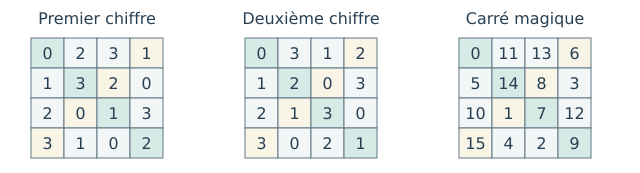

# ENS · MP-PC · Mathématiques-informatique 2002 — corrigé brut

*Corrigé rédigé par IA, non officiel. Signalez toute erreur.*

**Rédaction** · GPT-6.2 Astra Ultra · vitesse non renseignée · 25 novembre 2026

**Révision** · GPT-6.2 Astra Ultra · vitesse non renseignée · 26 novembre 2026

Les indices commencent à zéro. Nₙ désigne les entiers de zéro à n−1. Les pgcd sont positifs. Le sujet original sert de référence pour les formules et les indices ; la fiche de la banque ne fournit pas de rapport de jury pour cette session.

## Partie 1 · Matrices entières et opérations modulo

### Question 1.1 · Opérations élémentaires en colonnes

À droite, $P_{ij}$ échange les colonnes $i,j$ (pour $i=j$ c’est l’identité), $S_i$ change le signe de la colonne $i$ et $R_{ij}=I-E_{ij}$ soustrait la colonne $i$ à la colonne $j$ pour $i\ne j$. Les deux premières opérations non triviales ont déterminant $-1$ et sont leurs propres inverses. La dernière a déterminant un et inverse $I+E_{ij}$, car $E_{ij}^2=0$. Cet inverse est aussi $S_iR_{ij}S_i$.

### Question 1.2 · Réduction du premier rang

Le début rend la première ligne non négative. Placer son plus petit terme positif $m$ en colonne zéro, puis effectuer $C_j\gets C_j-\lfloor A_{0j}/m\rfloor C_0$ pour $j>0$. Les autres termes de la ligne deviennent des restes entre zéro et $m-1$. Si un reste est non nul, le prochain pivot positif est strictement inférieur à $m$. La décroissance assure l’arrêt. Toute opération élémentaire préserve l’idéal engendré par les valeurs de chaque ligne, car elle est inversible sur les entiers. Le premier rang final vaut $(g,0,\ldots,0)$ avec $g$ son pgcd, également en cas de ligne nulle. Les autres rangs gardent leur pgcd.

### Question 1.3 · Triangularisation et réduction des restes

Appliquer 1.2 à la première ligne puis au bloc restant, en agissant seulement sur les colonnes et lignes d’indice au moins un, et ainsi de suite. Une ligne nulle du bloc actif se conserve avec pivot zéro. Les opérations portent sur les colonnes entières correspondantes, sans changer les zéros déjà établis au-dessus. On construit $AU=H$ triangulaire inférieure à diagonale non négative, avec $U$ unimodulaire, et $Q=U^{-1}$. Si $\det A\ne0$, tout pivot $h_i=H_{ii}$ est positif. Par rangs $i$ croissants, soustraire à chaque colonne $j<i$ un multiple de $C_i$ pour ramener $H_{ij}$ dans $\{0,\ldots,h_i-1\}$. Les lignes antérieures sont inchangées.

### Question 1.4 · Groupe unimodulaire

Pour $|\det A|=1$, les pivots positifs ont produit un, donc valent un, et tous les restes réduits valent zéro. Ainsi $AU=I$ pour un produit d’élémentaires. Leurs inverses étant produits d’élémentaires par 1.1, $A$ en est un. Toute matrice unimodulaire est inversible sur $\mathbb Z$ par la comatrice. Inversement, un inverse entier impose que deux déterminants entiers aient produit un, d’où $\det A=\pm1$.

### Question 1.5 · Unicité de la forme d’Hermite

Si $H,H'$ sont deux formes admissibles de $A$, alors $H'=HV$ avec $V$ unimodulaire entière et triangulaire inférieure. Sa diagonale est positive et entière, de produit un, donc égale à un. Montrons par lignes croissantes que $V=I$. Si toutes les lignes antérieures sont celles de $I$, on a $H'_{ij}=H_{ij}+H_{ii}V_{ij}$ pour $j<i$. Comme les deux restes sont dans le même intervalle standard et $H'_{ii}=H_{ii}$, ils sont égaux et $V_{ij}=0$. Ainsi $H=H'$, et $Q=H^{-1}A$ est forcée.

### Question 1.6 · Injectivité sur une boîte

Deux points de $N_c$ ont même image si et seulement si leur différence entière $z$ a image nulle. Cette différence vérifie $-c_i<z_i<c_i$. Inversement, tout vecteur entier satisfaisant ces bornes s’écrit $z=z^+-z^-$ avec $z_i^+=\max(z_i,0)$ et $z_i^-=\max(-z_i,0)$, deux points de la boîte. L’injectivité équivaut donc à l’absence de différence non nulle dans le noyau indiqué.

### Question 1.7 · Boîte fondamentale

Soit $A^{-1}D=HQ$ avec diagonale de $H$ égale à $c$. Le noyau entier des congruences est $A^{-1}D\mathbb Z^n=H\mathbb Z^n$. Si $z=Ht\ne0$, soit $i$ le premier indice tel que $t_i\ne0$. Alors $z_i=c_i t_i$, exclu par les bornes strictes de 1.6. D’où injectivité, puis bijectivité car $\prod c_i=|\det(A^{-1}D)|=\prod a_i$.

### Question 1.8 · Même module dans toutes les directions

Si $\gcd(\det A,a)=1$, avec $a>1$, $A$ est de plein rang et ses pivots d’Hermite sont tous premiers à $a$. Les facteurs unimodulaires sont inversibles modulo $a$. La résolution triangulaire de $Ht=0\pmod a$ impose alors $t=0\pmod a$ coordonnée après coordonnée, d’où l’injectivité. Si l’application est surjective, choisir un antécédent de chaque vecteur canonique comme colonne de $B$, d’où $AB=I+aC$. Les déterminants vérifient $\det A\det B\equiv1\pmod a$. La condition est donc nécessaire et suffisante à la bijection sur la boîte de côté $a$. Pour $a=1$, source et but sont des singletons et le pgcd vaut toujours un.

## Partie 2 · Carrés latins, orthogonaux et magiques

### Question 2.1 · Normalisation et petits ordres

Sur $N_3$, $x*y=x-y\pmod3$ donne un carré latin sans neutre bilatère. Le neutre à droite serait zéro, qui ne convient pas à gauche. Pour normaliser une table, déplacer un symbole choisi en $(0,0)$ et le renommer zéro, puis ordonner les colonnes pour que la première ligne soit $0,\ldots,n-1$, et les lignes pour obtenir la même première colonne. Zéro est alors neutre. Aux ordres $1,2,3$, la table normalisée est forcée par les contraintes latines et vaut l’addition cyclique. Il y a une classe par ordre. Les nombres de tables sont $1,2,12$ : à symboles fixés, le passage de toute table à sa forme réduite trie sa première ligne de $n!$ façons inverses puis les $n-1$ autres lignes de $(n-1)!$ façons.

### Question 2.2 · Existence à toute taille

Pour tout $n\ge1$, $A(i,j)=(i+j)\bmod n$ est latin, car chaque ligne et chaque colonne est une translation bijective du groupe cyclique.

### Question 2.3 · Isotopie d’une loi associative

Notons $\star$ la loi sur $H$, $\cdot$ celle de $G$, $e$ le neutre de $G$ et $a=g^{-1}(e)$, $b=h^{-1}(e)$. L’associativité puis l’injectivité de $f$ donnent
$$
g(x\star y)\cdot h(z)=g(x)\cdot h(y\star z).
$$
En posant $x=a,z=b$, il vient $gf h(y)=hf g(y)$, soit $t=gfh=hfg$. Avec $x=a$ seul, on obtient $h(y\star z)=t(y)\cdot h(z)$. Enfin $t(x\star y)=h((x\star y)\star b)=h(x\star(y\star b))=t(x)\cdot t(y)$. La composée $t$ étant bijective, c’est l’isomorphisme demandé.

### Question 2.4 · Ordres quatre et cinq

Pour vérifier la classification sans hypothèse d’associativité, fixer la première ligne et la première colonne à $0123$. Remplir les lignes suivantes par les permutations commençant par leur numéro et n’ayant aucun symbole déjà utilisé dans sa colonne. On obtient exhaustivement, en omettant la première ligne commune, les suites de lignes suivantes :
```text
1032 / 2301 / 3210      1032 / 2310 / 3201
1230 / 2301 / 3012      1302 / 2031 / 3210
```
La première table est le groupe de Klein. Les trois autres sont les tables cycliques, avec pour générateur respectif $2,1,1$ (pour la dernière, $1+1=3$ dans sa propre loi). On le vérifie en listant les quatre puissances et en relisant leurs translations. Les deux groupes ne sont pas isomorphes, le second possédant un élément d’ordre quatre. Par 2.3 ils ne sont pas équivalents. Ils représentent les deux classes.

À l’ordre cinq, la table de lignes $01234,10342,23401,34120,42013$ est latine et de neutre zéro. Elle vérifie $(1*1)*2=2$ et $1*(1*2)=4$. Par 2.3 elle n’est équivalente à aucun groupe. La classification des ordres inférieurs prouve la minimalité.

### Question 2.5 · Transversales et ordre pair

Pour chaque symbole $j$ de $B$, ses cases sont exactement $(i,\sigma_j(i))$ et les colonnes choisies y forment une permutation. Les couples $(A,B)$ sont tous distincts si et seulement si, pour chaque $j$, les valeurs $A(i,\sigma_j(i))$ parcourent les $n$ symboles. Dans la table additive modulo $2p$, une telle transversale imposerait $\sum_i(i+\sigma(i))\equiv2\sum_i i\equiv0\pmod{2p}$. Or la somme de tous les symboles vaut $p(2p-1)\equiv p\pmod{2p}$, contradiction. Le résultat se transporte par renommage des coordonnées pour toute présentation du groupe cyclique.

### Question 2.6 · Encoder un couple

Poser $M(i,j)=nA(i,j)+B(i,j)$. Les couples distincts donnent tous les entiers de $0$ à $n^2-1$. Sur une ligne, une colonne ou chacune des deux diagonales, la somme vaut $(n+1)n(n-1)/2=n(n^2-1)/2$, puisque chaque chiffre parcourt $N_n$ une fois.

### Question 2.7 · Inventaire jusqu’à quatre

À l’ordre un, prendre $(0)$ pour les deux carrés et le carré magique. À l’ordre deux, aucun couple orthogonal par 2.5 et aucun carré magique car l’égalité de la première ligne et de la première colonne forcerait deux cases distinctes égales. À l’ordre trois, $A=i+j$, $B=i-j$ modulo trois sont orthogonaux. Aucun carré latin ne peut être diagonal : par 2.1 les permutations des lignes, colonnes et symboles du carré cyclique fournissent toutes les tables, et toute permutation de trois symboles est affine modulo trois. Dans $ai+bj+c$, $a,b=\pm1$, ainsi $a+b$ ou $a-b$ est nul. Un carré magique existe, de lignes $7,0,5$ puis $2,4,6$ puis $3,8,1$.

À l’ordre quatre, les deux tables de la figure ont respectivement pour lignes $0231,1320,2013,3102$ et $0312,1203,2130,3021$. Vérification directe des colonnes, des deux diagonales et des seize couples. La matrice $4A+B$ fournit le carré magique. Il existe donc les trois types d’objets.



### Question 2.8 · Formules affines

$ai+bj$ modulo $n$ est latin si et seulement si $\gcd(a,n)=\gcd(b,n)=1$. Il est diagonal si l’on ajoute $\gcd(a+b,n)=\gcd(a-b,n)=1$, en considérant $j=i$ puis $j=n-1-i$. Pour deux carrés latins, la liste de leurs couples est la valeur sur $N_n^2$ de la matrice de lignes $(a,b),(c,d)$. La question 1.8 dit qu’elle est bijective si et seulement si $\gcd(ad-bc,n)=1$.

### Question 2.9 · Construction pour un ordre premier à six

Prendre $A=i+2j$, $B=2i+j$ modulo $n$. Les coefficients, les pas sur les diagonales $3,\pm1$ et le déterminant $-3$ sont inversibles si $\gcd(n,6)=1$. Par 2.6 $nA+B$ est magique. À l’ordre cinq ses lignes sont
```text
 0 11 22  8 19
 7 18  4 10 21
14 20  6 17  3
16  2 13 24  5
23  9 15  1 12
```
La somme de référence est $60$.

## Partie 3 · Hyper-rectangles latins

### Question 3.1 · Répartitions de boules

Il faut $0\le c\le d$ et $cm\le n\le dm$. Réciproquement remplir $c$ boîtes puis distribuer les $n-cm$ boules restantes dans les $d-c$ boîtes, dont la capacité suffit. La procédure énumère les répartitions ordonnées admissibles. Si la dernière boîte reçoit $i<m$, on doit encore saturer au moins $c$ boîtes et laisser entre $cm$ et $(d-1)m$ boules à répartir. Les bornes de la boucle sont exactement celles-ci avec $0\le i<m$. Si elle reçoit $m$, il reste $n-m$ boules et $\max(0,c-1)$ saturations requises. Les branches sont disjointes et exhaustives, et la dimension décroît jusqu’à un. Pour matérialiser la liste, lire ou émettre le tableau à chaque feuille, avant que les écritures suivantes le remplacent.

### Question 3.2 · Exposants premiers des tailles minimales

Pour un premier $\ell\mid p$, notons $r=v_\ell(p)$, $e_i=v_\ell(c_i)$, $S=\sum_i e_i$ et $m=\max_i e_i$. Les contraintes de compatibilité sont $S-e_i\ge r$ pour tout $i$, soit $S\ge r+m$. Si l’inégalité est stricte, diminuer un exposant positif d’un conserve toutes les contraintes. Si le maximum est unique, le diminuer d’un conserve $S-m$ et laisse les autres contraintes satisfaites. Une taille élémentaire exige donc $S=r+m$ et au moins deux maxima. Inversement ces conditions empêchent toute diminution d’un exposant positif car il reste un maximum à un autre indice. Aucun facteur premier étranger à $p$ ne figure dans une taille élémentaire.

### Question 3.3 · Générer les tailles élémentaires

Pour $p=\ell^r$, parcourir $m$ de $\lceil r/(d-1)\rceil$ à $r$. Appeler $P(r+m,m,2,d)$ et émettre $(\ell^{e_0},\ldots,\ell^{e_{d-1}})$ pour chaque répartition énumérée. En effet, $r+m\le dm$ et $2m\le r+m$ sont exactement les bornes sur $m$, et 3.2 caractérise les solutions. Pour $p$ quelconque, factoriser $p$, générer les listes pour chaque puissance première et prendre tous leurs produits composante par composante. Les critères premiers sont indépendants. Pour $p=1$ l’unique taille élémentaire est $(1,\ldots,1)$.

À une feuille de $P$, le tableau partagé des exposants est complet. On en prend une copie avant que l’appel suivant le modifie. Le pseudocode suivant utilise cette action de sortie.

```text
Tailles(premier, r, d) :
    pour m de plafond(r / (d - 1)) à r :
        appeler P(r + m, m, 2, d)
        à chaque feuille de cet appel :
            émettre le tuple (premier ^ boîte[j] pour j de 0 à d - 1)
```

### Question 3.4 · Tranches parallèles

Sur la tranche $x_i=k$, $Ax$ diffère de sa valeur sur $x_i=0$, les autres coordonnées étant conservées, de $k$ fois la colonne $i$. Modulo $a$, cette translation permute les symboles et conserve les multiplicités. Tester toutes les tranches de niveau zéro est donc nécessaire et suffisant. Sur une telle tranche, la colonne et la coordonnée $i$ s’effacent, ce qui donne précisément l’application $B_a$ sur la boîte tronquée.

### Question 3.5 · Quand chaque tranche est bijective

Chaque tranche fixant la coordonnée $i$ contient $\prod_{j\ne i}c_j=p$ points. Comparer deux tels produits impose $c_i=c_j=q$, d’où $p=q^{d-1}$. Inversement, sur la boîte de côté $q$, renvoyer $(x_0-x_1,\ldots,x_{d-2}-x_{d-1})$ modulo $q$. Si un $x_i$ est fixé, les différences déterminent successivement tous les $x_j$ à gauche et à droite modulo $q$. Chaque symbole a exactement un antécédent sur cette tranche.

### Question 3.6 · Ajouter une dimension

Notons $a_*=a_{d-2}$ le dernier module. Sur une tranche fixant une des $d-1$ premières coordonnées, les anciennes sorties sont équidistribuées par hypothèse de récurrence, indépendamment de $x_{d-1}$. Pour chaque point ancien, la dernière sortie est une constante plus $x_{d-1}$ modulo $a_*$. Comme $a_*\mid c_{d-1}$, elle parcourt chaque résidu exactement $c_{d-1}/a_*$ fois. Les symboles complets sont donc équidistribués. Pour la dernière direction, la tranche de niveau zéro l’est par hypothèse et les autres par 3.4.

### Question 3.7 · Choix des modules

Pour des entiers positifs, écrire $g=\gcd(u,v)$ puis $u=gu'$, $v=gv'$ avec $u',v'$ premiers entre eux. On obtient $\gcd(u,vw)=g\gcd(u',w)$, valable avec valeurs absolues si les arguments sont signés. Posons $G_i=\gcd(p,\prod_{j=i}^{d-1}c_j)$ et $G_d=1$. Alors $a_i=G_{i+1}/G_{i+2}=\gcd(p/G_{i+2},c_{i+1})$ est un entier positif divisant $c_{i+1}$. Le produit télescope en $G_1=p$ par compatibilité. Posons $g=\gcd(p,c_{d-1})=a_{d-2}$, $p'=p/g$. Dans les rapports précédents le facteur $g$ s’annule et la même formule avec $p'$ et les côtés tronqués redonne $a_0,\ldots,a_{d-3}$. Chaque produit ancien excluant un côté, multiplié par $c_{d-1}$, est divisible par $p$, donc ce produit est divisible par $p'$.

Enfin $\prod_{j=0}^i a_j=p/G_{i+2}$. Or la compatibilité après suppression du côté $c_{i+1}$ donne $p\mid(\prod_{j=0}^i c_j)(\prod_{j=i+2}^{d-1}c_j)$. Par Bézout, $p/G_{i+2}\mid\prod_{j=0}^i c_j$, comme voulu.

### Question 3.8 · Diagonale d’une matrice bordée

Supposons les paramètres diagonaux positifs et $v_{d-2}>0$, comme dans l’application. Pour une matrice entière de plein rang dont ces coefficients sont signés, employer $|s_i|$ et $|v_{d-2}|$ pour obtenir les pivots positifs. Si un facteur diagonal ou le dernier coefficient est nul, le déterminant est nul et la forme d’Hermite de 1.5 ne s’applique plus. Posons $r_i=\gcd(v_i,\ldots,v_{d-2})$. Pour les $k+1$ premières lignes de $C$, le pgcd des mineurs maximaux est
$$
D_{k+1}=(s_0\cdots s_{k-1})r_k .
$$
En effet, les $k$ lignes diagonales obligent à choisir leurs $k$ colonnes. Il reste une colonne parmi celles d’indice au moins $k$, et le déterminant vaut le produit indiqué fois son coefficient $v_j$, au signe près. Ce pgcd est invariant sous multiplication à droite par une matrice unimodulaire, par multilinéarité puis en appliquant la réciproque. Pour une forme triangulaire inférieure, il vaut le produit des $k+1$ premiers pivots. Donc $h_0=r_0$, $h_{i+1}=s_ir_{i+1}/r_i$, avec $r_{d-2}=v_{d-2}$ et $r_i=\gcd(v_i,r_{i+1})$. En taille deux cela donne $h_0=\gcd(v_0,v_1)$ et $h_1=s_0v_1/h_0$.

### Question 3.9 · Les pivots divisent les côtés

Écrire $R=r_{i+1}$, $g=\gcd(R,c_{i+1})$, $w_i=R/g$. Puisque $a_i\mid c_{i+1}$, $\gcd(a_i,g)=\gcd(a_i,R)$. Donc
$$
r_i=\gcd(a_iR/g,R)=R\frac{\gcd(a_i,R)}g,\qquad
h_{i+1}=g\frac{a_i}{\gcd(a_i,R)}.
$$
Le second entier vaut $\operatorname{lcm}(a_i,g)$ car $\gcd(a_i,g)=\gcd(a_i,R)$. Il divise $c_{i+1}$ puisque ses deux facteurs au sens du ppcm le divisent.

Posons $A_i=\prod_{j=0}^i a_j$ et $C_i=\prod_{j=0}^i c_j$, avec $A_{-1}=1$. Au départ $r_{d-2}A_{d-3}=p\mid C_{d-2}$. Si $RA_i\mid C_ic_{i+1}$, on sait aussi $A_i\mid C_i$ par 3.7. Ainsi $R/g\mid C_i/A_i$, et comme $r_i=(R/g)\gcd(a_i,R)$, il vient $r_i A_{i-1}\mid C_i$. Par descente, $r_0\mid c_0$.

### Question 3.10 · Construire la matrice

En dimension deux prendre $A=(1,1)$ modulo $p$, qui divise les deux côtés compatibles. En dimension $d$, calculer les modules de 3.7. Par récurrence, construire le bloc antérieur $\underline A=(u\mid T)$ de taille $(d-2)\times(d-1)$, avec $T$ triangulaire inférieure unimodulaire. Compléter la matrice comme en 3.6, par la dernière colonne canonique et la ligne inférieure $(z_0,z_1,\ldots,z_{d-2},1)$, où les $w_i$ viennent de 3.9,
$$
z_0=1-wu,\qquad (z_1,\ldots,z_{d-2})=-wT .
$$
Le bloc formé en supprimant la nouvelle dernière colonne est $B$. Posons $D=\operatorname{diag}(a)$, $L=\left(\begin{smallmatrix}1&0\\u&T\end{smallmatrix}\right)$. La factorisation de l’inverse donnée dans le sujet donne $B^{-1}D=L^{-1}C$ où $C$ a pour première ligne $(w_0a_0,\ldots,w_{d-3}a_{d-3},a_{d-2})$ et en dessous le bloc diagonal de $a_0,\ldots,a_{d-3}$, suivi d’une colonne nulle. Le facteur de gauche est triangulaire unimodulaire à diagonale de uns dans la construction. Il conserve le pgcd des mineurs de chaque préfixe de lignes et donc les pivots d’Hermite. Par 3.8 et 3.9 ces pivots $h_i$ divisent les côtés $c_i$ de la tranche finale. La boîte de côtés $h_i$ est bijective par 1.7. La tranche entière est pavée de translatés de cette boîte, chacun bijectif à une translation des symboles près. Elle est donc multibijective. Puis $a_{d-2}\mid c_{d-1}$ permet d’appliquer 3.6. Après suppression de la première colonne du nouveau $A$, le bloc de droite reste triangulaire inférieur à diagonale de uns. L’induction est complète.

Pour $(c,p)=((15,10,6),30)$ on obtient $a=(5,6)$ et les lignes $(1,1,0)$, $(-2,-3,1)$. Les symboles se calculent par $(x+y\bmod5,\,-2x-3y+z\bmod6)$.


