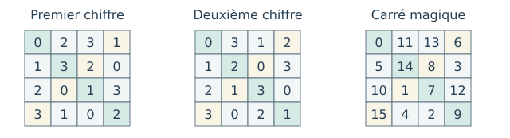

# ENS · MP-PC · Mathématiques-informatique 2002 — corrigé guidé

*Corrigé rédigé par IA, non officiel. Signalez toute erreur.*

**Rédaction** · GPT-6.2 Astra Ultra · vitesse non renseignée · 25 novembre 2026

**Révision** · GPT-6.2 Astra Ultra · vitesse non renseignée · 26 novembre 2026

Un même problème traverse le sujet : répartir des symboles exactement une fois, ou le même nombre de fois, sur chaque tranche d’un tableau. La forme d’Hermite traduit ces contraintes de comptage en conditions sur une matrice entière.

## Partie 1 · Matrices entières et opérations modulo

### Question 1.1 · Opérations élémentaires en colonnes

Examiner une colonne du produit $AM$. Les colonnes de $M$ disent quelles colonnes de $A$ combiner. Une permutation de deux colonnes inverse l’orientation, tout comme un changement de signe. Retrancher une colonne à une autre préserve le déterminant et se défait par l’addition correspondante. Les déterminants sont respectivement $-1$ pour un échange de colonnes distinctes, $-1$ pour un changement de signe et $1$ pour une soustraction. Pour $i=j$, $P_{ii}=I$ et son déterminant vaut $1$. Les deux premières matrices sont leurs propres inverses, et $(I-E_{ij})^{-1}=I+E_{ij}$ pour $i\ne j$.

### Question 1.2 · Réduction du premier rang

Le principe est l’algorithme d’Euclide appliqué à plusieurs nombres à la fois. Un pivot non nul sert à remplacer tous les autres nombres de la première ligne par leurs restes. La prochaine valeur non nulle retenue est plus petite et les entiers positifs ne peuvent décroître indéfiniment. Un diviseur commun de n’importe quelle ligne avant un tour reste diviseur de cette ligne après le tour, et la réciproque suit de l’inverse entier. Le dernier pivot occupe la colonne zéro et vaut le pgcd. Une première ligne entièrement nulle reste nulle et a pour pgcd zéro.

### Question 1.3 · Triangularisation et réduction des restes

Isoler le pgcd de la première ligne, puis ne plus toucher à la colonne où il se trouve pendant le traitement du bloc inférieur droit. Le bloc actif diminue de taille à chaque passage. Accumuler les opérations de colonnes dans une matrice inversible entière pour retrouver la décomposition demandée. Dans le cas de plein rang, chaque pivot est positif. Il permet alors de réduire les entrées de sa ligne à gauche modulo lui-même. Procéder de haut en bas pour conserver les restes déjà fixés.

### Question 1.4 · Groupe unimodulaire

La forme réduite d’une matrice de déterminant de valeur absolue un n’a de place ni pour un pivot supérieur à un ni pour des restes non nuls. C’est l’identité. Remonter les opérations fournit une décomposition. La condition sur le déterminant est aussi exactement celle qui rend l’inverse entier, par la formule de l’adjointe et la multiplicativité du déterminant.

### Question 1.5 · Unicité de la forme d’Hermite

Comparer les deux matrices triangulaires par un changement de base entier. La diagonale du changement est nécessairement composée de uns. En descendant les lignes, une différence sous le pivot est alors un multiple de ce pivot, tandis que les deux représentants comparés sont des restes entre zéro et le pivot exclu. Seule la différence nulle est possible. La matrice triangulaire est donc unique et son facteur à droite aussi.

### Question 1.6 · Injectivité sur une boîte

Soustraire les deux antécédents d’une collision. Les coordonnées de leur différence ont valeur absolue strictement inférieure au côté correspondant. Pour la réciproque, répartir les signes d’une différence autorisée sur deux points non négatifs. Si cette différence est annulée modulo les sorties et non nulle, ces deux points sont une collision.

### Question 1.7 · Boîte fondamentale

Lire les congruences comme une appartenance à un réseau. Dans la base triangulaire de ce réseau, la première coordonnée non nulle d’un coefficient entier produit une composante de valeur absolue au moins égale au côté de la boîte. Deux points de la boîte ne peuvent donc différer par ce vecteur. Les deux ensembles finis ont en outre même cardinal par le déterminant.

### Question 1.8 · Même module dans toutes les directions

Dans la matrice triangulaire réduite, le déterminant est au signe près le produit des pivots. S’il est une unité modulo $a$, chacun des pivots l’est. On peut donc résoudre successivement sans ambiguïté les congruences triangulaires. Dans l’autre sens, une surjection permet de relever toute la base canonique. Sa matrice de relèvement est un inverse à droite modulo $a$. Prendre les déterminants donne Bézout pour $\det A$ et $a$. Les deux ensembles ayant la même taille, injectivité et surjectivité coïncident. Le raisonnement par pivots suppose $a>1$, car la condition de Bézout force alors $\det A\ne0$. Pour $a=1$, les deux boîtes sont des singletons et $\gcd(\det A,1)=1$ même si $A$ est singulière.

## Partie 2 · Carrés latins, orthogonaux et magiques

### Question 2.1 · Normalisation et petits ordres

Pour un exemple, regarder la soustraction modulo trois. Chaque équation à une inconnue est soluble de manière unique, mais zéro ne joue pas le rôle de neutre à gauche. Pour obtenir un neutre après équivalence, arranger les bords du carré comme deux exemplaires de la liste des symboles commençant par zéro. Aux trois premières tailles, compléter ces bords donne une seule table réduite : à la taille trois, la case $(1,1)$ ne peut être un, et zéro y forcerait une répétition dans la dernière colonne. La valeur deux impose toute la suite. Les nombres absolus s’obtiennent en multipliant chaque forme réduite par $n!(n-1)!$, soit $1,2,12$.

### Question 2.2 · Existence à toute taille

Écrire les symboles dans l’ordre au premier rang puis décaler circulairement d’une position à chaque ligne. Chaque symbole visite exactement une fois chaque colonne.

### Question 2.3 · Isotopie d’une loi associative

Développer les deux parenthésages de trois facteurs par la définition de la loi sur $H$, puis ôter la bijection extérieure $f$. Choisir à gauche l’antécédent du neutre par $g$ et à droite l’antécédent du neutre par $h$. Les deux compositions $gfh$ et $hfg$ doivent alors coïncider. Appelons-les $t$. En laissant le troisième facteur variable, on lit $h(y\star z)=t(y)\cdot h(z)$. Appliquer cette dernière formule à $z=y\star b$ et utiliser l’associativité donne $t(x\star y)=t(x)\cdot t(y)$. La bijectivité découle de celles des trois facteurs de la composée.

### Question 2.4 · Ordres quatre et cinq

Il suffit d’explorer les tables dont les deux bords sont normalisés. Pour chacun des ordres possibles d’une nouvelle ligne, rejeter celle qui répète une valeur dans une colonne. Les fins possibles à la taille quatre sont les quatre triplets de lignes du corrigé ci-dessous :
```text
1032,2301,3210     1032,2310,3201
1230,2301,3012     1302,2031,3210
```
Dans la première table tout élément non nul est son propre inverse : c’est l’addition bit à bit des deux bits. Dans chacune des trois autres, les puissances d’un générateur listent tous les éléments et les lignes effectuent leurs translations cycliques. On peut choisir $2$, $1$, puis $1$ respectivement. On obtient deux classes, distinguées par les ordres des éléments grâce à l’isomorphisme de 2.3.

Pour quitter les classes de groupes, prendre les cinq lignes $01234,10342,23401,34120,42013$. Chaque colonne est aussi une permutation et zéro est neutre. Les calculs $(1*1)*2=0*2=2$ et $1*(1*2)=1*3=4$ donnent des résultats différents. L’équivalence à un groupe forcerait pourtant l’associativité par 2.3. Les tailles un à quatre étant épuisées, cinq est minimale.

### Question 2.5 · Transversales et ordre pair

Fixer la seconde valeur du couple. Il en reste une case par ligne et par colonne et la première valeur doit parcourir tout l’alphabet. Dans une table cyclique d’ordre pair, additionner les indices des lignes et ceux des colonnes donne deux fois la somme des résidus, donc zéro modulo l’ordre. Si la première valeur parcourait tous les symboles, la somme devrait au contraire valoir la moitié de l’ordre modulo cet ordre. Une telle transversale est impossible.

### Question 2.6 · Encoder un couple

Voir les deux symboles comme les deux chiffres d’un entier en base $n$. L’orthogonalité empêche toute répétition. La propriété latine diagonale fixe les deux sommes de chiffres de chaque ligne exigée, ce qui donne une somme magique indépendante de cette ligne.

### Question 2.7 · Inventaire jusqu’à quatre

Pour un seul symbole, toutes les conditions sont satisfaites. Avec deux symboles, le représentant cyclique interdit l’orthogonalité et deux sommes magiques partageant le même coin imposeraient une répétition. Avec trois, prendre les deux tables de la somme et de la différence modulo trois, dont les coefficients ont déterminant non nul modulo trois. Les six permutations sur trois résidus sont exactement $t\mapsto\pm t+c$. Toute table latine est donc affine, et l’une des deux diagonales y est constante. Le carré de lignes $705,246,381$ est cependant magique. À l’ordre quatre, lire la figure ligne par ligne : dans chaque grille de chiffres les deux diagonales contiennent quatre valeurs différentes, et les seize paires sont distinctes. L’encodage de 2.6 donne en même temps un exemple magique.



### Question 2.8 · Formules affines

Sur chaque ligne, la progression avance du pas $b$ et elle parcourt le groupe si ce pas est inversible. Sur chaque colonne, le même test porte sur $a$. Les deux diagonales utilisent les pas $a+b$ et $a-b$. Enfin, identifier la superposition des deux tableaux à un système linéaire modulo $n$. Sa bijectivité est caractérisée par son déterminant premier à $n$.

### Question 2.9 · Construction pour un ordre premier à six

Des pentes différentes doivent rester inversibles dans les lignes, les colonnes, les diagonales et dans le déterminant. Les deux lignes $(1,2)$ et $(2,1)$ n’exigent que l’inversibilité de deux et trois. Prendre leurs valeurs résiduelles comme chiffres en base $n$. Pour $n=5$, les cinq rangées obtenues sont $(0,11,22,8,19)$, $(7,18,4,10,21)$, $(14,20,6,17,3)$, $(16,2,13,24,5)$, $(23,9,15,1,12)$. Leurs sommes et celles des colonnes et diagonales valent soixante.

## Partie 3 · Hyper-rectangles latins

### Question 3.1 · Répartitions de boules

Commencer par réserver $c$ boîtes pleines. La capacité des autres explique les deux inégalités nécessaires et suffisantes. Pour énumérer, décider du contenu de la dernière boîte. Une valeur inférieure à la capacité ne réduit pas le quota de boîtes pleines. Le nombre restant de boules doit donc être assez grand pour le quota et assez petit pour les places restantes. La valeur égale à la capacité réduit le quota d’une unité sans jamais le rendre négatif. Une fois toutes les positions fixées, une feuille correspond à une répartition, et deux chemins qui divergent donnent deux répartitions différentes.

### Question 3.2 · Exposants premiers des tailles minimales

La tranche la plus exigeante pour le premier $\ell$ est celle qui retire sa plus grande puissance. Si l’exposant disponible dépasse le seuil nécessaire, on peut économiser un facteur premier. Si une seule composante porte le maximum, enlever un facteur à cette composante abaisse le maximum avec le total, sans gêner la tranche critique. En situation minimale, il faut donc atteindre le seuil exact et le faire atteindre à deux composantes au moins. Ces deux conditions suffisent : enlever un facteur ferait manquer une unité dans la tranche qui retire un autre maximum. Les premiers absents de $p$ peuvent toujours être supprimés.

### Question 3.3 · Générer les tailles élémentaires

Le paramètre $m$ est la puissance maximale à distribuer. Le total à distribuer vaut $r+m$ et au moins deux boîtes doivent être pleines. Employer le programme précédent avec ces paramètres, en excluant les valeurs de $m$ trop petites pour loger le total ou trop grandes pour remplir deux boîtes. Transformer les exposants en puissances du premier choisi. Répéter indépendamment pour chaque premier de $p$, puis faire le produit des composantes de chaque choix de listes.

À une feuille de $P$, le tableau partagé des exposants est complet. On en prend une copie avant que l’appel suivant le modifie. Le pseudocode suivant utilise cette action de sortie.

```text
Tailles(premier, r, d) :
    pour m de plafond(r / (d - 1)) à r :
        appeler P(r + m, m, 2, d)
        à chaque feuille de cet appel :
            émettre le tuple (premier ^ boîte[j] pour j de 0 à d - 1)
```

### Question 3.4 · Tranches parallèles

Déplacer une tranche parallèlement à elle-même ajoute le même vecteur à toutes ses sorties. Les noms des symboles changent par translation, sans modifier leurs nombres d’occurrences. Dans la tranche de niveau zéro, la contribution de la position fixée est nulle. La supprimer dans la boîte et dans la matrice décrit exactement le même tableau.

### Question 3.5 · Quand chaque tranche est bijective

Une tranche bijective contient exactement $p$ positions. Les produits de tous les côtés sauf un sont donc identiques, ce qui force l’égalité des côtés. Pour construire l’objet, stocker dans le symbole les différences entre voisins. Une fois donnée une coordonnée, ces différences permettent de reconstruire sans choix toute la liste, en progressant dans les deux sens. Cela donne la bijection demandée, aussi pour le côté un.

### Question 3.6 · Ajouter une dimension

Pour une direction déjà présente, regrouper les points par coordonnées anciennes. La partie supérieure de la matrice ne dépend pas de la nouvelle coordonnée. Dans chaque groupe, la dernière ligne fait défiler les nouveaux symboles d’un pas un. La divisibilité du côté assure un nombre entier de tours complets. Reste la nouvelle direction elle-même, couverte par l’hypothèse au niveau zéro et par translation aux autres niveaux.

### Question 3.7 · Choix des modules

Mettre de côté le pgcd de $u$ et $v$. Les quotients restants sont premiers entre eux, donc seule la partie provenant de $w$ peut encore contribuer. Appliquer ce découpage aux produits de côtés pris depuis la droite. Noter $G_i$ le pgcd de $p$ avec le produit commençant en $i$. Chaque rapport $G_{i+1}/G_{i+2}$ est un pgcd avec le seul côté $c_{i+1}$ et divise donc ce côté. En multipliant les rapports, tout s’annule sauf $G_1=p$. La dernière composante est $\gcd(p,c_{d-1})$. En la retirant simultanément du numérateur et du dénominateur des autres rapports, on retrouve la formule à une dimension de moins, pour $p'=p/\gcd(p,c_{d-1})$. La compatibilité ancienne suit en simplifiant les divisibilités par le dernier côté.

Pour vérifier les produits de gauche, le produit des modules de zéro à $i$ vaut $p$ privé du pgcd avec les côtés situés après $i+1$. Dans la tranche qui retire précisément le côté $i+1$, le produit de ces côtés de droite et des côtés de gauche est divisible par $p$. Toute la partie de $p$ encore requise doit donc diviser le produit de gauche.

### Question 3.8 · Diagonale d’une matrice bordée

Sur une matrice à deux lignes la première ligne donne son pgcd et le déterminant donne le produit des pivots. Pour généraliser, appliquer le même principe aux mineurs des premières lignes. Les opérations entières de colonnes ne changent pas leur pgcd, car chaque nouveau mineur est combinaison entière des anciens et les opérations sont réversibles. Dans la forme triangulaire, seul le mineur des premières colonnes peut être non nul. Dans la matrice bordée, les lignes diagonales fixent au contraire toutes les colonnes à choisir sauf une. Les valeurs restantes sont proportionnelles à la liste finale $v_k,\ldots,v_{d-2}$. Le quotient de deux pgcd de mineurs successifs donne alors le nouveau pivot. En notant $r_k=\gcd(v_k,\ldots,v_{d-2})$, ce pgcd de mineurs vaut $|s_0\cdots s_{k-1}|r_k$ pour les $k+1$ premières lignes. On obtient $h_0=r_0$, puis $h_{i+1}=|s_i|r_{i+1}/r_i$, avec $r_{d-2}=|v_{d-2}|$. Le déterminant est non nul dès que les $s_i$ et $v_{d-2}$ sont non nuls, condition requise par 1.5. Les coefficients de l’application en 3.10 sont positifs à ces emplacements.

### Question 3.9 · Les pivots divisent les côtés

Isoler d’abord le facteur commun au reste $R$ et au côté suivant. Le poids $w_i$ est le quotient de $R$ par ce facteur $g$. Le pgcd avec $a_iw_i$ s’écrit alors $(R/g)\gcd(a_i,g)$. Puisque $a_i$ divise le côté, son pgcd avec $g$ vaut son pgcd avec $R$. La formule de 3.8 transforme le prochain pivot en ppcm de $a_i$ et $g$, donc en diviseur du côté.

Pour le premier pivot, propager l’affirmation $r_i A_{i-1}\mid C_i$ vers la gauche, en notant $A_i,C_i$ les produits des préfixes. Elle commence par la compatibilité de la tranche privée du dernier côté. Au rang voisin, retirer le produit $A_i$ qui divise déjà $C_i$. Le quotient $C_i/A_i$ multiplié par $c_{i+1}$ est multiple de $R$. Il porte donc $R/g$. Le facteur manquant pour $r_i$ divise $a_i$, ce qui donne exactement la divisibilité à l’indice $i$. En bout de descente, le préfixe des modules est vide et $r_0$ divise $c_0$.

### Question 3.10 · Construire la matrice

Construire d’abord le tableau à une dimension de moins avec les côtés tronqués et la cardinalité $p/\gcd(p,c_{d-1})$. Conserver son bloc de coefficients, de la forme $(u\mid T)$. Pour ajouter la dernière équation, partir de la ligne $(1,0,\ldots,0,1)$ et lui soustraire les lignes précédentes affectées des poids $w_i$ de la descente de 3.9. Ajouter un zéro à droite des anciennes lignes. C’est exactement la mise à jour ligne par ligne du programme imprimé. Le cas initial est l’addition modulo $p$ en dimension deux.

Pourquoi la dernière tranche est-elle équilibrée ? Sa matrice $B$ est unimodulaire par la formule d’inversion du sujet. Dans $B^{-1}\operatorname{diag}(a)$, une multiplication à gauche par la matrice triangulaire de première ligne $(1,0,\ldots)$ et de bloc inférieur $(u\mid T)$ redonne la matrice bordée de 3.8, avec $s_i=a_i$ et $v_i=w_ia_i$ sauf le dernier $v$ qui vaut le dernier module. Cette transformation préserve les produits des premiers pivots, car ses blocs initiaux de lignes sont inversibles sur les entiers. Les pivots divisent ainsi les côtés de la tranche par 3.9. Une petite boîte ayant ces pivots pour côtés donne une permutation des symboles par 1.7. Les multiples entiers des côtés permettent de répéter les petites boîtes, et toute translation permute les sorties. La dernière tranche couvre donc tous les symboles également ; les autres sont justifiées par 3.6. Le nouveau bloc des colonnes autres que la première reste triangulaire à diagonale un, comme l’exige le prochain appel.

Dans le cas $15,10,6$ pour trente symboles, les sorties sont les résidus de $x+y$ modulo cinq et de $-2x-3y+z$ modulo six. Fixer successivement $x,y,z$ donne les multiplicités indiquées dans la figure.


