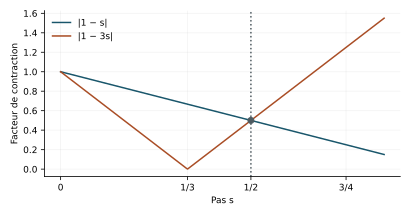

# École polytechnique — Deuxième composition de mathématiques MP 2002 · Corrigé brut

*Corrigé rédigé par IA, non officiel. Signalez toute erreur.*

**Rédaction** · GPT-6.2 Astra Ultra · vitesse non renseignée

**Révision (tour 1)** · GPT-6.2 Astra Ultra · vitesse non renseignée · 26 novembre 2026

Une famille de vecteurs permet des représentations redondantes. L’opérateur autoadjoint associé détermine la représentation de norme minimale et le pas optimal pour reconstruire un vecteur par itération. La dernière partie porte sur un espace préhilbertien réel.

## I. Opérateur associé à la famille de vecteurs

### Question 1

Pour $m=n$, une base orthonormale donne $\sum_j(x\mid e_j)^2=\|x\|^2$, d’où $\alpha=1$. Pour un $m>n$ prescrit, complétons cette famille avec $m-n$ copies du premier vecteur. Les termes ajoutés sont positifs ou nuls et la même constante convient.

### Question 2

Pour $x\in\operatorname{Vect}(e_j)^\perp$, la somme des carrés est nulle et $\alpha\|x\|^2\le0$, donc $x=0$. En dimension finie, $\operatorname{Vect}(e_j)=E$.

### Question 3

Les composantes scalaires sont $v$, $-\sqrt3u/2-v/2$ et $\sqrt3u/2-v/2$. La somme des carrés est $v^2+(3u^2+v^2)/2=3(u^2+v^2)/2$. En sommant les trois vecteurs $(x\mid e_j)e_j$, la première composante vaut $3u/2$ et la seconde $3v/2$. Donc $T=(3/2)I$.

### Question 4

On a $(T(x)\mid y)=\sum_j(x\mid e_j)(y\mid e_j)=(x\mid T(y))$. L’opérateur est autoadjoint et $(T(x)\mid x)=\sum_j(x\mid e_j)^2\ge\alpha\|x\|^2$. Son noyau est nul et, en dimension finie, il est inversible.

### Question 5

Le théorème spectral donne des valeurs propres $\lambda_i\ge\alpha>0$. Pour $\|x\|=1$, $\|Tx\|^2=\sum_i\lambda_i^2x_i^2$ et $(Tx\mid x)=\sum_i\lambda_i x_i^2$. Les deux maximums correspondants s’atteignent en un vecteur propre unitaire de plus grande valeur propre. Ainsi $\|T\|=\sup_{\|x\|=1}(Tx\mid x)=\lambda_{\max}$.

### Question 6

Les valeurs propres de $T^{-1}$ sont $1/\lambda_i$. On peut prendre $\beta=1/\alpha$ dans $(T^{-1}x\mid x)\le\beta\|x\|^2$. La plus petite constante vaut $1/\lambda_{\min}$ et coïncide avec $\|T^{-1}\|\le1/\alpha$.

### Question 7

L’hypothèse dit $(Tx\mid x)=\alpha\|x\|^2$ pour tout $x$. En particulier sur tout vecteur propre non nul on obtient $\lambda_i=\alpha$. L’endomorphisme vaut $T=\alpha I$.

## II. Représentations et coefficients de norme minimale

### Question 8

Pour $h=\sum_j h_j f_j$, $(h\mid\Phi x)_F=\sum_jh_j(x\mid e_j)=(\sum_j h_je_j\mid x)$. L’identité sur tous les $x$ donne $\Psi h=\sum_jh_je_j$. Puis $\Psi\Phi x=\sum_j(x\mid e_j)e_j=Tx$.

### Question 9

L’inverse de $T$ est autoadjoint, donc $(x\mid\tilde e_j)=(T^{-1}x\mid e_j)$. Il en résulte $\widetilde\Phi=\Phi T^{-1}$ et $\operatorname{Im}\widetilde\Phi=\operatorname{Im}\Phi$. La décomposition orthogonale usuelle en dimension finie donne $F=\operatorname{Im}\widetilde\Phi\oplus(\operatorname{Im}\Phi)^\perp$.

### Question 10

Le vecteur $h_0=\widetilde\Phi x$ vérifie $\Psi h_0=TT^{-1}x=x$. Toutes les solutions sont $h_0+k$ avec $k\in\ker\Psi=(\operatorname{Im}\Phi)^\perp$ d’après l’adjonction. Par 9, $\|h_0+k\|^2=\|h_0\|^2+\|k\|^2$. Le minimum est unique, atteint aux $h_j=(x\mid\tilde e_j)$. Sa valeur est
$$\|\Phi T^{-1}x\|^2=(\Psi\Phi T^{-1}x\mid T^{-1}x)=(x\mid T^{-1}x).$$

Le projecteur orthogonal de $F$ sur $\operatorname{Im}\Phi$ s’écrit $P=\Phi T^{-1}\Psi$. En effet $P^2=P$ puisque $\Psi\Phi=T$, et $P$ est autoadjoint par adjonction. Si $h$ représente $x$, alors $Ph=\Phi T^{-1}x=h_0$. Le supplément de coût d’une autre représentation vaut exactement $\|h-Ph\|^2$.

### Question 11.a

Ici $m=n$ et $\Psi$ est un isomorphisme. Les coefficients de 10 sont les coordonnées habituelles sur la base $(e_j)$. Appliquant la reconstruction à $x=e_i$, on trouve $(e_i\mid\tilde e_j)=\delta_{ij}$ : les $\tilde e_j$ forment la base duale identifiée à des vecteurs par le produit scalaire.

### Question 11.b

Ici $T=I$, $\tilde e_j=e_j$ et $h_j=(x\mid e_j)$. Le minimum vaut $\sum_j(x\mid e_j)^2=\|x\|^2$ par Parseval.

### Question 11.c

On a $T=\alpha I$ et $\tilde e_j=e_j/\alpha$. Les coefficients optimaux sont donc $h_j=(x\mid e_j)/\alpha$, le minimum vaut $\|x\|^2/\alpha$ et $x=\alpha^{-1}\sum_j(x\mid e_j)e_j$, y compris pour une famille redondante.

## III. Itération optimale en dimension finie

### Question 12

Par le théorème spectral, $a=\lambda_{\min}$ et $b=\lambda_{\max}$. Les valeurs propres de $V_s=I-sT$ valent $1-s\lambda_i$. La fonction $\lambda\mapsto|1-s\lambda|$ est convexe et son maximum sur $[a,b]$ est pris à une extrémité. Ces deux extrémités sont des valeurs propres, donc $\|V_s\|=\max(|1-as|,|1-bs|)$.

### Question 13

Pour $a<b$, si $s\le2/(a+b)$, la plus grande valeur absolue est $1-as$, et pour $s\ge2/(a+b)$ elle est $bs-1$. Cela vient de $(1-as)^2-(1-bs)^2=(b-a)s(2-(a+b)s)$ et des signes sur les branches dominantes. Le minimum unique est $s_0=2/(a+b)$, $C=(b-a)/(b+a)\in[0,1[$. Si $a=b$, la norme vaut $|1-as|$ et les mêmes formules donnent le minimum nul en $1/a$. Ainsi $C=0$ exactement si $a=b$, c’est-à-dire $T=aI$.

### Question 14

On a $U(x)-U(x')=(I-s_0T)(x-x')$, donc $\|U(x)-U(x')\|\le C\|x-x'\|$. Cette constante est la norme de la partie linéaire et est optimale.

### Question 15

Posons $x_*=T^{-1}y$. On a $U(x_*)=x_*$ et $x_n-x_*=V_{s_0}^n(x_0-x_*)$. Donc $\|x_n-x_*\|\le C^n\|x_0-x_*\|\to0$. L’itération converge vers l’unique solution de $Tx=y$ pour tout point de départ. Lorsque $C=0$, une itération suffit.

On peut vérifier la précision de l’itération sans disposer de $x_*$. Le résidu $r_n=y-Tx_n$ vaut $T(x_*-x_n)$, donc $\|x_n-x_*\|\le\|r_n\|/a$. Comme $x_{n+1}-x_n=s_0r_n$, la différence de deux itérés donne également un majorant calculable de l’erreur.

## IV. Extension à un espace préhilbertien

### Question 16.a

Il suffit de supposer $(Tx\mid x)\ge a\|x\|^2$ pour tout $x$ avec $a>0$, la continuité donnant déjà $b=\|T\|$. Pour tout vecteur unitaire, $\|(I-sT)x\|^2=1-2s(Tx\mid x)+s^2\|Tx\|^2\le1-2as+b^2s^2$. Le supremum fournit la majoration. Aucune symétrie de $T$ n’intervient.

### Question 16.b

Supposons $E$ complet, donc hilbertien. Dans le cas non nul, $0<a\le b$. Pour $0<s<2a/b^2$, $U_s$ a un coefficient de contraction au plus $\sqrt{1-2as+b^2s^2}<1$. Le théorème du point fixe donne la convergence de tous les itérés vers l’unique $x$ tel que $U_s(x)=x$, soit $Tx=y_0$. Comme $y_0$ est quelconque, $T$ est surjectif et injectif. En outre Cauchy–Schwarz et la minoration donnent $\|Tx\|\ge a\|x\|$, donc $\|T^{-1}\|\le1/a$. Dans l’espace nul la conclusion est immédiate.

Une preuve directe fait apparaître l’usage de la complétude. Avec $q=\sqrt{1-2as+b^2s^2}<1$, on a $\|x_{k+1}-x_k\|\le q^k\|x_1-x_0\|$. Pour $m>n$, la somme de ces écarts est majorée par $q^n\|x_1-x_0\|/(1-q)$. La suite est de Cauchy, donc converge dans $E$. Le passage à la limite dans l’itération donne $Tx=y_0$. Pour $Tu=Tv$, la coercivité appliquée à $u-v$ impose $u=v$.
