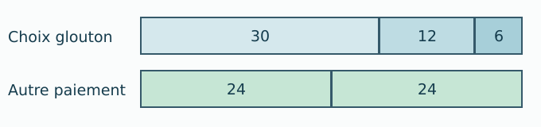

# X · MP · Informatique (option) 2002 — Corrigé guidé

*Corrigé rédigé par IA, non officiel. Signalez toute erreur.*

**Rédaction** · GPT-6.2 Astra Ultra · vitesse non renseignée

Épreuve de quatre heures, résolue en OCaml. Les deux premières parties utilisent des listes décroissantes, la dernière des vecteurs de multiplicités indicés à partir de 1. Les montants et les comptages sont supposés représentables. Aucun rapport de jury propre à cette épreuve n’a été retrouvé.

## I. Payer le compte exact

### 1. Valeur d’une somme

**Pour commencer.** Une espèce contribue pour sa dénomination, même si la même dénomination apparaît à nouveau.

```ocaml
type somme = int list
type systeme = int list
let valeur s = List.fold_left (+) 0 s
```

L’accumulateur contient la valeur du préfixe parcouru. La liste vide vaut zéro.

### 2.a. Succès avec ressources illimitées

**Pour commencer.** Examiner le plus petit choix possible tant qu’il reste quelque chose à payer.

Si le reste est positif, la pièce 1 est admissible. La dénomination choisie est comprise entre 1 et le reste. Le reste décroît donc strictement dans les naturels et atteint zéro. La somme des pièces choisies est alors le prix initial.

### 2.b. Construire le paiement glouton

**Pour commencer.** Après avoir utilisé une dénomination, elle reste disponible.

```ocaml
let rec glouton sys p =
  if p = 0 then [] else match sys with
  | [] -> invalid_arg "systeme sans unite"
  | d :: suite -> if d > p then glouton suite p
                  else d :: glouton sys (p-d)
```

Une dénomination trop grande reste trop grande après toute dépense ultérieure. La liste obtenue est décroissante au sens large.

### 3.a. Échec avec un portefeuille

**Pour commencer.** Chercher un reste trop petit pour chacune des pièces encore présentes.

Avec le portefeuille européen $(5,2,2,2)$ et le prix 6, le glouton donne 5 puis reste bloqué à 1. Les trois pièces de 2 paient pourtant 6.

### 3.b. Paiement glouton avec un stock fini

**Pour commencer.** Distinguer un succès de valeur zéro d’un échec avant de convertir le résultat en liste.

```ocaml
let paye_glouton pf p =
  let rec payer reste acc = function
    | _ when reste = 0 -> List.rev acc
    | [] -> []
    | d :: suite ->
        if d > reste then payer reste acc suite
        else payer (reste-d) (d::acc) suite
  in payer p [] pf
```

Chaque occurrence examinée est consommée ou écartée définitivement. Un échec efface tout le paiement partiel.

### 4. Compter les paiements

**Pour commencer.** Numéroter mentalement les pièces identiques. Une pièce précise figure dans l’extraction ou en est absente.

```ocaml
let compte_paiements pf p =
  let voies = Array.make (p+1) 0 in
  voies.(0) <- 1;
  List.iter (fun d ->
    for q = p downto d do
      voies.(q) <- voies.(q) + voies.(q-d)
    done) pf;
  voies.(p)
```

Avant chaque pièce, la case $q$ compte les façons d’atteindre $q$ avec les pièces déjà traitées. En parcourant les montants en descendant, la case $q-d$ contient encore l’ancien compte. Pour $(2,2,2)$ et le prix 2, la réponse est 3. Le prix nul admet une extraction.

## II. Paiement optimal dans un portefeuille

### 5.a. Insérer dans l’ordre

**Pour commencer.** Copier les éléments strictement supérieurs à la dénomination à insérer.

```ocaml
let rec ajoute s d = match s with
  | x :: suite when x > d -> x :: ajoute suite d
  | _ -> d :: s
```

### 5.b. Soustraction avec multiplicités

**Pour commencer.** Une tête plus grande que l’autre ne peut être appariée à un élément ultérieur de la petite liste.

```ocaml
let rec diff s t = match s,t with
  | [],_ -> [] | _,[] -> s
  | x::xs,y::ys ->
      if x=y then diff xs ys
      else if x>y then x::diff xs t
      else diff s ys
```

Chaque égalité annule exactement une occurrence de chaque côté.

### 6. Les trois premières couches

**Pour commencer.** Les deux pièces de 5 n’améliorent pas le paiement de 10. Une seule pièce de 1 est disponible.

Pour les montants payables, $T(0)=\{0\}$ avec $M(0)=()$. On a $T(1)=\{1,5,10\}$, avec respectivement $(1),(5),(10)$. Enfin $T(2)=\{6,11,15,20\}$, avec $(5,1),(10,1),(10,5),(10,10)$. Chaque $M_i$ réunit les affectations des lignes 0 à $i$.

Le cahier code aussi l’impossibilité par la liste vide. Si on applique littéralement la définition de $T(0)$ à tous les naturels, elle ajoute **tous les prix impossibles**, avec image vide sous $M_0$. La liste finie initiale exploitable en question 7 comporte uniquement le montant payable 0. Toutes les couches de taille positive sont identiques sous les deux lectures.

### 7.a. Construire la couche suivante

**Pour commencer.** À stock borné, calculer d’abord les meilleurs paiements avec les seules pièces déjà traitées. Parcourir chaque fois les montants en descendant.

On se restreint à $0\le q\le p$, comme le permet la taille de `tab`. La case auxiliaire `Some (k,s)` signifie que $s$ est une extraction optimale de taille $k$ du préfixe de pièces déjà utilisé. `None` désigne un montant impossible. Pour traiter une pièce $d$, on garde le meilleur entre le paiement déjà connu et un ancien paiement de $q-d$ augmenté de cette occurrence. Le parcours décroissant empêche sa double utilisation. Les pièces sont considérées par valeur croissante, donc l’ajout en tête préserve l’ordre décroissant.

```ocaml
let meilleurs pf p =
  let m = Array.make (p+1) None in
  m.(0) <- Some (0,[]);
  List.iter (fun d ->
    for q = p downto d do
      match m.(q-d) with
      | None -> ()
      | Some (k,s) ->
          match m.(q) with
          | Some (h,_) when h <= k+1 -> ()
          | _ -> m.(q) <- Some (k+1,d::s)
    done) (List.rev pf);
  m

let tab : somme array ref = ref [||]

let niveau = ref 0

let couche m ti =
  let i = match ti with
    | q::_ -> List.length !tab.(q)
    | [] -> !niveau in
  let suivant = ref [] in
  Array.iteri (fun v x -> match x with
    | Some (k,s) when k=i+1 ->
        !tab.(v) <- s; suivant := v :: !suivant
    | _ -> ()) m;
  niveau := i+1;
  !suivant

let etape pf p ti = couche (meilleurs pf p) ti
```

Le tableau global est accessible par une référence pour permettre son dimensionnement par l’appelant. Pour la suite d’appels, on initialise `niveau` à 0 avec le tableau. Une couche non vide livre sa taille par n’importe laquelle de ses cases. Le compteur mémorise cet indice même si une liste est vide. À chaque étape, le balayage sélectionne exactement les prix de coût $i+1$ et conserve les affectations précédentes. Une couche vide ne permet pas d’arrêter le calcul. Avec $(9,7,4,3,3,1)$ et $p=18$, les prix de coût 3 sont 14, 15 et 17. Aucun prix de 0 à 18 n’a pour coût 4, tandis que 18 exige les cinq pièces $(7,4,3,3,1)$. C’est la raison de conserver le numéro de la couche.

### 7.b. Trouver un paiement optimal

**Pour commencer.** Partager le tableau auxiliaire entre les appels successifs à la fonction de construction des couches.

```ocaml
let optimal pf p =
  tab := Array.make (p+1) []; niveau := 0;
  let m = meilleurs pf p in
  match m.(p) with
  | None -> []
  | Some (k,_) ->
      let t = ref [0] in
      for _i = 1 to k do t := couche m !t done;
      !tab.(p)
```

La récurrence sur les pièces prouve directement l’optimalité, y compris pour $p=0$. Avec $m$ pièces, le calcul et la matérialisation d’au plus $m$ couches demandent $O(m(p+1))$ opérations (la lecture des longueurs coûte au total $O(k^2)$ et $k\le p$, $k\le m$). Si seules les pièces du résultat sont demandées, on peut aussi lire directement la représentation dans le tableau auxiliaire.

### 8. Contre-exemple britannique

**Pour commencer.** Comparer deux pièces de 24 avec le choix initial de 30.

Pour 48 le glouton rend $(30,12,6)$, trois pièces. Le paiement $(24,24)$ en demande deux. Aucune pièce ne vaut 48. Le système n’est donc pas canonique.



## III. Décider la canonicité

### 9. Représentant glouton vectoriel

**Pour commencer.** Une division euclidienne traite en une opération toutes les pièces de même dénomination.

```ocaml
let tglouton sys p =
  let g = Array.make (Array.length sys) 0 and reste = ref p in
  for k = 1 to Array.length sys - 1 do
    g.(k) <- !reste / sys.(k);
    reste := !reste mod sys.(k)
  done;
  g
```

L’indice 0 est inutilisé. Chaque coefficient est le plus grand possible après fixation des précédents. Le coût est $\Theta(n)$ dans le modèle du cahier.

### 10.a. Croissance stricte

**Pour commencer.** Partir d’une représentation de $p$ et lui ajouter uniquement des unités.

Pour $p<q$, compléter $G(p)$ par $q-p$ pièces de 1 produit un vecteur strictement plus grand que $G(p)$ pour l’ordre lexicographique. Le maximum lexicographique $G(q)$ est au moins égal à ce vecteur.

### 10.b. Retrait d’une pièce gloutonne

**Pour commencer.** L’ordre lexicographique est invariant par addition d’un même vecteur.

Si $g_k>0$, $G(p)-I_k$ représente $p-d_k$. Toute représentation strictement supérieure de ce montant, augmentée de $I_k$, dépasserait $G(p)$ au prix $p$, ce qui contredit sa définition. Ainsi $G(p-d_k)=G(p)-I_k$.

### 10.c. Retrait d’une pièce optimale

**Pour commencer.** Distinguer le nombre de pièces et le départage lexicographique en cas d’égalité.

Lorsque $m_k>0$, retirer $I_k$ à $M(p)$ donne un paiement de $p-d_k$. Un concurrent plus court, ou de taille égale mais lexicographiquement supérieur, permettrait après ajout de $I_k$ de battre $M(p)$ selon le même critère. Donc $M(p-d_k)=M(p)-I_k$.

### 11.a. Supports disjoints

**Pour commencer.** Une pièce commune permet d’abaisser le contre-exemple minimal.

Si $m_k$ et $g_k$ sont positifs, les deux retraits précédents donnent encore des vecteurs différents pour $w-d_k<w$, contrairement à la minimalité de $w$. Aucune dénomination n’apparaît des deux côtés.

### 11.b. Premier indice utilisé

**Pour commencer.** Identifier le premier indice où glouton et optimal diffèrent.

Si $i=1$, le paiement optimal emploie la plus grosse pièce, donc $w\ge d_1$ et le glouton l’emploie aussi. D’après 11.a, c’est impossible. Ainsi $i>1$.

### 11.c. Encadrement du plus petit témoin

**Pour commencer.** Comparer le premier choix glouton avec $d_{i-1}$, puis retirer une pièce $d_j$ à l’optimum.

Comme $G(w)$ dépasse $M(w)$ lexicographiquement et que leurs supports sont disjoints, son premier coefficient positif précède $i$. Donc $w\ge d_{i-1}$. L’égalité donnerait un paiement glouton optimal à une pièce, d’où $w>d_{i-1}$. Par minimalité et par 10.c, $G(w-d_j)=M(w)-I_j$. Ce vecteur n’a aucune pièce d’indice $<i$. Le montant $w-d_j$ est donc strictement inférieur à $d_{i-1}$, sinon le glouton utiliserait une telle pièce. Finalement $d_{i-1}<w<d_{i-1}+d_j$.

### 12.a. Reconstruire le vecteur du témoin

**Pour commencer.** Les deux bornes de l’encadrement admis ne diffèrent qu’en position $j$. Tous les coefficients de la borne supérieure après $j$ sont nuls.

Posons $A=G(d_{i-1}-1)$. De $M(w)-I_j\le_\ell A<_\ell M(w)$, on déduit que $A$ et $M(w)$ coïncident avant $j$. Au rang $j$, la valeur doit être $m_j-1$ ou $m_j$. Ce dernier cas est impossible, car le suffixe de $M(w)$ est nul et les coefficients de $A$ sont positifs ou nuls. On garde donc le préfixe de $A$ jusqu’à $j-1$, on remplace $A_j$ par $A_j+1$ et on met à zéro tout le suffixe.

### 12.b. Parcourir les témoins possibles

**Pour commencer.** Une représentation candidate plus courte que le glouton suffit pour répondre faux, même si elle n’est pas elle-même optimale.

```ocaml
let canonique sys =
  let n = Array.length sys - 1 in
  let rec ligne i =
    if i > n then true else
    let a = tglouton sys (sys.(i-1)-1) in
    let rec colonne j v k =
      if j > n then ligne (i+1) else
      let v' = v + a.(j)*sys.(j) and k' = k + a.(j) in
      let g = tglouton sys (v'+sys.(j)) in
      if Array.fold_left (+) 0 g > k'+1 then false
      else colonne (j+1) v' k'
    in colonne i 0 0
  in ligne 2
```

Les coefficients de $A$ avant $i$ sont nuls. La boucle cumule le montant et la taille du préfixe de $A$. Elle teste tous les couples $2\le i\le j\le n$. Toute réponse négative a un témoin explicite. Si le système est non canonique, 12.a garantit que l’un des couples reconstruit l’optimum du plus petit contre-exemple. À ce prix le glouton utilise strictement plus de pièces, car il est déjà maximal lexicographiquement. Au plus $n(n-1)/2$ essais de coût $O(n)$ donnent $O(n^3)$.

### 12.c. Le système européen

**Pour commencer.** On peut certifier le résultat du programme en donnant les différences de tailles sur les 36 couples.

Pour $D=(500,200,100,50,20,10,5,2,1)$, les lignes ci-dessous donnent la taille du candidat moins celle du glouton, dans l’ordre $j=i,\ldots,9$.

| $d_{i-1}$ | Différences |
|---|---|
| 500 | 1, 2, 3, 4, 5, 6, 7, 8 |
| 200 | 1, 2, 3, 4, 5, 6, 7 |
| 100 | 1, 2, 3, 4, 5, 6 |
| 50 | 1, 2, 3, 4, 5 |
| 20 | 1, 2, 3, 4 |
| 10 | 1, 2, 3 |
| 5 | 1, 2 |
| 2 | 1 |

Par exemple, pour $d_{i-1}=5$, $G(4)$ contient deux pièces de 2. Les candidats sont $(2,2,2)$ pour 6 et $(2,2,1)$ pour 5. Le glouton utilise respectivement deux pièces et une pièce. Toutes les différences sont positives, le test retourne donc vrai.

[Sujet](https://www.wikiprepa.fr/concours/data/x_option-info_mp_2002.pdf) · [Autre exemplaire](https://www.doc-solus.fr/prepa/sci/adc/pdf/enonces.pdf/2002/MP_INFO_X_1_2002.enonce.pdf)
