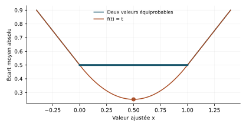

# École polytechnique — Première composition de mathématiques MP 2002 · Corrigé brut

*Corrigé rédigé par IA, non officiel. Signalez toute erreur.*

**Rédaction** · GPT-6.2 Astra Ultra · vitesse non renseignée

**Révision** · GPT-6.2 Astra Ultra · vitesse non renseignée

La moyenne minimise l’écart quadratique et les médianes minimisent l’écart absolu. Les quatre parties précisent la différence entre les deux critères, le rôle des masses ponctuelles et le comportement des médianes pour la convergence en moyenne.

## I. Écarts quadratiques et moyenne

### Question 1

Cauchy–Schwarz donne $\sum_n w_n|a_n|\le(\sum_nw_n)^{1/2}(\sum_nw_na_n^2)^{1/2}<\infty$. Posons $m=\sum_nw_na_n$. Pour tout réel $x$, la série est finie puisque $(a_n-x)^2\le2a_n^2+2x^2$. Le développement donne $D_a(x)=(x-m)^2+\sum_nw_na_n^2-m^2$. L’unique minimiseur est $m$, le minimum est $\sum_nw_n(a_n-m)^2=\sum_nw_na_n^2-m^2$.

### Question 2

L’intervalle ayant longueur un, $\int|f|\le(\int f^2)^{1/2}$. Avec $m=\int_0^1 f(t)dt$, tous les termes du carré sont intégrables et $D_f(x)=(x-m)^2+\int f^2-m^2$. Le minimum $\int(f-m)^2$ est atteint exactement au point $m$.

## II. Écarts absolus et existence des minimiseurs

### Question 3

La fonction $t\mapsto|f(t)-x|$ est continue par morceaux et dominée par $|f(t)|+|x|$. L’intégrabilité de $f$ et la longueur finie de $I$ donnent un réel $\Delta(x)$ pour tout $x$.

### Question 4.a

On a $\big||f(t)-x|-|f(t)-y|\big|\le|x-y|$, d’où $|\Delta(x)-\Delta(y)|\le|x-y|$. La fonction est continue. Pour $\lambda\in[0,1]$, $|f-(\lambda x+(1-\lambda)y)|\le\lambda|f-x|+(1-\lambda)|f-y|$. L’intégration établit la convexité.

### Question 4.b

L’encadrement $|x|-\int|f|\le\Delta(x)\le|x|+\int|f|$ donne $\Delta(x)\to+\infty$ lorsque $x\to+\infty$ ou $x\to-\infty$.

### Question 5

Par 4.b, il existe $R$ tel que $|x|>R\Rightarrow\Delta(x)>\Delta(0)$. La continuité donne un minimum $V$ sur $[-R,R]$, qui est aussi le minimum global. L’ensemble $M=\Delta^{-1}(\{V\})$ est fermé et borné. Entre deux minimiseurs, la convexité majore $\Delta$ par $V$ et la minimalité la minore par $V$. Ainsi $M$ est un intervalle compact non vide, éventuellement réduit à un point.

### Question 6.a

On a $\Delta(x)=(|1-x|+|x|)/2$. Cette expression vaut $1/2-x$ pour $x\le0$, $1/2$ pour $0\le x\le1$ et $x-1/2$ pour $x\ge1$. Donc $V=1/2$ et $M=[0,1]$.

### Question 6.b

Pour $x\le0$, $\Delta(x)=1/2-x$ ; pour $x\ge1$, $\Delta(x)=x-1/2$. Sur $[0,1]$, $\Delta(x)=x^2/2+(1-x)^2/2=(x-1/2)^2+1/4$. Ainsi $V=1/4$ et $M=\{1/2\}$.

## III. Répartition des valeurs et médianes

### Question 7

Pour une fonction monotone sur un intervalle, la préimage d’un intervalle est un intervalle, éventuellement vide ou réduit à un point : la valeur intermédiaire en position reste entre les valeurs extrêmes. Sur chacune des finitement nombreuses branches, $\chi_J$ ne change donc qu’aux deux bords éventuels de cet intervalle. Les points de subdivision n’en ajoutent qu’un nombre fini. Bornée, la fonction est continue par morceaux et intégrable ; $0\le\lambda(J)\le1$.

### Question 8.a

La disjonction donne $\chi_{\cup J_i}=\sum_{i=1}^n\chi_{J_i}$. Intégrer donne $\lambda(\cup J_i)=\sum_i\lambda(J_i)$.

### Question 8.b

Pour tout $t$, $\chi_{J_n}(t)\uparrow\chi_{\cup J_n}(t)$. Ces fonctions sont dominées par $1$, intégrable sur $I$, et l’union croissante est un intervalle. La convergence dominée donne $\lambda(\cup J_n)=\lim\lambda(J_n)=\sup_n\lambda(J_n)$.

### Question 8.c

Si les $J_n$ décroissent, $\chi_{J_n}\downarrow\chi_{\cap J_n}$, avec encore le majorant $1$. L’intégrale du dernier terme vaut la limite décroissante des intégrales, donc $\inf_n\lambda(J_n)$. L’intersection vide a pour mesure zéro.

Si les intervalles décroissants sont ouverts et se resserrent autour d’un point qu’ils excluent tous, l’intersection est vide. La même preuve s’applique avec la fonction indicatrice identiquement nulle. Ce cas intervient précisément avec $J_n=]x,x+1/n[$ en 9.b.

### Question 9.a

Pour $u=f(t)$, le quotient $(|u-x-\varepsilon|-|u-x|)/\varepsilon$ vaut $1$ si $u\le x$, $-1$ si $u\ge x+\varepsilon$, et $1+2(x-u)/\varepsilon$ entre les deux. En intégrant sur les trois préimages et en transportant les contributions extrêmes à gauche, on obtient
$$\frac{\Delta(x+\varepsilon)-\Delta(x)}{\varepsilon}-\lambda(J_1)+\lambda(J_3)=\lambda(J_2)+\frac2\varepsilon\int_0^1\chi_{J_2}(t)(x-f(t))dt.$$

### Question 9.b

Sur $J_2$, le quotient de 9.a est compris entre $-1$ et $1$, si bien que sa contribution est en module au plus $\lambda(]x,x+\varepsilon[)\to0$ par 8.c. La masse de $[x+\varepsilon,\infty[$ tend vers celle de $]x,\infty[$ par 8.b. On en déduit $\Delta'_+(x)=\lambda(]-\infty,x])-\lambda(]x,\infty[)=2\lambda(]-\infty,x])-1$.

### Question 9.c

Le quotient $(|u-x|-|u-(x-\varepsilon)|)/\varepsilon$ tend vers $1$ pour $u<x$ et vers $-1$ pour $u\ge x$. Il est en module au plus un. La convergence dominée donne $\Delta'_-(x)=2\lambda(]-\infty,x[)-1$.

### Question 9.d

La différence $\Delta'_+(x)-\Delta'_-(x)=2\lambda(\{x\})$ est positive ou nulle. La dérivée existe exactement lorsque la valeur $x$ est prise sur un ensemble de longueur nulle.

### Question 10.a

Les ensembles $]-\infty,x+1/n]$ décroissent vers $]-\infty,x]$ et les $]-\infty,x-1/n]$ croissent vers $]-\infty,x[$. D’après 8, $\varphi(x+0)=\varphi(x)$ et $\varphi(x-0)=\varphi(x)-\lambda(\{x\})$.

### Question 10.b

La fonction $\varphi$ est croissante et continue à droite. Par 8, ses limites aux infinis sont $0$ et $1$. L’ensemble $\{\varphi\ge1/2\}$ est une demi-droite $[a,\infty[$ par continuité à droite, avec $a$ fini. De même $x\mapsto\varphi(x-0)=\lambda(]-\infty,x[)$ est croissante, continue à gauche par 8.b et a les mêmes limites aux infinis. Donc $\{\varphi(\cdot-0)\le1/2\}=]-\infty,b]$ avec $b$ fini. Leur intersection, si non vide, est $[a,b]$.

### Question 10.c

Un minimum impose $\Delta'_-(x)\le0\le\Delta'_+(x)$. Inversement, par convexité, les pentes des cordes à droite sont au moins la dérivée à droite, et les pentes à gauche au plus la dérivée à gauche. Ces signes font donc de $x$ un minimum global. Les formules de 9 donnent $M=N$, non vide par 5. Si $a<x<b$, choisissons $y\in N$ avec $x<y$. Par croissance, $1/2\le\varphi(x)\le\varphi(y-0)\le1/2$. Ainsi $\varphi$ est constante égale à $1/2$ à l’intérieur de $N$.

En effet, pour $y>x$ la convexité donne $(\Delta(y)-\Delta(x))/(y-x)\ge\Delta'_+(x)$. Pour $y<x$, elle donne $(\Delta(x)-\Delta(y))/(x-y)\le\Delta'_-(x)$. Ces deux inégalités fournissent séparément $\Delta(y)\ge\Delta(x)$ et traitent aussi les extrémités d’un intervalle de médianes.

## IV. Unicité pour une fonction continue et stabilité

### Question 11.a

L’image $f(I)$ est un intervalle. Si $x$ lui est extérieur, toutes les valeurs de $f$ sont strictement supérieures à $x$ ou toutes strictement inférieures. Dans le premier cas $\varphi(x)=0$, dans le second $\varphi(x-0)=1$. Aucune des deux situations ne permet $x\in N=M_f$. D’où $M_f\subset f(I)$.

### Question 11.b

Si $[a,b]\subset M_f$ avec $a<b$, choisissons $a<u<v<b$. Par 11.a et continuité, une valeur entre $u$ et $v$ est prise. La préimage de $]u,v[$ est un ouvert non vide de $I$ et contient un intervalle de longueur positive. Mais 10.c donne $\lambda(]u,v])=\varphi(v)-\varphi(u)=0$, contradiction. Il reste donc une unique médiane $m_f$.

### Question 11.c

Par minimalité, $V_f\le\Delta(0)=\int|f|$. De plus $|m_f|\le\int|m_f-f|+\int|f|=V_f+\int|f|\le2\int|f|$. Cette borne implique aussi la comparaison demandée pour $m_f$ lui-même.

### Question 12

La convergence en moyenne donne $e_n=\int|g_n-g|\to0$ et borne les normes $\int|g_n|$. Les $m_n$ sont bornés par 11.c et ont donc au moins une valeur d’adhérence. Pour tout $x$, $|\Delta_{g_n}(x)-\Delta_g(x)|\le e_n$. La minimalité entraîne $\Delta_g(m_n)\le\Delta_g(x)+2e_n$. Si $m_{n_k}\to m$, la continuité de $\Delta_g$ donne $\Delta_g(m)\le\Delta_g(x)$ pour tout $x$. Donc $m\in M_g$.

Plus précisément, la majoration par $e_n$ est uniforme en $x$. Elle donne aussi $|V_{g_n}-V_g|\le e_n$ en prenant les infimums. L’argument précédent reste valable lorsque $M_g$ est tout un intervalle, comme dans l’exemple 6.a.
