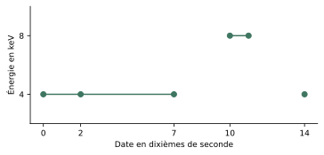
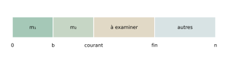
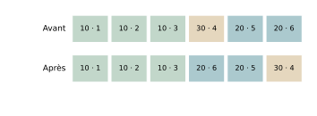

# École polytechnique · PSI et PT · Informatique facultative 2002 · Corrigé brut

*Corrigé rédigé par IA, non officiel. Signalez toute erreur.*

**Rédaction** · GPT-6.2 Astra Ultra · vitesse non renseignée · 25 novembre 2026

**Mesures du rayonnement gamma d’un pulsar.** Le langage choisi est Python. Les énergies sont en keV et les dates en dixièmes de seconde. Le sujet original occupe les deux premières pages scannées du fac-similé. Le rapport de Marc Pouzet, pages 3 à 6, présente cette session comme la première édition de l’épreuve de l’École polytechnique commune aux PSI et PT.

## Questions préliminaires · Comptages

### Question 1 · Compter les mesures d’une énergie donnée

```python
def compte(x, a):
    nombre = 0
    for mesure in a:
        if mesure == x:
            nombre += 1
    return nombre
```

Après chaque mesure, `nombre` est l’effectif de $x$ parmi les éléments déjà visités. Le temps est $\Theta(n)$ et l’espace auxiliaire constant.

### Question 2 · Associer à chaque observation son effectif total

```python
def occurences(a):
    r = [0] * len(a)
    for i in range(len(a)):
        r[i] = compte(a[i], a)
    return r
```

Chacun des $n$ appels à la question 1 parcourt $n$ mesures. Le temps vaut donc $\Theta(n^2)$. Pour les énergies $[10,10,10,30,20,20]$, le résultat est $[3,3,3,1,2,2]$.

## I · Périodes constantes

### Question 3 · Calculer la plus longue durée à énergie constante

```python
def maxconstant(a):
    debut = 0
    maximum = 0
    for j in range(1, len(a)):
        if a[j] != a[j - 1]:
            debut = j
        duree = t[j] - t[debut]
        if duree > maximum:
            maximum = duree
    return maximum
```

Le tableau chronologique `t` est accessible à la fonction conformément à la signature du sujet. À l’indice $j$, `debut` désigne la première mesure du bloc constant finissant en $j$. Comme les dates croissent, la plus longue période de ce bloc est atteinte à sa dernière mesure. Le calcul ne prolonge pas la période jusqu’à la première mesure différente. Une seule observation donne la durée zéro. Le temps est $\Theta(n)$ et la valeur retournée est en dixièmes de seconde.



## II · Regroupement des mesures

### Question 4 · Repérer les deux énergies les plus fréquentes

```python
def maxoccurences(a, occ):
    premier = 0
    second = -1
    for i in range(1, len(a)):
        if a[i] == a[premier] or (second != -1 and a[i] == a[second]):
            continue
        if occ[i] > occ[premier]:
            second, premier = premier, i
        elif second == -1 or occ[i] > occ[second]:
            second = i
    print(premier, second)
```

Après le préfixe traité, les deux indices désignent les meilleures valeurs **distinctes** rencontrées selon leurs occurrences globales. Si la nouvelle valeur dépasse le premier score, l’ancien premier devient second. Une égalité peut être départagée librement et le code conserve la valeur déjà retenue. Les deux valeurs d’une même énergie ont le même effectif fourni dans `occ`, si bien qu’une répétition ne change pas leur rang. Pour une série constante, la sortie est `0 -1` et la seconde énergie est conventionnellement $-1$. Le temps est $\Theta(n)$, sans recompter les occurrences.

### Question 5 · Regrouper les mesures sans dissocier leurs dates

```python
def echanger(a, t, i, j):
    a[i], a[j] = a[j], a[i]
    t[i], t[j] = t[j], t[i]

def trier(a, t, m1, m2):
    b = 0
    courant = 0
    fin = len(a)
    while courant < fin:
        if a[courant] == m1:
            echanger(a, t, courant, b)
            b += 1
            courant += 1
        elif a[courant] == m2:
            courant += 1
        else:
            fin -= 1
            echanger(a, t, courant, fin)
```

Avant chaque tour, $[0,b)$ contient uniquement $m_1$, $[b,\mathrm{courant})$ uniquement $m_2$, $[\mathrm{courant},\mathrm{fin})$ reste à examiner, et $[\mathrm{fin},n)$ contient les autres valeurs. Initialement seule la zone inconnue est non vide. Dans le premier cas, si $b<\mathrm{courant}$, la mesure déplacée vers la position courante est une valeur $m_2$ déjà reconnue. Dans le dernier cas, la valeur arrivée de droite peut être de n’importe quel type et l’indice courant reste donc en place. Chaque tour raccourcit exactement d’une unité la zone inconnue.

À l’arrêt, la deuxième coupure recherchée est $r=\mathrm{fin}=\mathrm{courant}$. Les échanges portent en parallèle sur les deux tableaux, donc chaque énergie conserve sa date. Le temps est $\Theta(n)$ et l’espace auxiliaire $O(1)$. Si la série est constante, la deuxième zone reste vide.



### Question 6 · Vérifier l’ordre des dates au sein des zones

La chronologie interne n’est pas garantie. Prenons $a=[10,10,10,30,20,20]$ et $t=[1,2,3,4,5,6]$, en dixièmes de seconde. L’énergie la plus fréquente est 10 et la suivante 20. Quand l’algorithme atteint la valeur 30, il l’échange avec la dernière valeur 20, celle de date 6. Il laisse ensuite passer les deux valeurs 20. Le résultat est

| Zone | Énergies | Dates correspondantes |
|---|---|---|
| Première | 10, 10, 10 | 1, 2, 3 |
| Deuxième | 20, 20 | 6, 5 |
| Autres | 30 | 4 |

La date 6 précède la date 5 dans la deuxième zone. Chaque couple énergie-date est pourtant resté intact, comme l’exige la question 5.


