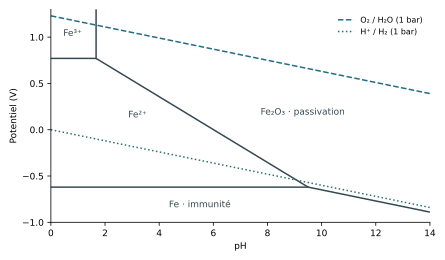
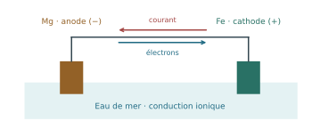
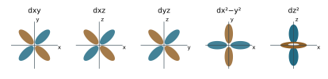
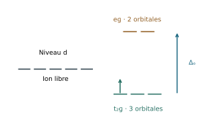
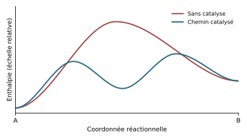
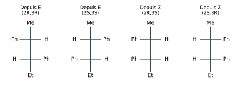

# ENS de Lyon — Second concours, Chimie 2003 · Corrigé brut

*Corrigé rédigé par IA, non officiel.*

**Rédaction (tour 1)** · GPT-6.2 Astra Ultra · vitesse non renseignée

Ces éditions traitent 47 des 53 questions ou sous-questions terminales. Les deux premières questions sont celles de l’introduction. Les questions II.2.a, II.2.c, III.B3.a, III.B6.a–b et IV.D2.d sont hors couverture. La corrosion du fer, la dureté de l’eau, le champ cristallin, la cinétique, le dosage potentiométrique et la stéréochimie des produits sont développés. L’original et le rapport commun Paris–Lyon ont été consultés.

## Introduction

### Question Intro.i — Métal natif et minerais

L’or peut se rencontrer **à l’état natif**, sous forme métallique. Beaucoup de minerais renferment au contraire des **oxydes** (hématite, $\mathrm{Fe_2O_3}$), des **sulfures** (galène, $\mathrm{PbS}$), ou encore des carbonates et autres sels.

### Question Intro.ii — Propriété physique

Un métal massif possède une conductivité électrique liée à ses électrons mobiles. Les valeurs varient fortement selon le métal et la température.

## I.A. Corrosion et diagramme du fer

### Question I.A1 — Corrosion, immunité et passivation

La corrosion est la dégradation chimique ou électrochimique du métal par son milieu. En domaine d’immunité, le métal est la forme thermodynamiquement stable. La passivation correspond à la formation d’une couche protectrice qui ralentit les échanges et la corrosion. Le diagramme donne la stabilité de l’oxyde, le caractère protecteur de sa couche est une hypothèse fournie ici.

### Question I.A2 — Carte potentiel–pH du fer

Le domaine de $\mathrm{Fe(s)}$, sous la limite basse, est celui de l’**immunité**. Les domaines de $\mathrm{Fe^{2+}}$ et $\mathrm{Fe^{3+}}$ dissous correspondent à la **corrosion**. Le domaine de $\mathrm{Fe_2O_3(s)}$ correspond à la **passivation** selon l’hypothèse du sujet. Les points de raccord lus sur le tracé sont proches de $(1{,}67;0{,}77\,\mathrm V)$ et $(9{,}5;-0{,}62\,\mathrm V)$. Le schéma conserve l’échelle demandée et superpose les deux limites de l’eau utilisées en I.A5.

### Question I.A3 — Apparition de l’oxyde ferrique

Avec l’état standard des solutés et en approximation diluée, $K_s=[\mathrm{Fe^{3+}}][\mathrm{OH^-}]^3=10^{-43}$. Pour $[\mathrm{Fe^{3+}}]=10^{-6}\,\mathrm{mol\,L^{-1}}$, $[\mathrm{OH^-}]^3=10^{-37}$. Donc $\mathrm{pOH}=37/3$ et **$\mathrm{pH}=14-37/3=1{,}67$** à 25 °C.

### Question I.A4 — Pente oxyde–ion ferreux

Pour $\mathrm{Fe_2O_3(s)+6H^++2e^-\rightleftharpoons2Fe^{2+}+3H_2O}$, à concentration en $\mathrm{Fe^{2+}}$ constante, Nernst donne une pente $-(0{,}06/2)\times6=\mathbf{-0{,}18\,V}$ par unité de pH. La ligne chute donc rapidement vers les pH élevés.

### Question I.A5 — Domaine de l’eau

Pour $\mathrm{2H^++2e^-\rightleftharpoons H_2}$, $E=-0{,}060\,\mathrm{pH}$. Pour $\mathrm{O_2+4H^++4e^-\rightleftharpoons2H_2O}$, $E=1{,}23-0{,}060\,\mathrm{pH}$. Le rapport du nombre de protons au nombre d’électrons vaut un dans les deux réactions. L’eau est stable entre les deux droites. Le dihydrogène est favorisé sous la droite basse et le dioxygène au-dessus de la droite haute.

### Question I.A6 — Oxydation à l’air

En milieu très acide, le potentiel du couple $\mathrm{O_2/H_2O}$ est supérieur à celui de $\mathrm{Fe^{3+}/Fe^{2+}}$. Ainsi $\mathrm{O_2+4H^++4Fe^{2+}\to2H_2O+4Fe^{3+}}$ est favorisée. Le caractère progressif dépend de la cinétique et du transfert du dioxygène de l’air à la solution.

## I.B. Protection du métal

### Question I.B1.a — Choix du métal protecteur

Dans la comparaison thermodynamique proposée, **Mg, Al et Zn** ont des potentiels de réduction inférieurs à celui de $\mathrm{Fe^{2+}/Fe}$ ($-0{,}44\,\mathrm V$). Ils peuvent donc s’oxyder préférentiellement en fournissant des électrons au fer. Cu et Ni sont plus nobles selon les valeurs données. En pratique, la passivation d’un métal tel que l’aluminium peut affecter l’efficacité.

### Question I.B1.b — Couple galvanique fer–cuivre

Sur le fer, l’oxydation est $\mathrm{Fe\to Fe^{2+}+2e^-}$. Le cuivre joue le rôle de cathode, où une espèce du milieu est réduite. En eau salée aérée, on peut écrire $\mathrm{O_2+2H_2O+4e^-\to4OH^-}$. En milieu acide, une réduction des protons en $\mathrm{H_2}$ est également possible. Le cuivre métallique peut ainsi porter une réaction cathodique sans être lui-même consommé.

### Question I.B1.c — Couple galvanique magnésium–fer

Le magnésium fournit $\mathrm{Mg\to Mg^{2+}+2e^-}$. La surface du fer est cathodique. Le rapport de jury donne comme demi-réaction $\mathrm{2H^++2e^-\to H_2}$. En eau salée aérée proche de la neutralité, la réduction du dioxygène en hydroxyde est une autre réaction cathodique pertinente. Le mécanisme de protection est identique dans les deux cas.

### Question I.B2.a — Polarités et sens du courant

Le magnésium est l’**anode négative**, siège de l’oxydation. Le fer est la **cathode positive** de la pile galvanique. Dans le conducteur métallique extérieur, les électrons vont de Mg vers Fe, le courant conventionnel va de Fe vers Mg. Le transport ionique dans l’eau ferme le circuit.

### Question I.B2.b — Anode sacrificielle

Le magnésium fournit les électrons qui soutiennent la réaction cathodique sur la coque. Ses atomes quittent l’anode sous forme ionique. La masse de l’anode diminue tandis que l’oxydation du fer est freinée, d’où le terme d’**anode sacrifiée**.

## II. Alcalins

### Question II.1.a — Couche externe d’un alcalin

Pour un métal alcalin dans son état fondamental, la couche externe porte **$ns^1$** au-delà du cœur électronique fermé, avec $n$ le numéro de période.

### Question II.1.b — Ion usuel

La perte de l’unique électron de valence donne le cation monovalent **$\mathrm{M^+}$** de configuration électronique du gaz noble précédent. Cette transformation explique la grande fréquence du degré d’oxydation +I.

### Question II.1.c — Caractère chimique

Le métal alcalin est électropositif et tend à **réduire** une autre espèce en lui cédant un électron. Il s’oxyde lui-même en cation.

*Question II.2.a hors couverture.*

### Question II.2.b — Organisation par un cation

Les oxygènes donneurs de doublets interagissent avec le cation $\mathrm{Na^+}$ par coordination et attraction ion–dipôle. Le cation rapproche et préorganise plusieurs sites donneurs. Le gain de probabilité de rencontre intramoléculaire favorise la fermeture du cycle. On parle d’**effet de gabarit**, ou *template effect*.

*Question II.2.c hors couverture.*

## III.A. Calcium et magnésium de l’eau

### Question III.A1 — Eau dure

Une eau riche en ions calcium et magnésium est dite dure. Elle peut former du tartre et diminue le pouvoir moussant de certains savons en formant des sels peu solubles. La dureté totale se rapporte à la somme des concentrations de ces cations.

### Question III.A2.a — Complexation de Ca et Mg

Pour $\mathrm{M^{2+}=Ca^{2+}}$ ou $\mathrm{Mg^{2+}}$, $\mathrm{M^{2+}+Y^{4-}\rightleftharpoons MY^{2-}}$. L’indicateur NET est violet dans son complexe et bleu libre. L’EDTA déplace le métal de l’indicateur près de l’équivalence. Avec les constantes données, le déplacement est favorisé d’un facteur $10^{11-5}=10^6$ pour Ca et $10^{9-7}=10^2$ pour Mg. Deux critères sont un contraste visuel suffisant et une stabilité du complexe indicateur assez grande pour le colorer avant l’équivalence, mais inférieure à celle du complexe avec l’EDTA. Le milieu doit convenir à ces formes du ligand et du colorant.

### Question III.A2.b — Degré hydrotimétrique

L’EDTA fixe un cation par molécule, d’où $C_M=C_{\rm EDTA}V_{\rm eq}/V_{\rm eau}=0{,}050\times16{,}0/250=0{,}00320\,\mathrm{mol\,L^{-1}}$, soit $3{,}20\,\mathrm{mol\,m^{-3}}$. Un degré représente $0{,}1\,\mathrm{mol\,m^{-3}}$. L’eau titre donc **32 degrés français** et appartient à la classe des eaux dures (27 à 36° dans la grille du sujet).

## III.B. Polarité et orbitales

### Question III.B1 — Polarité du carbonyle

L’oxygène attire davantage la densité électronique. Le carbone porte une charge partielle positive et constitue le centre **électrophile** du carbonyle.

### Question III.B2 — Longueur des doubles liaisons

La liaison C=O est généralement **plus courte** que C=C. Les ordres de grandeur sont $120$ à $123\,\mathrm{pm}$ pour un carbonyle et environ $134\,\mathrm{pm}$ pour un alcène. L’oxygène est plus petit que le carbone et la liaison C=O est également polarisée.

*Question III.B3.a hors couverture.*

### Question III.B3.b — Lewis et coordination du magnésium

Dans l’écriture moléculaire formelle $\mathrm{R{-}Mg{-}X}$, le magnésium est lié à R et à l’halogène X, qui porte trois doublets libres. Le carbone lié au Mg porte une polarité négative et le Mg reste déficient en électrons. L’oxygène de $\mathrm{R'{-}O{-}R''}$ porte deux doublets et peut en donner un à Mg, ce que symbolise $\mathrm{O\to Mg}$. Cette coordination stabilise les espèces organomagnésiennes en milieu éthéré. Des formes associées peuvent coexister.

### Question III.B4.a — Orbitale accepteur du carbonyle

La cétone intervient par sa **BV/LUMO**, essentiellement l’orbitale antiliante $\pi^*_{\rm C=O}$. Elle peut accueillir de la densité électronique provenant de l’orbitale occupée du nucléophile.

### Question III.B4.b — Site de l’interaction frontalière

L’orbitale $\pi^*$ du carbonyle polarisé a un coefficient plus grand du côté du carbone, alors que l’orbitale liante est davantage stabilisée du côté de l’oxygène. L’interaction donneur–accepteur et la polarité électrostatique favorisent donc l’attaque au **carbone**.

### Question III.B5 — Chélation et diastéréosélectivité

Le magnésium peut être simultanément coordonné par l’oxygène carbonylé et l’oxygène de l’éther. Ce chélate à cinq chaînons restreint les rotations et rend les deux faces du carbonyle diastéréotopiques. L’approche du phényle par la face la moins encombrée, opposée au groupe phényle déjà présent au centre voisin, conduit préférentiellement au produit B dessiné. L’autre approche donne C. Les pourcentages imprimés concernent les produits et ne constituent pas une mesure directe de l’équilibre de chélation.

*Question III.B6.a hors couverture.*

*Question III.B6.b hors couverture.*

### Question III.B7 — Contraintes industrielles

Ces réactifs sont sensibles à l’humidité et à l’air, peuvent présenter d’importants dégagements de chaleur, consomment du métal en quantité stœchiométrique et produisent des sels à traiter. Cela accroît le coût du changement d’échelle. Des procédés industriels les utilisent néanmoins lorsque leur intérêt synthétique compense ces contraintes.

## IV.A. Champ cristallin

### Question IV.A1 — Les cinq orbitales d

Les orbitales $d_{xy}$, $d_{xz}$ et $d_{yz}$ ont chacune quatre lobes **entre** les axes de leur plan. Les quatre lobes de $d_{x^2-y^2}$ sont dirigés suivant les axes x et y. $d_{z^2}$ possède deux lobes suivant z et un anneau équatorial de phase opposée. La figure montre les coupes significatives. Les couleurs codent le signe de la fonction d’onde et n’indiquent pas des charges électriques.

### Question IV.A2 — Champ cristallin octaédrique

Les orbitales $d_{x^2-y^2}$ et $d_{z^2}$ dirigent des lobes vers les ligands et sont davantage déstabilisées. Elles forment le groupe supérieur **$e_g$**. Les orbitales $d_{xy}$, $d_{xz}$ et $d_{yz}$, tournées entre les ligands, forment le groupe inférieur **$t_{2g}$**. Dans le modèle octaédrique, leurs niveaux se placent respectivement à $+0{,}6\Delta_o$ et $-0{,}4\Delta_o$ du barycentre.

### Question IV.A3.a — Configurations du titane

L’atome Ti, de numéro atomique 22, a pour configuration $[\mathrm{Ar}]\,3d^2 4s^2$. Pour $\mathrm{Ti^{3+}}$, le retrait des deux électrons 4s et d’un électron 3d donne **$[\mathrm{Ar}]\,3d^1$**.

### Question IV.A3.b — Occupation dans le complexe aquo

Avec un seul électron d, l’état fondamental de l’hexaaquatitane(III) est **$t_{2g}^1e_g^0$**, avec un électron célibataire. Il n’existe pas de choix entre haut et bas spin pour un unique électron.

### Question IV.A3.c — Transition à 493 nm

L’absorption correspond, dans ce modèle, à une transition d–d de $t_{2g}$ vers $e_g$. On obtient $\Delta_o\simeq hc/\lambda=(6{,}63\times10^{-34})(3{,}0\times10^8)/(493\times10^{-9})=4{,}03\times10^{-19}\,\mathrm J$. En divisant par $1{,}6\times10^{-19}\,\mathrm{J/eV}$, **$\Delta_o\simeq2{,}52\,\mathrm{eV}$**.

## IV.B. Cinétique du cobalt

### Question IV.B1 — Acte élémentaire

Un acte élémentaire est une transformation microscopique en une seule étape cinétique, sans intermédiaire à l’intérieur de cette étape. Dans le modèle de loi d’action de masse, la vitesse de cet acte fait intervenir les concentrations des réactifs selon sa molécularité.

### Question IV.B2 — Échange global au cobalt

Le bilan est $\mathrm{[Co(NH_3)_5Cl]^{2+}+OH^-\to[Co(NH_3)_5OH]^{2+}+Cl^-}$. Le cobalt demeure au degré +III. Le résultat global est une substitution du ligand chlorure par un ligand hydroxo.

### Question IV.B3 — Vitesse par quasi-stationnarité

Posons $v_1=k_1[A][\mathrm{OH^-}]$, $v_{-1}=k_{-1}[B][\mathrm{H_2O}]$, $v_2=k_2[B]$, $v_3=k_3[C][\mathrm{H_2O}]$. Les bilans quasi stationnaires donnent $0=v_1-v_{-1}-v_2$ et $0=v_2-v_3$. Donc $[B]=k_1[A][\mathrm{OH^-}]/(k_{-1}[\mathrm{H_2O}]+k_2)$. La vitesse de formation de D vaut **$v=v_3=v_2=k_1k_2[A][\mathrm{OH^-}]/(k_{-1}[\mathrm{H_2O}]+k_2)$**.

### Question IV.B4 — Limite de prééquilibre

Si $k_2\ll k_{-1}[\mathrm{H_2O}]$, le dénominateur est dominé par le retour de B vers A. L’expression devient **$v\simeq(k_2k_1/k_{-1})[A][\mathrm{OH^-}]/[\mathrm{H_2O}]$**. À concentration d’eau pratiquement constante, la vitesse est proportionnelle à $[A]$ et à $[\mathrm{OH^-}]$.

## IV.C. Potentiométrie et dosage

### Question IV.C1 — Nombre d’oxydation du chrome

Dans $\mathrm{Cr_2O_7^{2-}}$, $2x+7(-2)=-2$ donne **$x=+6$** pour chaque Cr.

### Question IV.C2 — Bilan du dosage redox

L’oxydation est $\mathrm{Fe^{2+}\to Fe^{3+}+e^-}$ et la réduction $\mathrm{Cr_2O_7^{2-}+14H^++6e^-\to2Cr^{3+}+7H_2O}$. Le bilan est $\mathrm{Cr_2O_7^{2-}+14H^++6Fe^{2+}\to2Cr^{3+}+7H_2O+6Fe^{3+}}$. Chaque mole de dichromate correspond donc à six moles de fer(II).

### Question IV.C3 — Constante standard du bilan

À 25 °C, $\log_{10}K^\circ=n\Delta E^\circ/0{,}06=6(1{,}33-0{,}77)/0{,}06=56$. Ainsi **$K^\circ\simeq10^{56}$** pour le bilan incluant les protons. Le caractère effectif du titrage dépend de l’acidité.

### Question IV.C4 — Deux électrodes et deux fonctions

Une électrode indicatrice inerte, par exemple en platine, suit le potentiel redox de la solution. Une électrode de référence, par exemple Ag/AgCl, fournit un potentiel stable connu. Le voltmètre à haute impédance mesure leur différence $E_{\rm ind}-E_{\rm réf}$.

### Question IV.C5 — Forme de la courbe potentiométrique

Le potentiel augmente avec le volume d’oxydant et présente un saut près de $V_E$. Avant l’équivalence, dès que Fe³⁺ est présent, $E_{\rm ind}=0{,}77+0{,}06\log_{10}([\mathrm{Fe^{3+}}]/[\mathrm{Fe^{2+}}])$. Le bilan stœchiométrique donne le rapport $V/(V_E-V)$ pour $0<V<V_E$. Après l’équivalence, $E_{\rm ind}=1{,}33+(0{,}06/6)\log_{10}([\mathrm{Cr_2O_7^{2-}}][\mathrm{H^+}]^{14}/[\mathrm{Cr^{3+}}]^2)$, en assimilant activités et concentrations réduites. Le décalage vers la tension affichée vaut $-E_{\rm réf}$. À l’équivalence, les expressions approchées avant et après ne doivent pas être extrapolées au bilan qui annule exactement le réactif résiduel.

### Question IV.C6 — Teneur en fer(II)

La prise de $10{,}0\,\mathrm{mL}$ contient $n(\mathrm{Fe^{2+}})=6\times2{,}0\times10^{-3}\times9{,}8\times10^{-3}=1{,}176\times10^{-4}\,\mathrm{mol}$. La concentration d’origine vaut **$1{,}18\times10^{-2}\,\mathrm{mol\,L^{-1}}$**, soit environ $1{,}2\times10^{-2}$ aux chiffres significatifs des données. L’eau ajoutée change le volume mesuré pendant le dosage mais pas la quantité initiale de fer.

## IV.D. Catalyse et stéréochimie

### Question IV.D1.a — Profil catalytique

Un catalyseur participe à un mécanisme et est régénéré dans son bilan global. Il fournit une voie dont la barrière cinétiquement déterminante est plus accessible. Une réaction endothermique a des produits plus hauts en enthalpie que les réactifs. Le profil non catalysé de l’acte élémentaire possède un seul maximum. Un profil catalysé possible comporte plusieurs maxima moins élevés et un intermédiaire. Le même écart entre états initial et final se retrouve sur les deux chemins.

### Question IV.D1.b — Homogène ou hétérogène

Dans une catalyse homogène, le catalyseur et les réactifs se trouvent dans une même phase. Dans une catalyse hétérogène, ils relèvent de phases différentes et la réaction peut se dérouler à leur interface.

### Question IV.D2.a — Addition syn sur l’alcène E

Le produit est le 2,3-diphénylpentane. À chacun des deux centres, les priorités sont **Ph**, puis **l’autre carbone stéréogène**, puis Me (C2) ou Et (C3), puis H. En effet le carbone ipso du phényle compare $[\mathrm{C,C,C}]$ à $[\mathrm{C,C,H}]$ pour le centre voisin. Avec les phényles initialement opposés, une même face d’addition donne des descripteurs identiques. Les deux faces conduisent au couple **$(2R,3R)$ et $(2S,3S)$**, en mélange racémique pour un environnement achiral.

### Question IV.D2.b — Addition syn sur l’alcène Z

Pour Z, les deux phényles sont du même côté de la double liaison. L’inversion de la géométrie d’un seul site change le descripteur d’un seul centre pour une face d’addition donnée. On obtient **$(2R,3S)$ et $(2S,3R)$**. Les extrémités méthyle et éthyle sont différentes, donc les deux produits sont des énantiomères distincts et aucune forme méso n’apparaît.

### Question IV.D2.c — Relations entre les quatre produits

$(2R,3R)$ et $(2S,3S)$ sont énantiomères, comme $(2R,3S)$ et $(2S,3R)$. Toute comparaison entre un produit du premier couple et un du second change un seul centre sur deux. Ces quatre comparaisons croisées sont des relations de **diastéréoisomérie**.

*Question IV.D2.d hors couverture.*
