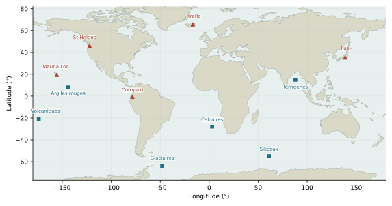
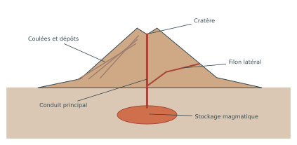
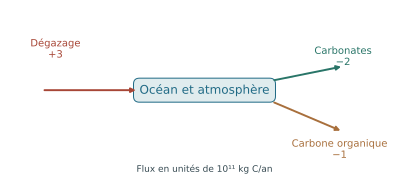
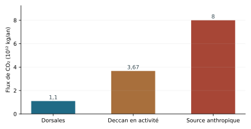

# ENS de Lyon — Second concours, Géosciences 2003 · Corrigé guidé

*Corrigé rédigé par IA, non officiel.*

**Rédaction (tour 1)** · GPT-6.2 Astra Ultra · vitesse non renseignée

Épreuve commune aux ENS Ulm et Lyon. Les 29 consignes des cinq parties sont traitées, y compris les deux séries de reports demandées sur le planisphère. Les flux de carbone élémentaire et de CO₂ sont convertis explicitement. Les données anthropiques employées sont celles du problème de 2003.

## 1. Preuves des mouvements des plaques

### Question 1 — Établir la tectonique des plaques

> [!INDICATION]
> Classer les indices selon ce qu’ils établissent, rapprochement ancien des continents, production de lithosphère, consommation et déplacements actuels.

#### Solution

Les marges d’Afrique et d’Amérique du Sud s’ajustent, surtout au niveau du rebord continental. Des chaînes anciennes, des séries de roches, des fossiles continentaux et des indices paléoclimatiques se prolongent d’un continent à l’autre après reconstitution. Ces observations appuient une ancienne réunion des continents.

La lithosphère océanique porte la preuve de son renouvellement. Les dorsales sont des axes de volcanisme basaltique, à flux thermique élevé et à séismes superficiels. Les bandes d’anomalies magnétiques s’ordonnent symétriquement autour des axes. Les forages montrent que le socle et les premiers sédiments deviennent plus anciens vers les marges. Les plaques s’écartent donc aux dorsales. Aux fosses, les foyers sismiques dessinent un plan plongeant, associé à un arc volcanique et à une plaque froide visible en tomographie. De la lithosphère y retourne dans le manteau. Les mécanismes au foyer des failles transformantes concordent avec les mouvements relatifs entre segments.

Les mesures géodésiques satellitaires déterminent aujourd’hui directement des déplacements de quelques cm/an. Sur les grands domaines peu déformés, les vecteurs sont cohérents avec des rotations de plaques autour de pôles d’Euler. La convergence entre reconstitutions anciennes, enregistrement océanique et cinématique actuelle fonde le modèle.

## 2. Volcanisme et atmosphère

### Question 2.1 — Localiser cinq volcans

> [!INDICATION]
> Choisir des volcans appartenant à plusieurs contextes. Porter leurs repères sur le planisphère commun avec la question 4.1.

#### Solution

**Mauna Loa** (19,5° N, 155,6° O), Hawaï, est un bouclier intraplaque de point chaud. **Krafla** (65,7° N, 16,8° O), en Islande, se situe sur la dorsale médio-atlantique émergée, avec une anomalie mantellique chaude. **Mont Saint Helens** (46,2° N, 122,2° O), aux États-Unis, est un volcan de l’arc des Cascades au-dessus de la subduction de Juan de Fuca. **Cotopaxi** (0,7° S, 78,4° O), en Équateur, relève de l’arc andin au-dessus de Nazca. **Mont Fuji** (35,4° N, 138,7° E), au Japon, appartient à une zone d’arc liée à la convergence et à la subduction de plaques océaniques. Les cinq positions sont portées sur le planisphère.

### Question 2.2 — Tracer une coupe de volcan

> [!INDICATION]
> Distinguer les unités déposées en surface, le système de conduits et la zone de stockage en profondeur.

#### Solution

Sous l’édifice, un système d’alimentation et de stockage contient du magma, souvent mêlé de cristaux. Des conduits et filons amènent le magma vers un cratère principal ou un évent latéral. Les dépôts successifs de lave et de produits fragmentés construisent l’édifice. L’illustration montre un volcan composite schématique. Un vaste volcan bouclier a généralement des pentes plus faibles et une proportion plus importante de coulées.

### Question 2.3 — Décrire la roche du manteau supérieur

> [!INDICATION]
> Distinguer une roche polyminérale de son minéral dominant.

#### Solution

La **péridotite** est une roche ultramafique généralement grenue et sombre à verdâtre. Elle est riche en olivine et comporte des pyroxènes, notamment orthopyroxène et clinopyroxène. Spinelle ou grenat peuvent s’y ajouter selon la pression. O, Mg, Si et Fe dominent. Ca et Al sont présents en proportions moindres. Cette description vise la péridotite du manteau supérieur, dont les phases évoluent avec la profondeur.

### Question 2.4 — Décrire le produit de fusion à la dorsale

> [!INDICATION]
> Suivre le liquide basaltique selon qu’il atteint la surface ou cristallise en profondeur.

#### Solution

La fusion partielle de la péridotite produit un liquide basaltique. Émis au fond de la mer et refroidi rapidement, il forme un **basalte de dorsale**, sombre, à texture microlitique ou vitreuse, souvent en coussins. Le plagioclase et le clinopyroxène dominent dans les portions cristallisées, avec de l’olivine possible et des oxydes de fer et titane. Les éléments majeurs sont O, Si, Al, Mg, Fe, Ca et Na. La cristallisation lente du même type de magma en profondeur forme un gabbro.

### Question 2.5 — Chiffrer le dégazage des dorsales

> [!INDICATION]
> Le pourcentage de carbone porte sur le manteau source. Revenir de la masse de croûte à la masse de manteau fondue partiellement.

#### Solution

Produire $6\times10^{13}$ kg de croûte par an avec une fraction fondue de 0,10 requiert $6\times10^{14}$ kg/an de source. À 0,05 % de carbone, le carbone mobilisé est $6\times10^{14}\times0,0005=3,0\times10^{11}$ kg C/an. Si tout passe dans le liquide puis dans le gaz comme le suppose le sujet, la masse de CO₂ atteint $3,0\times10^{11}\times44/12=\mathbf{1,10\times10^{12}}$ kg CO₂/an. Le liquide représente 10 % de la source et reçoit tout son carbone, soit une teneur effective de 0,5 % avant dégazage.

### Question 2.6 — Décrire l’effet de serre et la chimie de surface

> [!INDICATION]
> Suivre l’énergie solaire absorbée, le rayonnement thermique réémis et le carbone qui s’échange avec les eaux.

#### Solution

Le CO₂ absorbe dans certaines bandes infrarouges émises par la surface et l’atmosphère. L’atmosphère réémet dans toutes les directions. Lorsque la quantité de CO₂ augmente, l’altitude effective d’émission monte dans ces bandes et, à température initiale donnée, la Terre perd moins d’énergie vers l’espace. Surface et basse atmosphère se réchauffent jusqu’à retrouver un bilan radiatif. Le CO₂ dissous dans l’eau participe aussi aux équilibres CO₂–bicarbonate–carbonate. À alcalinité comparable, l’addition de CO₂ abaisse le pH et modifie la saturation vis-à-vis des carbonates.

## 3. Altération de la croûte

### Question 3.1 — Distinguer altération et érosion

> [!INDICATION]
> Repérer successivement la modification sur place et l’enlèvement des produits.

#### Solution

La fragmentation par gel, variations thermiques, décompression, racines et abrasion augmente la surface exposée. Dissolution, hydrolyse, hydratation et oxydoréduction transforment les minéraux et libèrent des ions. L’érosion enlève ensuite matériaux et solutés par ruissellement, rivières, glaciers, vent ou mouvements de versant. Un fragment peut s’altérer avant, pendant ou après son transport.

### Question 3.2 — Situer les intensités maximales

> [!INDICATION]
> L’export mécanique et la vitesse des réactions chimiques ont-ils les mêmes facteurs limitants ?

#### Solution

L’érosion mécanique peut être particulièrement intense dans les chaînes à forts reliefs, soulèvement rapide, crues et glissements de terrain, par exemple dans l’Himalaya ou à Taïwan. Les glaciers peuvent également éroder fortement. L’altération chimique est favorisée en milieu chaud et humide lorsque de l’eau circule au contact de minéraux réactifs. Les bassins tropicaux sur matériaux volcaniques récents peuvent avoir de forts flux dissous. Le maximum dépend de la lithologie, du drainage et du renouvellement des surfaces, et ne se déduit pas de la seule latitude.

### Question 3.3 — Citer un produit minéral d’altération

> [!INDICATION]
> Chercher un minéral secondaire formé à partir de feldspaths.

#### Solution

La **kaolinite** est un minéral argileux qui peut se former par hydrolyse de feldspaths sous l’action de l’eau dans des milieux où une partie des cations et de la silice est exportée.

### Question 3.4a — Comparer les lithologies

> [!INDICATION]
> Comparer chaque flux par unité de surface à celui de la Bretagne avant de déduire une tendance.

#### Solution

Les bassins volcaniques basiques d’Islande et de La Réunion donnent 44 000 et 88 000 kg CO₂/(km²·an), contre 12 000 dans le bassin breton sur socle surtout granito-métamorphique. Les rapports sont 3,7 et 7,3. Dans ces exemples, les bassins basaltiques ont une consommation surfacique supérieure, compatible avec une altération rapide de minéraux ferro-magnésiens et plagioclases. Ce sont des flux de bassins naturels. Climat, relief, âge du substrat et débit empêchent d’en faire une mesure de réactivité intrinsèque à conditions identiques.

### Question 3.4b — Comparer les deux îles basaltiques

> [!INDICATION]
> Garder la lithologie approximativement comparable. Quelle autre variable que la température peut changer entre les deux îles ?

#### Solution

La Réunion, chaude, présente un flux environ double de celui de l’Islande froide pour une lithologie globalement basaltique. Cette comparaison est compatible avec une accélération des réactions d’altération lorsque la température augmente. L’écoulement, la surface de roche fraîche et le climat pluviométrique peuvent également contribuer. Deux sites ne déterminent pas une loi quantitative de température.

### Question 3.4c — Intégrer sur les terres émergées

> [!INDICATION]
> La dernière ligne du tableau est la moyenne applicable et seule la fraction continentale de la sphère convient.

#### Solution

$4\pi R^2=4\pi(6\,371)^2\simeq5,10\times10^8$ km². En adoptant la fraction émergée usuelle, environ 29 %, on obtient $S_{\rm terres}\simeq1,48\times10^8$ km². La consommation est donc $8\,400\times1,48\times10^8\simeq\mathbf{1,24\times10^{12}}$ kg CO₂/an. Avec 30 % de terres, on trouve $1,29\times10^{12}$. La moyenne mondiale fournie inclut de nombreux bassins absents du tableau.

### Question 3.5 — Construire une rétroaction de long terme

> [!INDICATION]
> Quel serait l’effet d’un réchauffement favorable à l’altération des silicates sur le CO₂ ?

#### Solution

Si le climat se réchauffe et le cycle de l’eau s’intensifie, l’altération des silicates peut augmenter. Elle exporte davantage de bicarbonate, et l’enfouissement ultérieur de carbonates contribue à retirer durablement du carbone de l’ensemble océan–atmosphère. La baisse du CO₂ atténue alors le réchauffement. Si l’altération ralentit, le dégazage peut au contraire reconstituer le réservoir. La rétroaction agit à l’échelle géologique et dépend de l’apport de roche altérable, de l’eau et du relief.

## 4. Enfouissement sédimentaire

### Question 4.1 — Placer les principaux sédiments océaniques

> [!INDICATION]
> Associer chaque dépôt à sa provenance, à la productivité biologique et aux conditions de préservation.

#### Solution

Le planisphère de 2.1 porte six exemples. Les **terrigènes** s’accumulent devant les grands fleuves, tel le cône du Bengale. Les **boues calcaires** dominent sur des fonds assez élevés de l’Atlantique, par exemple la ride de Walvis, où se préservent foraminifères et coccolithes. Les **boues siliceuses** sont fréquentes dans les zones productives comme l’océan Austral, riches en diatomées. Les **argiles rouges** occupent des plaines abyssales du Pacifique central, loin des marges et souvent sous la profondeur de compensation des carbonates. Les **dépôts glaciaires** bordent notamment l’Antarctique, et des **dépôts volcaniques** s’accumulent à proximité des arcs et îles, comme aux Tonga. Les constituants authigènes, par exemple les nodules manganésifères du Pacifique abyssal, se forment sur place. Ces provinces peuvent contenir des assemblages mixtes.

### Question 4.2 — Équilibrer la précipitation de calcite

> [!INDICATION]
> Imposer conservation de Ca, C, H, O et de la charge électrique.

#### Solution

$\mathrm{Ca^{2+}+2\,HCO_3^-\longrightarrow CaCO_3(s)+CO_2+H_2O}$. Les deux charges négatives du bicarbonate compensent le calcium. Une mole de carbonate solide fixe un carbone et la réaction libère une mole de CO₂. Les deux atomes de carbone initiaux sont conservés.

### Question 4.3 — Localiser la calcification

> [!INDICATION]
> Distinguer le lieu où se forme un test de l’endroit où il se dépose après la mort.

#### Solution

La calcite précipite dans les tests de nombreux foraminifères et les plaques des coccolithophoridés, souvent dans les eaux superficielles pour les formes planctoniques, ou au fond pour les formes benthiques. Mollusques et autres organismes calcifiants participent sur les plates-formes. Une précipitation inorganique peut aussi intervenir dans des eaux sursaturées, par exemple aux Bahamas. Les fragments produits en surface peuvent ensuite sédimenter et se conserver au fond au-dessus de la profondeur de compensation.

### Question 4.4 — Comparer deux flux de carbone

> [!INDICATION]
> Les deux flux du sujet n’ont pas la même unité de masse chimique. Mettre d’abord les deux en kg C/an.

#### Solution

Le flux volcanique de 2.5 contient $3\times10^{11}$ kg C/an, contre un enfouissement carbonaté net de $2\times10^{11}$ kg C/an. Ce puits représente environ **deux tiers** du dégazage, qui lui est 1,5 fois supérieur. Équivalent en CO₂, le puits vaut environ $7,33\times10^{11}$ kg CO₂/an. Les signes sont opposés pour le réservoir océan–atmosphère.

### Question 4.5 — Écrire le bilan de la photosynthèse

> [!INDICATION]
> Représenter la matière organique par une unité générique CH₂O.

#### Solution

Le bilan simplifié est $\mathrm{CO_2+H_2O\longrightarrow (CH_2O)+O_2}$ en présence de lumière. Le carbone minéral du CO₂ est réduit et stocké dans la matière organique, tandis que l’eau fournit les électrons dans la photosynthèse oxygénique.

### Question 4.6 — Retrouver le devenir de la production primaire

> [!INDICATION]
> Le flux net enfoui ne représente qu’une petite fraction de la production brute.

#### Solution

La majorité de la matière organique est consommée, respirée, décomposée puis reminéralisée, dans les sols, les eaux et les sédiments superficiels. Son carbone retourne surtout sous forme de CO₂ ou de carbone inorganique dissous. Une partie peut transiter par le méthane dans des milieux réducteurs. Seule une petite fraction échappe assez longtemps à ces processus pour être enfouie, ici environ $10^{11}$ kg C/an.

### Question 4.7 — Identifier les roches riches en matière organique

> [!INDICATION]
> Associer production, faible oxydation et bassin où les dépôts peuvent être conservés.

#### Solution

La matière végétale accumulée en zones marécageuses peut former tourbe puis lignite et charbon après enfouissement. Des dépôts fins riches en matière organique peuvent donner des roches mères à kérogène, dont la maturation génère pétrole et gaz. Des bassins subsidents, deltas et milieux marins appauvris en oxygène favorisent la préservation. Les bassins houillers du Carbonifère d’Europe offrent un exemple. Ces conditions ne sont pas limitées à une période ou à un seul contexte tectonique.

### Question 4.8 — Fermer le bilan océan–atmosphère

> [!INDICATION]
> Choisir la frontière du système. Le transfert de carbone de l’air à l’eau est-il une perte pour la somme des deux ?

#### Solution

En kg C/an, le dégazage apporte $3\times10^{11}$ au système. Les enfouissements carbonaté et organique retirent $2\times10^{11}+1\times10^{11}=3\times10^{11}$. Le bilan net simplifié est donc voisin de **zéro**. L’altération transporte du carbone atmosphérique sous forme de bicarbonate vers l’océan, puis favorise son enfouissement. On ne retranche pas une seconde fois ce transfert interne au réservoir commun. L’équilibre de flux maintient approximativement le stock combiné. Une concentration atmosphérique stationnaire suppose aussi un partage air–océan et des conditions climatiques relativement stables.

## 5. Activités humaines et Deccan

### Question 5.1 — Expliquer l’horloge du radiocarbone

> [!INDICATION]
> Définir le moment où cessent les échanges avec le réservoir de référence.

#### Solution

Le ¹⁴C formé dans l’atmosphère entre dans le CO₂ et dans la matière vivante. Tant que le carbone de l’organisme est renouvelé, son rapport isotopique suit celui de la source. Après la mort, si le système est fermé, le ¹⁴C décroît selon $N=N_0\,2^{-t/5730}$. Une comparaison à une référence corrigée et calibrée donne un âge. Les variations passées du ¹⁴C atmosphérique et les effets réservoir des eaux doivent être pris en compte.

### Question 5.2 — Appliquer la demi-vie aux combustibles fossiles

> [!INDICATION]
> Comparer leur âge géologique à quelques dizaines de milliers d’années.

#### Solution

Le charbon, le pétrole et le gaz naturel usuels ont des âges de millions d’années. Leur ¹⁴C initial a presque entièrement disparu après un très grand nombre de demi-vies. Leur rapport ¹⁴C/carbone total est donc pratiquement nul pour ce bilan, même s’ils contiennent beaucoup de carbone stable.

### Question 5.3 — Exploiter la dilution atmosphérique

> [!INDICATION]
> Qu’arrive-t-il au rapport si l’on ajoute du carbone quasiment dépourvu de ¹⁴C ?

#### Solution

Le CO₂ fossile augmente la masse de carbone stable du réservoir sans ajouter de quantité comparable de ¹⁴C. Le rapport atmosphérique diminue par dilution. Dans un mélange idéal fermé de masse initiale $M$ et rapport $R_0$, une addition $F$ sans ¹⁴C donne approximativement $R=R_0 M/(M+F)$. La variation sur un intervalle connu renseigne sur le flux fossile. Une estimation réelle demande de modéliser les échanges avec océans et biosphère, le fond naturel et les perturbations de la production ou de l’inventaire atmosphérique de radiocarbone.

### Question 5.4 — Calculer l’augmentation annuelle du stock

> [!INDICATION]
> Le sujet exprime le flux en masse de CO₂ et demande le gain de carbone élémentaire.

#### Solution

Si les flux naturels précédents restent équilibrés, le gain du système océan–atmosphère est le flux imposé, $8\times10^{12}$ kg CO₂/an. En carbone, $8\times10^{12}\times12/44=\mathbf{2,18\times10^{12}}$ kg C/an. Il s’agit de la valeur de l’énoncé de 2003 et du réservoir combiné. Le partage futur entre atmosphère et océan est une question distincte.

### Question 5.5 — Comparer à l’activité volcanique de référence

> [!INDICATION]
> Vérifier si l’on compare des flux bruts ou le supplément d’une source déjà présente.

#### Solution

Le flux anthropique donné vaut $8\times10^{12}/1,10\times10^{12}=7,27$ fois le flux volcanique ordinaire. Un volcanisme émettant **7,3 fois** le flux normal fournirait le même flux brut que la source anthropique. Pour que **le supplément volcanique** au-dessus du bilan naturel initial produise exactement le même effet net, le flux volcanique total devrait atteindre $1+7,27=8,27$ fois le flux normal, si les puits restent inchangés.

### Question 5.6 — Dater le début et la fin des épanchements

> [!INDICATION]
> Une durée requiert deux bornes ou plusieurs niveaux régulièrement espacés dans une série.

#### Solution

On peut comparer des âges ⁴⁰Ar/³⁹Ar de coulées de la base et du sommet, ou dater par U–Pb des zircons de niveaux intercalés. Le rapport parent–fils évolue suivant la désintégration radioactive depuis la fermeture du système. La différence des âges encadre le temps écoulé, avec ses incertitudes et ses hiatus. Une méthode complémentaire est la magnétostratigraphie. L’aimantation rémanente des coulées fixe la polarité du champ à leur refroidissement. La succession des polarités se corrèle à une échelle de référence, donnant des bornes indépendantes de la datation isotopique de chaque coulée. Des sédiments intercalés documentent aussi les interruptions.

### Question 5.7 — Chiffrer le flux moyen du Deccan

> [!INDICATION]
> La teneur calculée en 2.5 s’applique au liquide avant dégazage. Distinguer temps cumulé d’éruption et durée géologique totale.

#### Solution

La production de lave vaut $10^{19}/(5\times10^4)=2,0\times10^{14}$ kg/an durant les années d’activité. Avec la teneur du liquide déduite de 2.5, $0,05\,\%/0,10=0,5\,\%$ de C, le flux est $1,0\times10^{12}$ kg C/an, soit **$3,67\times10^{12}$ kg CO₂/an**. Il représente environ 3,3 fois le dégazage volcanique de référence et 46 % du flux anthropique donné. Le volume de lave permet donc un dégazage exceptionnel, potentiellement important pour le climat. Le calcul suppose transfert et dégazage intégraux et porte sur 50 000 années cumulées d’éruption. Une durée calendaire totale incluant des pauses donnerait une moyenne plus faible.

