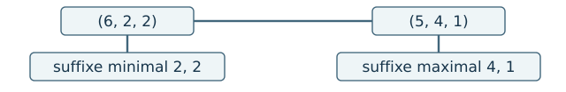
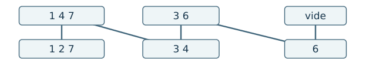

# ENS de Lyon · Second concours · Informatique 2003 — corrigé brut

*Corrigé rédigé par IA, non officiel. Signalez toute erreur.*

**Rédaction** · GPT-6.2 Astra Ultra · vitesse non renseignée · 25 novembre 2026

**Révision** · GPT-6.2 Astra Ultra · vitesse non renseignée · 26 novembre 2026

Une composition est une suite d’entiers strictement positifs de somme n. Une partition impose en plus que ses parts soient décroissantes au sens large. Toutes les listes de cette correction vont de la plus grande à la plus petite pour l’ordre lexicographique.

## Partie 1. Compositions

### Question 1.1 · Coupures et dénombrement

**1.** En écrivant sans virgules les parts (ici à un seul chiffre), on obtient dans l’ordre demandé

```text
5, 41, 32, 311, 23, 221, 212, 2111,
14, 131, 122, 1211, 113, 1121, 1112, 11111.
```

**2–3.** Aligner $n$ unités. Chacune des $n-1$ séparations peut être marquée pour ouvrir une nouvelle part. Les compositions de longueur $k$ correspondent bijectivement aux choix de $k-1$ séparations, soit $\binom{n-1}{k-1}$ si $1\le k\le n$, zéro sinon. Sans contrainte de longueur, les $n-1$ choix binaires donnent $2^{n-1}$ compositions.

### Question 1.2 · Successeur d’une composition

**1–2.** Soit $j$ le dernier indice tel que $p_j>1$ et $t$ le nombre de 1 qui le suivent. Le successeur conserve le préfixe jusqu’à $j-1$, puis porte $p_j-1,t+1$. À droite de $j$, aucun terme ne peut diminuer. Au pivot on descend d’une seule unité, et la plus grande queue de somme $t+1$ est celle d’une seule part. Avec un tableau de capacité $n$ et une longueur active $k$ (indices depuis 1), on obtient le programme suivant.

```text
j ← k
tant que j > 0 et p[j] = 1 : j ← j − 1
si j = 0 : renvoyer FIN
p[j] ← p[j] − 1
p[j+1] ← k−j+1
renvoyer la longueur j+1
```

**3.** Commencer en $(n)$ puis répéter. Si l’on écrit toutes les parts, les longueurs totalisent $(n+1)2^{n-2}$ pour $n\ge2$. Chaque composition contribue 1, et chaque coupure est présente dans la moitié des compositions. Recherche et écriture coûtent donc ensemble $\Theta(n2^{n-1})$. Pour $n=1$, une seule sortie de longueur 1.

## Partie 2. Partitions

### Question 2.1 · Successeur sans contrainte de longueur

**1.** Les quinze partitions de 7, en notation compacte des parts successives, sont

```text
7, 61, 52, 511, 43, 421, 4111, 331, 322, 3211,
31111, 2221, 22111, 211111, 1111111.
```

**2–3.** Au dernier indice $j$ de part $>1$, poser $d=p_j-1$ et $R=k-j+1$. Conserver le préfixe, écrire $d$, puis remplir la queue, de somme $R$, avec les plus grandes parts autorisées par $d$. Cela donne $\lfloor R/d\rfloor$ parts $d$ et éventuellement la part $R\bmod d$. La décision au pivot est la plus tardive possible et cette fin est maximale à chaque position.

```text
j ← dernier indice de part supérieure à 1
si j est absent : renvoyer FIN
d ← p[j] − 1 ; R ← k−j+1 ; p[j] ← d
tant que R > 0 :
    u ← min(d,R)
    j ← j+1 ; p[j] ← u ; R ← R−u
renvoyer j
```

La recherche du pivot et les écritures coûtent $O(n)$ au pire, en mémoire auxiliaire $O(1)$ avec le tableau déjà alloué. La partition $(2,1,\ldots,1)$ atteint l’ordre linéaire.

### Question 2.2 · Longueur fixée

**1.** Pour $1\le k\le n$, écrire $n=kq+r$, $0\le r<k$. La dernière partition a $r$ parts $q+1$ suivies de $k-r$ parts $q$. Si les extrêmes diffèrent d’au moins deux, transférer une unité du dernier exemplaire du maximum au premier exemplaire du minimum conserve la décroissance et diminue la partition. La seule partition sans un tel écart est la forme équilibrée affichée.

**2.** Parcourir de droite à gauche les indices $j<k$. Poser $h=k-j$, $d=p_j-1$ et $S=1+\sum_{t>j}p_t$. Retenir le premier indice tel que $d\ge1$ et $h\le S\le hd$. Le test caractérise exactement la possibilité de placer $S$ dans $h$ parts entre 1 et $d$. Une diminution plus forte au même pivot diminuerait encore le plafond et augmenterait la masse. Conserver le préfixe et écrire $d$, puis, tant que $h>0$, choisir $u=\min(d,S-h+1)$ et actualiser $(S,h,d)\gets(S-u,h-1,u)$. Cette construction maximise chaque part en réservant une unité par place restante. Elle produit le successeur immédiat.



## Partie 3. Tableaux de Young

### Question 3.1 · Insérer un élément

**1.** Dans chaque ligne, remplacer le premier élément $y>x$ par $x$, puis insérer $y$ une ligne plus bas. À défaut de tel élément, ajouter $x$ en bout de ligne et arrêter. La ligne reste strictement croissante. Si $y$ vient de la colonne $j$, la prochaine position $c$ vérifie $c\le j$ car l’ancienne valeur située sous $y$, si elle existe, lui était supérieure. Au-dessus de $c<j$ on lit donc un ancien prédécesseur de $y$, et au-dessus de $c=j$ son remplaçant plus petit. La case du dessous, si elle existe, garde une valeur supérieure après diminution. La case ajoutée possède une voisine supérieure dès qu’elle n’est pas en première ligne, au sens où cette voisine existe et contient une valeur plus petite. La forme reste une partition. La ligne traitée augmente à chaque déplacement et une seule case est créée.

**2.** Les lignes sont des listes extensibles et les indices commencent à 1.

```text
r ← 1
répéter :
    si r dépasse le nombre de lignes : ajouter une ligne vide
    c ← premier indice de la ligne r dont la valeur dépasse x
    si c est absent : ajouter x à la fin de la ligne r ; terminer
    échanger x et tableau[r][c]
    r ← r+1
```



### Question 3.2 · Supprimer une valeur quelconque

**1–2.** Localiser la valeur, vider sa case puis faire remonter le plus petit des voisins à droite et en dessous. La valeur déplacée dépasse les voisins du haut et de gauche par l’ordre initial et l’invariant du trou. Elle est inférieure à l’autre candidat. L’ordre est restauré autour de son ancienne destination et le trou se déplace vers le sud ou l’est. Son point d’arrêt est un coin amovible de la forme.

```text
chercher la case (r,c) de x ; si elle est absente, signaler absent
tant qu’il existe un voisin droit ou bas en (r,c) :
    choisir (s,t), voisin existant de plus petite valeur
    tableau[r][c] ← tableau[s][t]
    (r,c) ← (s,t)
retirer la dernière case de la ligne r
si la ligne est vide : retirer cette dernière ligne
```

### Question 3.3 · Extraire le minimum et trier

**1.** Le coin supérieur gauche est le minimum, car toute case est accessible depuis ce coin par un chemin vers la droite et le bas. Mémoriser sa valeur puis y démarrer la procédure du trou de 3.2 en sautant la recherche.

**2.** Insérer toutes les clés distinctes du tableau à trier dans un tableau de Young vide, puis extraire le minimum jusqu’à épuisement. Chaque extraction écrit dans la sortie la plus petite clé restante. Pour trier aussi des doublons, utiliser des couples (valeur, indice initial) en ordre lexicographique puis oublier l’indice.

### Question 3.4 · Combien de tableaux standard ?

**1.** Le maximum $n$ occupe un coin amovible car une case à droite ou en dessous porterait une valeur supérieure. Le retirer donne un tableau standard plus petit. Réciproquement, on peut replacer $n$ en ce coin sans modifier l’ordre. En sommant ces bijections disjointes on obtient $f(p)=\sum_j f(p-e_j)$ avec les conventions de nullité et $f(\varnothing)=1$.

**2.** Poser $D=k(k-1)/2$, degré de $\Delta$. Le polynôme $g=\sum_j x_j\Delta(x+ye_j)$ est alterné en $x$. Il est donc divisible par chacun des facteurs $x_i-x_j$ et par leur produit $\Delta$. Le quotient est homogène de degré 1 et symétrique en $x$, de la forme $a\sum x_j+b y$. À $y=0$ on trouve $a=1$. Le coefficient de $y$ dans $g$ vaut $\sum_j x_j\partial_j\Delta=D\Delta$ par homogénéité, d’où $b=D$.

**3.** Écrire $x_j=p_j+k-j$. L’expression proposée est $F(p)=n!\Delta(x)/\prod_j x_j!$. Pour la forme vide, $x=(k-1,\ldots,0)$ et $\Delta(x)=\prod_{j=0}^{k-1}j!$, donc $F=1$. Dans la somme des prédécesseurs, mettre en facteur $(n-1)!/\prod_jx_j!$. Il reste $\sum_j x_j\Delta(x-e_j)=(\sum x_j-D)\Delta(x)=n\Delta(x)$ par 3.4.2 à $y=-1$. Les retraits interdits produisent soit deux $x_j$ égaux après décrément, soit le facteur zéro $x_k=0$. L’expression vérifie ainsi la même récurrence et la même valeur initiale que $f$. Cela démontre la formule.

Pour la forme $(3,2)$, les coordonnées décalées sont $(4,2)$ et le déterminant vaut $4-2=2$. La formule donne $5!\,2/(4!\,2!)=5$. La récurrence donne aussi $f(2,2)+f(3,1)=2+3=5$. Ce contrôle explique le rôle du décalage avant de prendre le déterminant.
