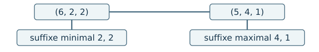
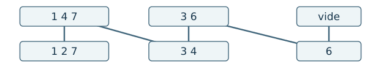

# ENS de Lyon · Second concours · Informatique 2003 — corrigé guidé

*Corrigé rédigé par IA, non officiel. Signalez toute erreur.*

**Rédaction** · GPT-6.2 Astra Ultra · vitesse non renseignée · 25 novembre 2026

**Révision** · GPT-6.2 Astra Ultra · vitesse non renseignée · 26 novembre 2026

L’ordre est décidé dès la première part qui diffère. Pour trouver un successeur, on peut donc chercher le préfixe le plus long qu’il est possible de conserver. Dans un tableau de Young, l’argument analogue consiste à déterminer quelles cases peuvent changer sans modifier l’ordre des voisines.

## Partie 1. Compositions

### Question 1.1 · Coupures et dénombrement

**1.** Fixer d’abord la première part et lister dans le même ordre toutes les fins possibles. Avec une première part 5, puis 4, puis 3, les groupes sont $(5)$, $(4,1)$, $(3,2),(3,1,1)$. Avec 2 viennent $(2,3),(2,2,1),(2,1,2),(2,1,1,1)$. Avec 1 viennent $(1,4),(1,3,1),(1,2,2),(1,2,1,1),(1,1,3),(1,1,2,1),(1,1,1,2),(1,1,1,1,1)$.

**2–3.** Une composition de 5 comme $(2,1,2)$ se lit $11|1|11$. Elle est déterminée par deux coupures entre les cinq unités. Le raisonnement donne $\binom{n-1}{k-1}$ compositions de longueur $k$, nulle hors de $1\le k\le n$. Laisser libre le nombre de coupures revient à choisir pour chaque intervalle si on le barre. On retrouve $2^{n-1}$ au total, donc bien 16 pour $n=5$.

### Question 1.2 · Successeur d’une composition

**1.** Dans $(2,2,1)$, diminuer le dernier 1 est impossible. Diminuer le dernier 2 libère une unité qui, jointe au 1 final, forme la plus grande part restante. Le résultat est $(2,1,2)$. En général, repérer le dernier $p_j\ge2$, le diminuer de 1 et concentrer tous les 1 terminaux avec l’unité libérée dans la part $k-j+1$. Conserver davantage de préfixe serait impossible, et toute autre répartition du suffixe serait plus petite.

**2.** Allouer un tableau de $n$ cases et conserver à part le nombre $k$ de cases occupées. L’opération suivante modifie ce tableau en place.

```text
t ← 0
tant que t < k et p[k−t] = 1 : t ← t+1
si t = k : signaler la fin
sinon :
    j ← k−t
    diminuer p[j] de 1
    écrire t+1 en case j+1
    k ← j+1
```

**3.** Préciser le coût de sortie. Afficher chaque composition exige autant d’écritures que de parts. Une coupure donnée figure dans $2^{n-2}$ compositions pour $n\ge2$. Ajouter une première part par composition donne $2^{n-1}+(n-1)2^{n-2}$ écritures. La recherche du pivot ne dépasse jamais la longueur courante. Le temps total avec affichage est ainsi $\Theta(n2^{n-1})$, avec $O(n)$ cases de travail.

## Partie 2. Partitions

### Question 2.1 · Successeur sans contrainte de longueur

**1.** Grouper par première part donne les quinze sorties suivantes. Les chiffres d’un même groupe de parts forment une partition, ainsi $421=(4,2,1)$.

```text
7
61
52, 511
43, 421, 4111
331, 322, 3211, 31111
2221, 22111, 211111
1111111
```

**2.** Après $(4,1,1,1)$, il reste à répartir 4 unités derrière le nouveau pivot 3. La meilleure queue est $(3,1)$. En général, les 1 terminaux ne peuvent servir de pivot. Diminuer de 1 la dernière part $>1$ et répartir la masse libérée derrière elle. On ne doit jamais dépasser la nouvelle part $d$. Prendre $d$ autant de fois que possible, puis le reste positif éventuel, maximise la queue.

**3.** Avec $p[1..k]$ placé dans un tableau de capacité $n$, appliquer la procédure suivante.

```text
chercher j depuis k vers 1 jusqu’à p[j] > 1
si aucun j ne convient : terminer
reste ← 1 + (k−j)
d ← p[j]−1 ; p[j] ← d ; k ← j
tant que reste > 0 :
    valeur ← min(d,reste)
    k ← k+1 ; p[k] ← valeur
    reste ← reste−valeur
```

On effectue au plus $n$ lectures puis $n$ écritures. Une suite de 1 après le pivot peut imposer un temps proportionnel à $n$ et le tableau est réutilisé en place.

### Question 2.2 · Longueur fixée

**1.** Le dernier élément est le minimum dans l’ordre considéré. Avec une différence d’au moins deux entre la plus grande et la plus petite part, on peut rapprocher ces extrêmes d’une unité en diminuant le dernier maximum et en augmentant le premier minimum. La somme et la longueur restent fixes, la partition diminue strictement. Tout minimum est donc équilibré. La division $n=kq+r$ fixe alors uniquement les $r$ parts $q+1$ suivies des $k-r$ parts $q$.

**2.** Pour $n=10$ et $k=3$, essayer de diminuer la deuxième part de $(6,2,2)$ échoue, car il faudrait placer 3 après 1. Au pivot précédent, diminuer 6 en 5 laisse au contraire une queue possible.



Pour chaque pivot $j$ en remontant depuis $k-1$, calculer le plafond $d=p_j-1$, le nombre $h=k-j$ de places et la somme à placer $S=1+\sum_{t>j}p_t$. La capacité des places est $hd$, le minimum nécessaire est $h$. Choisir le premier pivot où $h\le S\le hd$ et $d\ge1$. Un pivot qui échoue ne pourrait réussir en diminuant la part davantage. Après avoir écrit $d$, prendre pour part suivante $\min(d,S-h+1)$, le plus grand choix laissant $h-1$ unités au moins. Recalculer plafond, somme et nombre de places puis recommencer. Si le plafond a été atteint, le reste tient encore dans les places disponibles. Sinon, il ne reste que des 1. Ce remplissage et le choix du pivot prouvent qu’aucune partition ne s’intercale.

## Partie 3. Tableaux de Young

### Question 3.1 · Insérer un élément

**1.** Suivre la valeur chassée, plutôt que le numéro de la ligne. Une valeur $y$ délogée en colonne $j$ vient d’être remplacée par plus petit. En dessous, tout élément déjà présent en colonne $j$ était plus grand que $y$. On remplace donc en colonne $c\le j$, ou on ajoute dans une colonne $c\le j$ si cette ligne était plus courte. La case du dessus contient soit le remplaçant de $y$, soit un élément à gauche de son ancienne position. Dans les deux cas elle est plus petite que $y$. Le voisin du dessous reste plus grand et le choix du premier élément supérieur garantit l’ordre de la ligne. Quand on ajoute une case, la ligne précédente est assez longue. Une ligne vide accepte toujours la valeur portée, ce qui assure la terminaison et l’augmentation de taille d’une unité.



**2.** Représenter le tableau par ses lignes successives. Le programme reçoit une valeur absente du tableau.

```text
pour chaque ligne L depuis le haut :
    chercher de gauche à droite le premier j avec L[j] > x
    si ce j n’existe pas : ajouter x en fin de L et terminer
    y ← L[j] ; L[j] ← x ; x ← y
ajouter la nouvelle ligne [x] en bas
```

### Question 3.2 · Supprimer une valeur quelconque

**1.** Vider la case visée. Si deux voisins peuvent la remplir, choisir le plus petit, sinon le plus grand passerait devant le plus petit. Chaque valeur ainsi déplacée était à droite ou plus bas que les anciens prédécesseurs du trou. Elle est donc supérieure à ces prédécesseurs, et inférieure à l’autre candidat éventuel. La seule irrégularité restante est le nouveau trou. Sa distance au coin inférieur droit décroît à chaque mouvement du parcours. Au moment de retirer la case vide, il n’existe ni case à droite ni case au-dessous, ce qui préserve la forme.

**2.** Pour un tableau stocké ligne par ligne, une version avec un seul emplacement courant est

```text
position ← chercher x dans les lignes
si la recherche échoue : signaler absent
répéter :
    voisins ← cases existantes à droite et au-dessous de position
    si voisins est vide : sortir de la boucle
    suivante ← position du minimum de ces voisins
    copier la valeur de suivante vers position
    position ← suivante
raccourcir de 1 la ligne de position
retirer la ligne si elle est devenue vide
```

### Question 3.3 · Extraire le minimum et trier

**1.** Toute case autre que la première a un prédécesseur plus petit, en haut ou à gauche. Pour extraire le minimum, lire la première case et appliquer à cette position le glissement de la question 3.2. La valeur mémorisée est le résultat de l’extraction.

**2.** En première phase, construire un tableau vide puis appeler l’insertion pour chaque donnée. En seconde phase, répéter « enregistrer le minimum et l’extraire ». Entre deux tours, l’ensemble des cases est exactement celui des clés encore à sortir. Cette propriété donne le tri croissant par récurrence. La définition impose des clés distinctes. Une étiquette d’origine comme second champ permet aussi de distinguer deux clés de même valeur.

### Question 3.4 · Combien de tableaux standard ?

**1.** Où écrire le plus grand nombre ? Il ne peut avoir aucun successeur en bas ni à droite. Chaque coin extérieur fournit donc une famille de tableaux, en bijection par effacement avec les tableaux standard de la forme amputée de ce coin. Les familles sont disjointes. On obtient la somme des $f(p-e_j)$, les formes interdites comptant pour zéro.

**2.** Échanger deux $x_i$ permute les termes de la somme définissant $g$ et en change le signe par le déterminant. Ainsi $g$ s’annule dès que deux $x_i$ coïncident. Les facteurs linéaires distincts $x_i-x_j$ divisent donc tous $g$, et leur produit aussi. Diviser par $\Delta$ donne un polynôme symétrique en $x$, de degré total 1 car $\Delta$ est homogène de degré $D=\binom{k}{2}$. Il ne reste à identifier que deux coefficients. En $y=0$, le quotient vaut $\sum x_i$. En dérivant en $y$ puis en posant $y=0$, on obtient $\sum x_i\partial_i\Delta=D\Delta$, identité qui se vérifie sur chaque monôme de degré $D$. D’où $g=(\sum x_i+Dy)\Delta$.

**3.** Ajouter $k-j$ à la $j$-ième part transforme la décroissance large en décroissance stricte pour $x_j=p_j+k-j$. Une suppression interdite de case correspond alors à une collision entre deux $x_j$ ou à la tentative de décrémenter zéro. Tester la formule candidate $F=n!\Delta(x)/(x_1!\cdots x_k!)$ dans la récurrence. À chaque retrait autorisé, la factorielle manquante apporte le facteur $x_j$. La somme des numérateurs, après mise en facteur de $(n-1)!/\prod_jx_j!$, devient $g(x,-1)$. Les retraits interdits y valent zéro pour les raisons précédentes. Or $\sum x_j=n+D$, donc $g(x,-1)=n\Delta(x)$ et la récurrence redonne $F$. Au départ, le tableau vide, éventuellement complété de lignes de longueur zéro, donne $x=(k-1,\ldots,0)$ et le produit des écarts vaut $\prod_{t=0}^{k-1}t!$. La valeur initiale est 1. La récurrence établit la formule à toute taille.

Pour la forme $(3,2)$, les coordonnées décalées sont $(4,2)$ et le déterminant vaut $4-2=2$. La formule donne $5!\,2/(4!\,2!)=5$. La récurrence donne aussi $f(2,2)+f(3,1)=2+3=5$. Ce contrôle explique le rôle du décalage avant de prendre le déterminant.
