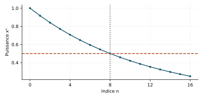

# ENS Ulm et Lyon — Mathématiques du second concours 2003 · Corrigé guidé

*Corrigé rédigé par IA, non officiel. Signalez toute erreur.*

**Rédaction** · GPT-6.2 Astra Ultra · vitesse non renseignée · 25 novembre 2026

**Révision** · GPT-6.2 Astra Ultra · vitesse non renseignée · 26 novembre 2026

Le premier problème décrit des solutions polynomiales d’une équation aux dérivées partielles. Les deux suivants relient la sommation de Cesàro, la limite d’Abel et la convergence d’une série lorsque ses termes sont dominés par une constante divisée par leur rang.

## I. Polynômes symétriques et équation différentielle

### Question I.1.a

> [!INDICATION]
> Sur chaque espace de degré borné, la dérivation est nilpotente.

#### Solution

Si $\lambda=0$, la dérivation a un noyau contenant les constantes et n’est pas inversible. Pour $\lambda\ne0$ et $P$ de degré $d$, posons $B(P)=\sum_{j=0}^d(-1)^j\lambda^{-j-1}P^{(j)}$ et $B(0)=0$. Les termes ultérieurs seraient nuls, de sorte que cette définition est linéaire et ne dépend pas du seuil choisi. Le produit géométrique fini donne $(D+\lambda I)B(P)=P=B(D+\lambda I)(P)$. On obtient donc un inverse sur tous les polynômes.

### Question I.1.b

> [!INDICATION]
> Faire commuter la dérivation avec les puissances de l’inverse.

#### Solution

Posons $B=D+2I$. Comme $DB=BD$, $D$ commute aussi avec $B^{-1}$. Pour $i\ge1$, $P_i'=P_{i-1}$ puisque $P_i=X^i/i!$. On obtient $(D^2+2D)Q_i=DB B^{-i}P_i=B^{-(i-1)}P_{i-1}=Q_{i-1}$. De plus $Q_0=1$.

### Question I.2.a

> [!INDICATION]
> Dans les nouvelles coordonnées, examiner l’effet de la permutation des variables.

#### Solution

Le changement $u=x+y$, $v=x-y$ est linéaire inversible, de sorte que $S$ s’écrit de manière unique comme un polynôme en $u,v$. La symétrie équivaut à l’invariance par $v\mapsto-v$, donc tous les coefficients des puissances impaires de $v$ sont nuls. En multipliant le coefficient de $v^{2i}$ par $(2i)!$, on trouve uniquement les polynômes $R_i$ tels que $S=\sum_{i=0}^n v^{2i}R_i(u)/(2i)!$, avec $R_n\ne0$ et $n$ déterminé.

### Question I.2.b

> [!INDICATION]
> Transformer l’opérateur mixte, puis comparer les coefficients en v.

#### Solution

On a $\partial_x\partial_y=\partial_u^2-\partial_v^2$. Pour $f=e^uS$, l’équation $f_{xy}=f$ devient $S_{uu}+2S_u=S_{vv}$. Les coefficients de $v^{2i}/(2i)!$ donnent $R_i''+2R_i'=R_{i+1}$ avec $R_{n+1}=0$. Le noyau polynomial de $D^2+2D$ est celui de $D$, puisque $D+2I$ est inversible : $R_n$ est donc constante non nulle. Réciproquement ce système implique l’équation initiale. Sur un polynôme de degré $d>0$, $D^2+2D$ abaisse exactement le degré d’une unité. Ainsi $\deg R_i=n-i$. Le degré du terme d’indice $i$ est $n+i$ et le plus haut est $2n$. Le changement de variables linéaire inversible conserve le degré total, d’où $\deg S=2n$.

### Question I.3

> [!INDICATION]
> Une solution particulière se décale d’une ligne grâce à I.1.b et deux solutions diffèrent d’une constante.

#### Solution

Écrivons $R_n=\lambda_0Q_0$ avec $\lambda_0\ne0$. Si $R_{n-j}=\sum_{h=0}^{j}\lambda_hQ_{j-h}$, alors $\sum_{h=0}^{j}\lambda_hQ_{j+1-h}$ est une solution particulière de $(D^2+2D)R_{n-j-1}=R_{n-j}$. Toutes les autres s’en déduisent par ajout d’une constante $\lambda_{j+1}Q_0$. La récurrence donne exactement les lignes de la matrice triangulaire $T$, chaque sous-diagonale étant constante. Réciproquement, ces combinaisons vérifient chaque équation, et $\lambda_0\ne0$ assure $R_n\ne0$.

Si les lignes et les colonnes sont numérotées à partir de zéro, la ligne $j$ représente $R_{n-j}$ dans l’ordre $Q_0,\ldots,Q_n$. Ainsi $T_{jh}=\lambda_{j-h}$ pour $0\le h\le j$ et $T_{jh}=0$ pour $h>j$. Les $\lambda_j$ sont uniques car les $Q_h$, de degrés distincts $h$, sont linéairement indépendants.

## II. Sommation de Cesàro et limite d’Abel

### Question II.1

> [!INDICATION]
> Séparer une moyenne en un début fini et une queue proche de la limite.

#### Solution

Si $s_n\to s$, fixons $N$ tel que $|s_k-s|\le\varepsilon$ pour $k\ge N$. Dans la moyenne de $s_k-s$, le début fini tend vers zéro et le reste est en module au plus $\varepsilon$. Donc $\sigma_n\to s$, et $\mathcal C'\subset\mathcal C$.

### Question II.2.a

> [!INDICATION]
> Calculer les deux sous-suites de sommes partielles.

#### Solution

Pour $a_n=(-1)^n$, $s_{2m}=1$, $s_{2m+1}=0$. La série ne converge pas. En revanche $\sigma_{2m}=(m+1)/(2m+1)$ et $\sigma_{2m+1}=1/2$, donc elle appartient à $\mathcal C$, avec moyenne limite $1/2$.

### Question II.2.b

> [!INDICATION]
> Grouper deux sommes partielles successives.

#### Solution

Pour $a_n=(-1)^nn$, on trouve $s_{2m}=m$ et $s_{2m+1}=-(m+1)$. La série ne converge pas. Chaque paire de sommes partielles $s_{2j}+s_{2j+1}$ vaut $-1$, donc $\sigma_{2m}=0$ et $\sigma_{2m+1}=-(m+1)/(2m+2)=-1/2$. Ces limites distinctes excluent aussi l’appartenance à $\mathcal C$.

### Question II.3.a

> [!INDICATION]
> Reconstituer s par différence de deux moyennes pondérées.

#### Solution

Pour $S\in\mathcal C$, les $\sigma_n$ sont bornés. Donc $\sum(n+1)\sigma_nx^n$ converge absolument pour $|x|<1$. L’identité $s_n=(n+1)\sigma_n-n\sigma_{n-1}$ pour $n\ge1$ donne $s_n=O(n+1)$ ; la série de $s_nx^n$ converge aussi absolument.

### Question II.3.b

> [!INDICATION]
> Prendre encore une différence.

#### Solution

Comme $a_n=s_n-s_{n-1}$ pour $n\ge1$, $a_n=O(n+1)$. Ainsi $\sum a_nx^n$ converge absolument pour $|x|<1$ et son rayon de convergence est au moins $1$.

### Question II.3.c

> [!INDICATION]
> Multiplier les séries de sommes cumulées par 1−x.

#### Solution

Par convergence absolue, $(1-x)g(x)=\sum_ns_nx^n$ grâce à II.3.a, et $(1-x)\sum_ns_nx^n=\sum_na_nx^n$. Les coefficients constants concordent puisque $\sigma_0=s_0=a_0$. D’où $f(x)=(1-x)^2g(x)$.

### Question II.3.d

> [!INDICATION]
> Interpréter le résultat comme une moyenne à poids positifs dont la masse s’éloigne des indices fixes.

#### Solution

Écrivons $\sigma_n\to s$. Pour $0<x<1$, les poids $w_n=(1-x)^2(n+1)x^n$ sont positifs et de somme $1$. Pour tout $N$ fixé, leur somme sur $n<N$ tend vers zéro quand $x\uparrow1$. Ainsi dans $f(x)-s=\sum_n w_n(\sigma_n-s)$, le début fini tend vers zéro et la queue est bornée par $\sup_{n\ge N}|\sigma_n-s|$. En faisant croître $N$, on obtient $f(x)\to s$.

## III. Passage de la limite d’Abel à la convergence

### Question III.1.a

> [!INDICATION]
> Développer le polynôme sans terme constant dans la base des puissances.

#### Solution

Si $P(t)=\sum_{j=1}^d p_jt^j$, on a $\sum_n a_nP(x^n)=\sum_{j=1}^dp_j f(x^j)$ par convergence absolue pour $|x|<1$, y compris pour $x=0$ avec la convention imprimée. Quand $x\uparrow1$, tous les $x^j$ tendent vers $1$ par valeurs inférieures, donc la limite est $\ell\sum_{j=1}^d p_j=\ell P(1)$.

### Question III.1.b

> [!INDICATION]
> Isoler le terme constant sans supposer déjà démontré le théorème final.

#### Solution

Si $c=P(0)\ne0$, la série vaut formellement $c\sum_n a_n+\sum_n a_n(P(x^n)-c)$. La seconde converge absolument. Pour tout $|x|<1$, la convergence de la première question est donc désormais équivalente à la convergence ordinaire de $\sum a_n$. Sous toutes les hypothèses de III, cette dernière convergence est effectivement vraie, mais elle est précisément le théorème prouvé en III.4. Une fois établi que la somme vaut $\ell$, la limite reste $\ell P(1)$. Sans utiliser ce théorème, la réduction aux puissances strictement positives ne décide pas la question du terme constant.

### Question III.1.c

> [!INDICATION]
> Traiter chaque puissance par une somme géométrique.

#### Solution

Pour $Q(t)=\sum_{j=0}^d q_jt^j$, $\sum_{n\ge0}x^nQ(x^n)=\sum_{j=0}^dq_j/(1-x^{j+1})$ pour $|x|<1$. En multipliant par $1-x$ et en utilisant $(1-x)/(1-x^{j+1})\to1/(j+1)$, la limite vaut $\sum_jq_j/(j+1)=\int_0^1Q(t)dt$.

### Question III.2

> [!INDICATION]
> Encadrer la discontinuité sur un petit intervalle avant d’approximer uniformément.

#### Solution

La fonction $\psi$ est bornée par un réel $M$. Prolongeons sa restriction gauche, par sa limite en $1/2$ puis constamment à droite, en une fonction continue $L$ ; prolongeons de même sa restriction droite constamment vers la gauche en $R$. Sur $[1/2-\delta,1/2]$, interpolons continûment de $L$ vers $\min(L,R)$ pour la minorante, et vers $\max(L,R)$ pour la majorante, par une combinaison convexe dont le poids passe de $0$ à $1$. Sur $[1/2,1/2+\delta]$, interpolons des mêmes minimum et maximum vers $R$. Hors de ce petit intervalle, reprenons $\psi$. Cela donne deux fonctions continues encadrantes, d’écart intégral au plus $4M\delta$. Choisissons $\delta$ assez petit, puis approchons chacune par un polynôme à $\eta$ près. En décalant le premier de $-\eta$ et le second de $+\eta$, l’encadrement est conservé et l’écart intégral augmente d’au plus $4\eta$. Prendre $4M\delta+4\eta\le\varepsilon$ conclut.

### Question III.3.a

> [!INDICATION]
> Compter les puissances encore situées au-dessus du seuil.

#### Solution

Pour $0<x<1$, $x^n\ge1/2$ équivaut à $n\le\log(1/2)/\log x$, donc la somme $\sum_n a_n\chi(x^n)$ est finie. Pour $x=0$, seul le terme $n=0$ reste, puisque $0^0=1$.

### Question III.3.b

> [!INDICATION]
> Retirer une fonction ayant les bonnes valeurs aux extrémités avant de diviser par le poids.

#### Solution

Pour $0<t<1$, posons $h(t)=(\chi(t)-t)/(t(1-t))$. Cette fonction vaut $-1/(1-t)$ pour $t<1/2$ et $1/t$ pour $t\ge1/2$. Les deux extrémités sont des singularités amovibles et $h$ vérifie les hypothèses de III.2. Prenons $Q_1\le h\le Q_2$ avec $\int(Q_2-Q_1)\le\varepsilon$. Alors $P_i(t)=t+t(1-t)Q_i(t)$ encadrent $\chi$, valent zéro en zéro et un en un. Leur écart pondéré intégré est exactement $\int_0^1(Q_2-Q_1)dt\le\varepsilon$.

L’imprimé demande $P_1(0)=P_2(0)=0$, $P_1(1)=P_2(1)$. La formule montre explicitement ces deux égalités et fixe leur valeur commune en $1$.

### Question III.3.c

> [!INDICATION]
> Tenir compte du signe quelconque des coefficients par le module. Transformer ensuite 1/n en un facteur 1−x.

#### Solution

Les termes en $n=0$ des différences sont nuls. Pour $n\ge1$, chaque écart entre $\chi(x^n)$ et un encadrement est au plus $(P_2-P_1)(x^n)=x^n(1-x^n)Q(x^n)$ avec $Q=Q_2-Q_1\ge0$. Comme $1-x^n=(1-x)(1+\cdots+x^{n-1})\le n(1-x)$, le module de chacune des deux différences est au plus $A(1-x)\sum_{n\ge1}x^nQ(x^n)$. Par III.1.c sa limite supérieure est au plus $A\int_0^1Q\le A\varepsilon$. Pour $x$ assez proche de $1$, la borne $(A+1)\varepsilon$ convient.

### Question III.4

> [!INDICATION]
> Choisir x de sorte que la coupure de la série auxiliaire soit exactement le rang N.

#### Solution

Par III.1.a et $P_i(1)=1$, les sommes avec $P_i(x^n)$ tendent vers $\ell$. Les deux bornes de III.3.c imposent pour $\sum a_n\chi(x^n)$ une limite supérieure au plus $\ell+(A+1)\varepsilon$ et une limite inférieure au moins $\ell-(A+1)\varepsilon$. Faire $\varepsilon\downarrow0$ donne la limite $\ell$. Prenons $x_N=2^{-1/N}$ pour $N\ge1$. Alors $x_N^n\ge1/2$ exactement pour $n\le N$, et $x_N\to1$. Donc $\sum_{n=0}^Na_n\to\ell$, ce qui prouve la convergence ordinaire.

L’argument reste valable pour des $a_n$ de signes différents. C’est le module de la différence des deux sommes qui tend à être petit en III.3.c, et non un ordre terme à terme entre les sommes pondérées. Les polynômes utilisés ici s’annulent en zéro, de sorte que III.1.a suffit jusqu’à l’obtention de la convergence ordinaire.

