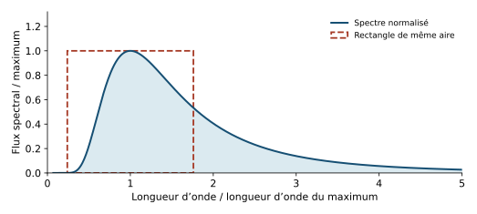
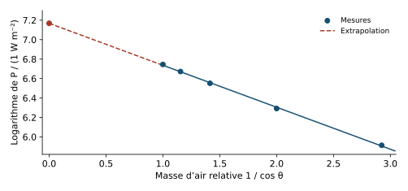
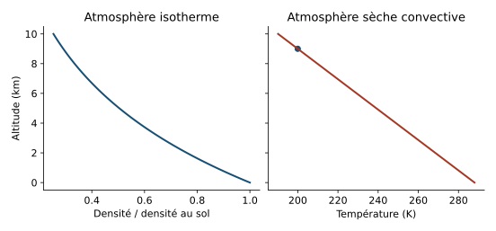

# ENS de Lyon, second concours 2003 — Physique · Corrigé brut

*Corrigé rédigé par IA, non officiel. Signalez toute erreur.*

**Lecture du rapport du jury** · GPT-6.2 Astra Ultra · vitesse non renseignée

**Rédaction** · GPT-6.2 Astra Ultra · vitesse non renseignée

## 1 — Loi de Planck

### Question 1.1 — Dimensions et énergies

Le produit $F_T(\lambda)\,dS\,d\lambda$ est une puissance, donc $[F_T]=\mathrm{W\,m^{-3}}$ pour une longueur d’onde mesurée en mètres. Dans la formule de Planck, $hc^2/\lambda^5$ a pour unité $(\mathrm{J\,s})(\mathrm{m^2\,s^{-2}})/\mathrm{m^5}=\mathrm{W\,m^{-3}}$. Le dénominateur exponentiel et le facteur $2\pi$ sont sans dimension. Dans $y=hc/(\lambda kT)$, $hc/\lambda=h\nu$ désigne l’énergie d’un photon et $kT$ l’échelle d’énergie thermique par particule du corps à la température absolue $T$.

### Question 1.2 — Lecture graphique du maximum

Sur les graphes du fascicule, on lit environ $0{,}50\,\mu\mathrm m$ à $5800\,\mathrm K$ et $10\,\mu\mathrm m$ à $290\,\mathrm K$. Les deux produits $\lambda_M T$ sont voisins de $2{,}9\times10^{-3}\,\mathrm{m\,K}$. Puisque $hc/k\simeq1{,}44\times10^{-2}\,\mathrm{m\,K}$, chaque maximum donne $y_M\simeq5$. La largeur des sommets sur la figure ne permet guère plus de précision.

### Question 1.3 — Dérivée et loi de déplacement

À température fixée $dy/d\lambda=-y/\lambda$. Pour $F_T=2\pi hc^2\lambda^{-5}(e^y-1)^{-1}$, il vient
$$\frac{1}{F_T}\frac{dF_T}{d\lambda}=\frac1\lambda\left[-5+\frac{y}{1-e^{-y}}\right].$$
La racine intérieure vérifie $5(1-e^{-y_M})=y_M$. À 4,96, le membre de gauche moins celui de droite est positif, à 4,97 il est négatif, d’où $y_M\simeq4{,}965$. La solution formelle zéro de l’équation multipliée correspond au bord $\lambda\to\infty$, où l’expression entre crochets tend vers $-4$. La fonction s’annule aux deux extrémités et possède un seul sommet, car $y/(1-e^{-y})$ croît strictement pour $y>0$. On obtient $\lambda_M T=w=hc/(k y_M)\simeq2{,}90\times10^{-3}\,\mathrm{m\,K}$.

### Question 1.4 — Puissance totale émise

L’émittance est $M(T)=\int_0^\infty F_T(\lambda)\,d\lambda$. Posons $x=hc/(\lambda kT)$, de sorte que $d\lambda=-(hc/kT)x^{-2}dx$. Les bornes s’échangent. En réunissant les puissances de $x$ et de $T$, on trouve
$$M(T)=\sigma T^4,\qquad \sigma=\frac{2\pi k^4}{h^3c^2}\int_0^\infty\frac{x^3}{e^x-1}\,dx.$$
Le flux de Planck du sujet est déjà intégré sur le demi-espace extérieur. Aucun facteur angulaire supplémentaire n’est requis. On adopte $\sigma=5{,}67\times10^{-8}\,\mathrm{W\,m^{-2}\,K^{-4}}$.

### Question 1.5 — Largeur spectrale équivalente

Au sommet, $y=y_M$ est constant et $F_T(\lambda_M)$ varie comme $\lambda_M^{-5}$, donc comme $T^5$. La largeur définie par $\Delta\lambda=M(T)/F_T(\lambda_M)$ est alors proportionnelle à $T^{-1}$ et donc à $\lambda_M$. Le fascicule propose $\Delta\lambda\simeq1{,}5\lambda_M$. Le rectangle représenté a la hauteur du sommet et l’aire du spectre entier. Sa largeur n’est pas la largeur à mi-hauteur. Sa position horizontale est choisie pour le dessin, seule son aire est imposée.

### Question 1.6 — Domaines spectraux

La fonction présente une bosse large. Du côté des courtes longueurs d’onde, l’exponentielle du dénominateur éteint rapidement le flux. De l’autre côté la queue décroît et ne renverse pas l’ordre de grandeur de l’aire. Une bande de largeur comparable à $\Delta\lambda$ autour de $\lambda_M$ contient donc une part importante du rayonnement. La bande n’est pas une limite de support et le spectre est dissymétrique.
Pour $5800\,\mathrm K$, le sommet vers $0{,}5\,\mu\mathrm m$ est visible et la bande d’émission comprend aussi le proche infrarouge et une part d’ultraviolet. Pour $290\,\mathrm K$, le sommet vers $10\,\mu\mathrm m$ est dans l’infrarouge thermique, avec une largeur équivalente d’environ $15\,\mu\mathrm m$. Une surface terrestre à cette température n’est pas portée à l’incandescence visible.

## 2 — Rayonnement solaire

### Question 2.1 — Luminosité solaire

Une surface unité émet $\sigma T_0^4$ vers l’extérieur. La surface réelle de la sphère solaire est $4\pi R_0^2$. On a
$$P_0=4\pi R_0^2\sigma T_0^4\simeq3{,}87\times10^{26}\,\mathrm W$$
pour $R_0=7\times10^8\,\mathrm m$ et $T_0=5770\,\mathrm K$. La surface du disque apparent servira pour intercepter un faisceau, mais n’est pas la surface émettrice de cette question.

### Question 2.2 — Origine et bilan de l’énergie solaire

Au centre du Soleil, la fusion de noyaux d’hydrogène produit principalement de l’hélium. La masse au repos des produits est inférieure à celle des noyaux initiaux. La différence fournit de l’énergie cinétique et du rayonnement, une petite part étant emportée par les neutrinos. L’énergie gagne progressivement la surface par transport radiatif puis, dans les couches externes appropriées, par convection. La photosphère émet le spectre thermique étudié. Les photons visibles émis à la surface n’ont pas traversé sans interaction tout l’intérieur solaire.
À luminosité constante pendant $\Delta t=10^{10}$ ans, la perte de masse associée au rayonnement électromagnétique est $\Delta M=P_0\Delta t/c^2\simeq1{,}36\times10^{27}\,\mathrm{kg}$. Avec $M_0=2\times10^{30}\,\mathrm{kg}$, la fraction vaut $6{,}8\times10^{-4}$, soit environ $0{,}068\,\%$. C’est la masse équivalente de l’énergie rayonnée dans l’hypothèse demandée. Le calcul ne compte pas le vent solaire.

### Question 2.3 — Constante solaire

Le rayonnement se répartit sur une sphère de rayon égal à la distance Terre-Soleil $R_t$. La puissance par unité de surface normale est
$$S_0=\frac{P_0}{4\pi R_t^2}=\sigma T_0^4\left(\frac{R_0}{R_t}\right)^2\simeq1{,}37\times10^3\,\mathrm{W\,m^{-2}}.$$
Cette valeur se rapporte au sommet de l’atmosphère. Le facteur géométrique quatre employé dans un bilan moyen sur toute la Terre n’intervient pas pour cette surface normale.

### Question 2.4 — Mesure de l’éclairement

Une méthode utilise un capteur thermique étalonné. Une surface noire connue, reliée à une thermopile, absorbe une large bande du rayonnement. Le signal thermoélectrique mesure la différence de température entre la surface exposée et une référence et se convertit en $\mathrm{W\,m^{-2}}$ par étalonnage. Un pyrhéliomètre orienté vers le Soleil, avec une ouverture limitant le champ, isole le faisceau direct normal. Un pyranomètre collectant l’hémisphère mesure l’éclairement global sur son plan, faisceau direct et lumière diffuse compris. On précise le montage et l’orientation correspondant à la grandeur mesurée.
Une calibration par substitution électrique peut aussi comparer la puissance nécessaire pour maintenir l’absorbeur à une même température à l’ombre puis au soleil, les pertes étant remises dans les mêmes conditions. La différence des puissances électriques, rapportée à l’aire et à l’absorptivité, fournit l’éclairement. Une photopile ordinaire a une réponse spectrale sélective et ne mesure pas directement toute la puissance sans correction.

### Question 2.5 — Atténuation dans l’atmosphère

La mesure au zénith vaut $850\,\mathrm{W\,m^{-2}}$, environ 62 % de la constante solaire calculée. Même par ciel clair, certains gaz absorbent dans des bandes sélectives, notamment l’ozone dans l’ultraviolet et la vapeur d’eau dans l’infrarouge. Les molécules et les aérosols diffusent aussi une partie du faisceau hors de son axe, y compris vers l’espace. Une partie diffusée parvient au sol sous d’autres angles et contribue au rayonnement diffus d’un capteur à grand champ. La proportion reçue dépend de la colonne atmosphérique et des propriétés optiques réelles.

## 3 — Transfert dans l’atmosphère

### Question 3.1 — Atmosphère isotherme et hauteur d’échelle

L’équilibre hydrostatique donne $dp/dz=-\rho g$. Pour l’air parfait isotherme $p=\rho RT_a/M_a$. Avec $g$ constant, $d\ln \rho/dz=-M_ag/(RT_a)$. En intégrant depuis le sol, on a
$$\rho(z)=\rho(0)e^{-z/H},\qquad H=\frac{RT_a}{M_a g}.$$
Avec $T_a=250\,\mathrm K$, $M_a=0{,}029\,\mathrm{kg\,mol^{-1}}$, $R=8{,}31\,\mathrm{J\,mol^{-1}\,K^{-1}}$ et $g\simeq9{,}81\,\mathrm{m\,s^{-2}}$, on trouve $H\simeq7{,}3\,\mathrm{km}$. La pression a le même profil dans ce modèle.

### Question 3.2 — Dépendance de l’extinction

Dans une petite tranche de longueur $ds$, le nombre de molécules ou particules rencontrées par unité de section croît comme $\rho\,ds$ à composition fixée. À faible épaisseur optique, la fraction de puissance retirée du faisceau est proportionnelle à ce nombre. On obtient $dP/P=-\kappa_0\rho\,ds$ avec $\kappa_0$ en $\mathrm{m^2/kg}$. Absorption et diffusion varient avec la longueur d’onde, selon les transitions moléculaires et les mécanismes de diffusion. Une transmission mesurée en lumière blanche donne donc un coefficient effectif dépendant du spectre incident et de la réponse du capteur.

### Question 3.3 — Rayon incliné et altitude

Le rayon descend en parcourant un élément $ds>0$. Pour $0\le\theta<\pi/2$ mesuré depuis la verticale, $dz=-\cos\theta\,ds$. Dans l’approximation d’une atmosphère plane, on a
$$\frac{dP_\theta}{dz}=\frac{\kappa_0\rho(0)}{\cos\theta}e^{-z/H}P_\theta.$$
Le signe positif signifie que la puissance directe est plus grande aux grandes altitudes. En parcourant le trajet vers le sol, elle diminue.

### Question 3.4 — Puissance au sol

En intégrant entre $Z$ et zéro, avec $P_\theta(Z)$ fixé, on obtient
$$P_\theta(0)=P_\theta(Z)\exp\!\left[-\frac{\kappa_0\rho(0)H(1-e^{-Z/H})}{\cos\theta}\right].$$
Pour $Z\gg H$, l’épaisseur optique verticale vaut $\tau=\kappa_0\rho(0)H$ et le facteur de transmission est $\exp(-\tau/\cos\theta)$. Aucune projection supplémentaire en cosinus ne multiplie la puissance mesurée, car la surface collectrice est toujours normale aux rayons.

### Question 3.5 — Interprétation des cinq mesures

Prenons $X=1/\cos\theta$ et $Y=\ln[P_\theta(0)/(1\,\mathrm{W\,m^{-2}})]$. Les cinq abscisses sont $1{,}000$, $1{,}155$, $1{,}414$, $2{,}000$ et $2{,}924$. Les ordonnées correspondantes sont $6{,}745$, $6{,}672$, $6{,}551$, $6{,}292$ et $5{,}914$. Le modèle de 3.4 prévoit une droite quand la puissance incidente au sommet est la même. L’ajustement par moindres carrés donne $Y\simeq7{,}168-0{,}432X$. On lit donc $\tau\simeq0{,}43$ et $P_\theta(Z)\simeq e^{7{,}168}\,\mathrm{W\,m^{-2}}\simeq1{,}30\,\mathrm{kW\,m^{-2}}$. L’ordonnée à l’origine est une extrapolation à masse d’air nulle.
Cette estimation est inférieure d’environ 5 % à $S_0\simeq1{,}37\,\mathrm{kW\,m^{-2}}$. Les mesures sont arrondies, l’angle maximal augmente la sensibilité à la géométrie et une atmosphère réelle éteint différemment chaque composante spectrale. La faible dispersion autour de la droite ne garantit pas que les erreurs systématiques sont petites. La précision raisonnable est celle de l’ordre de quelques dizaines de $\mathrm{W\,m^{-2}}$ pour cette lecture, sans intervalle expérimental garanti.

## 4 — Températures au sol et dans la troposphère

### Question 4.1 — Émission du sol terrestre

L’émission par unité d’aire vaut $M_s=\sigma T_s^4=5{,}67\times10^{-8}\times288^4\simeq390\,\mathrm{W\,m^{-2}}$. Le rayonnement émis se situe principalement dans l’infrarouge. Ce flux est inférieur à l’éclairement direct mesuré au zénith et proche en valeur de certaines mesures au soleil oblique. Une comparaison à une heure donnée entre émission de l’aire du sol et éclairement sur une aire normale ne constitue pas son bilan thermique. L’inclinaison de la surface, l’alternance jour-nuit, l’albédo, le rayonnement atmosphérique et les flux turbulents interviennent.

### Question 4.2 — Refroidissement de l’air qui monte

Le rayonnement solaire réchauffe en partie la surface. Celle-ci échange de la chaleur et de l’humidité avec la couche basse. Une parcelle qui monte rencontre une pression moindre, se détend et fournit du travail. Si les échanges de chaleur sont faibles pendant le déplacement, son énergie interne et sa température diminuent. Une parcelle qui descend se comprime et se réchauffe. La convection tend ainsi à rapprocher le profil d’une adiabatique lorsque la stratification devient instable. L’humidité, la condensation et les échanges radiatifs modifient le gradient réel.

### Question 4.3 — Relation adiabatique d’un gaz diatomique

Une mole a $C_V=5R/2$ et $C_P=C_V+R=7R/2$. L’identité thermodynamique du gaz parfait s’écrit $ds_m=C_P\,dT/T-R\,dp/p$. Dans le modèle à entropie molaire uniforme $ds_m=0$. Il vient
$$\frac{d\ln T}{d\ln p}=\frac{R}{C_P}=\frac27,$$
ou $Tp^{-2/7}=\text{constante}$. Le rapport est positif car température et pression diminuent toutes deux dans la montée isentropique.

### Question 4.4 — Gradient thermique et altitude de la tropopause

La relation hydrostatique de 3.1, écrite localement à la température réelle $T(z)$, donne $d\ln p/dz=-M_a g/[RT(z)]$. Pour le modèle isotherme de la partie 3, on aurait $-1/H\simeq-1{,}37\times10^{-4}\,\mathrm{m^{-1}}$ à 250 K. Au voisinage du sol à 288 K, le même calcul local donne $-1{,}19\times10^{-4}\,\mathrm{m^{-1}}$. Le profil isotherme global de 3.1 et le profil adiabatique global de cette partie sont deux hypothèses différentes.
En combinant la relation hydrostatique locale avec 4.3, la température s’élimine :
$$\frac{dT}{dz}=\frac27T\frac{d\ln p}{dz}=-\frac{2M_ag}{7R}\simeq-9{,}8\,\mathrm{K\,km^{-1}}.$$
Le rapport du jury corrige explicitement les « 9000 km » imprimés en **9000 m**. À 9 km, l’adiabatique sèche du modèle donne $T\simeq288-9\times9{,}78=200\,\mathrm K$. Une atmosphère humide peut présenter un refroidissement moins rapide. Prolonger un tel modèle jusqu’à 9000 km n’aurait aucun sens physique.

### Question 4.5 — Dioxyde de carbone et équilibre radiatif

Le sol émet dans l’infrarouge et le dioxyde de carbone absorbe dans certaines de ces bandes, notamment autour de $15\,\mu\mathrm m$. Le gaz émet également dans l’infrarouge. L’augmentation de sa concentration accroît l’épaisseur optique et peut élever, dans les bandes concernées, la hauteur effective depuis laquelle le rayonnement s’échappe vers l’espace. Dans la troposphère la température décroît en général avec l’altitude. À profil de température fixé, le flux sortant peut donc diminuer.
Si l’énergie solaire absorbée reste donnée, ce déséquilibre conduit à un réchauffement jusqu’à rétablir le bilan au sommet de l’atmosphère. Les échanges infrarouges entre sol et atmosphère ainsi que la convection relient ce changement à la température de surface. Le CO₂ agit ici sur le départ de l’énergie thermique vers l’espace, selon un mécanisme spectral distinct de l’atténuation de l’éclairement solaire direct.
