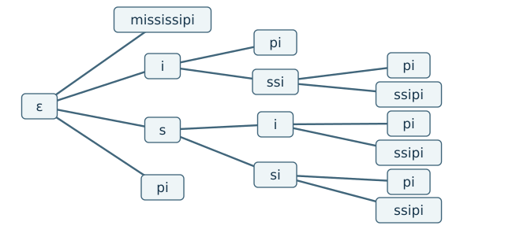
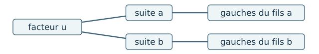

# ENS · MP-PC · Informatique 2003 — corrigé brut

*Corrigé rédigé par IA, non officiel. Signalez toute erreur.*

**Rédaction** · GPT-6.2 Astra Ultra · vitesse non renseignée · 25 novembre 2026

Les indices commencent à 1 et les intervalles sont fermés. Un facteur de longueur h se termine donc à l’indice de départ plus h moins un. Les mots renvoyés sont des vues sur le texte, représentées par leurs bornes. L’alphabet est fixé.

## Partie I. Recherche directe sur les mots

### Question I.1 · Comparer deux facteurs

```text
si i = 0 ou j = 0 ou i+k > |s| ou j+k > |t| : renvoyer faux
r ← 0
tant que r ≤ k et s[i+r] = t[j+r] : r ← r+1
renvoyer r = k+1
```

Les tests sont évalués de gauche à droite avec court-circuit. On compare au plus $k+1$ lettres ; le coût est $O(k+1)$.

### Question I.2 · Langages rationnels

Pour un motif fixé $c$, le langage des textes qui le contiennent est $A^*cA^*$, rationnel par concaténation. Celui des textes qui l’évitent en est le complément dans $A^*$, rationnel par clôture par complémentation. Pour $c=\varepsilon$, ce sont respectivement $A^*$ et $\varnothing$.

### Question I.3 · Trouver toutes les occurrences

Pour $m=|c|>0$, parcourir $i=1,\ldots,n-m+1$ et ajouter $i$ si CompareSousChaine$(c,t,1,i,m-1)$ renvoie vrai. Le dernier indice lu est $i+m-1$. Cela corrige le décalage d’une unité dans la définition imprimée du motif. Temps $O(mn)$ pour des mots non vides. Si $m>n$, la liste est vide ; si $m=0$, rendre toutes les $n+1$ frontières.

### Question I.4 · Plus long facteur commun

Pour chaque paire de débuts $(i,j)$, augmenter $h$ depuis zéro tant que $i+h\le n$, $j+h\le m$ et $s[i+h]=t[j+h]$. Conserver le plus grand $h$ et le début correspondant. Chaque facteur commun débute à l’une de ces paires. Temps $O(nm\min(n,m))\subseteq O(nm^2)$ et mémoire auxiliaire constante. Initialiser le meilleur facteur à $\varepsilon$.

### Question I.5 · Répétitions maximales

Pour chaque paire $i_1<i_2$, ignorer le cas où $i_1>1$ et où les lettres précédentes sont égales : une répétition serait extensible à gauche. Calculer la longueur $h$ du préfixe commun des deux suffixes comme en I.4. Si $h>0$, ajouter le facteur $s[i_1..i_1+h-1]$ (le paramètre $j$ du triplet vaut $h-1$). Le calcul impose la maximalité à droite. Temps $O(n^3)$ et au plus $O(n^2)$ résultats avec répétitions. Pour dédoublonner, insérer chaque mot dans un trie et ne marquer qu’une fois son nœud terminal, en temps au plus proportionnel à la somme des longueurs, donc $O(n^3)$.

## Partie II. Préfixes communs et recherche linéaire

### Question II.1 · Tableau des fenêtres

Pour $s=\mathtt{aabcaabdaaabc}$, les valeurs sont :

| $i$ | 2 | 3 | 4 | 5 | 6 | 7 | 8 | 9 | 10 | 11 | 12 | 13 |
|---|---|---|---|---|---|---|---|---|---|---|---|---|
| $L(i)$ | 1 | 0 | 0 | 3 | 1 | 0 | 0 | 2 | 4 | 1 | 0 | 0 |
| $g_i$ | 2 | 2 | 2 | 5 | 5 | 5 | 5 | 9 | 10 | 10 | 10 | 10 |
| $d_i$ | 2 | 2 | 2 | 7 | 7 | 7 | 7 | 10 | 13 | 13 | 13 | 13 |

### Question II.2 · En dehors de la fenêtre

Pour $k>d_{k-1}$, soit $i$ la première position du préfixe qui échoue, en prenant $i=n-k+2$ si on atteint la fin du texte sans échec. Alors $L(k)=i-1$. Si $i=1$, garder les deux anciennes bornes. Sinon $g_k=k$ et $d_k=k+i-2$, strictement meilleur que l’ancienne fin.

### Question II.3.a · Correspondance intérieure

Poser $g=g_{k-1}$, $d=d_{k-1}$. Sur la fenêtre $s[g..d]=s[1..L(g)]$. Supprimer les $k-g$ premières lettres des deux membres :
$$s[k..d]=s[k-g+1..L(g)].$$


### Question II.3.b · Désaccord dans la fenêtre

Poser $p=k-g+1$ et $b=d-k+1$. Si $L(p)<b$, le premier désaccord dans la comparaison entre le préfixe et le suffixe en $p$ a lieu à l’intérieur de la zone copiée. Il se reproduit depuis $k$, donc $L(k)=L(p)$. La nouvelle fin est strictement inférieure à $d$, d’où $(g_k,d_k)=(g,d)$.

### Question II.3.c · Prolonger après le bord

Si $L(p)\ge b$, on connaît déjà $b$ caractères. Prendre $j$ premier indice de $d+1$ à $n$ tel que $s[j]\ne s[j-k+1]$, ou $j=n+1$ à défaut. Alors $L(k)=j-k$. Si $j-1>d$, poser $(g_k,d_k)=(k,j-1)$ ; sinon garder $(g,d)$, car le premier des ex æquo est requis. L’erratum de notation signalé par le jury porte sur le test de cette question.

### Question II.4 · Calcul de tout le tableau

```text
g ← 0 ; d ← 0
pour k de 2 à n :
    si k ≤ d : h ← min(L[k-g+1], d-k+1)
    sinon : h ← 0
    si k > d ou h = d-k+1 :
        tant que k+h ≤ n et s[k+h] = s[h+1] : h ← h+1
    L[k] ← h
    si h > 0 et k+h-1 > d : g ← k ; d ← k+h-1
    G[k] ← g ; D[k] ← d
```

Le premier tour est nécessairement hors fenêtre. Une comparaison réussie de la boucle franchit l’ancien bord et ne sera plus payée ; il y a au plus $n$ tels progrès, et au plus un échec par $k$. Les copies intérieures coûtent $O(1)$, d’où $O(n)$ au total.

### Question II.5 · Motif séparé du texte

Former $P\#T$ et calculer ses longueurs $L$. Pour $m>0$, l’indice $i$ du texte est une occurrence exactement si $L(m+1+i)=m$. Le séparateur n’apparaît pas dans le texte, donc aucune comparaison partie du texte ne dépasse $m$. Temps et espace $O(m+n)$. Si $P=\varepsilon$, énumérer toutes les frontières.

## Partie III. Arbre des suffixes

### Question III.1 · Le mot mississipi

Pour le mot de dix lettres $\mathtt{mississipi}$, voici les listes d’arêtes sortantes, indexées par le mot du chemin complet jusqu’au nœud. Toute destination omise est une feuille.

| Nœud | Étiquettes sortantes |
|---|---|
| $\varepsilon$ | $\mathtt{mississipi},\mathtt{i},\mathtt{s},\mathtt{pi}$ |
| $\mathtt{i}$ | $\mathtt{ssi},\mathtt{pi}$ |
| $\mathtt{issi}$ | $\mathtt{ssipi},\mathtt{pi}$ |
| $\mathtt{s}$ | $\mathtt{si},\mathtt{i}$ |
| $\mathtt{ssi}$ | $\mathtt{ssipi},\mathtt{pi}$ |
| $\mathtt{si}$ | $\mathtt{ssipi},\mathtt{pi}$ |

Le suffixe de départ 10 s’arrête au nœud interne $\mathtt i$.



### Question III.2 · Présence du chemin avant insertion

Une insertion conserve tous les chemins existants : l’ajout d’un fils ne les modifie pas et un découpage remplace une arête par deux segments de même concaténation. Après l’appel $(i,j)$, le chemin $s[j..i]$ existe, soit qu’il existait, soit que l’ajout a prolongé $s[j..i-1]$ d’une arête commençant en $i$. Induction sur $i$ : à l’étape suivante, pour $j<i$ le chemin requis a été assuré à l’étape précédente (initialement $s[1]$ par la première feuille), et pour $j=i$ c’est le chemin vide à la racine. Les stades intermédiaires ne peuvent le détruire.

### Question III.3 · Une descente déterministe

Au départ la racine a un seul fils. Une extension à un nœud explicite n’ajoute un fils que si sa lettre initiale est absente. Dans une scission, la continuation ancienne et la nouvelle arête commencent par les deux lettres du désaccord ; la première lettre du segment vu depuis l’ancien père est conservée. Par induction les premières lettres des fils sont deux à deux distinctes. Une lecture détermine donc un seul chemin et un seul point d’arrêt, éventuellement implicite. À une frontière explicite, on attribue le point au nœud atteint : si la définition par « préfixe » admet aussi le début vide d’une arête fille, la même position géométrique aurait plusieurs descriptions. Cette convention (racine pour le mot vide) rend littérale l’unicité de la recherche.

### Question III.4 · Coût de la première construction

Il y a $\sum_{i=2}^n i=O(n^2)$ appels. Tout chemin comporte au plus $n$ arêtes non vides : son mot est un facteur de $s$ et a longueur au plus $n$. La recherche promise coûte donc $O(n)$ ; le changement local de pointeurs et de bornes coûte $O(1)$. Temps $O(n^3)$.

### Question III.5 · Persistance du cas 1

La feuille du cas 1 représente le suffixe de départ $j$ : le chemin lu a longueur $i-j+1$ et se termine sur la case $z=i$ de son occurrence sous-jacente. L’invariant commun démontré en III.6 est que les feuilles se créent par départs croissants. Une scission ultérieure de cette feuille est donc provoquée par un départ $h>j$. À la phase $r$, elle coupe juste avant le caractère de la feuille de position $j+(r-h)<r$. Elle conserve la feuille et son intervalle terminal ; le point actif du départ $j$ à la phase $r$ en position $r$ reste ainsi sur cette feuille. Les scissions antérieures sont encore plus à gauche, ce qui établit la persistance.

### Question III.6 · Un premier cas 3 termine la phase

Les feuilles explicites introduites le sont par ordre des départs. Justification conjointe avec III.5 : à la première phase seul le départ 1 possède une feuille. Supposons les feuilles de départs $1,\ldots,h$ avant une phase $i$. Ces départs se prolongent sur leurs propres feuilles : les scissions antérieures dues à un départ $\ell>j$ sur la feuille de $j$ y comparent au caractère $j+(r-\ell)<r$ de la phase $r$. Pour le premier départ non muni de feuille, un cas 2 crée sa feuille et maintient le préfixe de départs explicites. Si $s[j..i]$ est au contraire déjà représenté, il se lit à un départ $h'<j$ sur une feuille existante. Pour $j+1$, le mot raccourci se lit alors au départ $h'+1\le j$. Si $h'+1<j$, c’est une feuille existante ; si $h'+1=j$, le mot est un préfixe du chemin juste constaté depuis le départ $j$. Ainsi $s[j+1..i]$ est déjà présent, et le même raisonnement se répète. Aucun de ces départs ne possède sa propre feuille, donc tous sont dans le cas 3. L’induction ferme les deux assertions.

### Question III.7 · Éviter les stades sans effet

Mémoriser le premier départ sans feuille. À la phase suivante, commencer à ce départ puisque tous les précédents sont dans le cas 1. Créer des feuilles tant que le cas 2 se produit puis arrêter la phase au premier cas 3. Au total il y a au plus $n$ créations de feuille et au plus $n$ arrêts de phase. Cela donne même $O(n)$ stades effectifs (donc la borne $O(n^2)$ imprimée sur les itérations) et $O(n^2)$ opérations si chaque recherche repart de la racine.

### Question III.8 · Cible d’un lien suffixe

La création d’un nœud au mot $ay=s[j..i]$ résulte de deux prolongements distincts $ayb$ et $ayc$. L’ancienne occurrence appartient à une feuille d’un départ $h<j$. En retirant $a$, l’ancien $yb$ se lit depuis $h+1\le j$ ; cette feuille existe désormais (y compris celle de $j$ créée au stade courant). Le stade $j+1$ garantit le chemin $yc$. Les deux prolongements ayant leurs premières lettres divergentes après $y$, le point $y=s[j+1..i]$ est nécessairement un nœud explicite au plus tard après ce stade. Si $y=\varepsilon$ il s’agit de la racine.

### Question III.9 · Profondeur d’un lien

Considérer les ancêtres explicites non racines sur la branche de $v_1$, y compris $v_1$. Leurs étiquettes complètes sont des préfixes emboîtés de $ay$. Après retrait de la première lettre, elles donnent des préfixes distincts de $y$, explicites par III.8 (la racine est permise). Ils s’injectent dans les ancêtres de $v_2$, celui-ci compris. En comptant aussi la racine du chemin initial, $\mathrm{Prof}(v_1)\le\mathrm{Prof}(v_2)+1$.

### Question III.10 · Construction en temps linéaire

Reprendre III.7 avec un **point actif**, composé d’un nœud explicite et d’un fragment d’arête décrit par sa position initiale et sa longueur. Garder les transitions des fils indexées par leur première lettre (alphabet fixé) et des longueurs d’arêtes calculées par soustraction de bornes. Une comparaison sur la prochaine lettre donne le cas 2 ou 3. Après un cas 3, conserver le point avancé d’une lettre pour la phase suivante. Après un cas 2, créer la feuille et, au besoin, couper l’arête ; retenir le dernier nœud scindé dont le lien reste à remplir.

Pour passer du départ $j$ à $j+1$, partir de l’ancêtre explicite ayant un lien (le père si le nœud vient d’être créé). Suivre le lien, puis redescendre le fragment déjà connu en sautant les arêtes entières grâce à leurs longueurs. Depuis la racine, supprimer directement la première lettre du fragment à relire. Si la longueur restante s’arrête au milieu d’une arête, seul son décalage est nécessaire. Le point atteint, ou la scission du stade suivant, fournit le lien en attente par III.8. Le stade final rattache à la racine si le mot restant est vide.

Il y a $O(n)$ extensions effectives. Le maintien du point et des liens coûte $O(1)$ par extension hors arêtes sautées. Compter comme potentiel le nombre de nœuds explicites franchis jusqu’au point actif. Une remontée au père et un lien suffixe le font baisser d’au plus deux par III.9 ; la règle à la racine ne peut retirer qu’un premier caractère du fragment. Chaque arête franchie en descendant l’augmente d’une unité. Les scissions et les transitions de phase modifient localement ce compte d’un nombre borné par événement. Avec un potentiel final $O(n)$, il n’y a que $O(n)$ descentes au total. Temps et espace $O(n)$ ; la recherche coûte ainsi un temps **amorti** constant par extension.

### Question III.11 · Un terminateur par suffixe

Dans $s\#$, aucun suffixe non vide ne peut être préfixe propre d’un autre : son dernier caractère $\#$ devrait apparaître deux fois. Tous les $n+1$ suffixes non vides sont présents et finissent donc sur des feuilles distinctes. Réciproquement toute feuille a été créée pour un suffixe. On compte les $n$ suffixes non vides de $s$ prolongés par $\#$ et le suffixe isolé $\#$.

## Partie IV. Applications de l’arbre

### Question IV.1 · Suffixes en ordre lexicographique

Déclarer $\#$ inférieur aux vraies lettres. Parcourir les fils en profondeur dans l’ordre de leur première lettre et émettre les indices de départ des feuilles, en excluant la feuille $\#$ si l’on ne veut que les suffixes non vides. Le premier caractère différent détermine l’ordre de deux branches ; le terminateur met un suffixe préfixe avant son prolongement. Visite $O(n)$ sur alphabet fixé. Renvoyer des indices ou des vues : recopier tous les suffixes occuperait $\Theta(n^2)$ lettres.

### Question IV.2 · Occurrences après indexation

Si $m=|P|>n$, rendre la liste vide par test de longueur. Sinon descendre l’arbre en comparant les lettres du motif ; au premier échec, aucune occurrence. Si $P$ se termine sur une arête ou à un nœud, énumérer les départs des feuilles de son sous-arbre. Un arbre compact à $k$ feuilles a $O(k)$ nœuds en dessous d’un tel point, d’où $O(m+k)\subseteq O(n+k)$ par requête. Le motif vide a $n+1$ occurrences aux frontières. Le prétraitement du texte coûte $O(n)$ une fois ; la méthode II.5 coûte $O(n+m)$ par motif.

### Question IV.3 · Bifurcations et répétitions maximales

Noter $h$ la **longueur** du facteur commun (donc $h=j+1$ avec le dernier décalage $j$ de I.5). Deux occurrences maximales à droite sont suivies de lettres différentes dans $T\#$, le terminateur prenant en charge la fin du texte. Au point de mot $u=T[i_1..i_1+h-1]$, deux arêtes distinctes partent donc d’un nœud explicite. Avec la terminologie de l’énoncé, ces deux fils ont la même « étiquette depuis la racine » $u$, qui s’arrête avant leur propre étiquette. À chaque mot répété maximal distinct correspond ainsi un nœud interne. L’arbre compact ayant $n+1$ feuilles et au plus $n$ nœuds internes, il y a $O(n)$ tels **mots**.

### Question IV.4 · Maximalité des deux côtés

À la feuille de départ $i$, associer le contexte gauche $T[i-1]$, ou un marqueur distinct si $i=1$. En parcours postfixe, calculer dans chaque sous-arbre l’ensemble des contextes gauches de ses feuilles. À un nœud interne non racine, chercher deux fils distincts $B,C$ et deux contextes distincts $a\in B,b\in C$ (on note ici $B,C$ aussi pour leurs ensembles). Si on les trouve, émettre le mot du chemin une seule fois, par une occurrence témoin et sa longueur. Deux fils assurent des lettres suivantes différentes ; les deux contextes assurent la maximalité gauche pour la **même paire**. Réciproquement toute paire maximale est rencontrée à sa bifurcation. L’alphabet fixé borne le nombre de fils, de bits et de comparaisons par nœud. Temps et espace $O(n)$.



### Question IV.5 · Plus long facteur commun

Construire l’arbre de $s\#t\diamond$ avec deux séparateurs distincts absents des mots. Colorer chaque feuille réelle selon que son départ vient de $s$ ou de $t$, puis agréger les couleurs par parcours postfixe. Tout chemin de deux couleurs épelle un facteur commun, qui ne traverse aucun séparateur. Tout facteur commun a des occurrences dans les deux sources et se prolonge jusqu’à un nœud bicolore au moins aussi profond (une divergence ou les terminateurs l’y arrêtent). Choisir le nœud bicolore de plus grande **profondeur en lettres**, en additionnant les longueurs d’arêtes ; la racine donne le mot vide à défaut. Un début de feuille témoin et cette profondeur rendent la réponse. Coût $O(n+m)$.
