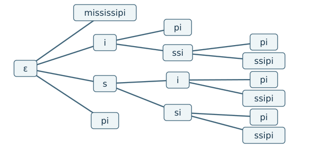
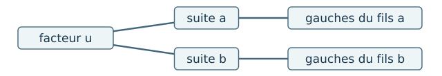

# ENS · MP-PC · Informatique 2003 — corrigé guidé

*Corrigé rédigé par IA, non officiel. Signalez toute erreur.*

**Rédaction** · GPT-6.2 Astra Ultra · vitesse non renseignée · 25 novembre 2026

Le sujet passe d’une comparaison naïve au tableau des préfixes communs, puis à l’arbre des suffixes. Le rapport relève une coquille à la question II.3.c. Les bornes de lecture et l’arrêt sur la fin du texte sont explicités ci-dessous.

## Partie I. Recherche directe sur les mots

### Question I.1 · Comparer deux facteurs

Ici $k$ est un dernier décalage, donc le facteur a $k+1$ lettres. Rejeter d’abord les bornes invalides. Ensuite avancer un curseur tant que les deux lettres coïncident, en testant la borne avant toute lecture. Une différence donne faux ; dépasser le dernier décalage prouve l’égalité.

Le test coûte $O(k+1)$, puisqu’il compare au plus $k+1$ positions, sans mémoriser les sous-chaînes.

### Question I.2 · Langages rationnels

Être une occurrence signifie qu’on peut couper le texte en un préfixe quelconque, exactement le mot $c$, puis un suffixe quelconque. Cette description est directement une expression rationnelle. Éviter le motif est la négation de cette propriété ; la classe des langages rationnels est fermée pour cette opération.

Les deux langages sont $A^*cA^*$ et $A^*\setminus(A^*cA^*)$. Pour $c=\varepsilon$, ils deviennent $A^*$ et $\varnothing$.

### Question I.3 · Trouver toutes les occurrences

Faire glisser la première lettre du motif en incluant le dernier départ où sa dernière lettre tient encore dans le texte. Appeler la première fonction avec $m-1$, puisqu’elle compte ses deux bornes. Les départs sont testés indépendamment, y compris ceux des occurrences qui se chevauchent.

Pour $m>0$, tester exactement $i=1,\ldots,n-m+1$, avec la sortie vide si $m>n$. Cela fait $O(nm)$ comparaisons. Un motif vide occupe les $n+1$ frontières.

### Question I.4 · Plus long facteur commun

Fixer deux points de départ avant de comparer. Le premier désaccord ou la fin de l’un des mots donne exactement leur préfixe commun maximal. Essayer les $nm$ alignements suffit, et une comparaison d’alignement utilise au plus $m$ lettres, d’où la borne demandée.

### Question I.5 · Répétitions maximales

Une répétition maximale dépend de deux occurrences précises. Elles doivent avoir deux contextes gauches distincts, en comptant le début du texte comme un contexte spécial. À cette paire de débuts, il n’y a ensuite qu’un candidat, le plus long accord possible vers la droite. Le retenir s’il est non vide. Les deux occurrences peuvent se chevaucher. Des paires différentes peuvent donner le même mot : un arbre de préfixes des résultats en fournit une représentation unique.

Les $O(n^2)$ paires coûtent chacune $O(n)$ examens de lettres, soit $O(n^3)$ au total, dédoublonnage compris si l’on inscrit les facteurs dans un arbre de préfixes.

## Partie II. Préfixes communs et recherche linéaire

### Question II.1 · Tableau des fenêtres

Les préfixes communs non vides commencent en $2,5,6,9,10,11$ et ont respectivement les longueurs $1,3,1,2,4,1$. Les fenêtres qui battent le record de fin sont $(2,2)$, $(5,7)$, $(9,10)$ et $(10,13)$. Conserver la dernière fenêtre record à tous les indices suivants, jusqu’au record suivant, donne chaque couple $(g_i,d_i)$.

| $i$ | 2 | 3 | 4 | 5 | 6 | 7 | 8 | 9 | 10 | 11 | 12 | 13 |
|---|---|---|---|---|---|---|---|---|---|---|---|---|
| $L(i)$ | 1 | 0 | 0 | 3 | 1 | 0 | 0 | 2 | 4 | 1 | 0 | 0 |
| $g_i$ | 2 | 2 | 2 | 5 | 5 | 5 | 5 | 9 | 10 | 10 | 10 | 10 |
| $d_i$ | 2 | 2 | 2 | 7 | 7 | 7 | 7 | 10 | 13 | 13 | 13 | 13 |

### Question II.2 · En dehors de la fenêtre

La fenêtre précédente ne couvre aucune lettre à tester. Repartir donc du début du mot et avancer jusqu’au premier désaccord ou au bord droit. Un accord non vide qui commence déjà après l’ancien record en produit nécessairement un nouveau.

Si le premier désaccord est $s[k+i-1]\ne s[i]$, on obtient $L(k)=i-1$. Pour $L(k)>0$, la nouvelle fenêtre est $(k,k+i-2)$ ; sinon, garder la précédente. Si le texte se termine sans désaccord, la longueur est $n-k+1$.

### Question II.3.a · Correspondance intérieure

Les deux copies ont le même contenu et leurs débuts sont séparés de $g-1$ positions. Le caractère situé en $k$ dans la copie de droite correspond donc à celui situé en $k-g+1$ dans le préfixe. Lire jusqu’à $d$ ne quitte pas la zone connue.

Plus précisément $s[k..d]=s[k-g+1..L(g)]$.

### Question II.3.b · Désaccord dans la fenêtre

Si l’accord connu au point miroir s’arrête avant le bord droit, même son caractère de désaccord se trouve dans la fenêtre. Il est inutile de relire la moindre lettre : la longueur déjà calculée est exacte.

Avec $p=k-g+1$ et $b=d-k+1$, la condition $L(p)<b$ donne $L(k)=L(p)$ et préserve $(g_k,d_k)=(g,d)$.

### Question II.3.c · Prolonger après le bord

Démarrer à la première lettre encore inconnue et comparer à la position correspondante dans le préfixe commençant en 1. L’offset est $k-1$, indépendamment de l’ancienne fin $d$. Un échec immédiat égale l’ancien record et ne change pas son début ; une lecture réussie le déplace. La borne fictive $n+1$ couvre le cas où le mot finit sans désaccord.

Pour $L(p)\ge b$, le premier $j>d$ tel que $s[j]\ne s[j-k+1]$ (ou $n+1$) donne $L(k)=j-k$. Changer les bornes en $(k,j-1)$ seulement si $j-1>d$.

### Question II.4 · Calcul de tout le tableau

Conserver un couple de bornes à fin maximale et le tableau $L$ déjà rempli. Si $k$ est couvert, lire le miroir avant de lancer une comparaison. N’étendre que lorsque toute la fin connue est déjà certifiée égale ; hors fenêtre, recommencer à longueur zéro. Mémoriser le nouveau record seulement pour une fin strictement meilleure et une correspondance non vide. À $k=2$ il n’existe encore aucune fenêtre. Un même tour peut lire beaucoup de lettres, mais chaque succès d’extension avance l’extrémité droite, et il n’y a qu’un désaccord terminal par tour. C’est l’amortissement qui donne le temps linéaire.

### Question II.5 · Motif séparé du texte

Mettre le motif au début transforme chaque recherche en calcul de préfixe commun. Le caractère neuf entre motif et texte empêche la fenêtre de continuer au-delà d’une occurrence entière. Un décalage de $m+1$ ramène chaque position du tableau global à sa position dans le texte.

Dans le texte combiné, le départ $i$ du texte initial correspond à $m+1+i$. Il y a occurrence si et seulement si $L(m+1+i)=m$. L’ensemble se calcule en $O(n+m)$ pour $m>0$.

## Partie III. Arbre des suffixes

### Question III.1 · Le mot mississipi

Grouper les suffixes selon la première lettre. Les départs 1 et 9 donnent les branches isolées $\mathtt{mississipi}$ et $\mathtt{pi}$. Les départs 2, 5, 8 et 10 partagent $\mathtt i$ ; 2 et 5 partagent ensuite $\mathtt{ssi}$ avant de diverger. Les départs 3 et 6 partagent $\mathtt{ssi}$, tandis que 4 et 7 partagent $\mathtt{si}$. Dans ces deux derniers groupes, les fins alternatives sont $\mathtt{ssipi}$ et $\mathtt{pi}$. Aucun terminateur n’a encore été ajouté, donc le suffixe court $\mathtt i$ n’a pas de feuille propre.

### Question III.2 · Présence du chemin avant insertion

Énoncer l’invariant après une phase : tous les suffixes du préfixe déjà lu sont des chemins, quitte à finir au milieu d’une arête. La phase suivante conserve ces chemins et tente de leur adjoindre un caractère. Son dernier stade part du mot vide, toujours présent. L’initialisation par l’intervalle du mot entier contient en particulier sa première lettre.

### Question III.3 · Une descente déterministe

À une bifurcation, la prochaine lettre désigne le fils. Créer une branche nouvelle signifie précisément que ce fils manquait, et couper une arête produit deux débuts distincts. Il est donc impossible que le même mot traverse deux branches différentes. Quand la lecture finit exactement à un nœud, on la considère terminée à ce nœud, avant de choisir un fils.

### Question III.4 · Coût de la première construction

La taille des étiquettes ne doit pas être multipliée une seconde fois : le sujet accorde une recherche proportionnelle au nombre de nœuds visités. Chaque nœud non racine consomme au moins une lettre sur une branche de longueur au plus $n$. Avec un nombre quadratique de stades, on retrouve la borne cubique.

### Question III.5 · Persistance du cas 1

Une feuille matérialise l’occurrence qui commence en $j$, avec sa fin ouverte jusqu’à la fin du texte. Les positions successives du suffixe sont déjà écrites sur son arête. Si un autre départ introduit une bifurcation, il conserve la feuille du suffixe initial. À la phase $r$, une bifurcation avec un départ $h$ sur cette feuille, pour le caractère nouveau de $h$, compare au caractère de position $j+(r-h)$ : si $h>j$, elle porte sur une position antérieure à $r$, et si $h<j$, elle ne peut être créée par une feuille plus ancienne $j$ à ce stade (les feuilles sont introduites dans l’ordre des départs, comme le formalise III.6). Les nouvelles bifurcations ne rattrapent donc pas l’extrémité active de la feuille.

### Question III.6 · Un premier cas 3 termine la phase

Pendant la phase, les départs explicites forment le premier segment $1,\ldots,h$, puis les nouvelles feuilles allongent ce segment une à une. Le premier suffixe déjà présent sans feuille à lui est représenté sur une feuille plus ancienne. Enlever sa première lettre donne une occurrence décalée d’un cran. Le départ de cette occurrence est encore explicite ou coïncide avec le départ dont on vient de vérifier le chemin ; dans ce dernier cas on n’en demande qu’un préfixe. Tous les suffixes suivants de la phase sont donc déjà présents. C’est la règle d’arrêt de la construction en ligne.

### Question III.7 · Éviter les stades sans effet

Les anciennes feuilles se prolongent sans opération. Le premier succès implicite garantit que le reste de la phase ne changera pas l’arbre. Les seules visites à payer sont donc un nombre linéaire de créations et une dernière visite par phase. La recherche primitive peut encore coûter linéaire à chacune, ce qui explique le temps quadratique intermédiaire.

### Question III.8 · Cible d’un lien suffixe

Un point interne signale deux lettres suivantes différentes. Retirer la même première lettre aux deux occurrences ne change pas ces deux lettres suivantes. L’une des occurrences décalées est couverte par les anciennes feuilles, l’autre doit l’être par l’extension suivante. Leur nouvelle divergence force donc le nœud destination du lien.

### Question III.9 · Profondeur d’un lien

Suivre un lien ne perd qu’une lettre de texte, mais peut modifier le nombre d’arêtes parcourues. Pour contrôler cette différence, associer à chaque ancienne bifurcation celle que l’on obtient en effaçant la première lettre. Deux profondeurs textuelles différentes donnent encore deux longueurs différentes. Un seul ancien nœud, la racine, ne reçoit pas de correspondant de cette manière.

### Question III.10 · Construction en temps linéaire

Le temps quadratique provenait des retours à la racine. Conserver la position de la dernière comparaison sous la forme « nœud, début de morceau, longueur restante ». Pour une phase qui s’achève sur un chemin existant, ce chemin est exactement ce qui précède la prochaine lettre : le conserver suffit. Pour une insertion, on doit abandonner la première lettre du chemin. Atteindre le nœud suffixe de son dernier ancêtre explicite puis relire le petit descriptif du reste. Ce reste est connu comme chemin : une comparaison par lettre serait inutile, la longueur d’une arête permet de l’enjamber en une opération. Si l’ancêtre est la racine, raccourcir le reste d’une lettre.

Un nouveau nœud de bifurcation attend au plus jusqu’à l’extension suivante pour obtenir son lien. Les fils, le père, les intervalles et le lien suffisent à chaque modification locale. Les feuilles occupent un intervalle du texte dont l’extrémité droite peut rester partagée. Pour le coût, une descente d’une arête augmente la profondeur du point suivi ; une remontée locale puis un lien la diminuent d’au plus deux. Le nombre de ces changements de départ et de ces phases est linéaire. La profondeur finale ne dépasse pas $n$, donc le nombre total de sauts d’arêtes est aussi linéaire. Cette estimation porte sur l’ensemble des recherches, et autorise qu’une recherche particulière traverse plusieurs nœuds.

### Question III.11 · Un terminateur par suffixe

Sans signe de fin, comme pour le dernier $\mathtt i$ de l’exemple, un suffixe peut s’arrêter avant une feuille. Le symbole neuf force tous les arrêts à être terminaux et distingue même le suffixe composé seulement de ce symbole. Le départ de chaque feuille sert d’identifiant du suffixe.

## Partie IV. Applications de l’arbre

### Question IV.1 · Suffixes en ordre lexicographique

Dans un arbre de préfixes, tous les mots descendant d’une même branche restent groupés. Visiter d’abord la branche de plus petite lettre donne donc l’ordre du dictionnaire, même quand les arêtes regroupent plusieurs lettres. Le signe de fin doit passer en premier pour que le plus court arrive avant ses prolongements.

Avec des arêtes représentées par couples d’indices et un alphabet fixé, la visite des nœuds et l’émission des indices de départ prennent $O(n)$. Écrire les suffixes intégralement demanderait la taille quadratique de cette autre sortie.

### Question IV.2 · Occurrences après indexation

Toutes les occurrences d’un motif sont des débuts de suffixes ayant le même préfixe. Une fois le point du motif atteint, les feuilles en dessous sont donc exactement la sortie attendue. Sur plusieurs motifs, l’arbre réutilise le travail effectué sur le texte ; la méthode du séparateur parcourt de nouveau le texte à chaque appel.

Un motif de longueur $m$ requiert $O(m+r)$ après construction de l’index, où $r$ désigne le nombre d’occurrences émises. Le coût de l’index est $O(n)$.

### Question IV.3 · Bifurcations et répétitions maximales

Le caractère suivant révèle le lieu de séparation des deux suffixes. Une répétition maximale à droite occupe tout le chemin avant cette séparation, sans s’arrêter au milieu d’une arête. Deux répétitions de contenus différents ne peuvent étiqueter le même chemin. Le nombre de paires d’occurrences peut dépasser le nombre de nœuds, mais un seul représentant du contenu suffit ici.

### Question IV.4 · Maximalité des deux côtés

Colorer une feuille de la lettre qui précède le suffixe. Pour comparer deux occurrences maximales, elles doivent se séparer au prochain caractère et porter des couleurs différentes. Remonter les ensembles de couleurs depuis les feuilles et tester les couples de branches à chaque bifurcation. Compter le début du texte comme couleur supplémentaire, distincte de toutes les lettres. La sortie sous forme d’intervalles de texte tient dans la borne linéaire.

### Question IV.5 · Plus long facteur commun

Réunir les deux textes tout en empêchant une coïncidence artificielle à leurs frontières. Une couleur par provenance dit de quel texte arrive une occurrence. Un facteur appartient aux deux exactement lorsque des feuilles des deux couleurs passent par son point. S’il finit au milieu d’une arête, on peut avancer jusqu’à son extrémité en conservant ces mêmes feuilles. Le plus long se trouve donc parmi les nœuds explicites portant les deux couleurs.

Employer deux terminateurs distincts, puis choisir le nœud bicolore de plus grande profondeur comptée en lettres. Le parcours coûte $O(n+m)$, comme la construction.
